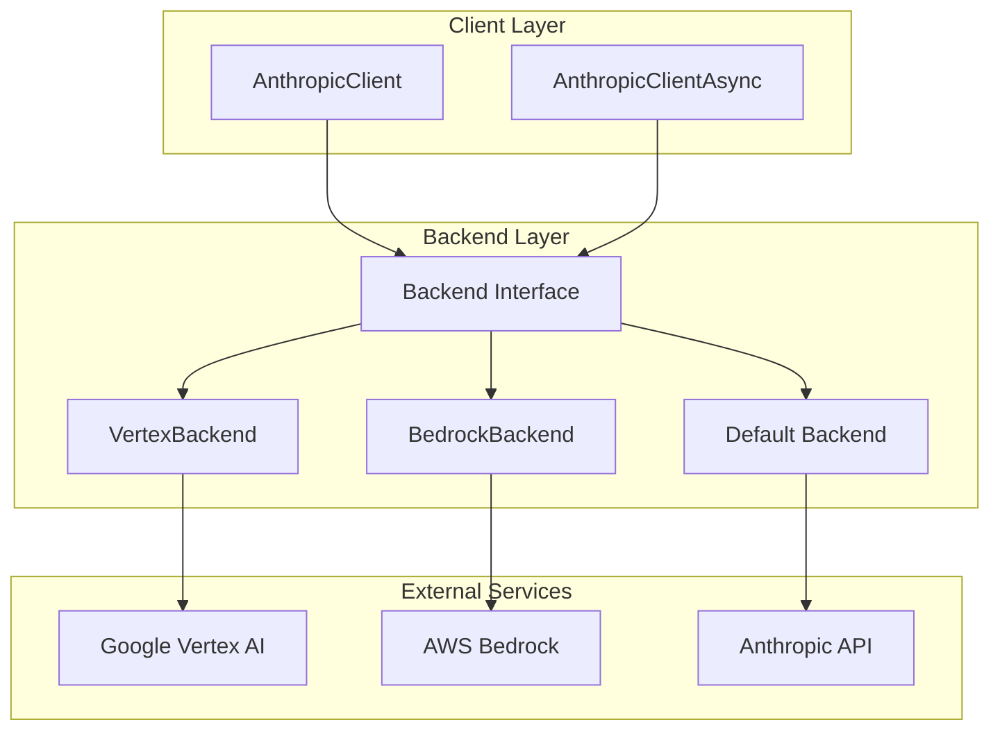
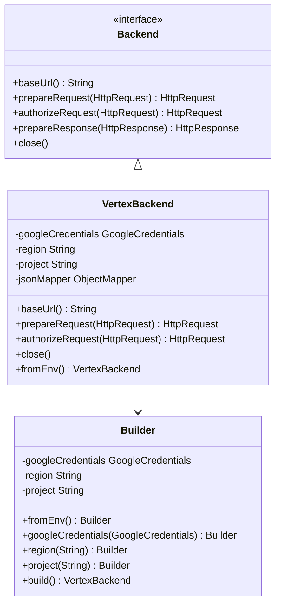
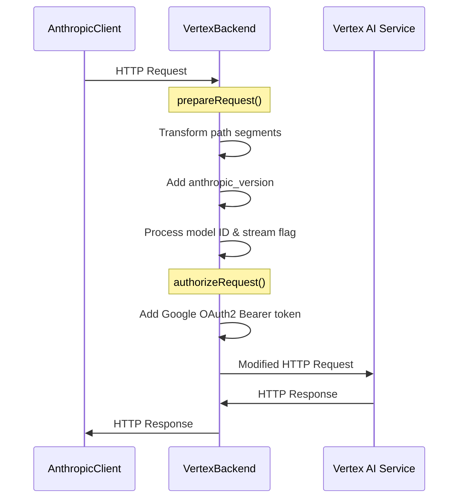

<!-- source: DeepWiki mcp.deepwiki.com · repo anthropics/anthropic-sdk-java · page 6.2 Google Vertex AI Integration · fetched 2026-10-26 -->

# Google Vertex AI Integration

<details>
<summary>Relevant source files</summary>

The following files were used as context for generating this wiki page:

- [.release-please-manifest.json](.release-please-manifest.json)
- [CHANGELOG.md](CHANGELOG.md)
- [README.md](README.md)
- [anthropic-java-bedrock/src/main/kotlin/com/anthropic/bedrock/backends/BedrockBackend.kt](anthropic-java-bedrock/src/main/kotlin/com/anthropic/bedrock/backends/BedrockBackend.kt)
- [anthropic-java-bedrock/src/test/kotlin/com/anthropic/bedrock/backends/BedrockBackendTest.kt](anthropic-java-bedrock/src/test/kotlin/com/anthropic/bedrock/backends/BedrockBackendTest.kt)
- [anthropic-java-vertex/src/main/kotlin/com/anthropic/vertex/backends/VertexBackend.kt](anthropic-java-vertex/src/main/kotlin/com/anthropic/vertex/backends/VertexBackend.kt)
- [anthropic-java-vertex/src/test/kotlin/com/anthropic/vertex/backends/VertexBackendTest.kt](anthropic-java-vertex/src/test/kotlin/com/anthropic/vertex/backends/VertexBackendTest.kt)
- [anthropic-java/build.gradle.kts](anthropic-java/build.gradle.kts)
- [build.gradle.kts](build.gradle.kts)

</details>


This page documents the integration between the Anthropic Java SDK and Google Cloud's Vertex AI platform. It explains how to set up, configure, and use Anthropic's Claude models via Vertex AI, as well as the internal architecture that powers this integration.

For AWS Bedrock integration, see [AWS Bedrock Integration](#6.1).

## Overview

The Anthropic Java SDK provides support for accessing Claude models through Google's Vertex AI platform. This integration requires a separate dependency and allows you to use your Google Cloud credentials to authenticate with Vertex AI while maintaining the same client interface as the standard Anthropic API.

When using Vertex AI, the SDK internally transforms standard Anthropic API requests into the format required by Vertex AI's endpoints, handles authentication using Google Cloud credentials, and processes responses to maintain compatibility with the core SDK interfaces.

Sources: [README.md:564-646](). [VertexBackend.kt:1-193]()

## Installation and Setup

### Dependencies

To use the Vertex AI integration, include the `anthropic-java-vertex` library:

**Gradle**
```kotlin
implementation("com.anthropic:anthropic-java-vertex:1.4.0")
```

**Maven**
```xml
<dependency>
    <groupId>com.anthropic</groupId>
    <artifactId>anthropic-java-vertex</artifactId>
    <version>1.4.0</version>
</dependency>
```

### Environment Configuration

The VertexBackend requires the following configuration:

1. **Google Cloud credentials** - Can be provided through Application Default Credentials (ADC)
2. **Google Cloud region** - Can be specified via the `CLOUD_ML_REGION` environment variable
3. **Google Cloud project ID** - Can be specified via the `ANTHROPIC_VERTEX_PROJECT_ID` environment variable

Sources: [README.md:571-611](). [VertexBackend.kt:37-40]()

## Architecture

The VertexBackend component is the bridge between the Anthropic SDK and Google Cloud Vertex AI. Let's explore how it fits in the larger system:



Sources: [VertexBackend.kt:27-32](). [README.md:599-610]()

### VertexBackend Implementation

The VertexBackend class implements the Backend interface and provides Vertex AI-specific functionality:



Sources: [VertexBackend.kt:27-192]()

## Client Initialization

There are two primary ways to initialize a client with Vertex AI:

### 1. Using Environment Variables

```java
// Uses Application Default Credentials and environment variables
AnthropicClient client = AnthropicOkHttpClient.builder()
        .backend(VertexBackend.fromEnv())
        .build();
```

This approach automatically:
- Resolves Google OAuth2 credentials from Application Default Credentials (ADC)
- Gets the region from the `CLOUD_ML_REGION` environment variable
- Gets the project ID from the `ANTHROPIC_VERTEX_PROJECT_ID` environment variable

### 2. Manual Configuration

```java
// Manual configuration
AnthropicClient client = AnthropicOkHttpClient.builder()
        .backend(VertexBackend.builder()
                .googleCredentials(googleCredentials)
                .region("us-central1")
                .project(projectId)
                .build())
        .build();
```

This approach allows you to:
- Provide custom Google credentials
- Specify the region directly
- Specify the project ID directly

Sources: [README.md:592-638](). [VertexBackend.kt:42-44, 150-192]()

## Request Processing

The VertexBackend transforms standard Anthropic API requests into the format expected by Vertex AI. Here's how the request flow works:



Sources: [VertexBackend.kt:49-137]()

### Path Transformation

When a request is prepared, the VertexBackend:

1. Verifies the request has a valid path structure
2. Extracts the model ID from the request body
3. Transforms the path to follow Vertex AI's structure:
   - `v1/messages` → `v1/projects/{project}/locations/{region}/publishers/anthropic/models/{modelId}:rawPredict`
   - For streaming requests, it uses `:streamRawPredict` instead
   - For token counting, it uses `count-tokens:rawPredict`

For example, a message creation request using model "claude-3-sonnet" would have its path transformed from:
```
/v1/messages
```
to:
```
/v1/projects/{project}/locations/{region}/publishers/anthropic/models/claude-3-sonnet:rawPredict
```

Sources: [VertexBackend.kt:49-124](). [VertexBackendTest.kt:216-247]()

### Request Body Modification

The VertexBackend also modifies the request body:

1. Adds `"anthropic_version": "vertex-2023-10-16"` to the JSON body
2. Removes the `model` property after extracting the model ID
3. Retains the `stream` property (unlike Bedrock backend which removes it)

Sources: [VertexBackend.kt:83-107](). [VertexBackendTest.kt:248-266]()

### Authorization

For authorization, the VertexBackend:

1. Ensures the Google credentials are not expired (refreshes if needed)
2. Adds an `Authorization: Bearer {token}` header with the access token from Google credentials

Sources: [VertexBackend.kt:126-137](). [VertexBackendTest.kt:351-427]()

## Supported Features and Limitations

The Vertex AI integration supports most of the core Anthropic API functionality:

| Feature | Support Status | Notes |
|---------|----------------|-------|
| Message API | ✓ Supported | Both streaming and non-streaming |
| Token Counting | ✓ Supported | |
| Batch API | ✗ Not Supported | "Batch API is not supported for Vertex" |
| Model API | ✓ Supported | |

### Feature Support Details

1. **Messages API**: Fully supported for both streaming and non-streaming requests.
2. **Token Counting**: Supported via the `/v1/messages/count_tokens` endpoint.
3. **Streaming**: Supported - uses `:streamRawPredict` endpoint variant.

Sources: [VertexBackend.kt:68-72](). [VertexBackendTest.kt:158-165](). [README.md:645-646]()

## Example Usage

Here's a complete example of using the Vertex AI integration:

```java
import com.anthropic.client.AnthropicClient;
import com.anthropic.client.okhttp.AnthropicOkHttpClient;
import com.anthropic.models.messages.Message;
import com.anthropic.models.messages.MessageCreateParams;
import com.anthropic.models.messages.Model;
import com.anthropic.vertex.backends.VertexBackend;

// Configure Vertex backend - either from environment variables
VertexBackend backend = VertexBackend.fromEnv();

// Or with explicit configuration
/*
VertexBackend backend = VertexBackend.builder()
        .googleCredentials(googleCredentials)
        .region("us-central1")
        .project("your-project-id")
        .build();
*/

// Create the Anthropic client with the Vertex backend
AnthropicClient client = AnthropicOkHttpClient.builder()
        .backend(backend)
        .build();

// Use the client as you would with the standard Anthropic API
MessageCreateParams params = MessageCreateParams.builder()
        .maxTokens(1024L)
        .addUserMessage("Hello, Claude")
        .model(Model.CLAUDE_3_7_SONNET_LATEST)
        .build();

// Create a message
Message message = client.messages().create(params);

// Or stream the response
client.messages().createStreaming(params)
        .stream()
        .forEach(event -> System.out.println(event));
```

Sources: [README.md:592-638]()

## Internal Implementation Details

### Environment Variables

The VertexBackend uses the following environment variables:

- `CLOUD_ML_REGION`: The Google Cloud region to use
- `ANTHROPIC_VERTEX_PROJECT_ID`: The Google Cloud project ID

### Constants

The VertexBackend uses the following constants:

- `ANTHROPIC_VERSION = "vertex-2023-10-16"`: The Anthropic version to use with Vertex AI

Sources: [VertexBackend.kt:37-39]()

---

