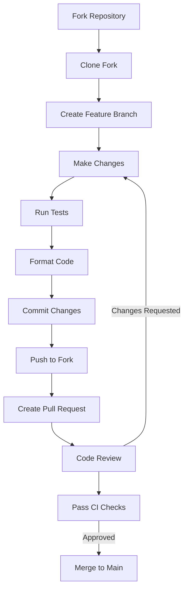
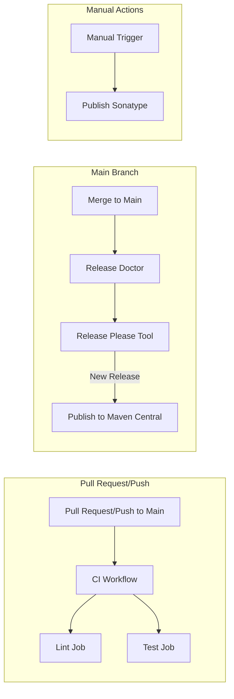
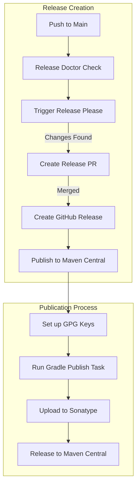

<!-- source: DeepWiki mcp.deepwiki.com · repo anthropics/anthropic-sdk-java · page 7 Development and Contribution · fetched 2026-10-26 -->

# Development and Contribution

<details>
<summary>Relevant source files</summary>

The following files were used as context for generating this wiki page:

- [.github/workflows/ci.yml](.github/workflows/ci.yml)
- [.github/workflows/create-releases.yml](.github/workflows/create-releases.yml)
- [.github/workflows/publish-sonatype.yml](.github/workflows/publish-sonatype.yml)
- [.github/workflows/release-doctor.yml](.github/workflows/release-doctor.yml)
- [bin/check-release-environment](bin/check-release-environment)
- [buildSrc/build.gradle.kts](buildSrc/build.gradle.kts)
- [buildSrc/src/main/kotlin/anthropic.java.gradle.kts](buildSrc/src/main/kotlin/anthropic.java.gradle.kts)
- [buildSrc/src/main/kotlin/anthropic.publish.gradle.kts](buildSrc/src/main/kotlin/anthropic.publish.gradle.kts)
- [gradle/wrapper/gradle-wrapper.jar](gradle/wrapper/gradle-wrapper.jar)
- [gradle/wrapper/gradle-wrapper.properties](gradle/wrapper/gradle-wrapper.properties)
- [gradlew](gradlew)
- [gradlew.bat](gradlew.bat)

</details>


This document provides essential information for developers who want to contribute to the Anthropic Java SDK. It covers development environment setup, build processes, testing, and release procedures. For information about using the SDK in your applications, please see [Introduction to Anthropic Java SDK](#1).

## Table of Contents

## Setting Up Development Environment

### Prerequisites

To contribute to the Anthropic Java SDK, you'll need:

- Java JDK 8 (for compatibility) and JDK 21 (for development)
- Git
- Gradle (optional, as the project includes Gradle wrapper)

### Building from Source

1. Clone the repository:
   ```bash
   git clone https://github.com/anthropics/anthropic-sdk-java.git
   cd anthropic-sdk-java
   ```

2. Build the project:
   ```bash
   ./gradlew build
   ```

The project is built with Java 8 compatibility but uses Java 21 for the toolchain, as defined in the build configuration:

```
java {
    toolchain {
        languageVersion.set(JavaLanguageVersion.of(21))
    }

    sourceCompatibility = JavaVersion.VERSION_1_8
    targetCompatibility = JavaVersion.VERSION_1_8
}
```

Sources: [buildSrc/src/main/kotlin/anthropic.java.gradle.kts:22-29]()

## Development Workflow

The development workflow for contributing to the Anthropic Java SDK is illustrated below:



### Code Style and Formatting

The project uses the Spotless plugin with Palantir Java formatter to maintain consistent code style:

```
configure<SpotlessExtension> {
    java {
        importOrder()
        removeUnusedImports()
        palantirJavaFormat()
        toggleOffOn()
    }
}
```

Sources: [buildSrc/src/main/kotlin/anthropic.java.gradle.kts:13-19]()

To format your code according to these standards, run:

```bash
./gradlew spotlessApply
```

Or use the provided script:

```bash
./scripts/lint
```

Sources: [.github/workflows/ci.yml:32-33]()

## Building and Testing

### Gradle Tasks

The main Gradle tasks you'll use during development:

| Task | Description |
|------|-------------|
| `./gradlew build` | Compiles the code and runs all checks |
| `./gradlew test` | Runs all tests |
| `./gradlew spotlessCheck` | Checks code formatting |
| `./gradlew spotlessApply` | Fixes code formatting issues |
| `./gradlew publishToMavenLocal` | Publishes to local Maven repository |

### Running Tests

Tests are configured to run in parallel with JUnit 5:

```
tasks.withType<Test>().configureEach {
    useJUnitPlatform()

    // Run tests in parallel to some degree.
    maxParallelForks = (Runtime.getRuntime().availableProcessors() / 2).coerceAtLeast(1)
    forkEvery = 100

    testLogging {
        exceptionFormat = TestExceptionFormat.FULL
    }
}
```

Sources: [buildSrc/src/main/kotlin/anthropic.java.gradle.kts:45-55]()

To run all tests:

```bash
./gradlew test
```

Or use the provided script:

```bash
./scripts/test
```

Sources: [.github/workflows/ci.yml:53-54]()

## CI/CD Pipeline

The Continuous Integration and Deployment pipeline is implemented with GitHub Actions and includes several key workflows:



### CI Workflow

The CI workflow runs on pull requests and pushes to the repository, executing linting and testing:

```yaml
jobs:
  lint:
    # ...
    steps:
      # ...
      - name: Run lints
        run: ./scripts/lint
  test:
    # ...
    steps:
      # ...
      - name: Run tests
        run: ./scripts/test
```

Sources: [.github/workflows/ci.yml:12-54]()

### Release Process

The release process is automated through GitHub Actions:



The release process consists of:

1. **Release Doctor Check**: Verifies all required environment variables are set
2. **Release Creation**: Uses the Stainless API's release-please integration
3. **Publication**: Publishes artifacts to Maven Central via Sonatype

Sources: [.github/workflows/create-releases.yml:1-50](), [.github/workflows/release-doctor.yml:1-27]()

#### Required Environment Variables

For publishing releases, the following environment variables are required:

| Variable | Description |
|----------|-------------|
| `SONATYPE_USERNAME` | Sonatype repository username |
| `SONATYPE_PASSWORD` | Sonatype repository password |
| `GPG_SIGNING_KEY` | GPG private key for signing artifacts |
| `GPG_SIGNING_PASSWORD` | GPG key password |
| `STAINLESS_API_KEY` | API key for Stainless release automation |

These are checked by the release doctor workflow before allowing releases:

```bash
if [ -z "${SONATYPE_USERNAME}" ]; then
  errors+=("The ANTHROPIC_SONATYPE_USERNAME secret has not been set. Please set it in either this repository's secrets or your organization secrets")
fi
```

Sources: [bin/check-release-environment:5-31]()

### Manual Publication

If the automated publication fails, it can be triggered manually using the `publish-sonatype.yml` workflow:

```yaml
name: Publish Sonatype
on:
  workflow_dispatch:
```

Sources: [.github/workflows/publish-sonatype.yml:1-5]()

## Publication Configuration

The SDK is published to Maven Central using the `gradle-maven-publish-plugin`:

```kotlin
configure<MavenPublishBaseExtension> {
    signAllPublications()
    publishToMavenCentral(SonatypeHost.CENTRAL_PORTAL)

    coordinates(project.group.toString(), project.name, project.version.toString())
    configure(
        KotlinJvm(
            javadocJar = JavadocJar.Dokka("dokkaJavadoc"),
            sourcesJar = true,
        )
    )

    pom {
        name.set("Anthropic API")
        description.set("An SDK library for anthropic")
        url.set("https://docs.anthropic.com/claude/reference/")
        // ...
    }
}
```

Sources: [buildSrc/src/main/kotlin/anthropic.publish.gradle.kts:19-54]()

## Contributing Guidelines

When contributing to the Anthropic Java SDK:

1. **Create an Issue**: For major changes, create an issue first to discuss your proposed changes
2. **Fork and Clone**: Fork the repository and clone it locally
3. **Branch**: Create a feature branch for your changes
4. **Test**: Ensure all tests pass with your changes
5. **Format**: Make sure your code is properly formatted
6. **Pull Request**: Submit a pull request with a clear description of your changes

### Pull Request Process

1. Ensure your code follows the project's formatting guidelines
2. Update documentation as necessary
3. The PR must pass all CI checks
4. The PR requires approval from a maintainer

## Conclusion

This guide covers the essentials for contributing to the Anthropic Java SDK. The project uses modern Java development practices with Gradle as the build system and GitHub Actions for CI/CD. By following these guidelines, you can effectively contribute to the development of the SDK.

---

