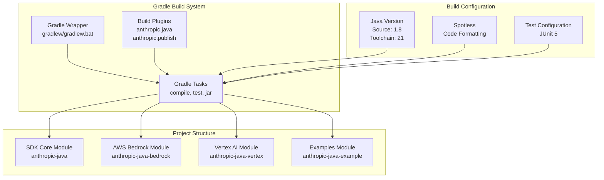
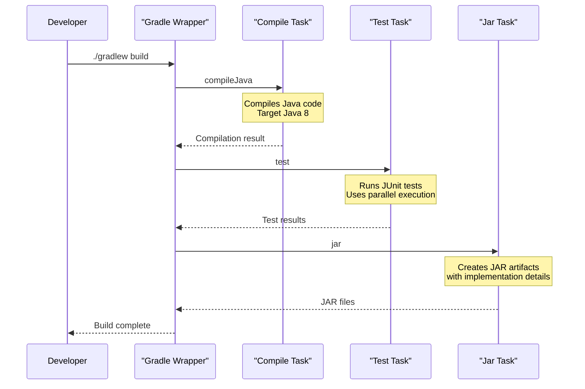
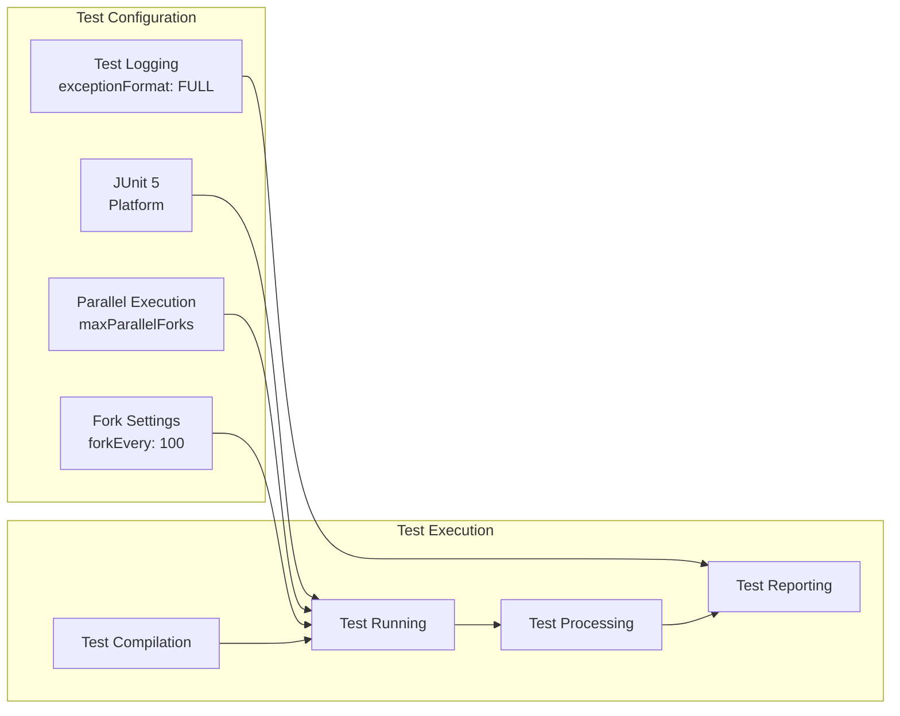
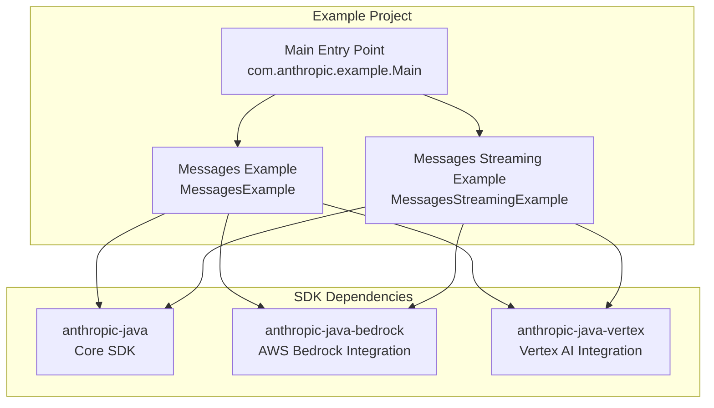
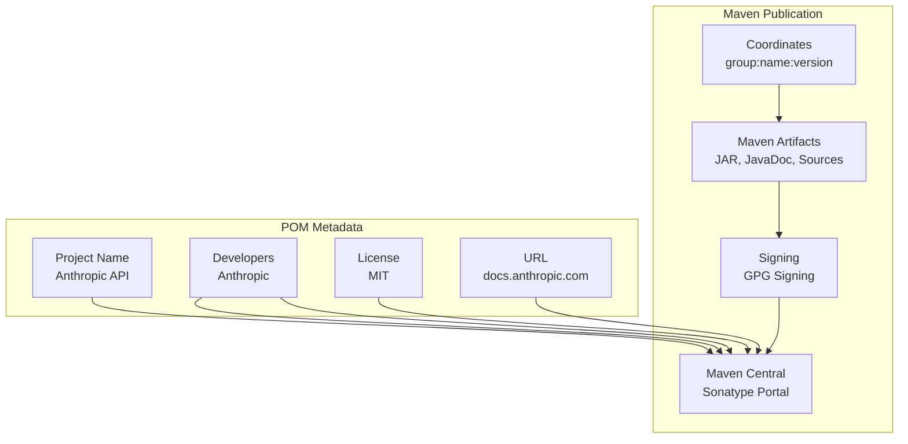

<!-- source: DeepWiki mcp.deepwiki.com · repo anthropics/anthropic-sdk-java · page 7.1 Building and Testing · fetched 2026-10-26 -->

# Building and Testing

<details>
<summary>Relevant source files</summary>

The following files were used as context for generating this wiki page:

- [anthropic-java-example/build.gradle.kts](anthropic-java-example/build.gradle.kts)
- [anthropic-java-example/src/main/java/com/anthropic/example/Main.java](anthropic-java-example/src/main/java/com/anthropic/example/Main.java)
- [buildSrc/build.gradle.kts](buildSrc/build.gradle.kts)
- [buildSrc/src/main/kotlin/anthropic.java.gradle.kts](buildSrc/src/main/kotlin/anthropic.java.gradle.kts)
- [buildSrc/src/main/kotlin/anthropic.publish.gradle.kts](buildSrc/src/main/kotlin/anthropic.publish.gradle.kts)
- [gradle/wrapper/gradle-wrapper.jar](gradle/wrapper/gradle-wrapper.jar)
- [gradle/wrapper/gradle-wrapper.properties](gradle/wrapper/gradle-wrapper.properties)
- [gradlew](gradlew)
- [gradlew.bat](gradlew.bat)

</details>


This document outlines the processes, tools, and configurations used for building and testing the Anthropic Java SDK. It covers the Gradle-based build system, test configuration, execution, and related development workflows. For information about the CI/CD pipeline, see [CI/CD Pipeline](#7.2), and for details on the release process, see [Release Process](#7.3).

## Build System Overview

The Anthropic Java SDK uses Gradle as its build system with custom plugins to standardize build configurations across modules.

### Build System Architecture



Sources: [buildSrc/src/main/kotlin/anthropic.java.gradle.kts:1-56](), [anthropic-java-example/build.gradle.kts:1-24](), [gradle/wrapper/gradle-wrapper.properties:1-8]()

### Build Plugins

The SDK uses custom Gradle plugins to standardize the build process across modules:

| Plugin | Purpose | Source File |
|--------|---------|-------------|
| `anthropic.java` | Configures Java compilation, formatting, and testing | [buildSrc/src/main/kotlin/anthropic.java.gradle.kts]() |
| `anthropic.publish` | Sets up Maven publication for releasing to Maven Central | [buildSrc/src/main/kotlin/anthropic.publish.gradle.kts]() |

The `anthropic.java` plugin applies the following configurations:

- Java source compatibility: Java 8
- Java target compatibility: Java 8
- Java toolchain: Java 21
- Code formatting using Spotless with Palantir Java format
- JUnit 5 for testing with parallel execution

Sources: [buildSrc/src/main/kotlin/anthropic.java.gradle.kts:4-56](), [buildSrc/src/main/kotlin/anthropic.publish.gradle.kts:6-55]()

## Building the SDK

### Prerequisites

Before building the SDK, ensure you have:

1. JDK 21 installed (for toolchain)
2. Git to clone the repository

### Build Process Flow



Sources: [buildSrc/src/main/kotlin/anthropic.java.gradle.kts:22-43]()

### Building with Gradle

To build the SDK, use the Gradle wrapper script included in the repository:

```
# On Linux/macOS
./gradlew build

# On Windows
gradlew.bat build
```

This will compile the source code, run tests, and create JAR artifacts for all modules.

For building individual modules:

```
./gradlew :anthropic-java:build
./gradlew :anthropic-java-bedrock:build
./gradlew :anthropic-java-vertex:build
```

Sources: [gradlew:1-251](), [gradlew.bat:1-94]()

### Compilation Settings

The SDK uses specific compiler settings:

| Setting | Value | Purpose |
|---------|-------|---------|
| Source Compatibility | Java 8 | Ensures source code is compatible with Java 8 |
| Target Compatibility | Java 8 | Ensures bytecode is compatible with Java 8 runtime |
| Toolchain | Java 21 | Uses JDK 21 features for build tools |
| Compiler Args | "-Werror" | Treats warnings as errors |
| Release | 8 | Sets Java release compatibility |

This configuration ensures the SDK is widely compatible while allowing modern development tools.

Sources: [buildSrc/src/main/kotlin/anthropic.java.gradle.kts:22-34]()

## Testing

### Test Configuration

The SDK uses JUnit 5 for testing with optimized parallel execution:



Sources: [buildSrc/src/main/kotlin/anthropic.java.gradle.kts:45-55]()

### Test Execution

Tests are configured to run in parallel to optimize execution time:

- **Max Parallel Forks**: Set to half the available processors (minimum of 1)
- **Fork Every**: Set to 100 test classes
- **Exception Format**: Full exception details are logged

To run the tests:

```
# Run all tests
./gradlew test

# Run tests for a specific module
./gradlew :anthropic-java:test
```

Sources: [buildSrc/src/main/kotlin/anthropic.java.gradle.kts:45-55]()

## Example Projects

The SDK includes example projects that demonstrate usage and can serve as integration tests:

### Example Structure



Sources: [anthropic-java-example/src/main/java/com/anthropic/example/Main.java:1-11](), [anthropic-java-example/build.gradle.kts:1-24]()

### Running Examples

The example projects are configured as a Java application with the main class set to `com.anthropic.example.Main`. To run the examples:

```
./gradlew :anthropic-java-example:run
```

The examples demonstrate:
- Basic message creation
- Streaming message responses
- Integration with AWS Bedrock
- Integration with Google Vertex AI

Sources: [anthropic-java-example/build.gradle.kts:10-23](), [anthropic-java-example/src/main/java/com/anthropic/example/Main.java:6-9]()

## Maven Publication

The SDK is configured for publication to Maven Central using the `anthropic.publish` plugin:

### Publication Configuration



Sources: [buildSrc/src/main/kotlin/anthropic.publish.gradle.kts:15-55]()

### Publishing Process

To publish the SDK to Maven Central:

1. Set environment variables for signing:
   - `GPG_SIGNING_KEY`: GPG signing key
   - `GPG_SIGNING_KEY_ID`: GPG signing key ID
   - `GPG_SIGNING_PASSWORD`: GPG signing password

2. Run the publish task:
   ```
   ./gradlew publish
   ```

This process:
- Creates JAR, JavaDoc, and sources artifacts
- Signs the artifacts with GPG
- Uploads them to Maven Central via Sonatype Portal

Sources: [buildSrc/src/main/kotlin/anthropic.publish.gradle.kts:15-55]()

## Local Development Workflow

For local development and testing, the recommended workflow is:

1. Clone the repository
2. Make changes to the code
3. Run the build to verify compilation: `./gradlew build`
4. Run tests to verify functionality: `./gradlew test`
5. Run examples to verify integration: `./gradlew :anthropic-java-example:run`

This ensures that changes work correctly before committing them.

Sources: [gradlew:1-251](), [buildSrc/src/main/kotlin/anthropic.java.gradle.kts:4-56]()

---

