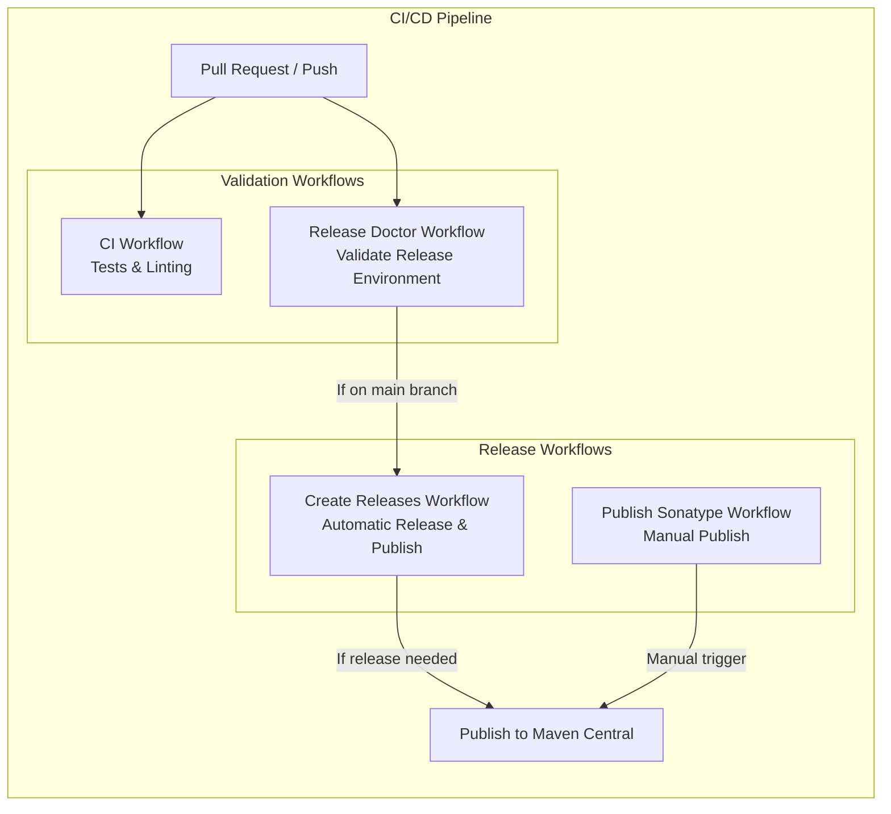
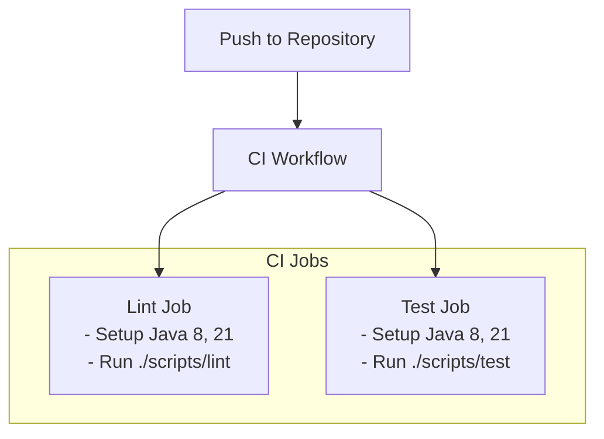
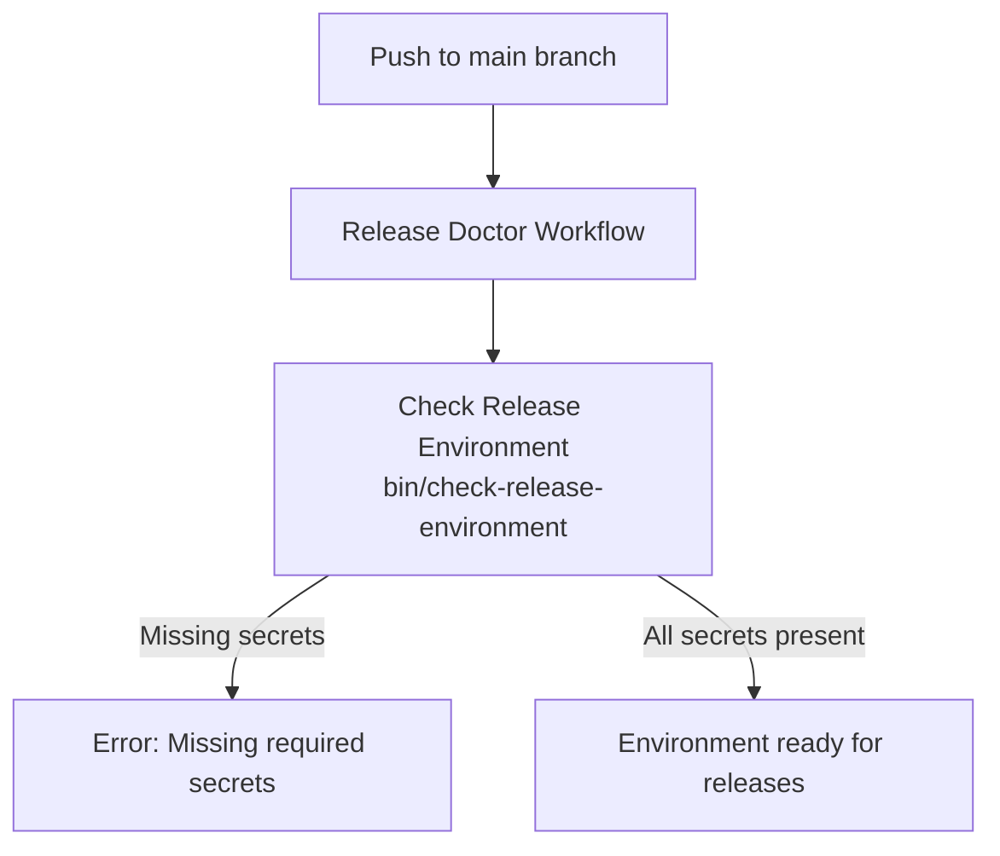
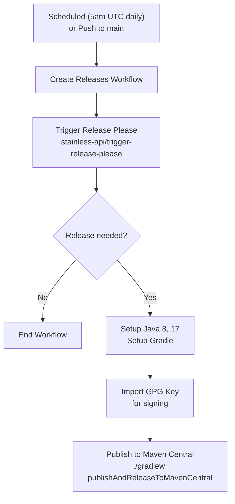
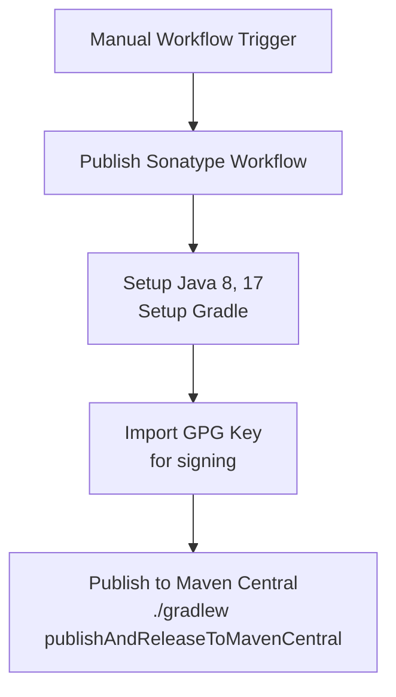
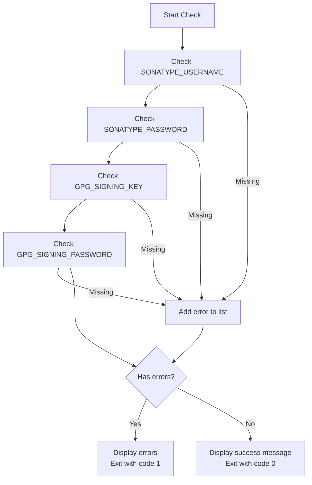
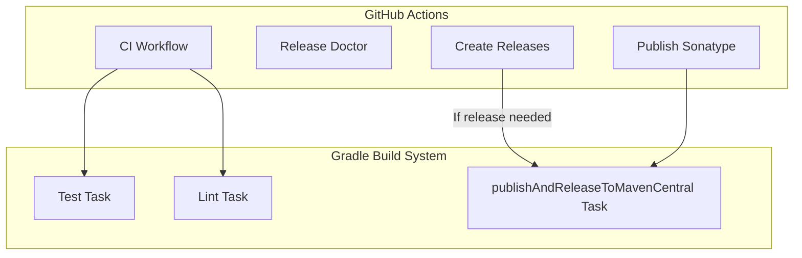

<!-- source: DeepWiki mcp.deepwiki.com · repo anthropics/anthropic-sdk-java · page 7.2 CI/CD Pipeline · fetched 2026-10-26 -->

# CI/CD Pipeline

Relevant source files

The following files were used as context for generating this wiki page:

- [.github/workflows/ci.yml](.github/workflows/ci.yml)
- [.github/workflows/create-releases.yml](.github/workflows/create-releases.yml)
- [.github/workflows/publish-sonatype.yml](.github/workflows/publish-sonatype.yml)
- [.github/workflows/release-doctor.yml](.github/workflows/release-doctor.yml)
- [bin/check-release-environment](bin/check-release-environment)

This document describes the Continuous Integration and Continuous Deployment (CI/CD) pipeline used in the Anthropic Java SDK. The pipeline automates testing, linting, release creation, and publishing artifacts to Maven Central via Sonatype. For information about the actual release process, see [Release Process](#7.3).

## Overview

The Anthropic Java SDK uses GitHub Actions for its CI/CD pipeline. The pipeline consists of several workflows that handle different aspects of the continuous integration and deployment process.

Sources: [.github/workflows/ci.yml](), [.github/workflows/release-doctor.yml](), [.github/workflows/create-releases.yml](), [.github/workflows/publish-sonatype.yml]()

## CI Workflow

The CI workflow runs on every push to non-generated branches and handles testing and linting.

Sources: [.github/workflows/ci.yml:12-54]()

### Lint Job

The lint job:
1. Sets up Java 8 and 21
2. Sets up Gradle
3. Runs the linting script (`./scripts/lint`)

This job ensures that the code follows the project's coding standards and conventions.

Sources: [.github/workflows/ci.yml:12-33]()

### Test Job

The test job:
1. Sets up Java 8 and 21
2. Sets up Gradle
3. Runs the test script (`./scripts/test`)

This job ensures that all unit tests pass, verifying that the code works as expected.

Sources: [.github/workflows/ci.yml:34-54]()

## Release Doctor Workflow

The Release Doctor workflow runs on pushes to the main branch and validates that the environment is properly set up for creating releases.

Sources: [.github/workflows/release-doctor.yml](), [bin/check-release-environment]()

The workflow runs the `bin/check-release-environment` script, which checks for the presence of the following secrets:

| Secret | Purpose |
|--------|---------|
| `ANTHROPIC_SONATYPE_USERNAME` or `SONATYPE_USERNAME` | Username for Sonatype (Maven Central) |
| `ANTHROPIC_SONATYPE_PASSWORD` or `SONATYPE_PASSWORD` | Password for Sonatype (Maven Central) |
| `ANTHROPIC_SONATYPE_GPG_SIGNING_KEY` or `GPG_SIGNING_KEY` | GPG key for signing artifacts |
| `ANTHROPIC_SONATYPE_GPG_SIGNING_PASSWORD` or `GPG_SIGNING_PASSWORD` | Password for the GPG key |

If any of these secrets are missing, the workflow will fail with an error message, preventing releases from being created without the proper authentication credentials.

Sources: [bin/check-release-environment:5-19]()

## Create Releases Workflow

The Create Releases workflow runs on a daily schedule and on pushes to the main branch. It handles automatically creating new releases and publishing artifacts to Maven Central.

Sources: [.github/workflows/create-releases.yml]()

The workflow:
1. Uses the `stainless-api/trigger-release-please` action to determine if a new release should be created based on commit history
2. If a release is needed, it sets up Java 8 and 17
3. Imports the GPG key for signing artifacts
4. Runs the Gradle task `publishAndReleaseToMavenCentral` to publish the artifacts to Maven Central

The workflow only runs on the main branch of the official repository (`anthropics/anthropic-sdk-java`).

Sources: [.github/workflows/create-releases.yml:9-50]()

## Manual Publish Sonatype Workflow

The Publish Sonatype workflow is a manually triggered workflow that can be used if the automatic publishing fails.

Sources: [.github/workflows/publish-sonatype.yml]()

This workflow can be manually triggered from the GitHub Actions UI to retry publishing to Maven Central if the automatic process fails for any reason. It performs the same publishing steps as the Create Releases workflow:

1. Set up Java 8 and 17
2. Import the GPG key for signing artifacts
3. Run the Gradle task `publishAndReleaseToMavenCentral`

Sources: [.github/workflows/publish-sonatype.yml:8-37]()

## Release Environment Validation

The release environment validation is performed by the `bin/check-release-environment` script, which ensures all required secrets are available before allowing a release to proceed.

Sources: [bin/check-release-environment]()

The script checks for the presence of the following environment variables:
- `SONATYPE_USERNAME`
- `SONATYPE_PASSWORD`
- `GPG_SIGNING_KEY`
- `GPG_SIGNING_PASSWORD`

If any are missing, it adds an error message to a list. After checking all variables, it either displays all error messages and exits with code 1 (if any errors were found) or displays a success message and exits with code 0.

Sources: [bin/check-release-environment:3-34]()

## CI/CD Pipeline Integration with Build System

The CI/CD pipeline integrates with the Gradle build system to execute tests, linting, and publishing tasks.

Sources: [.github/workflows/ci.yml](), [.github/workflows/create-releases.yml](), [.github/workflows/publish-sonatype.yml]()

The integration ensures that the same build processes used by developers locally are also used in the automated CI/CD pipeline, maintaining consistency across environments.

---

