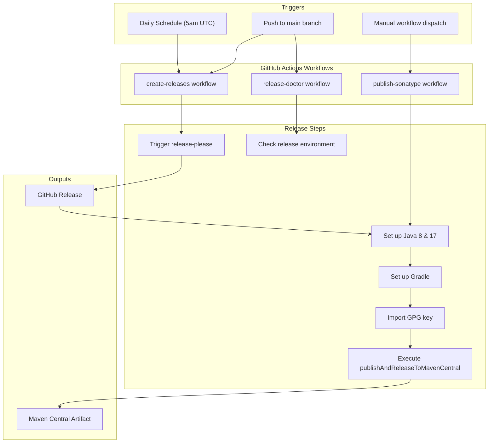
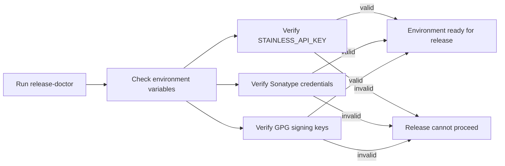

<!-- source: DeepWiki mcp.deepwiki.com · repo anthropics/anthropic-sdk-java · page 7.3 Release Process · fetched 2026-10-26 -->

# Release Process

<details>
<summary>Relevant source files</summary>

The following files were used as context for generating this wiki page:

- [.github/workflows/ci.yml](.github/workflows/ci.yml)
- [.github/workflows/create-releases.yml](.github/workflows/create-releases.yml)
- [.github/workflows/publish-sonatype.yml](.github/workflows/publish-sonatype.yml)
- [.github/workflows/release-doctor.yml](.github/workflows/release-doctor.yml)
- [bin/check-release-environment](bin/check-release-environment)
- [buildSrc/build.gradle.kts](buildSrc/build.gradle.kts)
- [buildSrc/src/main/kotlin/anthropic.java.gradle.kts](buildSrc/src/main/kotlin/anthropic.java.gradle.kts)
- [buildSrc/src/main/kotlin/anthropic.publish.gradle.kts](buildSrc/src/main/kotlin/anthropic.publish.gradle.kts)
- [gradle/wrapper/gradle-wrapper.jar](gradle/wrapper/gradle-wrapper.jar)
- [gradle/wrapper/gradle-wrapper.properties](gradle/wrapper/gradle-wrapper.properties)
- [gradlew](gradlew)
- [gradlew.bat](gradlew.bat)

</details>


This document explains how the Anthropic Java SDK is versioned, released, and published to Maven Central. It covers the automated CI/CD pipeline, required environment configuration, and both automated and manual release processes. For information about developing and contributing to the SDK, see [Development and Contribution](#7).

## Release Environment Setup

Before releases can be created and published, the environment must be properly configured with the following secrets:

| Secret | Purpose |
|--------|---------|
| `ANTHROPIC_SONATYPE_USERNAME` or `SONATYPE_USERNAME` | Username for Sonatype/Maven Central |
| `ANTHROPIC_SONATYPE_PASSWORD` or `SONATYPE_PASSWORD` | Password for Sonatype/Maven Central |
| `ANTHROPIC_SONATYPE_GPG_SIGNING_KEY` or `GPG_SIGNING_KEY` | GPG key used for signing artifacts |
| `ANTHROPIC_SONATYPE_GPG_SIGNING_PASSWORD` or `GPG_SIGNING_PASSWORD` | Password for the GPG key |
| `STAINLESS_API_KEY` | API key for the Stainless release system |

The `release-doctor` workflow automatically checks for these environment variables to ensure the release process can proceed without issues.

Sources: [.github/workflows/release-doctor.yml:1-27](), [bin/check-release-environment:1-34]()

## Release Process Overview

The diagram below illustrates the complete release process for the Anthropic Java SDK:



Sources: [.github/workflows/create-releases.yml:1-51](), [.github/workflows/publish-sonatype.yml:1-37](), [.github/workflows/release-doctor.yml:1-27]()

## Automated Release Process

The Anthropic Java SDK uses an automated release process based on GitHub Actions. Releases are automatically triggered:

1. On a daily schedule at 5:00 AM UTC
2. When changes are pushed to the main branch in the `anthropics/anthropic-sdk-java` repository

The automated process consists of two main workflows:

### Release Doctor

The `release-doctor` workflow runs first to validate the environment:



If all environment variables are correctly set, the workflow reports success and releases can proceed.

Sources: [.github/workflows/release-doctor.yml:1-27](), [bin/check-release-environment:1-34]()

### Create Releases

The `create-releases` workflow handles the actual release creation and publishing:

1. The workflow runs on a schedule or when changes are pushed to the main branch
2. It uses the `stainless-api/trigger-release-please` action to create releases
3. If a release is created:
   - Java is set up with both Java 8 and 17
   - Gradle is set up
   - The GPG signing key is imported
   - The artifact is built and published to Maven Central using the `publishAndReleaseToMavenCentral` Gradle task

Sources: [.github/workflows/create-releases.yml:1-51]()

## Manual Release Process

If the automated release process fails, you can manually trigger the release process using the `publish-sonatype` workflow:

1. Navigate to the GitHub Actions tab in the repository
2. Select the "Publish Sonatype" workflow
3. Click "Run workflow"

This workflow performs the same publishing steps as the automated process but can be manually triggered when needed.

Sources: [.github/workflows/publish-sonatype.yml:1-37]()

## Maven Publishing Configuration

The SDK is published to Maven Central through Sonatype. The publishing configuration is defined in the `anthropic.publish.gradle.kts` file:

```mermaid
classDiagram
    class "MavenPublishBaseExtension" {
        +signAllPublications()
        +publishToMavenCentral()
        +coordinates()
        +configure()
        +pom()
    }
    
    class "POM Configuration" {
        +name: "Anthropic API"
        +description: "An SDK library for anthropic"
        +url: "https://docs.anthropic.com/claude/reference/"
        +license: "MIT"
        +developers
        +scm connection
    }
    
    class "PublishTask" {
        +publishAndReleaseToMavenCentral
    }
    
    "MavenPublishBaseExtension" --> "POM Configuration"
    "MavenPublishBaseExtension" --> "PublishTask"
```

Key configuration elements include:

- The artifact is signed using the GPG key
- The Maven coordinates are set with the group, name, and version
- The POM file includes necessary information (name, description, license, etc.)
- The artifacts are published to Maven Central via Sonatype

Sources: [buildSrc/src/main/kotlin/anthropic.publish.gradle.kts:1-56](), [buildSrc/build.gradle.kts:1-17]()

## Publishing Execution Process

When the publishing process runs, it executes these key steps:

1. Import the GPG signing key:
   ```
   printenv -- GPG_SIGNING_KEY | gpg --batch --passphrase-fd 3 --import 3<<< "$GPG_SIGNING_PASSWORD"
   ```

2. Extract the key ID:
   ```
   GPG_SIGNING_KEY_ID="$(gpg --with-colons --list-keys | awk -F : -- '/^pub:/ { getline; print "0x" substr($10, length($10) - 7) }')"
   ```

3. Execute the Gradle publishing task:
   ```
   ./gradlew publishAndReleaseToMavenCentral --stacktrace -PmavenCentralUsername="$SONATYPE_USERNAME" -PmavenCentralPassword="$SONATYPE_PASSWORD" --no-configuration-cache
   ```

This process handles building the SDK, signing the artifacts, and publishing them to Maven Central.

Sources: [.github/workflows/create-releases.yml:40-45](), [.github/workflows/publish-sonatype.yml:28-32]()

## Java Build Configuration

The SDK is built using the Java library plugin with specific configurations:

- Java language version is set to 21 for development
- Source and target compatibility is set to Java 8 for maximum compatibility
- Jar manifest includes implementation title and version
- Tests are configured to run in parallel

This ensures the SDK is compatible with Java 8 and above while being developed with modern Java features.

Sources: [buildSrc/src/main/kotlin/anthropic.java.gradle.kts:1-56]()

## Troubleshooting

If the release process fails, check:

1. The release-doctor workflow logs to ensure all environment variables are properly set
2. The create-releases workflow logs for any errors in the release creation process
3. The publish-sonatype workflow logs for any errors in the publishing process

You can also manually run the publish-sonatype workflow to retry publishing if it failed.

Common issues include:

| Issue | Resolution |
|-------|------------|
| Missing environment variables | Configure the required secrets in the GitHub repository settings |
| GPG key issues | Verify the GPG key is correctly formatted and the password is correct |
| Sonatype credential issues | Verify the Sonatype username and password are correct |
| Gradle build failures | Check the build logs for compilation or test failures |

Sources: [.github/workflows/release-doctor.yml:1-27](), [bin/check-release-environment:1-34](), [.github/workflows/publish-sonatype.yml:1-37]()

## Continuous Integration

In addition to the release process, the SDK has continuous integration workflows that run on every pull request and push:

| Workflow | Purpose |
|----------|---------|
| `lint` | Runs code style and quality checks |
| `test` | Runs the test suite |

These workflows ensure that code quality is maintained before releases are created.

Sources: [.github/workflows/ci.yml:1-55]()