# Page: Introduction to Anthropic Java SDK

# Introduction to Anthropic Java SDK

<details>
<summary>Relevant source files</summary>

The following files were used as context for generating this wiki page:

- [.release-please-manifest.json](.release-please-manifest.json)
- [CHANGELOG.md](CHANGELOG.md)
- [README.md](README.md)
- [anthropic-java/build.gradle.kts](anthropic-java/build.gradle.kts)
- [build.gradle.kts](build.gradle.kts)

</details>


The Anthropic Java SDK provides a convenient and type-safe way to interact with the [Anthropic Claude API](https://docs.anthropic.com/claude/reference/) from Java applications. This document introduces the key components, architecture, and basic usage of the SDK.

The SDK allows Java developers to easily integrate Claude's large language model capabilities into their applications, with features for message creation, streaming responses, model information retrieval, and batch operations. For more detailed information about specific component usage, see [SDK Structure and Components](#1.2).

## Key Features

- **Type-safe API client** with comprehensive model classes
- **Synchronous and asynchronous interfaces** for flexible programming styles
- **Streaming support** for efficient handling of long-running requests
- **Cloud provider integrations** with AWS Bedrock and Google Vertex AI
- **Robust error handling** with specialized exception types
- **Pagination support** for listing operations
- **Immutable object model** with builder patterns

Sources: [README.md:9-16](), [README.md:139-158]()

## Architecture Overview

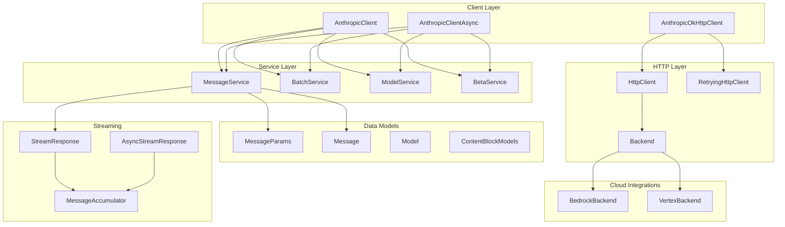

Sources: [README.md:10-11](), [README.md:775-782]()

## Core Client Structure

The SDK provides both synchronous and asynchronous interfaces for interacting with the Anthropic API. The key interface is `AnthropicClient`, which serves as the main entry point to the API.

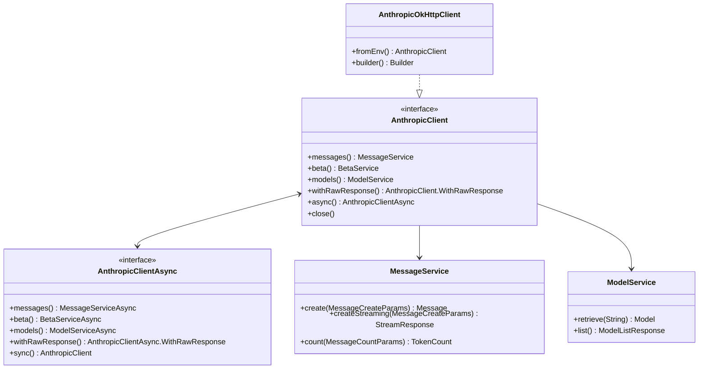

Sources: [README.md:48-64](), [README.md:139-179]()

## Installation

### Requirements
The SDK requires Java 8 or later.

### Maven
```xml
<dependency>
  <groupId>com.anthropic</groupId>
  <artifactId>anthropic-java</artifactId>
  <version>1.4.0</version>
</dependency>
```

### Gradle
```kotlin
implementation("com.anthropic:anthropic-java:1.4.0")
```

Sources: [README.md:18-38](), [README.md:42](), [build.gradle.kts:9-12]()

## Basic Usage

Creating a client and sending a basic message to Claude:

```java
// Create a client using environment variables
AnthropicClient client = AnthropicOkHttpClient.fromEnv();

// Build message parameters
MessageCreateParams params = MessageCreateParams.builder()
    .maxTokens(1024L)
    .addUserMessage("Hello, Claude")
    .model(Model.CLAUDE_3_7_SONNET_LATEST)
    .build();

// Send the message and get a response
Message message = client.messages().create(params);
```

Sources: [README.md:48-64](), [README.md:66-87]()

## Client Configuration

The client can be configured using environment variables, explicitly through the builder pattern, or a combination of both:

| Setter      | Environment variable   | Required | Default value                 |
| ----------- | ---------------------- | -------- | ----------------------------- |
| `apiKey`    | `ANTHROPIC_API_KEY`    | false    | -                             |
| `authToken` | `ANTHROPIC_AUTH_TOKEN` | false    | -                             |
| `baseUrl`   | `ANTHROPIC_BASE_URL`   | true     | `"https://api.anthropic.com"` |

```java
// Using environment variables
AnthropicClient client = AnthropicOkHttpClient.fromEnv();

// Using builder pattern
AnthropicClient client = AnthropicOkHttpClient.builder()
    .apiKey("my-anthropic-api-key")
    .build();

// Combining approaches
AnthropicClient client = AnthropicOkHttpClient.builder()
    .fromEnv()
    .apiKey("my-anthropic-api-key")
    .build();
```

Sources: [README.md:66-109]()

## Asynchronous API

The SDK provides asynchronous versions of all operations, which return `CompletableFuture` objects:

```java
// Get the async client
AnthropicClientAsync asyncClient = client.async();

// Build message parameters
MessageCreateParams params = MessageCreateParams.builder()
    .maxTokens(1024L)
    .addUserMessage("Hello, Claude")
    .model(Model.CLAUDE_3_7_SONNET_LATEST)
    .build();

// Send the message asynchronously
CompletableFuture<Message> messageFuture = asyncClient.messages().create(params);
```

Sources: [README.md:138-179]()

## Streaming Responses

For long-running requests, the SDK provides streaming capabilities that allow processing response chunks as they arrive:

```java
// Using synchronous streaming
try (StreamResponse<RawMessageStreamEvent> streamResponse = client.messages().createStreaming(params)) {
    streamResponse.stream().forEach(chunk -> {
        System.out.println(chunk);
    });
}

// Using MessageAccumulator to collect the full message
MessageAccumulator messageAccumulator = MessageAccumulator.create();
try (StreamResponse<RawMessageStreamEvent> streamResponse = client.messages().createStreaming(params)) {
    streamResponse.stream()
            .peek(messageAccumulator::accumulate)
            .flatMap(event -> event.contentBlockDelta().stream())
            .flatMap(deltaEvent -> deltaEvent.delta().text().stream())
            .forEach(textDelta -> System.out.print(textDelta.text()));
}
Message message = messageAccumulator.message();
```

Sources: [README.md:185-246](), [README.md:275-329]()

## Error Handling

The SDK uses a hierarchy of exception types for different error scenarios:

| Status | Exception                   |
| ------ | --------------------------- |
| 400    | `BadRequestException`       |
| 401    | `UnauthorizedException`     |
| 403    | `PermissionDeniedException` |
| 404    | `NotFoundException`         |
| 422    | `UnprocessableEntityException` |
| 429    | `RateLimitException`        |
| 5xx    | `InternalServerException`   |

All these exceptions are subclasses of `AnthropicServiceException`, which itself extends the base `AnthropicException` class.

Sources: [README.md:380-402]()

## Cloud Provider Integrations

The SDK supports integration with AWS Bedrock and Google Vertex AI for using Anthropic models through these platforms.

### AWS Bedrock

```java
// Add dependency: com.anthropic:anthropic-java-bedrock:1.4.0

// Create client with Bedrock backend
AnthropicClient client = AnthropicOkHttpClient.builder()
        .backend(BedrockBackend.fromEnv())
        .build();
```

### Google Vertex AI

```java
// Add dependency: com.anthropic:anthropic-java-vertex:1.4.0

// Create client with Vertex backend
AnthropicClient client = AnthropicOkHttpClient.builder()
        .backend(VertexBackend.fromEnv())
        .build();
```

Sources: [README.md:458-645]()

## SDK Structure

The SDK consists of three main artifacts:

1. **anthropic-java-core**: Contains the core logic without OkHttp dependency
2. **anthropic-java-client-okhttp**: Implements the core interfaces using OkHttp
3. **anthropic-java**: Combines both artifacts for convenience

This structure allows for flexibility in replacing the HTTP client implementation if needed.

Sources: [README.md:771-796]()

## Additional Features

- **Raw response access**: Access response headers and status codes with `.withRawResponse()`
- **Pagination**: Handle paginated results with `.autoPager()` or manual pagination
- **Retries**: Automatic retries (default: 2) for certain error types
- **Timeouts**: Configurable request timeouts (default: 10 minutes)
- **Logging**: HTTP logging via the standard OkHttp logging interceptor
- **Proxy support**: Route requests through a proxy

Sources: [README.md:332-379](), [README.md:405-457](), [README.md:649-768]()

For more detailed information about specific components and usage patterns, see [Getting Started](#1.1) and [SDK Structure and Components](#1.2).

---

# Page: Getting Started

# Getting Started

<details>
<summary>Relevant source files</summary>

The following files were used as context for generating this wiki page:

- [.release-please-manifest.json](.release-please-manifest.json)
- [CHANGELOG.md](CHANGELOG.md)
- [README.md](README.md)
- [anthropic-java-example/build.gradle.kts](anthropic-java-example/build.gradle.kts)
- [anthropic-java-example/src/main/java/com/anthropic/example/BatchAsyncExample.java](anthropic-java-example/src/main/java/com/anthropic/example/BatchAsyncExample.java)
- [anthropic-java-example/src/main/java/com/anthropic/example/BatchExample.java](anthropic-java-example/src/main/java/com/anthropic/example/BatchExample.java)
- [anthropic-java-example/src/main/java/com/anthropic/example/Main.java](anthropic-java-example/src/main/java/com/anthropic/example/Main.java)
- [anthropic-java-example/src/main/java/com/anthropic/example/MessagesAsyncExample.java](anthropic-java-example/src/main/java/com/anthropic/example/MessagesAsyncExample.java)
- [anthropic-java-example/src/main/java/com/anthropic/example/MessagesConversationAsyncExample.java](anthropic-java-example/src/main/java/com/anthropic/example/MessagesConversationAsyncExample.java)
- [anthropic-java-example/src/main/java/com/anthropic/example/MessagesConversationExample.java](anthropic-java-example/src/main/java/com/anthropic/example/MessagesConversationExample.java)
- [anthropic-java-example/src/main/java/com/anthropic/example/MessagesExample.java](anthropic-java-example/src/main/java/com/anthropic/example/MessagesExample.java)
- [anthropic-java-example/src/main/java/com/anthropic/example/MessagesStreamingAsyncExample.java](anthropic-java-example/src/main/java/com/anthropic/example/MessagesStreamingAsyncExample.java)
- [anthropic-java-example/src/main/java/com/anthropic/example/MessagesStreamingExample.java](anthropic-java-example/src/main/java/com/anthropic/example/MessagesStreamingExample.java)
- [anthropic-java/build.gradle.kts](anthropic-java/build.gradle.kts)
- [build.gradle.kts](build.gradle.kts)

</details>


This page provides instructions for installing the Anthropic Java SDK, setting up a client, and making your first API calls. It covers the essential steps to integrate Claude AI capabilities into your Java applications.

For information about the SDK's structure and components, see [SDK Structure and Components](#1.2).

## Prerequisites

The Anthropic Java SDK requires Java 8 or later. Before you begin, make sure you have:

1. A Java development environment (JDK 8+)
2. An Anthropic API key (get one from [Anthropic's website](https://www.anthropic.com))
3. Maven or Gradle for dependency management

Sources: [README.md:42-42]()

## Installation

Add the Anthropic Java SDK to your project using one of the following methods:

### Gradle

```kotlin
implementation("com.anthropic:anthropic-java:1.4.0")
```

### Maven

```xml
<dependency>
  <groupId>com.anthropic</groupId>
  <artifactId>anthropic-java</artifactId>
  <version>1.4.0</version>
</dependency>
```

Sources: [README.md:22-36](), [build.gradle.kts:9-12]()

## Client Setup

### Creating a Basic Client

The main entry point to the SDK is the `AnthropicClient` interface. The simplest way to create a client is using environment variables:

```java
import com.anthropic.client.AnthropicClient;
import com.anthropic.client.okhttp.AnthropicOkHttpClient;

// Configures using the `ANTHROPIC_API_KEY` environment variable
AnthropicClient client = AnthropicOkHttpClient.fromEnv();
```

The client will automatically use the `ANTHROPIC_API_KEY` environment variable for authentication.

### Manual Configuration

You can also configure the client manually:

```java
import com.anthropic.client.AnthropicClient;
import com.anthropic.client.okhttp.AnthropicOkHttpClient;

AnthropicClient client = AnthropicOkHttpClient.builder()
    .apiKey("your-anthropic-api-key")
    .build();
```

### Configuration Options

| Setter      | Environment variable   | Required | Default value                 |
| ----------- | ---------------------- | -------- | ----------------------------- |
| `apiKey`    | `ANTHROPIC_API_KEY`    | false    | -                             |
| `authToken` | `ANTHROPIC_AUTH_TOKEN` | false    | -                             |
| `baseUrl`   | `ANTHROPIC_BASE_URL`   | true     | `"https://api.anthropic.com"` |

Sources: [README.md:68-108]()

## Client Architecture

The following diagram illustrates the main components involved in creating and using an Anthropic client:

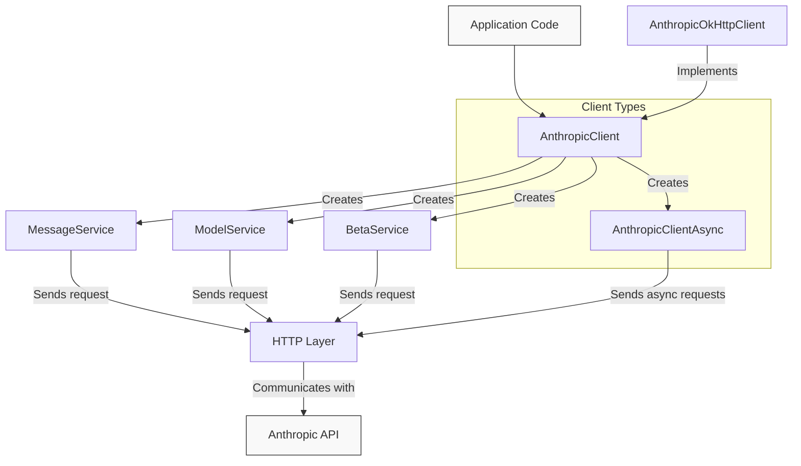

Sources: [README.md:139-179]()

## Making Your First API Call

The following example demonstrates how to create a simple message with Claude:

```java
import com.anthropic.client.AnthropicClient;
import com.anthropic.client.okhttp.AnthropicOkHttpClient;
import com.anthropic.models.messages.Message;
import com.anthropic.models.messages.MessageCreateParams;
import com.anthropic.models.messages.Model;

// Create client from environment variables
AnthropicClient client = AnthropicOkHttpClient.fromEnv();

// Build message parameters
MessageCreateParams params = MessageCreateParams.builder()
    .maxTokens(1024L)
    .addUserMessage("Hello, Claude")
    .model(Model.CLAUDE_3_7_SONNET_LATEST)
    .build();

// Send the request
Message message = client.messages().create(params);

// Access the response content
message.content().stream()
    .flatMap(contentBlock -> contentBlock.text().stream())
    .forEach(textBlock -> System.out.println(textBlock.text()));
```

Sources: [README.md:48-64](), [anthropic-java-example/src/main/java/com/anthropic/example/MessagesExample.java:11-25]()

## Request-Response Flow

This diagram illustrates the flow from creating a request to processing the response:

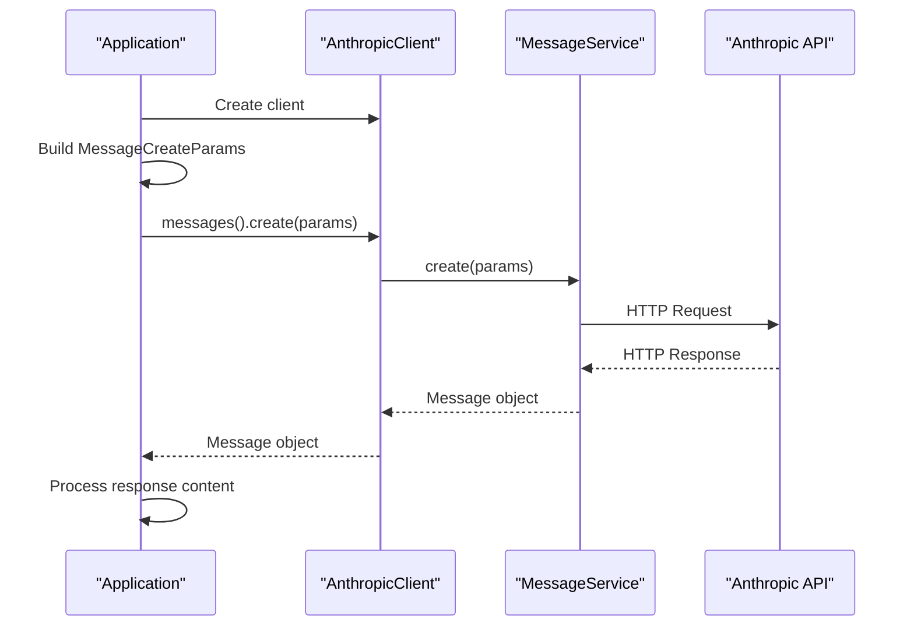

Sources: [anthropic-java-example/src/main/java/com/anthropic/example/MessagesExample.java:11-25]()

## Working with Responses

The SDK uses immutable objects for both requests and responses. The `Message` object returned from a successful API call contains content blocks that you can process:

```java
// Get and print all text from the response
message.content().stream()
    .flatMap(contentBlock -> contentBlock.text().stream())
    .forEach(textBlock -> System.out.println(textBlock.text()));
```

Sources: [README.md:130-136](), [anthropic-java-example/src/main/java/com/anthropic/example/MessagesExample.java:21-23]()

## Asynchronous Execution

The SDK supports asynchronous execution for non-blocking operations. You can switch to asynchronous mode from a synchronous client:

```java
import java.util.concurrent.CompletableFuture;

// Get an async client from a sync client
CompletableFuture<Message> futureMessage = client.async().messages().create(params);

// Or create an async client directly
AnthropicClientAsync asyncClient = AnthropicOkHttpClientAsync.fromEnv();
CompletableFuture<Message> futureMessage = asyncClient.messages().create(params);
```

Sources: [README.md:139-179](), [anthropic-java-example/src/main/java/com/anthropic/example/MessagesAsyncExample.java:11-28]()

## Streaming Responses

For longer responses, especially those that take time to generate, you can use streaming to receive content incrementally:

```java
import com.anthropic.core.http.StreamResponse;
import com.anthropic.models.messages.RawMessageStreamEvent;

try (StreamResponse<RawMessageStreamEvent> streamResponse = 
        client.messages().createStreaming(params)) {
    streamResponse.stream()
        .flatMap(event -> event.contentBlockDelta().stream())
        .flatMap(deltaEvent -> deltaEvent.delta().text().stream())
        .forEach(textDelta -> System.out.print(textDelta.text()));
}
```

For asynchronous streaming:

```java
client.async().messages().createStreaming(params)
    .subscribe(event -> event.contentBlockDelta().stream()
        .flatMap(deltaEvent -> deltaEvent.delta().text().stream())
        .forEach(textDelta -> System.out.print(textDelta.text())))
    .onCompleteFuture()
    .join();
```

Sources: [README.md:184-245](), [anthropic-java-example/src/main/java/com/anthropic/example/MessagesStreamingExample.java:11-32](), [anthropic-java-example/src/main/java/com/anthropic/example/MessagesStreamingAsyncExample.java:11-29]()

## Accumulating Streamed Content

When using streaming, you can use `MessageAccumulator` to build a complete `Message` object from the stream of events:

```java
import com.anthropic.helpers.MessageAccumulator;

MessageAccumulator messageAccumulator = MessageAccumulator.create();

try (StreamResponse<RawMessageStreamEvent> streamResponse =
        client.messages().createStreaming(params)) {
    streamResponse.stream()
        .peek(messageAccumulator::accumulate)
        .flatMap(event -> event.contentBlockDelta().stream())
        .flatMap(deltaEvent -> deltaEvent.delta().text().stream())
        .forEach(textDelta -> System.out.print(textDelta.text()));
}

// Get the complete message after streaming is done
Message message = messageAccumulator.message();
```

Sources: [README.md:276-329]()

## Error Handling

The SDK throws custom exception types for different error scenarios:

| Status | Exception                        |
| ------ | -------------------------------- |
| 400    | `BadRequestException`            |
| 401    | `UnauthorizedException`          |
| 403    | `PermissionDeniedException`      |
| 404    | `NotFoundException`              |
| 422    | `UnprocessableEntityException`   |
| 429    | `RateLimitException`             |
| 5xx    | `InternalServerException`        |
| others | `UnexpectedStatusCodeException`  |

All of these exceptions extend from `AnthropicServiceException`. There are also `AnthropicIoException` for I/O networking errors and `AnthropicInvalidDataException` for data interpretation failures.

Sources: [README.md:381-403]()

## Next Steps

Now that you're familiar with the basics, you can explore more advanced features of the SDK:

1. See [Core Client Architecture](#2) for more details on the client structure
2. Learn about [Streaming Response Handling](#4) for working with real-time content generation
3. Explore [Cloud Provider Integration](#6) for using the SDK with AWS Bedrock or Google Vertex AI
4. Check out [Services and Operations](#3) to understand all available API endpoints

## Complete SDK Architecture

This diagram shows the complete architecture of the Anthropic Java SDK:

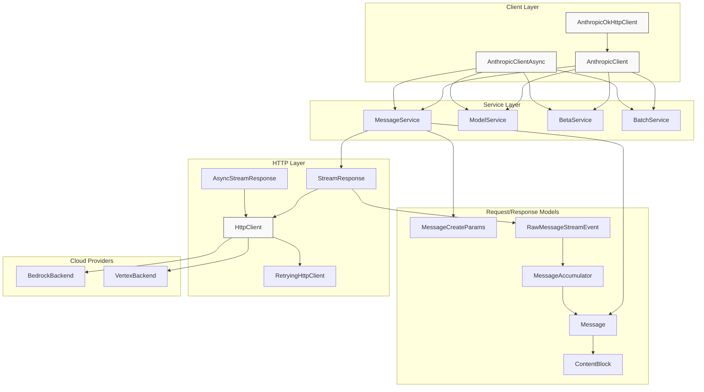

Sources: [README.md:10-810]()

---

# Page: SDK Structure and Components

# SDK Structure and Components

<details>
<summary>Relevant source files</summary>

The following files were used as context for generating this wiki page:

- [.release-please-manifest.json](.release-please-manifest.json)
- [CHANGELOG.md](CHANGELOG.md)
- [README.md](README.md)
- [anthropic-java-core/src/main/kotlin/com/anthropic/client/AnthropicClient.kt](anthropic-java-core/src/main/kotlin/com/anthropic/client/AnthropicClient.kt)
- [anthropic-java-core/src/main/kotlin/com/anthropic/client/AnthropicClientAsync.kt](anthropic-java-core/src/main/kotlin/com/anthropic/client/AnthropicClientAsync.kt)
- [anthropic-java-core/src/main/kotlin/com/anthropic/client/AnthropicClientAsyncImpl.kt](anthropic-java-core/src/main/kotlin/com/anthropic/client/AnthropicClientAsyncImpl.kt)
- [anthropic-java-core/src/main/kotlin/com/anthropic/client/AnthropicClientImpl.kt](anthropic-java-core/src/main/kotlin/com/anthropic/client/AnthropicClientImpl.kt)
- [anthropic-java-core/src/main/kotlin/com/anthropic/core/http/HttpResponseFor.kt](anthropic-java-core/src/main/kotlin/com/anthropic/core/http/HttpResponseFor.kt)
- [anthropic-java-core/src/main/kotlin/com/anthropic/services/async/BetaServiceAsync.kt](anthropic-java-core/src/main/kotlin/com/anthropic/services/async/BetaServiceAsync.kt)
- [anthropic-java/build.gradle.kts](anthropic-java/build.gradle.kts)
- [build.gradle.kts](build.gradle.kts)

</details>


This page provides an overview of the main components that make up the Anthropic Java SDK and how they relate to each other. It focuses on the core architecture, package organization, and key interfaces that developers will interact with. For information about specific API operations, see [Services and Operations](#3).

## SDK Package Structure

The Anthropic Java SDK is organized into multiple modules, each with a specific purpose. This modular design allows developers to include only the dependencies they need.

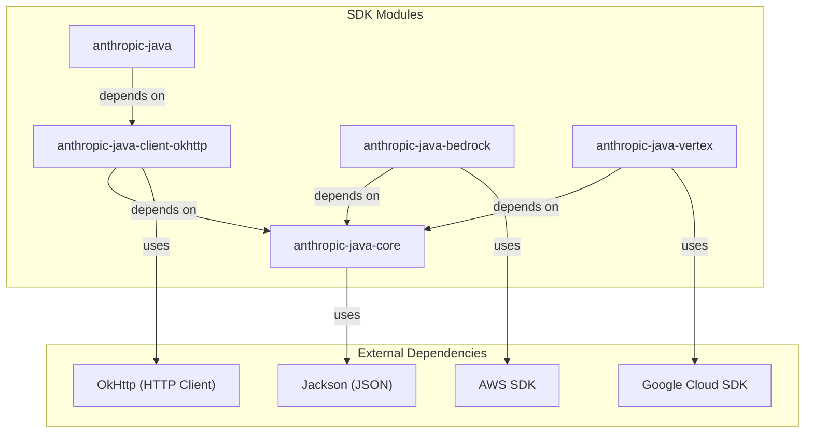

### Module Descriptions

| Module | Description | Purpose |
|--------|-------------|---------|
| **anthropic-java** | Main artifact | Brings together core and OkHttp implementation |
| **anthropic-java-core** | Core interfaces and models | Provides the foundation without HTTP client dependency |
| **anthropic-java-client-okhttp** | OkHttp implementation | Implements the core interfaces using OkHttp |
| **anthropic-java-bedrock** | AWS Bedrock support | Integration with AWS Bedrock |
| **anthropic-java-vertex** | Google Vertex AI support | Integration with Google Vertex AI |

Sources: [README.md:762-784](). [build.gradle.kts:1-24](). [anthropic-java/build.gradle.kts:1-30]().

## Core Client Structure

The SDK is designed around a set of interfaces that define the client behavior, with implementations that provide the actual functionality.

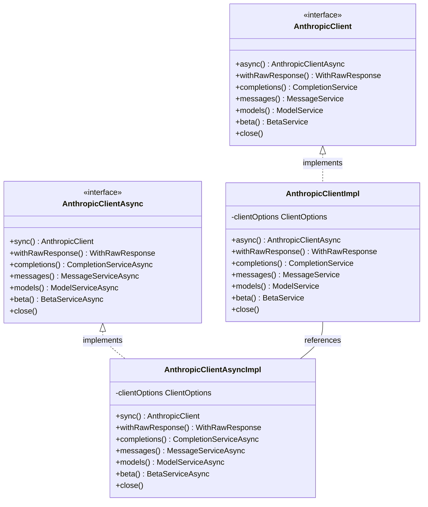

The client interfaces provide access to various services that correspond to different parts of the Anthropic API:

- **CompletionService**: Operations for the legacy completion API (deprecated in favor of messages API)
- **MessageService**: Operations for creating messages and streaming responses
- **ModelService**: Operations for retrieving model information
- **BetaService**: Operations for beta features (including batches)

Sources: [anthropic-java-core/src/main/kotlin/com/anthropic/client/AnthropicClient.kt:1-72](). [anthropic-java-core/src/main/kotlin/com/anthropic/client/AnthropicClientAsync.kt:1-74](). [anthropic-java-core/src/main/kotlin/com/anthropic/client/AnthropicClientImpl.kt:1-85](). [anthropic-java-core/src/main/kotlin/com/anthropic/client/AnthropicClientAsyncImpl.kt:1-89]().

## Service Layer Structure

Each service provides methods that correspond to API operations. The SDK offers both synchronous and asynchronous versions of each service.

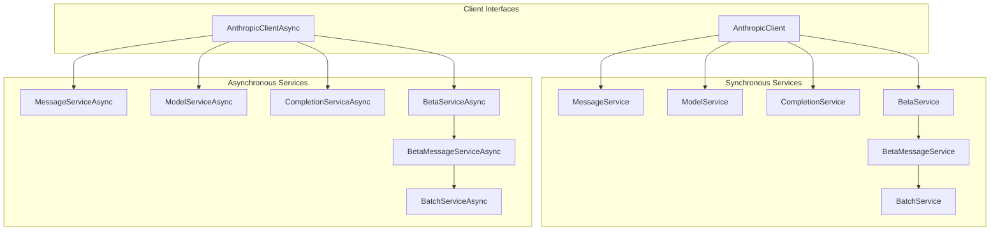

### Service Methods

Each service interface provides methods corresponding to API operations:

| Service | Key Methods | Description |
|---------|-------------|-------------|
| **MessageService** | `create`, `createStreaming` | Create messages, with optional streaming |
| **ModelService** | `list` | List available models |
| **BetaService.messages().batches()** | `create`, `retrieve`, `list`, `cancel` | Batch message operations |

Sources: [anthropic-java-core/src/main/kotlin/com/anthropic/client/AnthropicClient.kt:24-71](). [anthropic-java-core/src/main/kotlin/com/anthropic/client/AnthropicClientAsync.kt:24-73](). [anthropic-java-core/src/main/kotlin/com/anthropic/services/async/BetaServiceAsync.kt:1-27]().

## HTTP Layer

The SDK's HTTP layer handles communication with the Anthropic API, including authentication, retries, and streaming responses.

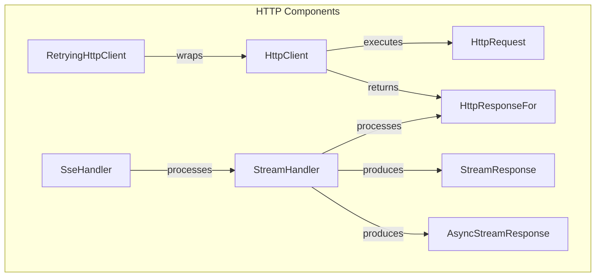

The HTTP layer provides several important features:

- **Request Authentication**: Adds API keys or tokens to requests
- **Retries**: Automatically retries failed requests with exponential backoff
- **Response Parsing**: Deserializes JSON responses into Java objects
- **Streaming**: Handles Server-Sent Events (SSE) for streaming responses
- **Raw Response Access**: Provides access to raw HTTP responses via `withRawResponse()`

Sources: [README.md:115-120](). [README.md:332-361](). [anthropic-java-core/src/main/kotlin/com/anthropic/core/http/HttpResponseFor.kt:1-26]().

## Helper Components

The SDK includes several helper components that make it easier to work with the API.

### MessageAccumulator

The `MessageAccumulator` helps accumulate streaming events into a complete message:

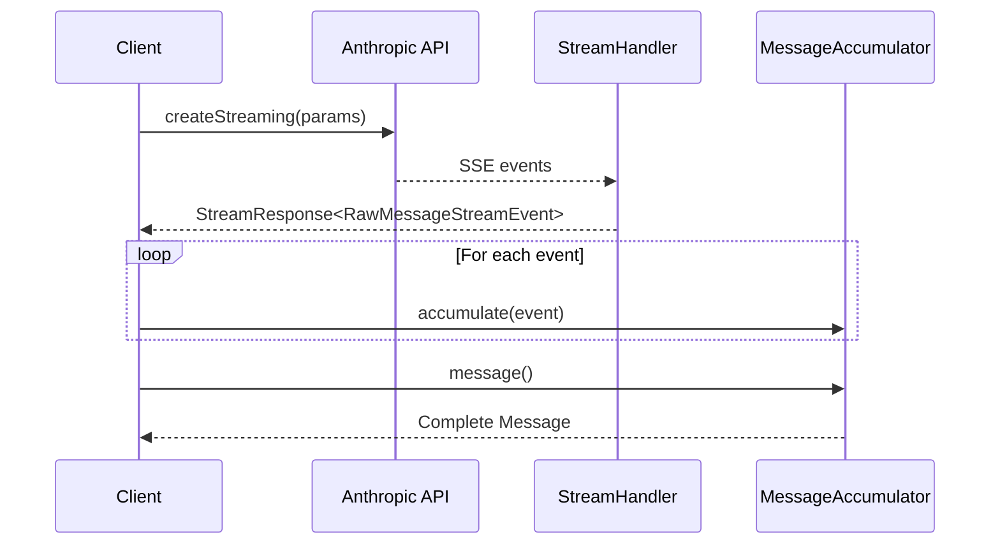

### Backend Integration

The SDK provides integrations with cloud providers via the `Backend` interface:

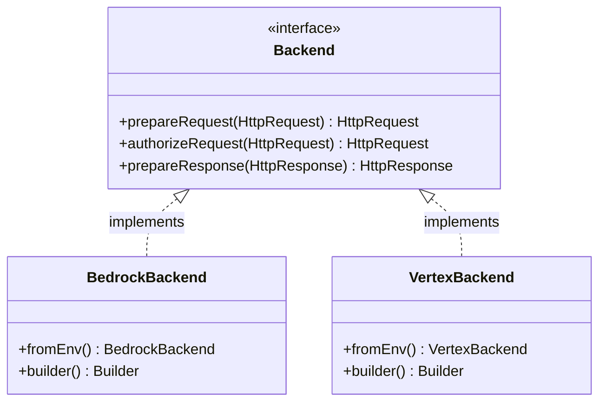

Sources: [README.md:277-329](). [README.md:459-563](). [README.md:564-647]().

## Request-Response Flow

The following sequence diagram illustrates how a request flows through the SDK:

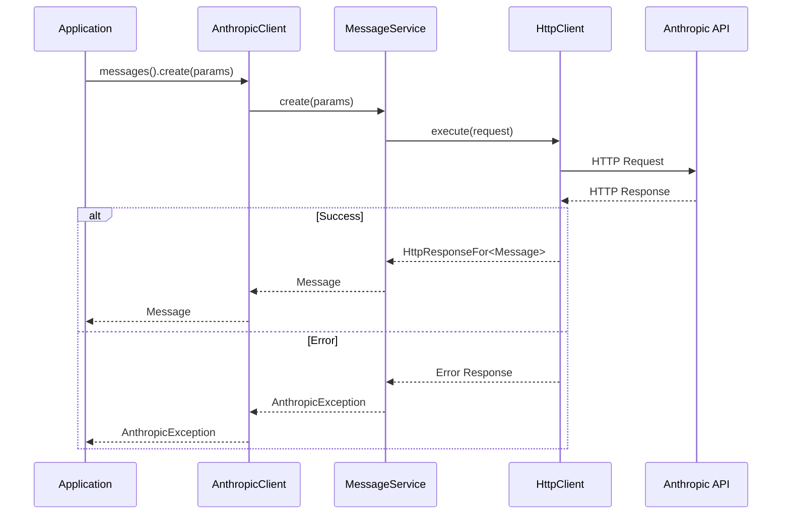

Sources: [README.md:115-129](). [README.md:381-404]().

## Data Models

The SDK defines numerous data models that represent request parameters and response objects:

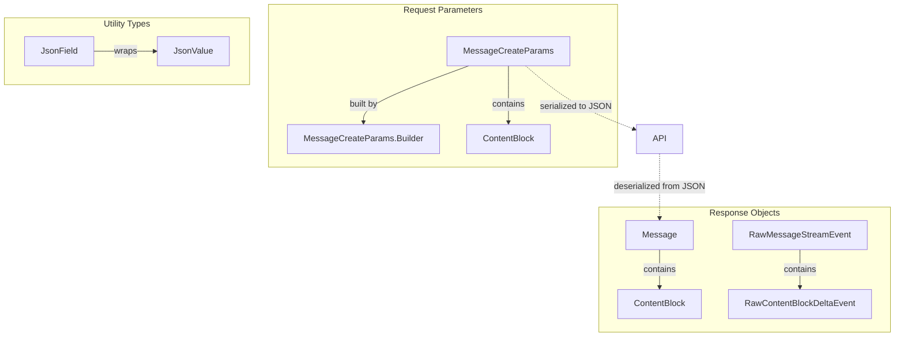

All data models in the SDK follow a builder pattern and are immutable once constructed.

Sources: [README.md:130-136](). [README.md:806-893]().

## Package Naming Convention

The SDK follows a consistent package naming convention:

| Package | Content Type |
|---------|--------------|
| `com.anthropic.client` | Client interfaces and implementations |
| `com.anthropic.services.blocking` | Synchronous service interfaces |
| `com.anthropic.services.async` | Asynchronous service interfaces |
| `com.anthropic.models` | Data models for API requests and responses |
| `com.anthropic.core` | Core utilities and abstractions |
| `com.anthropic.errors` | Exception classes |
| `com.anthropic.helpers` | Helper classes like MessageAccumulator |

Sources: [README.md:806-893](). [CHANGELOG.md:1-390]().

## Cloud Provider Integration

The SDK provides integrations with cloud providers that offer Anthropic models:

- **AWS Bedrock**: Integration with Amazon's Bedrock service
- **Google Vertex AI**: Integration with Google's Vertex AI platform

These integrations use the same client interfaces but with different underlying backends, allowing consistent API usage regardless of where the models are hosted.

Sources: [README.md:459-563](). [README.md:564-647]().

---

# Page: Core Client Architecture

# Core Client Architecture

<details>
<summary>Relevant source files</summary>

The following files were used as context for generating this wiki page:

- [anthropic-java-client-okhttp/src/main/kotlin/com/anthropic/client/okhttp/OkHttpClient.kt](anthropic-java-client-okhttp/src/main/kotlin/com/anthropic/client/okhttp/OkHttpClient.kt)
- [anthropic-java-core/src/main/kotlin/com/anthropic/client/AnthropicClient.kt](anthropic-java-core/src/main/kotlin/com/anthropic/client/AnthropicClient.kt)
- [anthropic-java-core/src/main/kotlin/com/anthropic/client/AnthropicClientAsync.kt](anthropic-java-core/src/main/kotlin/com/anthropic/client/AnthropicClientAsync.kt)
- [anthropic-java-core/src/main/kotlin/com/anthropic/client/AnthropicClientAsyncImpl.kt](anthropic-java-core/src/main/kotlin/com/anthropic/client/AnthropicClientAsyncImpl.kt)
- [anthropic-java-core/src/main/kotlin/com/anthropic/client/AnthropicClientImpl.kt](anthropic-java-core/src/main/kotlin/com/anthropic/client/AnthropicClientImpl.kt)
- [anthropic-java-core/src/main/kotlin/com/anthropic/core/Check.kt](anthropic-java-core/src/main/kotlin/com/anthropic/core/Check.kt)
- [anthropic-java-core/src/main/kotlin/com/anthropic/core/http/HttpClient.kt](anthropic-java-core/src/main/kotlin/com/anthropic/core/http/HttpClient.kt)
- [anthropic-java-core/src/main/kotlin/com/anthropic/core/http/HttpRequest.kt](anthropic-java-core/src/main/kotlin/com/anthropic/core/http/HttpRequest.kt)
- [anthropic-java-core/src/main/kotlin/com/anthropic/core/http/HttpRequestBody.kt](anthropic-java-core/src/main/kotlin/com/anthropic/core/http/HttpRequestBody.kt)
- [anthropic-java-core/src/main/kotlin/com/anthropic/core/http/HttpResponse.kt](anthropic-java-core/src/main/kotlin/com/anthropic/core/http/HttpResponse.kt)
- [anthropic-java-core/src/main/kotlin/com/anthropic/core/http/HttpResponseFor.kt](anthropic-java-core/src/main/kotlin/com/anthropic/core/http/HttpResponseFor.kt)
- [anthropic-java-core/src/main/kotlin/com/anthropic/core/http/StreamResponse.kt](anthropic-java-core/src/main/kotlin/com/anthropic/core/http/StreamResponse.kt)
- [anthropic-java-core/src/main/kotlin/com/anthropic/services/async/BetaServiceAsync.kt](anthropic-java-core/src/main/kotlin/com/anthropic/services/async/BetaServiceAsync.kt)

</details>


This page describes the core client architecture of the Anthropic Java SDK, focusing on the client interfaces, implementations, and the request-response flow. For information about HTTP communication details, see [HTTP Communication Layer](#2.2), and for usage patterns of synchronous versus asynchronous APIs, see [Synchronous vs Asynchronous API](#2.1).

## Overview

The Anthropic Java SDK provides a client-based architecture for interacting with Anthropic's AI services. The SDK is designed around the following principles:

- Clear separation between synchronous and asynchronous APIs
- Resource efficiency through reusable connections and thread pools
- Flexible backend integration for cloud provider support
- Comprehensive error handling
- Consistent request-response patterns

## Client Interfaces

The SDK provides two primary client interfaces:

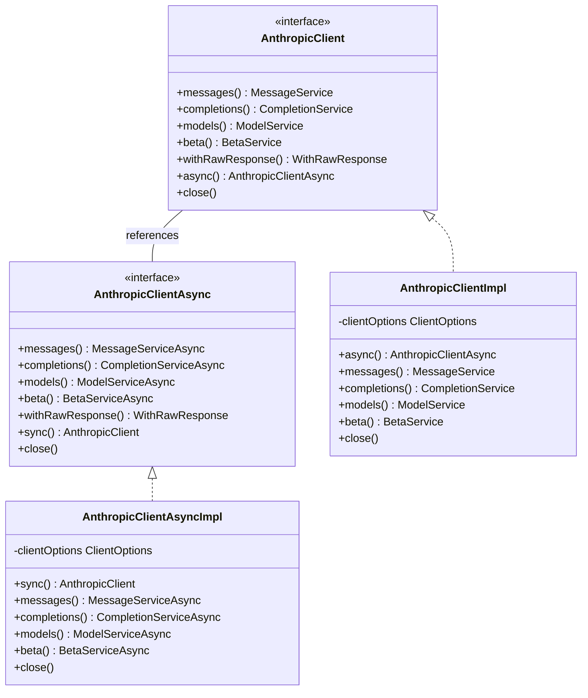

Sources:
- [anthropic-java-core/src/main/kotlin/com/anthropic/client/AnthropicClient.kt]()
- [anthropic-java-core/src/main/kotlin/com/anthropic/client/AnthropicClientAsync.kt]()
- [anthropic-java-core/src/main/kotlin/com/anthropic/client/AnthropicClientImpl.kt]()
- [anthropic-java-core/src/main/kotlin/com/anthropic/client/AnthropicClientAsyncImpl.kt]()

### AnthropicClient

The `AnthropicClient` interface provides synchronous access to Anthropic's API. It offers methods to access various services and can be converted to an asynchronous client when needed.

Key methods:
- `messages()`: Returns a `MessageService` for message-related operations
- `completions()`: Returns a `CompletionService` for completion-related operations
- `models()`: Returns a `ModelService` for model-related operations
- `beta()`: Returns a `BetaService` for beta features
- `async()`: Converts to an asynchronous client
- `withRawResponse()`: Returns a version that provides access to raw HTTP responses
- `close()`: Releases resources held by the client

### AnthropicClientAsync

The `AnthropicClientAsync` interface provides asynchronous access to Anthropic's API. It mirrors the synchronous interface but returns asynchronous service implementations.

Key methods:
- `messages()`: Returns a `MessageServiceAsync` for asynchronous message operations
- `completions()`: Returns a `CompletionServiceAsync` for asynchronous completion operations
- `models()`: Returns a `ModelServiceAsync` for asynchronous model operations
- `beta()`: Returns a `BetaServiceAsync` for asynchronous beta features
- `sync()`: Converts to a synchronous client
- `withRawResponse()`: Returns a version that provides access to raw HTTP responses
- `close()`: Releases resources held by the client

## Client Implementation

The primary client implementations are `AnthropicClientImpl` and `AnthropicClientAsyncImpl`. These implementations handle resource management, service creation, and communication with Anthropic's API.

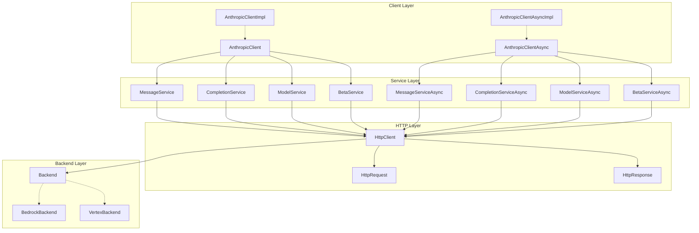

Sources:
- [anthropic-java-core/src/main/kotlin/com/anthropic/client/AnthropicClientImpl.kt]()
- [anthropic-java-core/src/main/kotlin/com/anthropic/client/AnthropicClientAsyncImpl.kt]()
- [anthropic-java-client-okhttp/src/main/kotlin/com/anthropic/client/okhttp/OkHttpClient.kt]()

Key aspects of the implementations:

1. **Lazy Initialization**: Services are created lazily when first accessed, improving startup time.
2. **Resource Sharing**: Synchronous and asynchronous clients share resources to reduce overhead.
3. **User-Agent Management**: Clients set appropriate User-Agent headers for API communication.
4. **Thread and Connection Management**: Clients manage thread pools and connections for efficient API communication.

Example from `AnthropicClientImpl`:
```kotlin
private val messages: MessageService by lazy { MessageServiceImpl(clientOptionsWithUserAgent) }
private val async: AnthropicClientAsync by lazy { AnthropicClientAsyncImpl(clientOptions) }
```

Example from `AnthropicClientAsyncImpl`:
```kotlin
private val messages: MessageServiceAsync by lazy { MessageServiceAsyncImpl(clientOptionsWithUserAgent) }
private val sync: AnthropicClient by lazy { AnthropicClientImpl(clientOptions) }
```

## Service Structure

The client provides access to multiple services, each handling a specific area of functionality:

| Service | Purpose | Key Operations |
|---------|---------|----------------|
| MessageService | Handles message-related operations | create, stream |
| CompletionService | Handles completion-related operations | create |
| ModelService | Provides information about available models | list, retrieve |
| BetaService | Provides access to beta features | messages, models |

Each service has both synchronous and asynchronous versions, with identical method signatures but different return types (direct values vs. `CompletableFuture`).

## Request-Response Flow

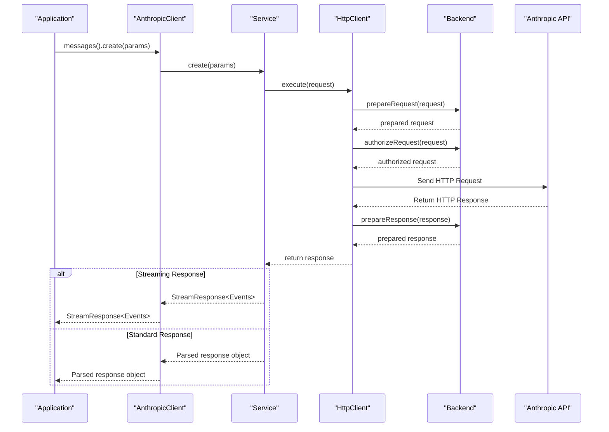

Sources:
- [anthropic-java-client-okhttp/src/main/kotlin/com/anthropic/client/okhttp/OkHttpClient.kt:35-46]()
- [anthropic-java-client-okhttp/src/main/kotlin/com/anthropic/client/okhttp/OkHttpClient.kt:48-71]()
- [anthropic-java-core/src/main/kotlin/com/anthropic/core/http/HttpClient.kt]()

The request-response flow follows these steps:

1. **Request Preparation**: Requests are prepared by the service and passed to the HTTP client.
2. **Backend Processing**: The Backend prepares and authorizes the request.
3. **HTTP Communication**: The HTTP client sends the request to Anthropic's API.
4. **Response Handling**: Responses are processed by the Backend and returned to the service.
5. **Result Parsing**: Services parse responses into appropriate model objects.

### Request Customization

Requests can be customized using `RequestOptions`, which allow for:
- Timeout configuration
- Custom headers
- Response handling configuration

Example from `OkHttpClient`:
```kotlin
private fun newCall(request: HttpRequest, requestOptions: RequestOptions): Call {
    val clientBuilder = okHttpClient.newBuilder()
    
    // Apply timeout settings if provided
    requestOptions.timeout?.let {
        clientBuilder
            .connectTimeout(it.connect())
            .readTimeout(it.read())
            .writeTimeout(it.write())
            .callTimeout(it.request())
    }
    
    // Create and return the call
    val client = clientBuilder.build()
    return client.newCall(request.toRequest(client))
}
```

## Resource Management

The client architecture includes proper resource management to ensure efficient use of system resources.

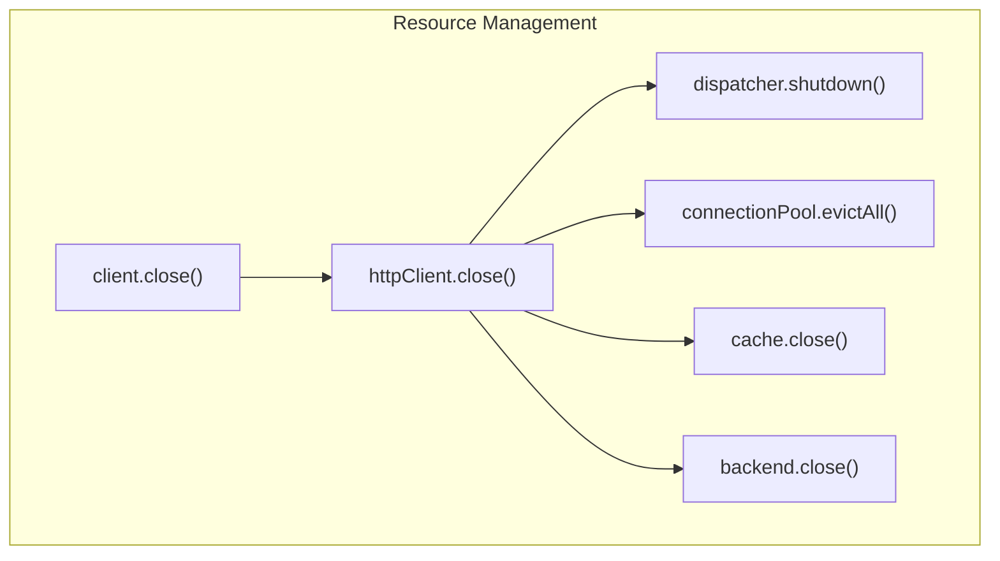

Sources:
- [anthropic-java-core/src/main/kotlin/com/anthropic/client/AnthropicClientImpl.kt:55]()
- [anthropic-java-core/src/main/kotlin/com/anthropic/client/AnthropicClientAsyncImpl.kt:59]()
- [anthropic-java-client-okhttp/src/main/kotlin/com/anthropic/client/okhttp/OkHttpClient.kt:73-78]()

When `close()` is called on a client:
1. The underlying HTTP client's resources are released.
2. Thread pools in the dispatcher are shut down.
3. The connection pool is evicted.
4. Any cache is closed.
5. The backend resources are released.

However, the client documentation notes that it's usually not necessary to explicitly close the client, as the default HTTP client automatically releases idle threads and connections.

## Backend Integration

The client architecture supports different backends for flexibility in how it connects to Anthropic's API, including direct access and cloud provider integrations.

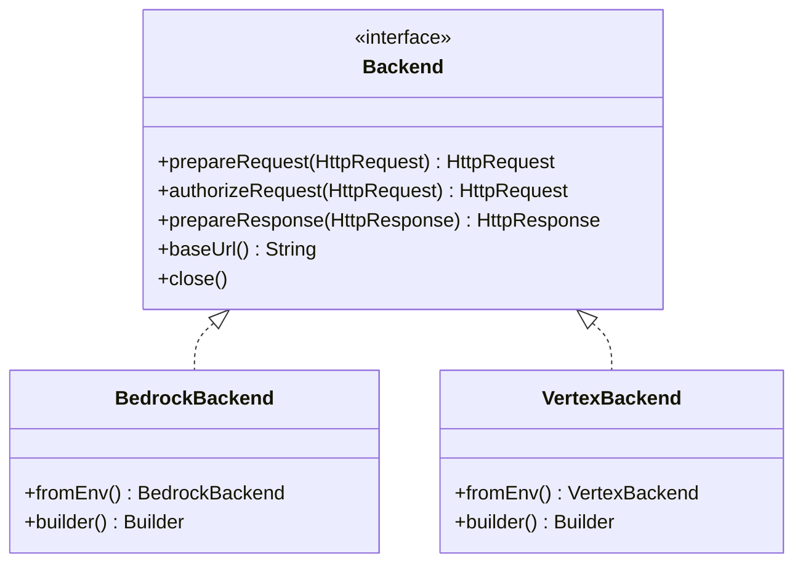

Sources:
- [anthropic-java-client-okhttp/src/main/kotlin/com/anthropic/client/okhttp/OkHttpClient.kt:80-86]()

The `Backend` interface defines methods for:
1. Preparing requests before they're sent
2. Authorizing requests with appropriate credentials
3. Processing responses before they're returned to the client
4. Providing the base URL for API requests
5. Releasing resources when closed

For more details on cloud provider integrations, see [Cloud Provider Integration](#6).

## Error Handling and Validation

The client architecture includes robust error handling and validation:

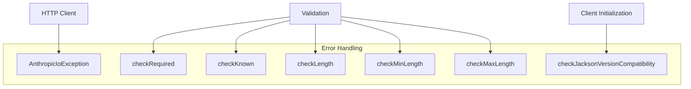

Sources:
- [anthropic-java-core/src/main/kotlin/com/anthropic/core/Check.kt]()
- [anthropic-java-client-okhttp/src/main/kotlin/com/anthropic/client/okhttp/OkHttpClient.kt:42]()
- [anthropic-java-client-okhttp/src/main/kotlin/com/anthropic/client/okhttp/OkHttpClient.kt:65]()

Key error handling aspects:
1. **IO Exceptions**: Network errors are wrapped in `AnthropicIoException` for consistent error handling.
2. **Required Parameters**: The `checkRequired` function ensures required parameters are provided.
3. **Type Checking**: The `checkKnown` functions validate that fields have expected types.
4. **String Validation**: Various check functions validate string lengths.
5. **Version Compatibility**: The `checkJacksonVersionCompatibility` function ensures compatible Jackson library versions.

For more detailed information about error handling, see [Error Handling](#2.3).

## Best Practices

When using the Anthropic Java SDK client:

1. **Reuse Clients**: Create a single client instance and reuse it for all API operations to benefit from connection pooling and rate limiting.
2. **Prefer Asynchronous API**: For non-blocking applications, use the asynchronous API to avoid blocking threads during API calls.
3. **Proper Resource Management**: In applications that need aggressive resource management, call `close()` when the client is no longer needed.
4. **Error Handling**: Implement proper error handling to gracefully handle API errors and network issues.
5. **Timeouts**: Configure appropriate timeouts for different types of operations to prevent hanging requests.

---

# Page: Synchronous vs Asynchronous API

# Synchronous vs Asynchronous API

<details>
<summary>Relevant source files</summary>

The following files were used as context for generating this wiki page:

- [.release-please-manifest.json](.release-please-manifest.json)
- [CHANGELOG.md](CHANGELOG.md)
- [README.md](README.md)
- [anthropic-java-core/src/main/kotlin/com/anthropic/client/AnthropicClient.kt](anthropic-java-core/src/main/kotlin/com/anthropic/client/AnthropicClient.kt)
- [anthropic-java-core/src/main/kotlin/com/anthropic/client/AnthropicClientAsync.kt](anthropic-java-core/src/main/kotlin/com/anthropic/client/AnthropicClientAsync.kt)
- [anthropic-java-core/src/main/kotlin/com/anthropic/client/AnthropicClientAsyncImpl.kt](anthropic-java-core/src/main/kotlin/com/anthropic/client/AnthropicClientAsyncImpl.kt)
- [anthropic-java-core/src/main/kotlin/com/anthropic/client/AnthropicClientImpl.kt](anthropic-java-core/src/main/kotlin/com/anthropic/client/AnthropicClientImpl.kt)
- [anthropic-java-core/src/main/kotlin/com/anthropic/core/http/HttpResponseFor.kt](anthropic-java-core/src/main/kotlin/com/anthropic/core/http/HttpResponseFor.kt)
- [anthropic-java-core/src/main/kotlin/com/anthropic/services/async/BetaServiceAsync.kt](anthropic-java-core/src/main/kotlin/com/anthropic/services/async/BetaServiceAsync.kt)
- [anthropic-java-example/src/main/java/com/anthropic/example/BatchAsyncExample.java](anthropic-java-example/src/main/java/com/anthropic/example/BatchAsyncExample.java)
- [anthropic-java-example/src/main/java/com/anthropic/example/BatchExample.java](anthropic-java-example/src/main/java/com/anthropic/example/BatchExample.java)
- [anthropic-java-example/src/main/java/com/anthropic/example/MessagesAsyncExample.java](anthropic-java-example/src/main/java/com/anthropic/example/MessagesAsyncExample.java)
- [anthropic-java-example/src/main/java/com/anthropic/example/MessagesConversationAsyncExample.java](anthropic-java-example/src/main/java/com/anthropic/example/MessagesConversationAsyncExample.java)
- [anthropic-java-example/src/main/java/com/anthropic/example/MessagesConversationExample.java](anthropic-java-example/src/main/java/com/anthropic/example/MessagesConversationExample.java)
- [anthropic-java-example/src/main/java/com/anthropic/example/MessagesExample.java](anthropic-java-example/src/main/java/com/anthropic/example/MessagesExample.java)
- [anthropic-java-example/src/main/java/com/anthropic/example/MessagesStreamingAsyncExample.java](anthropic-java-example/src/main/java/com/anthropic/example/MessagesStreamingAsyncExample.java)
- [anthropic-java-example/src/main/java/com/anthropic/example/MessagesStreamingExample.java](anthropic-java-example/src/main/java/com/anthropic/example/MessagesStreamingExample.java)
- [anthropic-java/build.gradle.kts](anthropic-java/build.gradle.kts)
- [build.gradle.kts](build.gradle.kts)

</details>


This page explains the two programming models offered by the Anthropic Java SDK: synchronous and asynchronous API access. It details how these interfaces are structured, how to create and switch between client types, and provides guidance on when to use each approach in your applications.

## Overview

The Anthropic Java SDK supports both synchronous (blocking) and asynchronous (non-blocking) programming patterns. This allows developers to choose the approach that best fits their application requirements:

- **Synchronous API**: Blocks the calling thread until the operation completes
- **Asynchronous API**: Allows operations to be performed without blocking, using callbacks or futures

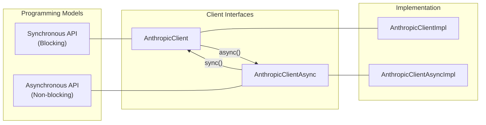

Sources: [anthropic-java-core/src/main/kotlin/com/anthropic/client/AnthropicClient.kt](), [anthropic-java-core/src/main/kotlin/com/anthropic/client/AnthropicClientAsync.kt](), [anthropic-java-core/src/main/kotlin/com/anthropic/client/AnthropicClientImpl.kt](), [anthropic-java-core/src/main/kotlin/com/anthropic/client/AnthropicClientAsyncImpl.kt]()

## Client Interfaces

The SDK exposes two primary client interfaces:

### Synchronous Client

The `AnthropicClient` interface provides synchronous access to the Anthropic API. Methods on this interface directly return response objects and block the calling thread until a response is received.

```java
AnthropicClient client = AnthropicOkHttpClient.fromEnv();
Message message = client.messages().create(params); // Blocks until complete
```

### Asynchronous Client

The `AnthropicClientAsync` interface provides asynchronous access to the API. Methods on this interface return `CompletableFuture` objects, which allow non-blocking operation.

```java
AnthropicClientAsync client = AnthropicOkHttpClientAsync.fromEnv();
CompletableFuture<Message> future = client.messages().create(params); // Returns immediately
```

Sources: [anthropic-java-core/src/main/kotlin/com/anthropic/client/AnthropicClient.kt](), [anthropic-java-core/src/main/kotlin/com/anthropic/client/AnthropicClientAsync.kt](), [README.md:139-179]()

## Creating Clients

### Creating a Synchronous Client

```java
// Using environment variables
AnthropicClient client = AnthropicOkHttpClient.fromEnv();

// Or manually configuring
AnthropicClient client = AnthropicOkHttpClient.builder()
    .apiKey("your-api-key")
    .build();
```

### Creating an Asynchronous Client

```java
// Using environment variables
AnthropicClientAsync client = AnthropicOkHttpClientAsync.fromEnv();

// Or manually configuring
AnthropicClientAsync client = AnthropicOkHttpClientAsync.builder()
    .apiKey("your-api-key")
    .build();
```

Sources: [README.md:67-100](), [anthropic-java-example/src/main/java/com/anthropic/example/MessagesExample.java](), [anthropic-java-example/src/main/java/com/anthropic/example/MessagesAsyncExample.java]()

## Switching Between Client Types

The SDK provides convenient methods to switch between synchronous and asynchronous execution:

### From Synchronous to Asynchronous

```java
AnthropicClient syncClient = AnthropicOkHttpClient.fromEnv();
AnthropicClientAsync asyncClient = syncClient.async();
```

### From Asynchronous to Synchronous

```java
AnthropicClientAsync asyncClient = AnthropicOkHttpClientAsync.fromEnv();
AnthropicClient syncClient = asyncClient.sync();
```

When switching between client types, the new client shares resources like connection pools and thread pools with the original client.

Sources: [anthropic-java-core/src/main/kotlin/com/anthropic/client/AnthropicClient.kt:24-32](), [anthropic-java-core/src/main/kotlin/com/anthropic/client/AnthropicClientAsync.kt:24-32](), [README.md:138-179]()

## Method Return Types Comparison

The primary difference between the two client types is in their method return types:

| Operation | Synchronous Client | Asynchronous Client |
|-----------|-------------------|---------------------|
| Create Message | `Message` | `CompletableFuture<Message>` |
| Stream Message | `StreamResponse<RawMessageStreamEvent>` | `AsyncStreamResponse<RawMessageStreamEvent>` |
| List Models | `ModelList` | `CompletableFuture<ModelList>` |
| Create Batch | `MessageBatch` | `CompletableFuture<MessageBatch>` |

Sources: [README.md:139-179](), [anthropic-java-example/src/main/java/com/anthropic/example/MessagesExample.java](), [anthropic-java-example/src/main/java/com/anthropic/example/MessagesAsyncExample.java]()

## Service Interface Architecture

```mermaid
classDiagram
    class AnthropicClient {
        <<interface>>
        +messages() MessageService
        +beta() BetaService
        +models() ModelService
        +withRawResponse() WithRawResponse
        +async() AnthropicClientAsync
        +close()
    }
    
    class AnthropicClientAsync {
        <<interface>>
        +messages() MessageServiceAsync
        +beta() BetaServiceAsync
        +models() ModelServiceAsync
        +withRawResponse() WithRawResponse
        +sync() AnthropicClient
        +close()
    }
    
    class MessageService {
        <<interface>>
        +create(params) Message
        +createStreaming(params) StreamResponse
        +count(params) MessageCountResponse
        +batches() BatchService
    }
    
    class MessageServiceAsync {
        <<interface>>
        +create(params) CompletableFuture~Message~
        +createStreaming(params) AsyncStreamResponse
        +count(params) CompletableFuture~MessageCountResponse~
        +batches() BatchServiceAsync
    }
    
    AnthropicClient -- MessageService : provides
    AnthropicClientAsync -- MessageServiceAsync : provides
```

Sources: [anthropic-java-core/src/main/kotlin/com/anthropic/client/AnthropicClient.kt](), [anthropic-java-core/src/main/kotlin/com/anthropic/client/AnthropicClientAsync.kt]()

## Basic Usage Examples

### Synchronous API Example

```java
// Create a synchronous client
AnthropicClient client = AnthropicOkHttpClient.fromEnv();

// Build the message parameters
MessageCreateParams params = MessageCreateParams.builder()
    .model(Model.CLAUDE_3_5_SONNET_LATEST)
    .maxTokens(2048)
    .addUserMessage("Tell me a story about building the best SDK!")
    .build();

// Make a blocking API call
Message message = client.messages().create(params);

// Process the response
message.content().stream()
    .flatMap(contentBlock -> contentBlock.text().stream())
    .forEach(textBlock -> System.out.println(textBlock.text()));
```

### Asynchronous API Example

```java
// Create an asynchronous client
AnthropicClientAsync client = AnthropicOkHttpClientAsync.fromEnv();

// Build the message parameters
MessageCreateParams params = MessageCreateParams.builder()
    .model(Model.CLAUDE_3_5_SONNET_LATEST)
    .maxTokens(2048)
    .addUserMessage("Tell me a story about building the best SDK!")
    .build();

// Make a non-blocking API call
client.messages()
    .create(params)
    .thenAccept(message -> message.content().stream()
        .flatMap(contentBlock -> contentBlock.text().stream())
        .forEach(textBlock -> System.out.println(textBlock.text())))
    .join(); // Optional: block until complete
```

Sources: [anthropic-java-example/src/main/java/com/anthropic/example/MessagesExample.java](), [anthropic-java-example/src/main/java/com/anthropic/example/MessagesAsyncExample.java]()

## Streaming Comparison

Streaming is handled differently in the synchronous and asynchronous APIs:

### Synchronous Streaming

The synchronous API uses `StreamResponse<T>` which implements `AutoCloseable` and exposes a Java `Stream<T>` for processing:

```java
// Using try-with-resources to ensure the stream is closed
try (StreamResponse<RawMessageStreamEvent> streamResponse = 
        client.messages().createStreaming(params)) {
    streamResponse.stream()
        .flatMap(event -> event.contentBlockDelta().stream())
        .flatMap(deltaEvent -> deltaEvent.delta().text().stream())
        .forEach(textDelta -> System.out.print(textDelta.text()));
}
```

### Asynchronous Streaming

The asynchronous API uses `AsyncStreamResponse<T>` which provides subscription methods:

```java
client.messages()
    .createStreaming(params)
    .subscribe(event -> event.contentBlockDelta().stream()
        .flatMap(deltaEvent -> deltaEvent.delta().text().stream())
        .forEach(textDelta -> System.out.print(textDelta.text())))
    .onCompleteFuture()
    .join();
```

The asynchronous streaming interface also offers more comprehensive error handling:

```java
client.messages().createStreaming(params).subscribe(
    new AsyncStreamResponse.Handler<>() {
        @Override
        public void onNext(RawMessageStreamEvent chunk) {
            System.out.println(chunk);
        }

        @Override
        public void onComplete(Optional<Throwable> error) {
            if (error.isPresent()) {
                System.out.println("Error occurred:");
                error.get().printStackTrace();
            } else {
                System.out.println("Stream completed successfully");
            }
        }
    });
```

Sources: [README.md:185-246](), [anthropic-java-example/src/main/java/com/anthropic/example/MessagesStreamingExample.java](), [anthropic-java-example/src/main/java/com/anthropic/example/MessagesStreamingAsyncExample.java]()

## Conversation Flow Comparison

For multi-turn conversations, the approaches differ slightly:

### Synchronous Conversation Flow

```java
MessageCreateParams.Builder paramsBuilder = MessageCreateParams.builder()
    .model(Model.CLAUDE_3_5_SONNET_LATEST)
    .maxTokens(2048)
    .addUserMessage("Initial question");

for (int i = 0; i < 3; i++) {
    // Blocking call
    Message message = client.messages().create(paramsBuilder.build());
    
    // Process response
    // ...
    
    // Prepare for next turn
    paramsBuilder.addMessage(message).addUserMessage("Follow-up question");
}
```

### Asynchronous Conversation Flow

```java
MessageCreateParams.Builder paramsBuilder = MessageCreateParams.builder()
    .model(Model.CLAUDE_3_5_SONNET_LATEST)
    .maxTokens(2048)
    .addUserMessage("Initial question");

CompletableFuture<Void> future = CompletableFuture.completedFuture(null);

for (int i = 0; i < 3; i++) {
    final int index = i;
    future = future
        .thenComposeAsync(unused -> 
            client.messages().create(paramsBuilder.build()))
        .thenAccept(message -> {
            // Process response
            // ...
            
            // Prepare for next turn
            paramsBuilder.addMessage(message)
                .addUserMessage("Follow-up question " + index);
        });
}

// Wait for all turns to complete
future.join();
```

Sources: [anthropic-java-example/src/main/java/com/anthropic/example/MessagesConversationExample.java](), [anthropic-java-example/src/main/java/com/anthropic/example/MessagesConversationAsyncExample.java]()

## Error Handling

Both API styles handle errors but in different ways:

### Synchronous Error Handling

In the synchronous API, errors are thrown as exceptions:

```java
try {
    Message message = client.messages().create(params);
    // Process message
} catch (BadRequestException e) {
    // Handle 400 error
} catch (RateLimitException e) {
    // Handle rate limit
} catch (AnthropicException e) {
    // Handle other API errors
}
```

### Asynchronous Error Handling

In the asynchronous API, errors are delivered through the CompletableFuture exception handling:

```java
client.messages().create(params)
    .thenAccept(message -> {
        // Process message
    })
    .exceptionally(throwable -> {
        if (throwable.getCause() instanceof BadRequestException) {
            // Handle 400 error
        } else if (throwable.getCause() instanceof RateLimitException) {
            // Handle rate limit
        } else {
            // Handle other API errors
        }
        return null;
    });
```

Sources: [README.md:380-404]()

## When to Use Each API Style

### Use Synchronous API When:

1. You have simple, sequential workflows
2. Your application doesn't need to maintain responsiveness during API calls
3. You prefer simpler, more straightforward code structure
4. You're writing scripts or command-line tools

### Use Asynchronous API When:

1. You need to maintain UI responsiveness during API calls
2. You want to execute multiple operations concurrently
3. You're building a server application handling multiple requests
4. You need to perform other tasks while waiting for responses
5. You're implementing a reactive programming model

## Resource Management

Both client types hold their own connection pools and thread pools. Resources are shared when switching between synchronous and asynchronous modes using `async()` or `sync()`.

For efficient resource usage:
- Create a single client instance and reuse it
- Only call `close()` when you're completely done with the client

The clients automatically release idle resources, but you can explicitly close them if needed:

```java
// Synchronous close
client.close();

// Asynchronous close
asyncClient.close();
```

Sources: [anthropic-java-core/src/main/kotlin/com/anthropic/client/AnthropicClient.kt:47-58](), [anthropic-java-core/src/main/kotlin/com/anthropic/client/AnthropicClientAsync.kt:47-58](), [README.md:110-113]()

## Implementation Details

```mermaid
sequenceDiagram
    participant App as Application
    participant SC as AnthropicClient
    participant SAC as AnthropicClientAsync
    participant HTC as HttpClient
    participant API as Anthropic API

    Note over App,SC: Synchronous Flow
    App->>SC: messages().create(params)
    SC->>HTC: execute(request)
    HTC->>API: HTTP Request
    API-->>HTC: HTTP Response
    HTC-->>SC: parse response
    SC-->>App: Message object

    Note over App,SAC: Asynchronous Flow
    App->>SAC: messages().create(params)
    SAC->>HTC: executeAsync(request)
    HTC->>API: HTTP Request
    Note right of HTC: Calling thread returns with CompletableFuture
    HTC-->>App: CompletableFuture<Message>
    API-->>HTC: HTTP Response (later)
    HTC->>HTC: parse response
    HTC->>App: Complete the future with Message
```

Sources: [anthropic-java-core/src/main/kotlin/com/anthropic/client/AnthropicClientImpl.kt](), [anthropic-java-core/src/main/kotlin/com/anthropic/client/AnthropicClientAsyncImpl.kt](), [README.md:115-401]()

## Conclusion

The Anthropic Java SDK offers flexible API access through both synchronous and asynchronous programming models. By understanding the differences between these approaches, you can choose the most appropriate style for your application's needs.

For more details about other aspects of the SDK, see:
- [Streaming Response Handling](#4)
- [Error Handling](#2.3)
- [HTTP Communication Layer](#2.2)

---

# Page: HTTP Communication Layer

# HTTP Communication Layer

<details>
<summary>Relevant source files</summary>

The following files were used as context for generating this wiki page:

- [anthropic-java-client-okhttp/src/main/kotlin/com/anthropic/client/okhttp/OkHttpClient.kt](anthropic-java-client-okhttp/src/main/kotlin/com/anthropic/client/okhttp/OkHttpClient.kt)
- [anthropic-java-core/src/main/kotlin/com/anthropic/core/Check.kt](anthropic-java-core/src/main/kotlin/com/anthropic/core/Check.kt)
- [anthropic-java-core/src/main/kotlin/com/anthropic/core/http/HttpClient.kt](anthropic-java-core/src/main/kotlin/com/anthropic/core/http/HttpClient.kt)
- [anthropic-java-core/src/main/kotlin/com/anthropic/core/http/HttpRequest.kt](anthropic-java-core/src/main/kotlin/com/anthropic/core/http/HttpRequest.kt)
- [anthropic-java-core/src/main/kotlin/com/anthropic/core/http/HttpRequestBody.kt](anthropic-java-core/src/main/kotlin/com/anthropic/core/http/HttpRequestBody.kt)
- [anthropic-java-core/src/main/kotlin/com/anthropic/core/http/HttpResponse.kt](anthropic-java-core/src/main/kotlin/com/anthropic/core/http/HttpResponse.kt)
- [anthropic-java-core/src/main/kotlin/com/anthropic/core/http/RetryingHttpClient.kt](anthropic-java-core/src/main/kotlin/com/anthropic/core/http/RetryingHttpClient.kt)
- [anthropic-java-core/src/main/kotlin/com/anthropic/core/http/StreamResponse.kt](anthropic-java-core/src/main/kotlin/com/anthropic/core/http/StreamResponse.kt)
- [anthropic-java-core/src/test/kotlin/com/anthropic/core/PhantomReachableTest.kt](anthropic-java-core/src/test/kotlin/com/anthropic/core/PhantomReachableTest.kt)
- [anthropic-java-core/src/test/kotlin/com/anthropic/core/http/HeadersTest.kt](anthropic-java-core/src/test/kotlin/com/anthropic/core/http/HeadersTest.kt)
- [anthropic-java-core/src/test/kotlin/com/anthropic/core/http/QueryParamsTest.kt](anthropic-java-core/src/test/kotlin/com/anthropic/core/http/QueryParamsTest.kt)
- [anthropic-java-core/src/test/kotlin/com/anthropic/core/http/RetryingHttpClientTest.kt](anthropic-java-core/src/test/kotlin/com/anthropic/core/http/RetryingHttpClientTest.kt)
- [anthropic-java-core/src/test/kotlin/com/anthropic/services/ErrorHandlingTest.kt](anthropic-java-core/src/test/kotlin/com/anthropic/services/ErrorHandlingTest.kt)
- [anthropic-java-core/src/test/kotlin/com/anthropic/services/ServiceParamsTest.kt](anthropic-java-core/src/test/kotlin/com/anthropic/services/ServiceParamsTest.kt)
- [buildSrc/src/main/kotlin/anthropic.kotlin.gradle.kts](buildSrc/src/main/kotlin/anthropic.kotlin.gradle.kts)
- [gradle.properties](gradle.properties)

</details>


The HTTP Communication Layer in the Anthropic Java SDK manages all network interactions between client applications and the Anthropic API. This layer abstracts away the complexities of HTTP communication, providing robust mechanisms for request execution, response handling, automatic retries, and streaming responses.

Sources: [anthropic-java-core/src/main/kotlin/com/anthropic/core/http/HttpClient.kt:1-27](), [anthropic-java-core/src/main/kotlin/com/anthropic/core/http/HttpResponse.kt:1-31]()

## Architecture Overview

```mermaid
flowchart TD
    subgraph "HTTP Communication Layer"
        HC["HttpClient Interface"]
        RHC["RetryingHttpClient"]
        OHC["OkHttpClient"] 
        HR["HttpRequest"]
        HP["HttpResponse"]
        SR["StreamResponse"]
    end
    
    subgraph "Client Layer"
        AC["AnthropicClient"]
        AOHC["AnthropicOkHttpClient"]
    end
    
    subgraph "Service Layer"
        S["Service"]
    end
    
    subgraph "Backend Integration"
        B["Backend"]
    end
    
    AC --> S
    S --> RHC
    AOHC --> RHC
    RHC --> HC
    OHC --> HC
    HC --> HR
    HC --> HP
    HC --> SR
    HC --> B
```

The HTTP Communication Layer sits between the Service Layer and Backend Integration, providing a uniform interface for making HTTP requests while adding features like automatic retries, error handling, and streaming response management.

Sources: [anthropic-java-core/src/main/kotlin/com/anthropic/core/http/HttpClient.kt:1-27](), [anthropic-java-core/src/main/kotlin/com/anthropic/core/http/RetryingHttpClient.kt:1-287]()

## Core Components

### HttpClient Interface

The `HttpClient` interface is the central component of the HTTP communication layer, defining methods for executing both synchronous and asynchronous HTTP requests.

```mermaid
classDiagram
    class HttpClient {
        <<interface>>
        +execute(HttpRequest, RequestOptions) HttpResponse
        +execute(HttpRequest) HttpResponse
        +executeAsync(HttpRequest, RequestOptions) CompletableFuture~HttpResponse~
        +executeAsync(HttpRequest) CompletableFuture~HttpResponse~
        +close()
    }
    
    class RetryingHttpClient {
        -httpClient HttpClient
        -sleeper Sleeper
        -clock Clock
        -maxRetries int
        -idempotencyHeader String?
        +execute(HttpRequest, RequestOptions) HttpResponse
        +executeAsync(HttpRequest, RequestOptions) CompletableFuture~HttpResponse~
    }
    
    class OkHttpClient {
        -okHttpClient okhttp3.OkHttpClient
        -backend Backend
        +execute(HttpRequest, RequestOptions) HttpResponse
        +executeAsync(HttpRequest, RequestOptions) CompletableFuture~HttpResponse~
    }
    
    HttpClient <|.. RetryingHttpClient
    HttpClient <|.. OkHttpClient
```

The `HttpClient` interface provides:
- Synchronous request execution via `execute()` methods
- Asynchronous request execution via `executeAsync()` methods, which return `CompletableFuture<HttpResponse>`
- Resource cleanup through the `close()` method

Key implementations include:
- `RetryingHttpClient`: Adds retry capability to any underlying HTTP client
- `OkHttpClient`: An implementation that uses the OkHttp library for actual HTTP communication

Sources: [anthropic-java-core/src/main/kotlin/com/anthropic/core/http/HttpClient.kt:1-27](), [anthropic-java-core/src/main/kotlin/com/anthropic/core/http/RetryingHttpClient.kt:23-31](), [anthropic-java-client-okhttp/src/main/kotlin/com/anthropic/client/okhttp/OkHttpClient.kt:31-34]()

### HttpRequest and HttpResponse

The `HttpRequest` class represents an outgoing HTTP request, while the `HttpResponse` interface represents the incoming response.

```mermaid
classDiagram
    class HttpRequest {
        -method HttpMethod
        -url String?
        -pathSegments List~String~
        -headers Headers
        -queryParams QueryParams
        -body HttpRequestBody?
        +toBuilder() Builder
    }
    
    class HttpResponse {
        <<interface>>
        +statusCode() int
        +headers() Headers
        +requestId() Optional~String~
        +body() InputStream
        +close()
    }
    
    class HttpRequestBody {
        <<interface>>
        +writeTo(OutputStream)
        +contentType() String?
        +contentLength() long
        +repeatable() boolean
        +close()
    }
    
    class Headers {
        +names() Set~String~
        +values(String) List~String~
        +size() int
        +toMap() Map~String,List~String~~
        +toBuilder() Builder
    }
    
    class QueryParams {
        +keys() Set~String~
        +values(String) List~String~
        +size() int
        +toMap() Map~String,List~String~~
        +toBuilder() Builder
    }
    
    HttpRequest -- HttpRequestBody
    HttpRequest -- Headers
    HttpRequest -- QueryParams
    HttpResponse -- Headers
```

Key features:
- `HttpRequest` provides a builder pattern for easy construction of requests
- `HttpResponse` exposes status code, headers, and body via a consistent interface
- `Headers` and `QueryParams` classes provide case-insensitive, multi-value collections
- `HttpRequestBody` defines an interface for request bodies that can be written to an output stream

Sources: [anthropic-java-core/src/main/kotlin/com/anthropic/core/http/HttpRequest.kt:1-151](), [anthropic-java-core/src/main/kotlin/com/anthropic/core/http/HttpResponse.kt:1-31](), [anthropic-java-core/src/main/kotlin/com/anthropic/core/http/HttpRequestBody.kt:1-26]()

## Retry Mechanism

The `RetryingHttpClient` adds automatic retry capability to any `HttpClient` implementation, using configurable policies.

```mermaid
sequenceDiagram
    participant App as Application
    participant RHC as RetryingHttpClient
    participant HC as Underlying HttpClient
    participant API as Anthropic API
    
    App->>RHC: execute(request)
    
    alt Request not retryable or maxRetries <= 0
        RHC->>HC: execute(request)
        HC->>API: HTTP Request
        API-->>HC: HTTP Response
        HC-->>RHC: response
        RHC-->>App: response
    else Request is retryable
        RHC->>RHC: Add idempotency header (if configured)
        RHC->>RHC: Add retry count header
        RHC->>HC: execute(modifiedRequest)
        HC->>API: HTTP Request
        
        alt Success (no retry needed)
            API-->>HC: HTTP Response (Success)
            HC-->>RHC: response
            RHC-->>App: response
        else Failure (retry needed)
            API-->>HC: HTTP Response (Error)
            HC-->>RHC: response
            RHC->>RHC: Check if should retry
            RHC->>RHC: Calculate backoff duration
            RHC->>RHC: Close failed response
            RHC->>RHC: Sleep for backoff duration
            
            loop Until success or max retries reached
                RHC->>RHC: Update retry count header
                RHC->>HC: execute(modifiedRequest)
                HC->>API: HTTP Request
                API-->>HC: HTTP Response
                HC-->>RHC: response
                
                alt Success or max retries reached
                    RHC-->>App: final response
                else Failure (retry again)
                    RHC->>RHC: Close failed response
                    RHC->>RHC: Sleep for backoff duration
                end
            end
        end
    end
```

### Key Features of the Retry Mechanism

1. **Configurable Retry Policies**
   - Maximum number of retries (default: 2)
   - Customizable idempotency header
   - Built-in retry determination based on status codes and exceptions

2. **Smart Backoff Strategy**
   - Exponential backoff with jitter
   - Respects `Retry-After` and `Retry-After-Ms` headers
   - Default maximum backoff of 8 seconds

3. **Retry Decision Logic**
   - Retries on 408 (Request Timeout), 409 (Conflict), 429 (Rate Limit), and 5xx (Server Errors)
   - Retries on network errors (`IOException`) and `AnthropicIoException`
   - Supports explicit control via `X-Should-Retry` header

4. **Resource Management**
   - Ensures proper cleanup of intermediate responses before retrying

Sources: [anthropic-java-core/src/main/kotlin/com/anthropic/core/http/RetryingHttpClient.kt:23-286](), [anthropic-java-core/src/test/kotlin/com/anthropic/core/http/RetryingHttpClientTest.kt:21-263]()

## Streaming Response Handling

The `StreamResponse` interface provides a way to handle streaming responses from the API, particularly important for handling large language model outputs.

```mermaid
classDiagram
    class StreamResponse~T~ {
        <<interface>>
        +stream() Stream~T~
        +close()
    }
    
    class AsyncStreamResponse~T~ {
        <<internal class>>
        -executor ExecutorService
        -responseSupplier Supplier~HttpResponse~
        -streamHandler StreamHandler~T~
        +stream() Stream~T~
        +close()
    }
    
    class StreamHandler~T~ {
        <<internal interface>>
        +handle(HttpResponse) Stream~T~
    }
    
    class SseHandler~T~ {
        <<internal class>>
        -eventParser Function~String,T~
        +handle(HttpResponse) Stream~T~
    }
    
    StreamResponse <|.. AsyncStreamResponse
    AsyncStreamResponse --> StreamHandler
    StreamHandler <|.. SseHandler
```

Key features:
- `StreamResponse<T>` provides access to a Stream of parsed events
- Streaming responses are automatically closed when the stream is exhausted or the client is closed
- Support for SSE (Server-Sent Events) through `SseHandler`
- Transformation capabilities through the `map` extension function

Sources: [anthropic-java-core/src/main/kotlin/com/anthropic/core/http/StreamResponse.kt:1-20]()

## Request-Response Flow

```mermaid
sequenceDiagram
    participant Client as AnthropicClient
    participant Service as Service Layer
    participant HTTP as HttpClient
    participant Backend as Backend
    participant API as Anthropic API
    
    Client->>Service: API Method Call
    Service->>HTTP: execute(request)
    
    alt Using RetryingHttpClient
        HTTP->>HTTP: Add retry/idempotency headers
    end
    
    HTTP->>Backend: prepareRequest(request)
    Backend-->>HTTP: Prepared request
    HTTP->>Backend: authorizeRequest(request)
    Backend-->>HTTP: Authorized request
    
    HTTP->>API: HTTP Request
    API-->>HTTP: HTTP Response
    
    HTTP->>Backend: prepareResponse(response)
    Backend-->>HTTP: Prepared response
    
    alt Is streaming response
        HTTP-->>Service: StreamResponse<T>
        Service-->>Client: StreamResponse<T>
    else Standard response
        HTTP-->>Service: HttpResponse
        Service->>Service: Parse response body
        Service-->>Client: Parsed model object
    end
```

This diagram illustrates the complete request-response flow through the HTTP Communication Layer, showing how requests are processed, authorized, and executed, and how responses are handled.

Sources: [anthropic-java-client-okhttp/src/main/kotlin/com/anthropic/client/okhttp/OkHttpClient.kt:34-85](), [anthropic-java-core/src/main/kotlin/com/anthropic/core/http/RetryingHttpClient.kt:32-130]()

## Error Handling

The HTTP Communication Layer provides comprehensive error handling for HTTP errors and network issues. For more details about specific error types and handling, see [Error Handling](#2.3).

Key aspects of error handling in the HTTP layer:

1. **Exception Propagation**
   - Network errors are wrapped in `AnthropicIoException`
   - HTTP errors are converted to specific exception types based on status code

2. **Retry Integration**
   - `RetryingHttpClient` automatically retries on transient errors
   - Respects rate limiting through the `Retry-After` header

3. **Resource Cleanup**
   - Error responses are properly closed to avoid resource leaks
   - Uses try-finally blocks and CompletableFuture callbacks to ensure cleanup

Sources: [anthropic-java-core/src/test/kotlin/com/anthropic/services/ErrorHandlingTest.kt:1-768](), [anthropic-java-core/src/main/kotlin/com/anthropic/core/http/RetryingHttpClient.kt:156-181]()

## Implementation Details

### OkHttp Implementation

The SDK provides a concrete implementation of the `HttpClient` interface using the OkHttp library:

```mermaid
classDiagram
    class HttpClient {
        <<interface>>
        +execute(HttpRequest, RequestOptions) HttpResponse
        +executeAsync(HttpRequest, RequestOptions) CompletableFuture~HttpResponse~
        +close()
    }
    
    class OkHttpClient {
        -okHttpClient okhttp3.OkHttpClient
        -backend Backend
        +execute(HttpRequest, RequestOptions) HttpResponse
        +executeAsync(HttpRequest, RequestOptions) CompletableFuture~HttpResponse~
        +close()
        -prepareRequest(HttpRequest) HttpRequest
        -newCall(HttpRequest, RequestOptions) Call
        -toUrl() String
    }
    
    class AnthropicOkHttpClient {
        +fromEnv() AnthropicClient
        +builder() Builder
    }
    
    HttpClient <|.. OkHttpClient
    OkHttpClient <-- AnthropicOkHttpClient
```

Key features of the OkHttp implementation:
- Configurable via builder pattern
- Support for timeout configuration
- Logging through environment variable `ANTHROPIC_LOG`
- Proper resource management

Sources: [anthropic-java-client-okhttp/src/main/kotlin/com/anthropic/client/okhttp/OkHttpClient.kt:31-240]()

### Resource Management

The HTTP Communication Layer carefully manages resources to prevent leaks:

1. **AutoCloseable**
   - All key interfaces implement `AutoCloseable`
   - Overridden to remove checked exceptions from signature

2. **Response Closure**
   - Responses are automatically closed when streams are exhausted
   - Failed responses during retries are explicitly closed
   - CompletableFuture callbacks ensure closure in async scenarios

3. **Phantom Reference Tracking**
   - Uses phantom references to track unreachable objects
   - Ensures resources are cleaned up if clients forget to call `close()`

Sources: [anthropic-java-core/src/main/kotlin/com/anthropic/core/http/HttpResponse.kt:8-25](), [anthropic-java-core/src/main/kotlin/com/anthropic/core/http/StreamResponse.kt:5-11](), [anthropic-java-core/src/test/kotlin/com/anthropic/core/PhantomReachableTest.kt:1-28]()

## Integration with Other Layers

The HTTP Communication Layer integrates with:

1. **Backend Integration Layer**
   - Backends prepare and authorize requests
   - Backends process responses before returning them

2. **Service Layer**
   - Services construct requests and handle responses
   - Services use the HTTP layer for all API communication

3. **Client Layer**
   - Provides configuration of HTTP clients
   - Manages lifecycle of HTTP resources

Sources: [anthropic-java-client-okhttp/src/main/kotlin/com/anthropic/client/okhttp/OkHttpClient.kt:80-86]()

---

# Page: Error Handling

# Error Handling

<details>
<summary>Relevant source files</summary>

The following files were used as context for generating this wiki page:

- [.release-please-manifest.json](.release-please-manifest.json)
- [CHANGELOG.md](CHANGELOG.md)
- [README.md](README.md)
- [anthropic-java-core/src/main/kotlin/com/anthropic/core/http/RetryingHttpClient.kt](anthropic-java-core/src/main/kotlin/com/anthropic/core/http/RetryingHttpClient.kt)
- [anthropic-java-core/src/test/kotlin/com/anthropic/core/PhantomReachableTest.kt](anthropic-java-core/src/test/kotlin/com/anthropic/core/PhantomReachableTest.kt)
- [anthropic-java-core/src/test/kotlin/com/anthropic/core/http/HeadersTest.kt](anthropic-java-core/src/test/kotlin/com/anthropic/core/http/HeadersTest.kt)
- [anthropic-java-core/src/test/kotlin/com/anthropic/core/http/QueryParamsTest.kt](anthropic-java-core/src/test/kotlin/com/anthropic/core/http/QueryParamsTest.kt)
- [anthropic-java-core/src/test/kotlin/com/anthropic/core/http/RetryingHttpClientTest.kt](anthropic-java-core/src/test/kotlin/com/anthropic/core/http/RetryingHttpClientTest.kt)
- [anthropic-java-core/src/test/kotlin/com/anthropic/services/ErrorHandlingTest.kt](anthropic-java-core/src/test/kotlin/com/anthropic/services/ErrorHandlingTest.kt)
- [anthropic-java-core/src/test/kotlin/com/anthropic/services/ServiceParamsTest.kt](anthropic-java-core/src/test/kotlin/com/anthropic/services/ServiceParamsTest.kt)
- [anthropic-java/build.gradle.kts](anthropic-java/build.gradle.kts)
- [build.gradle.kts](build.gradle.kts)
- [buildSrc/src/main/kotlin/anthropic.kotlin.gradle.kts](buildSrc/src/main/kotlin/anthropic.kotlin.gradle.kts)
- [gradle.properties](gradle.properties)

</details>


This document describes the error handling mechanisms in the Anthropic Java SDK. It covers the exception hierarchy, how different types of errors are handled, retry mechanisms, and best practices for error handling in your applications using the SDK.

## 1. Exception Hierarchy

The Anthropic Java SDK uses a structured exception hierarchy to represent different types of errors that can occur during API interactions. All exceptions extend from a common base class.

```mermaid
classDiagram
    class AnthropicException {
        <<abstract>>
        +getMessage() String
    }
    
    class AnthropicServiceException {
        <<abstract>>
        +statusCode() int
        +headers() Headers
        +body() JsonValue
        +requestId() Optional~String~
    }
    
    class AnthropicIoException {
        +getCause() IOException
    }
    
    class AnthropicInvalidDataException {
    }
    
    class SseException {
        +getMessage() String
        +getCause() Throwable
    }
    
    class BadRequestException {
    }
    
    class UnauthorizedException {
    }
    
    class PermissionDeniedException {
    }
    
    class NotFoundException {
    }
    
    class UnprocessableEntityException {
    }
    
    class RateLimitException {
    }
    
    class InternalServerException {
    }
    
    class UnexpectedStatusCodeException {
    }
    
    AnthropicException <|-- AnthropicServiceException
    AnthropicException <|-- AnthropicIoException
    AnthropicException <|-- AnthropicInvalidDataException
    AnthropicException <|-- SseException
    
    AnthropicServiceException <|-- BadRequestException
    AnthropicServiceException <|-- UnauthorizedException
    AnthropicServiceException <|-- PermissionDeniedException
    AnthropicServiceException <|-- NotFoundException
    AnthropicServiceException <|-- UnprocessableEntityException
    AnthropicServiceException <|-- RateLimitException
    AnthropicServiceException <|-- InternalServerException
    AnthropicServiceException <|-- UnexpectedStatusCodeException
```

Sources: [README.md:380-404]()

### Exception Types

| Status Code | Exception Class | Description |
|-------------|-----------------|-------------|
| 400 | `BadRequestException` | Malformed request or invalid parameters |
| 401 | `UnauthorizedException` | Invalid or missing API key |
| 403 | `PermissionDeniedException` | Valid API key but lacks permissions |
| 404 | `NotFoundException` | Requested resource not found |
| 422 | `UnprocessableEntityException` | Request validation failed |
| 429 | `RateLimitException` | Rate limit exceeded |
| 5xx | `InternalServerException` | Server-side errors |
| Other | `UnexpectedStatusCodeException` | Any other status code |

Additional Exception Types:
- `SseException`: Errors during Server-Sent Events (SSE) streaming after initial successful response
- `AnthropicIoException`: Network I/O errors
- `AnthropicInvalidDataException`: Data parsing or interpretation failures
- `AnthropicException`: Base class for all SDK exceptions

Sources: [README.md:380-404](), [anthropic-java-core/src/test/kotlin/com/anthropic/services/ErrorHandlingTest.kt:1-550]()

## 2. HTTP Error Handling

When the SDK makes HTTP requests to the Anthropic API, responses with error status codes are automatically converted to the appropriate exception type.

```mermaid
sequenceDiagram
    participant Client as "Client Code"
    participant SDK as "AnthropicClient"
    participant HTTP as "HttpClient"
    participant API as "Anthropic API"
    
    Client->>SDK: Create message request
    SDK->>HTTP: Execute HTTP request
    HTTP->>API: Send request to API
    API->>HTTP: Return error response (e.g., 400)
    
    alt Status code 400
        HTTP->>SDK: Throw BadRequestException
    else Status code 401
        HTTP->>SDK: Throw UnauthorizedException
    else Status code 403
        HTTP->>SDK: Throw PermissionDeniedException
    else Status code 404
        HTTP->>SDK: Throw NotFoundException
    else Status code 422
        HTTP->>SDK: Throw UnprocessableEntityException
    else Status code 429
        HTTP->>SDK: Throw RateLimitException
    else Status code 5xx
        HTTP->>SDK: Throw InternalServerException
    else Other status code
        HTTP->>SDK: Throw UnexpectedStatusCodeException
    end
    
    SDK->>Client: Propagate exception
```

Sources: [README.md:380-404](), [anthropic-java-core/src/test/kotlin/com/anthropic/services/ErrorHandlingTest.kt:1-550]()

### Accessing Error Details

All `AnthropicServiceException` instances provide access to important details about the error:

```java
try {
    // Make API call
    client.messages().create(params);
} catch (AnthropicServiceException e) {
    int statusCode = e.statusCode();          // HTTP status code
    Headers headers = e.headers();            // Response headers
    JsonValue errorBody = e.body();           // Error response body as JsonValue
    Optional<String> requestId = e.requestId(); // Request ID for troubleshooting
    
    // Handle error based on status code or other properties
}
```

The `requestId()` method provides convenient access to the `request-id` header, which is useful for reporting issues to Anthropic support.

Sources: [README.md:364-378]()

## 3. Retry Mechanism

The SDK includes an automatic retry mechanism for certain transient errors. This is implemented in the `RetryingHttpClient` class.

```mermaid
flowchart TD
    Start["Request Initiated"] --> IsRetryable{"Is Request\nRetryable?"}
    
    IsRetryable -- "Yes" --> AddHeaders["Add retry/idempotency headers"]
    IsRetryable -- "No" --> DirectExecution["Execute without retry"]
    
    AddHeaders --> Execute["Execute HTTP request"]
    Execute --> ResponseCheck{"Check Response\nStatus"}
    
    ResponseCheck -- "Success" --> ReturnResponse["Return Response"]
    ResponseCheck -- "Error" --> ShouldRetry{"Should Retry?"}
    
    Execute -- "IOException" --> ShouldRetryException{"Should Retry\nException?"}
    ShouldRetryException -- "Yes" --> RetryCheck
    ShouldRetryException -- "No" --> ThrowException["Throw Exception"]
    
    ShouldRetry -- "Yes" --> RetryCheck{"Retry Count\n< Max Retries?"}
    ShouldRetry -- "No" --> ReturnErrorResponse["Return Error Response"]
    
    RetryCheck -- "Yes" --> CalculateBackoff["Calculate Backoff Duration"]
    RetryCheck -- "No" --> ReturnErrorResponse
    
    CalculateBackoff --> Sleep["Sleep for backoff duration"]
    Sleep --> RetryCountIncrement["Increment retry counter"]
    RetryCountIncrement --> AddHeaders
    
    DirectExecution --> ReturnResponse
```

Sources: [anthropic-java-core/src/main/kotlin/com/anthropic/core/http/RetryingHttpClient.kt:1-287](), [anthropic-java-core/src/test/kotlin/com/anthropic/core/http/RetryingHttpClientTest.kt:1-264]()

### Retry Configuration

By default, the SDK retries requests up to 2 times with exponential backoff. You can customize this behavior:

```java
AnthropicClient client = AnthropicOkHttpClient.builder()
    .fromEnv()
    .maxRetries(4)  // Set custom number of retries
    .build();
```

Sources: [README.md:679-702]()

### Conditions for Retry

Only specific error types are retried automatically:

1. Connection errors (network issues)
2. HTTP status codes:
   - 408 Request Timeout
   - 409 Conflict
   - 429 Rate Limit
   - 5xx Internal Server errors
3. Explicit retry instructions via response headers

The SDK will honor the `Retry-After` or `Retry-After-Ms` headers if the server provides them, adjusting the backoff duration accordingly.

Sources: [anthropic-java-core/src/main/kotlin/com/anthropic/core/http/RetryingHttpClient.kt:134-181]()

### Idempotency

For requests that might be retried, the SDK can add an idempotency header to ensure that duplicate requests aren't processed multiple times. This is particularly important for operations that might have side effects.

Sources: [anthropic-java-core/src/main/kotlin/com/anthropic/core/http/RetryingHttpClient.kt:144-154]()

## 4. Streaming Error Handling

The SDK provides special handling for errors that occur during streaming responses. While a normal error before or during the initial response is handled by the regular exception hierarchy, errors that occur after a streaming response has begun are represented by `SseException`.

```mermaid
sequenceDiagram
    participant Client as "Client Code"
    participant SDK as "AnthropicClient"
    participant API as "Anthropic API"
    
    Client->>SDK: Call createStreaming()
    SDK->>API: Send streaming request
    API->>SDK: Start successful response stream
    SDK->>Client: Return StreamResponse object
    
    loop For each event
        API->>SDK: Send event chunk
        SDK->>Client: Process event
    end
    
    alt Stream error occurs
        API--xSDK: Connection error or malformed event
        SDK->>Client: Throw SseException
    end
```

Source: [README.md:397-398]()

### Error Handling in Streaming Code

In streaming code, you should handle both regular `AnthropicServiceException` exceptions (which can occur before streaming starts) and `SseException` (which can occur during streaming):

```java
try {
    StreamResponse<RawMessageStreamEvent> response = client.messages().createStreaming(params);
    response.stream().forEach(event -> {
        // Process events
    });
} catch (AnthropicServiceException e) {
    // Handle API errors
    System.err.println("API error: " + e.statusCode() + " - " + e.body());
} catch (SseException e) {
    // Handle streaming errors
    System.err.println("Streaming error: " + e.getMessage());
}
```

For asynchronous streaming, errors can be handled using the `onComplete` callback which receives an `Optional<Throwable>`:

```java
client.async().messages().createStreaming(params).subscribe(
    new AsyncStreamResponse.Handler<>() {
        @Override
        public void onNext(RawMessageStreamEvent chunk) {
            // Process chunk
        }

        @Override
        public void onComplete(Optional<Throwable> error) {
            if (error.isPresent()) {
                // Handle error
                Throwable e = error.get();
                // Check exception type and handle appropriately
            } else {
                // Stream completed successfully
            }
        }
    }
);
```

Sources: [README.md:210-246]()

## 5. Best Practices for Error Handling

### Catching Specific Exceptions

Rather than catching the general `AnthropicException`, catch specific exceptions to handle different error cases appropriately:

```java
try {
    client.messages().create(params);
} catch (RateLimitException e) {
    // Implement backoff or retry strategy
} catch (UnauthorizedException e) {
    // Handle authentication issues
} catch (BadRequestException e) {
    // Fix request parameters
} catch (InternalServerException e) {
    // Maybe retry later
} catch (AnthropicIoException e) {
    // Handle network issues
} catch (AnthropicException e) {
    // Catch-all for any other errors
}
```

### Using Request IDs for Troubleshooting

When reporting issues to Anthropic support, always include the request ID:

```java
try {
    client.messages().create(params);
} catch (AnthropicServiceException e) {
    Optional<String> requestId = e.requestId();
    logger.error("Error with request ID {}: {}", requestId.orElse("unknown"), e.getMessage());
}
```

For raw responses, use the `requestId()` helper method:

```java
HttpResponseFor<Message> response = client.messages().withRawResponse().create(params);
Optional<String> requestId = response.requestId();
```

Sources: [README.md:364-378]()

### Accessing Raw Error Data

For complex error handling or logging, you can access the raw error data from the exception:

```java
try {
    client.messages().create(params);
} catch (AnthropicServiceException e) {
    int statusCode = e.statusCode();
    Headers headers = e.headers();
    JsonValue errorBody = e.body();
    
    // Access specific error fields
    String errorMessage = errorBody.get("message").asString().orElse("Unknown error");
    String errorType = errorBody.get("type").asString().orElse("Unknown type");
    
    logger.error("API error {}: {} ({})", statusCode, errorMessage, errorType);
}
```

Sources: [anthropic-java-core/src/test/kotlin/com/anthropic/services/ErrorHandlingTest.kt:146-150]()

## 6. Error Handling Implementation Details

### Error Response Processing

When an HTTP request results in an error status code, the SDK processes the response through a series of steps:

1. The HTTP response is received with an error status code
2. The status code is mapped to the appropriate exception type
3. The response headers and body are extracted
4. A new exception instance is created with the error details
5. The exception is thrown back to the caller

This process ensures that all relevant error information is preserved and accessible to your application code.

### Retry Implementation

The `RetryingHttpClient` implements the retry logic:

```mermaid
classDiagram
    class HttpClient {
        <<interface>>
        +execute(HttpRequest, RequestOptions) HttpResponse
        +executeAsync(HttpRequest, RequestOptions) CompletableFuture~HttpResponse~
        +close() void
    }
    
    class RetryingHttpClient {
        -httpClient: HttpClient
        -sleeper: Sleeper
        -clock: Clock
        -maxRetries: int
        -idempotencyHeader: String?
        +execute(HttpRequest, RequestOptions) HttpResponse
        +executeAsync(HttpRequest, RequestOptions) CompletableFuture~HttpResponse~
        -isRetryable(HttpRequest) boolean
        -shouldRetry(HttpResponse) boolean
        -shouldRetry(Throwable) boolean
        -getRetryBackoffDuration(int, HttpResponse?) Duration
    }
    
    class RetryingHttpClient.Builder {
        +httpClient(HttpClient) Builder
        +clock(Clock) Builder
        +maxRetries(int) Builder
        +idempotencyHeader(String) Builder
        +build() HttpClient
    }
    
    class RetryingHttpClient.Sleeper {
        <<interface>>
        +sleep(Duration) void
        +sleepAsync(Duration) CompletableFuture~Void~
    }
    
    HttpClient <|.. RetryingHttpClient : implements
    RetryingHttpClient +-- RetryingHttpClient.Builder
    RetryingHttpClient +-- RetryingHttpClient.Sleeper
```

Sources: [anthropic-java-core/src/main/kotlin/com/anthropic/core/http/RetryingHttpClient.kt:23-286]()

The `RetryingHttpClient` uses a configurable backoff strategy. When a retryable error occurs:

1. It calculates the appropriate backoff duration
2. If the API provides a `Retry-After` or `Retry-After-Ms` header, it respects that timing
3. Otherwise, it uses exponential backoff with jitter
4. It increments the retry counter and adds it as a header on the next attempt
5. It sleeps for the calculated duration before retrying

Sources: [anthropic-java-core/src/main/kotlin/com/anthropic/core/http/RetryingHttpClient.kt:183-226]()

---

# Page: Services and Operations

# Services and Operations

<details>
<summary>Relevant source files</summary>

The following files were used as context for generating this wiki page:

- [.release-please-manifest.json](.release-please-manifest.json)
- [CHANGELOG.md](CHANGELOG.md)
- [README.md](README.md)
- [anthropic-java-core/src/main/kotlin/com/anthropic/services/async/ModelServiceAsyncImpl.kt](anthropic-java-core/src/main/kotlin/com/anthropic/services/async/ModelServiceAsyncImpl.kt)
- [anthropic-java-core/src/main/kotlin/com/anthropic/services/async/beta/ModelServiceAsyncImpl.kt](anthropic-java-core/src/main/kotlin/com/anthropic/services/async/beta/ModelServiceAsyncImpl.kt)
- [anthropic-java-core/src/main/kotlin/com/anthropic/services/async/beta/messages/BatchServiceAsyncImpl.kt](anthropic-java-core/src/main/kotlin/com/anthropic/services/async/beta/messages/BatchServiceAsyncImpl.kt)
- [anthropic-java-core/src/main/kotlin/com/anthropic/services/async/messages/BatchServiceAsyncImpl.kt](anthropic-java-core/src/main/kotlin/com/anthropic/services/async/messages/BatchServiceAsyncImpl.kt)
- [anthropic-java-core/src/main/kotlin/com/anthropic/services/blocking/ModelServiceImpl.kt](anthropic-java-core/src/main/kotlin/com/anthropic/services/blocking/ModelServiceImpl.kt)
- [anthropic-java-core/src/main/kotlin/com/anthropic/services/blocking/beta/ModelServiceImpl.kt](anthropic-java-core/src/main/kotlin/com/anthropic/services/blocking/beta/ModelServiceImpl.kt)
- [anthropic-java-core/src/main/kotlin/com/anthropic/services/blocking/beta/messages/BatchServiceImpl.kt](anthropic-java-core/src/main/kotlin/com/anthropic/services/blocking/beta/messages/BatchServiceImpl.kt)
- [anthropic-java-core/src/main/kotlin/com/anthropic/services/blocking/messages/BatchServiceImpl.kt](anthropic-java-core/src/main/kotlin/com/anthropic/services/blocking/messages/BatchServiceImpl.kt)
- [anthropic-java-core/src/test/kotlin/com/anthropic/services/blocking/MessageServiceTest.kt](anthropic-java-core/src/test/kotlin/com/anthropic/services/blocking/MessageServiceTest.kt)
- [anthropic-java-core/src/test/kotlin/com/anthropic/services/blocking/beta/MessageServiceTest.kt](anthropic-java-core/src/test/kotlin/com/anthropic/services/blocking/beta/MessageServiceTest.kt)
- [anthropic-java-core/src/test/kotlin/com/anthropic/services/blocking/beta/messages/BatchServiceTest.kt](anthropic-java-core/src/test/kotlin/com/anthropic/services/blocking/beta/messages/BatchServiceTest.kt)
- [anthropic-java/build.gradle.kts](anthropic-java/build.gradle.kts)
- [build.gradle.kts](build.gradle.kts)

</details>


This page documents the core services and operations available in the Anthropic Java SDK. It covers the standard services (Message, Batch, Model) and their operations, as well as the Beta versions of these services that contain experimental features. For detailed information on streaming responses and accumulating messages, see [Streaming Response Handling](#4).

## Service Architecture

The Anthropic Java SDK organizes functionality into a hierarchy of services. Each service provides specific operations for interacting with the Anthropic API.

```mermaid
classDiagram
    class AnthropicClient {
        +messages() MessageService
        +models() ModelService
        +beta() BetaService
    }
    
    class MessageService {
        +create() Message
        +createStreaming() StreamResponse
        +countTokens() MessageTokensCount
    }
    
    class BatchService {
        +create() MessageBatch
        +retrieve() MessageBatch
        +list() BatchListPage
        +delete() DeletedMessageBatch
        +cancel() MessageBatch
        +resultsStreaming() StreamResponse
    }
    
    class ModelService {
        +retrieve() ModelInfo
        +list() ModelListPage
    }
    
    class BetaService {
        +messages() BetaMessageService
        +models() BetaModelService
    }
    
    AnthropicClient --> MessageService
    AnthropicClient --> ModelService
    AnthropicClient --> BetaService
    MessageService --> BatchService
    BetaService --> BetaMessageService
    BetaService --> BetaModelService
```

Sources: 
- [README.md:1-248]()
- [anthropic-java-core/src/main/kotlin/com/anthropic/services/blocking/MessageServiceImpl.kt]()
- [anthropic-java-core/src/main/kotlin/com/anthropic/services/blocking/ModelServiceImpl.kt]()

## Message Service

The Message Service provides operations for creating messages and counting tokens. It is the primary interface for interacting with Claude's capabilities.

### Operations

#### 1. Create Message

Creates a new message and returns a response from Claude.

```java
MessageCreateParams params = MessageCreateParams.builder()
    .maxTokens(1024L)
    .addUserMessage("Hello, Claude")
    .model(Model.CLAUDE_3_7_SONNET_LATEST)
    .build();
Message message = client.messages().create(params);
```

#### 2. Create Message (Streaming)

Creates a new message with a streaming response, allowing you to process the response as it is generated.

```java
MessageCreateParams params = MessageCreateParams.builder()
    .maxTokens(1024L)
    .addUserMessage("Hello, Claude")
    .model(Model.CLAUDE_3_7_SONNET_LATEST)
    .build();
StreamResponse<RawMessageStreamEvent> streamResponse = client.messages().createStreaming(params);
```

#### 3. Count Tokens

Counts tokens in a message without generating a response. Useful for checking if a message is within token limits.

```java
MessageCountTokensParams params = MessageCountTokensParams.builder()
    .addUserMessage("Hello, Claude")
    .model(Model.CLAUDE_3_7_SONNET_LATEST)
    .build();
MessageTokensCount tokenCount = client.messages().countTokens(params);
```

Sources:
- [anthropic-java-core/src/test/kotlin/com/anthropic/services/blocking/MessageServiceTest.kt:1-247]()
- [README.md:45-64]()

## Batch Service

The Batch Service provides operations for asynchronous batch processing of multiple message requests. Batch processing is useful for handling many requests efficiently without waiting for immediate responses.

```mermaid
sequenceDiagram
    participant Client as Client
    participant BatchService as BatchService
    participant API as Anthropic API
    
    Client->>BatchService: create(BatchCreateParams)
    BatchService->>API: POST /v1/messages/batches
    API-->>BatchService: Return MessageBatch
    BatchService-->>Client: Return MessageBatch
    
    Client->>BatchService: resultsStreaming(BatchResultsParams)
    BatchService->>API: GET /v1/messages/batches/{id}/results
    API-->>BatchService: Stream individual responses
    BatchService-->>Client: Forward stream events
```

### Operations

#### 1. Create Batch

Creates a new message batch containing multiple requests.

```java
BatchCreateParams params = BatchCreateParams.builder()
    .addRequest(
        BatchCreateParams.Request.builder()
            .customId("request-1")
            .params(
                BatchCreateParams.Request.Params.builder()
                    .maxTokens(1024L)
                    .addUserMessage("Hello, Claude")
                    .model(Model.CLAUDE_3_7_SONNET_LATEST)
                    .build()
            )
            .build()
    )
    .build();
MessageBatch batch = client.messages().batches().create(params);
```

#### 2. Retrieve Batch

Retrieves information about a specific batch by ID.

```java
BatchRetrieveParams params = BatchRetrieveParams.builder()
    .messageBatchId("batch_id")
    .build();
MessageBatch batch = client.messages().batches().retrieve(params);
```

#### 3. List Batches

Lists all message batches, with pagination support.

```java
BatchListPage page = client.messages().batches().list();
for (MessageBatch batch : page.autoPager()) {
    System.out.println(batch.id());
}
```

#### 4. Delete Batch

Deletes a message batch by ID.

```java
BatchDeleteParams params = BatchDeleteParams.builder()
    .messageBatchId("batch_id")
    .build();
DeletedMessageBatch deleted = client.messages().batches().delete(params);
```

#### 5. Cancel Batch

Cancels a running message batch by ID.

```java
BatchCancelParams params = BatchCancelParams.builder()
    .messageBatchId("batch_id")
    .build();
MessageBatch batch = client.messages().batches().cancel(params);
```

#### 6. Stream Batch Results

Streams individual results from a completed batch.

```java
BatchResultsParams params = BatchResultsParams.builder()
    .messageBatchId("batch_id")
    .build();
StreamResponse<MessageBatchIndividualResponse> stream = 
    client.messages().batches().resultsStreaming(params);
```

Sources:
- [anthropic-java-core/src/main/kotlin/com/anthropic/services/blocking/messages/BatchServiceImpl.kt:1-278]()
- [anthropic-java-core/src/main/kotlin/com/anthropic/services/async/messages/BatchServiceAsyncImpl.kt:1-286]()

## Model Service

The Model Service provides operations for retrieving information about available Claude models.

### Operations

#### 1. Retrieve Model

Retrieves information about a specific model by ID.

```java
ModelRetrieveParams params = ModelRetrieveParams.builder()
    .modelId("claude-3-sonnet-20240229")
    .build();
ModelInfo model = client.models().retrieve(params);
```

#### 2. List Models

Lists all available models, with pagination support.

```java
ModelListPage page = client.models().list();
for (ModelInfo model : page.autoPager()) {
    System.out.println(model.id());
}
```

Sources:
- [anthropic-java-core/src/main/kotlin/com/anthropic/services/blocking/ModelServiceImpl.kt:1-106]()
- [anthropic-java-core/src/main/kotlin/com/anthropic/services/async/ModelServiceAsyncImpl.kt:1-119]()

## Beta Services

The Beta namespace contains experimental features that may change in the future. Access beta services through the `beta()` method of the client.

```mermaid
graph TD
    subgraph "Beta Services"
        BetaClient["client.beta()"] --> BetaMessages["messages()"]
        BetaMessages --> BetaMessageOps["- create\n- createStreaming\n- countTokens"]
        BetaMessages --> BetaBatches["batches()"]
        BetaBatches --> BetaBatchOps["- create\n- retrieve\n- list\n- delete\n- cancel\n- resultsStreaming"]
        BetaClient --> BetaModels["models()"]
        BetaModels --> BetaModelOps["- retrieve\n- list"]
    end
```

### Beta Message Service

The Beta Message Service is similar to the standard Message Service but includes experimental features like enhanced system messages and new tool options.

```java
// Create a message with beta features
MessageCreateParams params = MessageCreateParams.builder()
    .addBeta(AnthropicBeta.MESSAGE_BATCHES_2024_09_24)
    .maxTokens(1024L)
    .addUserMessage("Hello, Claude")
    .model(Model.CLAUDE_3_7_SONNET_LATEST)
    .systemOfBetaTextBlockParams(
        List.of(
            BetaTextBlockParam.builder()
                .text("Today's date is 2024-06-01.")
                .cacheControl(BetaCacheControlEphemeral.builder().build())
                .build()
        )
    )
    .build();
BetaMessage message = client.beta().messages().create(params);
```

### Beta Batch Service

The Beta Batch Service provides experimental batch processing features.

```java
// Create a batch with beta features
BatchCreateParams params = BatchCreateParams.builder()
    .addBeta(AnthropicBeta.MESSAGE_BATCHES_2024_09_24)
    .addRequest(
        BatchCreateParams.Request.builder()
            .customId("request-1")
            .params(
                BatchCreateParams.Request.Params.builder()
                    .maxTokens(1024L)
                    .addUserMessage("Hello, Claude")
                    .model(Model.CLAUDE_3_7_SONNET_LATEST)
                    .build()
            )
            .build()
    )
    .build();
BetaMessageBatch batch = client.beta().messages().batches().create(params);
```

### Beta Model Service

The Beta Model Service provides access to experimental model information.

```java
// List models with beta features
ModelListPage page = client.beta().models().list();
```

Sources:
- [anthropic-java-core/src/test/kotlin/com/anthropic/services/blocking/beta/MessageServiceTest.kt:1-255]()
- [anthropic-java-core/src/test/kotlin/com/anthropic/services/blocking/beta/messages/BatchServiceTest.kt:1-227]()
- [anthropic-java-core/src/main/kotlin/com/anthropic/services/blocking/beta/ModelServiceImpl.kt:1-111]()

## Request-Response Flow

The following diagram illustrates how requests flow through the SDK to the Anthropic API:

```mermaid
sequenceDiagram
    participant App as Application
    participant Client as AnthropicClient
    participant Service as Service (e.g., MessageService)
    participant HttpClient as HttpClient
    participant API as Anthropic API
    
    App->>Client: messages().create(params)
    Client->>Service: create(params)
    Service->>HttpClient: execute(HttpRequest)
    HttpClient->>API: HTTP Request
    API->>HttpClient: HTTP Response
    HttpClient->>Service: HttpResponse
    Service->>App: Message
    
    Note over App,API: For streaming responses:
    
    App->>Client: messages().createStreaming(params)
    Client->>Service: createStreaming(params)
    Service->>HttpClient: execute(HttpRequest)
    HttpClient->>API: HTTP Request
    
    loop For each event
        API-->>HttpClient: Stream event
        HttpClient-->>Service: Forward event
        Service-->>App: RawMessageStreamEvent
    end
```

Sources:
- [README.md:115-178]()
- [anthropic-java-core/src/main/kotlin/com/anthropic/services/blocking/MessageServiceImpl.kt]()

## Synchronous vs Asynchronous Operations

All services support both synchronous and asynchronous operations. Use the `async()` method to switch to asynchronous execution:

```java
// Synchronous
Message message = client.messages().create(params);

// Asynchronous
CompletableFuture<Message> messageFuture = client.async().messages().create(params);
```

For asynchronous streaming, the API returns an `AsyncStreamResponse`:

```java
AsyncStreamResponse<RawMessageStreamEvent> streamResponse = 
    client.async().messages().createStreaming(params);
    
streamResponse.subscribe(event -> {
    // Process each event as it arrives
    System.out.println(event);
});
```

Sources:
- [README.md:138-179]()

## Error Handling

All service operations may throw exceptions. Handle them appropriately:

```java
try {
    Message message = client.messages().create(params);
} catch (BadRequestException e) {
    // Handle 400 errors
} catch (RateLimitException e) {
    // Handle 429 errors
} catch (AnthropicServiceException e) {
    // Handle other API errors
} catch (AnthropicException e) {
    // Handle any other Anthropic SDK exception
}
```

For more information on error handling, see [Error Handling](#2.3).

Sources:
- [README.md:380-404]()

## Pagination

Services that return lists of objects (like `models().list()` and `messages().batches().list()`) support pagination. Use the `autoPager()` method to iterate through all results:

```java
// Automatically iterate through all pages
BatchListPage page = client.messages().batches().list();
for (MessageBatch batch : page.autoPager()) {
    System.out.println(batch.id());
}

// Manually control pagination
while (page != null) {
    for (MessageBatch batch : page.data()) {
        System.out.println(batch.id());
    }
    page = page.getNextPage().orElse(null);
}
```

Sources:
- [README.md:405-456]()

---

# Page: Message Operations

# Message Operations

<details>
<summary>Relevant source files</summary>

The following files were used as context for generating this wiki page:

- [anthropic-java-core/src/main/kotlin/com/anthropic/models/beta/messages/MessageCountTokensParams.kt](anthropic-java-core/src/main/kotlin/com/anthropic/models/beta/messages/MessageCountTokensParams.kt)
- [anthropic-java-core/src/main/kotlin/com/anthropic/models/beta/messages/MessageCreateParams.kt](anthropic-java-core/src/main/kotlin/com/anthropic/models/beta/messages/MessageCreateParams.kt)
- [anthropic-java-core/src/main/kotlin/com/anthropic/models/beta/messages/batches/BatchCreateParams.kt](anthropic-java-core/src/main/kotlin/com/anthropic/models/beta/messages/batches/BatchCreateParams.kt)
- [anthropic-java-core/src/main/kotlin/com/anthropic/models/completions/CompletionCreateParams.kt](anthropic-java-core/src/main/kotlin/com/anthropic/models/completions/CompletionCreateParams.kt)
- [anthropic-java-core/src/main/kotlin/com/anthropic/models/messages/MessageCountTokensParams.kt](anthropic-java-core/src/main/kotlin/com/anthropic/models/messages/MessageCountTokensParams.kt)
- [anthropic-java-core/src/main/kotlin/com/anthropic/models/messages/MessageCreateParams.kt](anthropic-java-core/src/main/kotlin/com/anthropic/models/messages/MessageCreateParams.kt)
- [anthropic-java-core/src/main/kotlin/com/anthropic/models/messages/batches/BatchCreateParams.kt](anthropic-java-core/src/main/kotlin/com/anthropic/models/messages/batches/BatchCreateParams.kt)
- [anthropic-java-core/src/test/kotlin/com/anthropic/services/blocking/MessageServiceTest.kt](anthropic-java-core/src/test/kotlin/com/anthropic/services/blocking/MessageServiceTest.kt)
- [anthropic-java-core/src/test/kotlin/com/anthropic/services/blocking/beta/MessageServiceTest.kt](anthropic-java-core/src/test/kotlin/com/anthropic/services/blocking/beta/MessageServiceTest.kt)
- [anthropic-java-core/src/test/kotlin/com/anthropic/services/blocking/beta/messages/BatchServiceTest.kt](anthropic-java-core/src/test/kotlin/com/anthropic/services/blocking/beta/messages/BatchServiceTest.kt)
- [anthropic-java-example/src/main/java/com/anthropic/example/BatchAsyncExample.java](anthropic-java-example/src/main/java/com/anthropic/example/BatchAsyncExample.java)
- [anthropic-java-example/src/main/java/com/anthropic/example/BatchExample.java](anthropic-java-example/src/main/java/com/anthropic/example/BatchExample.java)
- [anthropic-java-example/src/main/java/com/anthropic/example/MessagesAsyncExample.java](anthropic-java-example/src/main/java/com/anthropic/example/MessagesAsyncExample.java)
- [anthropic-java-example/src/main/java/com/anthropic/example/MessagesConversationAsyncExample.java](anthropic-java-example/src/main/java/com/anthropic/example/MessagesConversationAsyncExample.java)
- [anthropic-java-example/src/main/java/com/anthropic/example/MessagesConversationExample.java](anthropic-java-example/src/main/java/com/anthropic/example/MessagesConversationExample.java)
- [anthropic-java-example/src/main/java/com/anthropic/example/MessagesExample.java](anthropic-java-example/src/main/java/com/anthropic/example/MessagesExample.java)
- [anthropic-java-example/src/main/java/com/anthropic/example/MessagesStreamingAsyncExample.java](anthropic-java-example/src/main/java/com/anthropic/example/MessagesStreamingAsyncExample.java)
- [anthropic-java-example/src/main/java/com/anthropic/example/MessagesStreamingExample.java](anthropic-java-example/src/main/java/com/anthropic/example/MessagesStreamingExample.java)

</details>


This document covers the core operations for interacting with Claude AI models through the Anthropic Java SDK's Messages API. You'll learn how to create messages, stream responses, and count tokens, which are the fundamental building blocks for any application using Claude.

For information about batch processing multiple message requests simultaneously, see [Batch Operations](#3.2).

## Message Operations Overview

The Anthropic Java SDK provides three primary message operations:

1. **Message Creation** - Send inputs to Claude and receive a complete response
2. **Message Streaming** - Receive Claude's response in real-time as it's being generated
3. **Token Counting** - Calculate the token usage of a message without generating a response

These operations are available through the `MessageService` interface, accessed via the `messages()` method on the `AnthropicClient`.

```mermaid
flowchart TD
    subgraph "Client Layer"
        AC["AnthropicClient"]
        ACA["AnthropicClientAsync"]
    end
    
    subgraph "Message Service Layer"
        MS["MessageService"]
        MSA["MessageServiceAsync"]
    end
    
    subgraph "Operations"
        MC["create(MessageCreateParams)"]
        MS_["createStreaming(MessageCreateParams)"]
        TC["countTokens(MessageCountTokensParams)"]
    end
    
    subgraph "Response Types"
        M["Message"]
        SR["StreamResponse<RawMessageStreamEvent>"]
        MTC["MessageTokensCount"]
    end

    AC --> MS
    ACA --> MSA
    MS --> MC
    MS --> MS_
    MS --> TC
    MSA --> MC
    MSA --> MS_
    MSA --> TC
    MC --> M
    MS_ --> SR
    TC --> MTC
```

Sources:
- [anthropic-java-example/src/main/java/com/anthropic/example/MessagesExample.java]()
- [anthropic-java-example/src/main/java/com/anthropic/example/MessagesStreamingExample.java]()
- [anthropic-java-core/src/test/kotlin/com/anthropic/services/blocking/MessageServiceTest.kt]()

## Message Creation

The basic message creation operation allows you to send inputs to Claude and receive a complete response.

### Synchronous Message Creation

The simplest way to create a message is using the synchronous client:

```mermaid
sequenceDiagram
    participant App as "Application"
    participant Client as "AnthropicClient"
    participant Service as "MessageService"
    participant API as "Anthropic API"
    
    App->>Client: "messages().create(params)"
    Client->>Service: "create(params)"
    Service->>API: "HTTP POST /v1/messages"
    API-->>Service: "Response JSON"
    Service-->>Client: "Message object"
    Client-->>App: "Message object"
    App->>App: "Process message.content()"
```

Sources:
- [anthropic-java-example/src/main/java/com/anthropic/example/MessagesExample.java:11-24]()

Example code:

```java
AnthropicClient client = AnthropicOkHttpClient.fromEnv();

MessageCreateParams createParams = MessageCreateParams.builder()
        .model(Model.CLAUDE_3_5_SONNET_LATEST)
        .maxTokens(2048)
        .addUserMessage("Tell me a story about building the best SDK!")
        .build();

client.messages().create(createParams).content().stream()
        .flatMap(contentBlock -> contentBlock.text().stream())
        .forEach(textBlock -> System.out.println(textBlock.text()));
```

### Asynchronous Message Creation

For non-blocking operations, use the asynchronous client:

```java
AnthropicClientAsync client = AnthropicOkHttpClientAsync.fromEnv();

client.messages()
        .create(createParams)
        .thenAccept(message -> message.content().stream()
                .flatMap(contentBlock -> contentBlock.text().stream())
                .forEach(textBlock -> System.out.println(textBlock.text())))
        .join();
```

Sources:
- [anthropic-java-example/src/main/java/com/anthropic/example/MessagesAsyncExample.java:11-27]()

### Multi-turn Conversations

To create a conversation with multiple turns, add previous messages to the history:

```java
MessageCreateParams.Builder createParamsBuilder = MessageCreateParams.builder()
        .model(Model.CLAUDE_3_5_SONNET_LATEST)
        .maxTokens(2048)
        .addUserMessage("Tell me a story about building the best SDK!");

// First message
Message message = client.messages().create(createParamsBuilder.build());

// Second message, adding the first message to history
createParamsBuilder.addMessage(message).addUserMessage("Make it shorter.");
Message followupMessage = client.messages().create(createParamsBuilder.build());
```

Sources:
- [anthropic-java-example/src/main/java/com/anthropic/example/MessagesConversationExample.java:16-33]()

### Message Creation Parameters

The following table shows the key parameters available when creating a message:

| Parameter | Type | Description | Required |
|-----------|------|-------------|----------|
| `model` | `Model` | The Claude model to use | Yes |
| `maxTokens` | `Long` | Maximum tokens to generate | Yes |
| `messages` | `List<MessageParam>` | Conversation history | Yes |
| `system` | `String` or `System` | System prompt instructions | No |
| `metadata` | `Metadata` | Custom metadata about the request | No |
| `temperature` | `Double` | Controls randomness (0.0-1.0) | No |
| `stopSequences` | `List<String>` | Custom stop sequences | No |
| `tools` | `List<ToolUnion>` | Tool definitions | No |
| `toolChoice` | `ToolChoice` | How to use tools | No |
| `thinking` | `ThinkingConfigParam` | Extended thinking settings | No |
| `topK` | `Long` | Token sampling limitation | No |
| `topP` | `Double` | Nucleus sampling parameter | No |

Sources:
- [anthropic-java-core/src/main/kotlin/com/anthropic/models/messages/MessageCreateParams.kt:44-562]()
- [anthropic-java-core/src/test/kotlin/com/anthropic/services/blocking/MessageServiceTest.kt:22-98]()

## Message Streaming

Streaming allows you to receive Claude's response incrementally as it's being generated, rather than waiting for the complete response.

### Synchronous Streaming

```mermaid
flowchart TD
    subgraph "Client Side"
        MP["MessageCreateParams"]
        CS["client.messages().createStreaming()"]
        SR["StreamResponse<RawMessageStreamEvent>"]
        SP["stream().flatMap().forEach()"]
    end
    
    subgraph "Server Side"
        CM["Claude Model"]
        RG["Response Generation"]
        SSE["Server-Sent Events Stream"]
    end
    
    MP --> CS
    CS --> SSE
    SSE --> SR
    SR --> SP
    CM --> RG
    RG --> SSE
```

Sources:
- [anthropic-java-example/src/main/java/com/anthropic/example/MessagesStreamingExample.java:14-30]()

Example code:

```java
AnthropicClient client = AnthropicOkHttpClient.fromEnv();

MessageCreateParams createParams = MessageCreateParams.builder()
        .model(Model.CLAUDE_3_5_SONNET_LATEST)
        .maxTokens(2048)
        .addUserMessage("Tell me a story about building the best SDK!")
        .build();

try (StreamResponse<RawMessageStreamEvent> streamResponse =
        client.messages().createStreaming(createParams)) {
    streamResponse.stream()
            .flatMap(event -> event.contentBlockDelta().stream())
            .flatMap(deltaEvent -> deltaEvent.delta().text().stream())
            .forEach(textDelta -> System.out.print(textDelta.text()));
}
```

### Asynchronous Streaming

For non-blocking streaming operations:

```java
AnthropicClientAsync client = AnthropicOkHttpClientAsync.fromEnv();

client.messages()
        .createStreaming(createParams)
        .subscribe(event -> event.contentBlockDelta().stream()
                .flatMap(deltaEvent -> deltaEvent.delta().text().stream())
                .forEach(textDelta -> System.out.print(textDelta.text())))
        .onCompleteFuture()
        .join();
```

Sources:
- [anthropic-java-example/src/main/java/com/anthropic/example/MessagesStreamingAsyncExample.java:11-28]()

### Understanding Stream Events

When streaming, you receive a series of `RawMessageStreamEvent` objects that you need to process:

```mermaid
classDiagram
    class RawMessageStreamEvent {
        +String type
        +Optional~Message~ message
        +List~ContentBlockDelta~ contentBlockDelta()
        +Optional~ContentBlockStart~ contentBlockStart()
        +Optional~ContentBlockStop~ contentBlockStop()
        +Optional~MessageStop~ messageStop()
    }
    
    class ContentBlockDelta {
        +int index
        +ContentBlockDeltaEvent delta
    }
    
    class ContentBlockDeltaEvent {
        +String type
        +Optional~TextDelta~ text()
    }
    
    class TextDelta {
        +String text
    }
    
    RawMessageStreamEvent --> ContentBlockDelta : "contains"
    ContentBlockDelta --> ContentBlockDeltaEvent : "has"
    ContentBlockDeltaEvent --> TextDelta : "may contain"
```

The most common pattern for extracting text is to:
1. Process each `RawMessageStreamEvent`
2. Extract the `contentBlockDelta` elements
3. Extract the `delta.text()` from each delta event
4. Process the text content

Sources:
- [anthropic-java-example/src/main/java/com/anthropic/example/MessagesStreamingExample.java:26-29]()
- [anthropic-java-example/src/main/java/com/anthropic/example/MessagesStreamingAsyncExample.java:23-25]()

## Token Counting

The token counting API allows you to calculate the number of tokens in a message without actually generating a response. This is useful for estimating costs or ensuring your requests stay within token limits.

```mermaid
flowchart TD
    MCTP["MessageCountTokensParams"]
    CT["client.messages().countTokens()"]
    MTC["MessageTokensCount"]
    IT["inputTokens"]
    
    MCTP --> CT
    CT --> MTC
    MTC --> IT
```

Sources:
- [anthropic-java-core/src/main/kotlin/com/anthropic/models/messages/MessageCountTokensParams.kt]()
- [anthropic-java-core/src/test/kotlin/com/anthropic/services/blocking/MessageServiceTest.kt:179-246]()

Example code:

```java
AnthropicClient client = AnthropicOkHttpClient.fromEnv();

MessageCountTokensParams countParams = MessageCountTokensParams.builder()
        .addUserMessage("Hello, world")
        .model(Model.CLAUDE_3_5_SONNET_LATEST)
        .build();

MessageTokensCount tokenCount = client.messages().countTokens(countParams);

// Access token count information
long inputTokens = tokenCount.inputTokens();
```

The `MessageCountTokensParams` accept most of the same parameters as `MessageCreateParams` that affect token counting:

| Parameter | Type | Description | Required |
|-----------|------|-------------|----------|
| `model` | `Model` | The Claude model to use | Yes |
| `messages` | `List<MessageParam>` | Messages to count tokens for | Yes |
| `system` | `String` or `System` | System prompt (if any) | No |
| `tools` | `List<MessageCountTokensTool>` | Tool definitions (if any) | No |
| `thinking` | `ThinkingConfigParam` | Extended thinking settings | No |

Sources:
- [anthropic-java-core/src/main/kotlin/com/anthropic/models/messages/MessageCountTokensParams.kt:44-427]()

## Best Practices

### Resource Management

Always close streaming responses when you're done with them, preferably using try-with-resources:

```java
try (StreamResponse<RawMessageStreamEvent> response = client.messages().createStreaming(params)) {
    // Process stream
}
```

### Error Handling

The SDK throws exceptions for various error conditions. Handle these appropriately:

```java
try {
    Message message = client.messages().create(params);
    // Process message
} catch (AnthropicException e) {
    // Handle error based on e.getStatusCode(), e.getMessage(), etc.
}
```

### Parameter Reuse

Use parameter builders to efficiently create multiple related requests:

```java
MessageCreateParams.Builder paramsBuilder = MessageCreateParams.builder()
        .model(Model.CLAUDE_3_5_SONNET_LATEST)
        .maxTokens(2048);

// Create first message
paramsBuilder.addUserMessage("Hello!");
Message first = client.messages().create(paramsBuilder.build());

// Create follow-up message with conversation history
paramsBuilder.addMessage(first).addUserMessage("Tell me more.");
Message second = client.messages().create(paramsBuilder.build());
```

Sources:
- [anthropic-java-example/src/main/java/com/anthropic/example/MessagesConversationExample.java:16-33]()

## Related Operations

- For batch processing multiple message requests, see [Batch Operations](#3.2)
- For retrieving model information, see [Model Operations](#3.3)

---

# Page: Batch Operations

# Batch Operations

<details>
<summary>Relevant source files</summary>

The following files were used as context for generating this wiki page:

- [anthropic-java-core/src/main/kotlin/com/anthropic/models/beta/messages/batches/BatchCancelParams.kt](anthropic-java-core/src/main/kotlin/com/anthropic/models/beta/messages/batches/BatchCancelParams.kt)
- [anthropic-java-core/src/main/kotlin/com/anthropic/models/beta/messages/batches/BatchDeleteParams.kt](anthropic-java-core/src/main/kotlin/com/anthropic/models/beta/messages/batches/BatchDeleteParams.kt)
- [anthropic-java-core/src/main/kotlin/com/anthropic/models/beta/messages/batches/BatchListPage.kt](anthropic-java-core/src/main/kotlin/com/anthropic/models/beta/messages/batches/BatchListPage.kt)
- [anthropic-java-core/src/main/kotlin/com/anthropic/models/beta/messages/batches/BatchListPageAsync.kt](anthropic-java-core/src/main/kotlin/com/anthropic/models/beta/messages/batches/BatchListPageAsync.kt)
- [anthropic-java-core/src/main/kotlin/com/anthropic/models/beta/models/ModelListPage.kt](anthropic-java-core/src/main/kotlin/com/anthropic/models/beta/models/ModelListPage.kt)
- [anthropic-java-core/src/main/kotlin/com/anthropic/models/beta/models/ModelListPageAsync.kt](anthropic-java-core/src/main/kotlin/com/anthropic/models/beta/models/ModelListPageAsync.kt)
- [anthropic-java-core/src/main/kotlin/com/anthropic/models/messages/batches/BatchCancelParams.kt](anthropic-java-core/src/main/kotlin/com/anthropic/models/messages/batches/BatchCancelParams.kt)
- [anthropic-java-core/src/main/kotlin/com/anthropic/models/messages/batches/BatchDeleteParams.kt](anthropic-java-core/src/main/kotlin/com/anthropic/models/messages/batches/BatchDeleteParams.kt)
- [anthropic-java-core/src/main/kotlin/com/anthropic/models/messages/batches/BatchListPage.kt](anthropic-java-core/src/main/kotlin/com/anthropic/models/messages/batches/BatchListPage.kt)
- [anthropic-java-core/src/main/kotlin/com/anthropic/models/messages/batches/BatchListPageAsync.kt](anthropic-java-core/src/main/kotlin/com/anthropic/models/messages/batches/BatchListPageAsync.kt)
- [anthropic-java-core/src/main/kotlin/com/anthropic/models/models/ModelListPage.kt](anthropic-java-core/src/main/kotlin/com/anthropic/models/models/ModelListPage.kt)
- [anthropic-java-core/src/main/kotlin/com/anthropic/models/models/ModelListPageAsync.kt](anthropic-java-core/src/main/kotlin/com/anthropic/models/models/ModelListPageAsync.kt)
- [anthropic-java-core/src/test/kotlin/com/anthropic/services/blocking/MessageServiceTest.kt](anthropic-java-core/src/test/kotlin/com/anthropic/services/blocking/MessageServiceTest.kt)
- [anthropic-java-core/src/test/kotlin/com/anthropic/services/blocking/beta/MessageServiceTest.kt](anthropic-java-core/src/test/kotlin/com/anthropic/services/blocking/beta/MessageServiceTest.kt)
- [anthropic-java-core/src/test/kotlin/com/anthropic/services/blocking/beta/messages/BatchServiceTest.kt](anthropic-java-core/src/test/kotlin/com/anthropic/services/blocking/beta/messages/BatchServiceTest.kt)

</details>


This document details how to use the Batch Operations API in the Anthropic Java SDK. Batch operations allow you to efficiently process multiple message generation requests as a single operation. The batch API provides methods for creating, retrieving, listing, canceling, and deleting batches of message requests.

## Overview of Batch Operations

The Anthropic Java SDK's batch operations enable you to:

1. Create batches containing multiple message generation requests
2. Check the status of batch processing
3. Retrieve results when processing completes
4. Cancel in-progress batches
5. Delete completed batches

Batch operations are particularly useful for processing large numbers of requests without needing to handle each one individually.

```mermaid
flowchart TB
    subgraph "Batch Lifecycle"
        A["Create Batch"] --> B["Processing"]
        B --> C["Completed"]
        B --> D["Canceling"]
        D --> E["Canceled"]
    end

    subgraph "Available Operations"
        F["Create"] 
        G["Retrieve"]
        H["List"]
        I["Cancel"]
        J["Delete"]
        K["Get Results"]
    end

    F --> A
    G --> B
    G --> C
    G --> E
    H -.-> A
    H -.-> B
    H -.-> C
    H -.-> E
    I --> D
    J --> C
    J --> E
    K --> C
```

Sources: 
- [anthropic-java-core/src/main/kotlin/com/anthropic/models/beta/messages/batches/BatchCancelParams.kt:17-27]()
- [anthropic-java-core/src/main/kotlin/com/anthropic/models/beta/messages/batches/BatchDeleteParams.kt:16-23]()
- [anthropic-java-core/src/test/kotlin/com/anthropic/services/blocking/beta/messages/BatchServiceTest.kt:28-226]()

## Batch Service Architecture

The Batch Service is part of the Services layer in the Anthropic Java SDK, providing specialized batch processing functionality.

```mermaid
classDiagram
    class AnthropicClient {
        <<interface>>
        +messages() MessageService
        +beta() BetaService
    }

    class BetaService {
        <<interface>>
        +messages() BetaMessageService
    }

    class BetaMessageService {
        <<interface>>
        +batches() BatchService
    }

    class BatchService {
        <<interface>>
        +create(BatchCreateParams) BetaMessageBatch
        +retrieve(BatchRetrieveParams) BetaMessageBatch
        +list(BatchListParams) BatchListPage
        +cancel(BatchCancelParams) BetaMessageBatch
        +delete(BatchDeleteParams) BetaDeletedMessageBatch
        +resultsStreaming(BatchResultsParams) StreamResponse
    }

    AnthropicClient --> BetaService: beta()
    BetaService --> BetaMessageService: messages()
    BetaMessageService --> BatchService: batches()
```

Sources:
- [anthropic-java-core/src/test/kotlin/com/anthropic/services/blocking/beta/messages/BatchServiceTest.kt:35-36]()
- [anthropic-java-core/src/test/kotlin/com/anthropic/services/blocking/beta/messages/BatchServiceTest.kt:28-226]()

## Creating Batches

To create a batch, you'll need to configure individual message requests that will be processed as part of the batch.

### Create Batch Parameters

Creating a batch requires at least one request, with each request containing message parameters similar to those used for individual message creation.

```java
BatchCreateParams.builder()
    .addBeta(AnthropicBeta.MESSAGE_BATCHES_2024_09_24)
    .addRequest(
        BatchCreateParams.Request.builder()
            .customId("my-custom-id-1")
            .params(
                BatchCreateParams.Request.Params.builder()
                    .maxTokens(1024L)
                    .addUserMessage("Hello, world")
                    .model(Model.CLAUDE_3_7_SONNET_LATEST)
                    // Additional parameters...
                    .build()
            )
            .build()
    )
    .build()
```

Each request can have its own parameters, including:
- Model to use
- User messages
- System prompts
- Temperature and other generation settings
- Tool definitions
- Custom IDs for tracking

### Usage Example

```java
AnthropicClient client = AnthropicOkHttpClient.builder()
    .apiKey("your-api-key")
    .build();

BatchService batchService = client.beta().messages().batches();

BetaMessageBatch batch = batchService.create(
    BatchCreateParams.builder()
        .addBeta(AnthropicBeta.MESSAGE_BATCHES_2024_09_24)
        .addRequest(
            // First request
            BatchCreateParams.Request.builder()
                .customId("request-1")
                .params(/* message parameters */)
                .build()
        )
        .addRequest(
            // Second request
            BatchCreateParams.Request.builder()
                .customId("request-2")
                .params(/* message parameters */)
                .build()
        )
        .build()
);

// Save the batch ID for later retrieval
String batchId = batch.id();
```

Sources:
- [anthropic-java-core/src/test/kotlin/com/anthropic/services/blocking/beta/messages/BatchServiceTest.kt:28-126]()

## Retrieving Batch Information

You can retrieve information about a specific batch using its ID.

### Usage Example

```java
BetaMessageBatch batch = batchService.retrieve(
    BatchRetrieveParams.builder()
        .messageBatchId("message_batch_id")
        .addBeta(AnthropicBeta.MESSAGE_BATCHES_2024_09_24)
        .build()
);

// Check batch status
String status = batch.status();
```

The retrieved batch includes:
- Batch ID
- Status (created, processing, completed, etc.)
- Created timestamp
- Request counts (total, pending, completed, failed, canceled)
- Individual request details

Sources:
- [anthropic-java-core/src/test/kotlin/com/anthropic/services/blocking/beta/messages/BatchServiceTest.kt:128-146]()

## Listing Batches

You can retrieve a list of all your batches with pagination support.

### Basic Listing

```java
BatchListPage page = batchService.list();
List<BetaMessageBatch> batches = page.data();
```

### Pagination

The SDK supports both manual pagination and automatic pagination through all results.

#### Manual Pagination

```java
// Get the first page
BatchListPage firstPage = batchService.list();

// Check if there are more pages
if (firstPage.hasNextPage()) {
    // Get the next page
    Optional<BatchListPage> nextPage = firstPage.getNextPage();
}
```

#### Auto Pagination

```java
// Iterate through all batches across all pages
for (BetaMessageBatch batch : batchService.list().autoPager()) {
    // Process each batch
}

// Or convert all batches to a list
List<BetaMessageBatch> allBatches = StreamSupport
    .stream(batchService.list().autoPager().spliterator(), false)
    .collect(Collectors.toList());
```

Sources:
- [anthropic-java-core/src/test/kotlin/com/anthropic/services/blocking/beta/messages/BatchServiceTest.kt:148-160]()
- [anthropic-java-core/src/main/kotlin/com/anthropic/models/beta/messages/batches/BatchListPage.kt:14-161]()
- [anthropic-java-core/src/main/kotlin/com/anthropic/models/beta/messages/batches/BatchListPageAsync.kt:14-176]()

## Canceling Batches

You can cancel a batch that is still processing. 

```java
BetaMessageBatch canceledBatch = batchService.cancel(
    BatchCancelParams.builder()
        .messageBatchId("message_batch_id")
        .addBeta(AnthropicBeta.MESSAGE_BATCHES_2024_09_24)
        .build()
);
```

When a batch is canceled:
1. It enters a "canceling" state
2. In-progress, non-interruptible requests may still complete
3. The final state becomes "canceled"
4. The `request_counts` field in the response indicates how many requests were canceled

Note that not all requests may be cancellable if they were already non-interruptible.

Sources:
- [anthropic-java-core/src/main/kotlin/com/anthropic/models/beta/messages/batches/BatchCancelParams.kt:17-27]()
- [anthropic-java-core/src/test/kotlin/com/anthropic/services/blocking/beta/messages/BatchServiceTest.kt:182-200]()

## Deleting Batches

You can delete a batch once it has completed processing.

```java
BetaDeletedMessageBatch deletedBatch = batchService.delete(
    BatchDeleteParams.builder()
        .messageBatchId("message_batch_id")
        .addBeta(AnthropicBeta.MESSAGE_BATCHES_2024_09_24)
        .build()
);
```

Important considerations for batch deletion:
- Batches can only be deleted after they've finished processing
- If you need to delete an in-progress batch, you must first cancel it
- After deletion, batch results are no longer available

Sources:
- [anthropic-java-core/src/main/kotlin/com/anthropic/models/beta/messages/batches/BatchDeleteParams.kt:16-23]()
- [anthropic-java-core/src/test/kotlin/com/anthropic/services/blocking/beta/messages/BatchServiceTest.kt:162-180]()

## Processing Batch Results

Once a batch is completed, you can retrieve the results using the streaming API.

```java
StreamResponse<BetaMessageBatchIndividualResponse> resultStream = batchService.resultsStreaming(
    BatchResultsParams.builder()
        .messageBatchId("message_batch_id")
        .addBeta(AnthropicBeta.MESSAGE_BATCHES_2024_09_24)
        .build()
);

// Process each result
try (resultStream) {
    resultStream.stream().forEach(response -> {
        // Process individual batch response
        String customId = response.customId();
        BetaMessage message = response.message();
        
        // Or check if there was an error
        Optional<BetaMessageBatchError> error = response.error();
    });
}
```

The results stream provides JSONL-formatted responses for each request in the batch.

Sources:
- [anthropic-java-core/src/test/kotlin/com/anthropic/services/blocking/beta/messages/BatchServiceTest.kt:202-226]()

## Batch States and Lifecycle

Understanding the batch lifecycle is important for effective batch management.

```mermaid
stateDiagram-v2
    [*] --> "Created"
    "Created" --> "Processing": Start processing
    "Processing" --> "Completed": All requests complete
    "Processing" --> "Canceling": Cancel called
    "Canceling" --> "Canceled": Cancellation complete
    "Completed" --> [*]: Delete batch
    "Canceled" --> [*]: Delete batch
    
    note right of "Created"
        Batch created but processing has not started
    end note
    
    note right of "Processing"
        Batch requests are being executed
    end note
    
    note right of "Canceling"
        Batch is being canceled, but some 
        non-interruptible requests may finish
    end note
    
    note right of "Completed"
        All requests have completed 
        (success or failure)
    end note
    
    note right of "Canceled"
        Batch was canceled and all
        interruptible requests stopped
    end note
```

| State | Description | Available Operations |
|-------|-------------|---------------------|
| Created | Batch has been created but processing hasn't started | Retrieve, Cancel |
| Processing | Batch requests are being executed | Retrieve, Cancel |
| Canceling | Batch is being canceled | Retrieve |
| Canceled | Batch has been successfully canceled | Retrieve, Delete, Get Results |
| Completed | All batch requests have completed processing | Retrieve, Delete, Get Results |

Sources:
- [anthropic-java-core/src/main/kotlin/com/anthropic/models/beta/messages/batches/BatchCancelParams.kt:17-27]()
- [anthropic-java-core/src/main/kotlin/com/anthropic/models/beta/messages/batches/BatchDeleteParams.kt:16-23]()

## Asynchronous Batch Operations

All batch operations support both synchronous and asynchronous programming models through the Anthropic Java SDK.

```mermaid
flowchart LR
    subgraph "Sync API"
        A["AnthropicClient"]
        B["BatchService"]
        C["BatchListPage"]
    end
    
    subgraph "Async API"
        D["AnthropicClientAsync"]
        E["BatchServiceAsync"]
        F["BatchListPageAsync"]
    end
    
    A --> B
    B --> C
    
    D --> E
    E --> F
    
    A <--> D: "sync() / async()"
```

For asynchronous operation, use the `async()` method on the client:

```java
AnthropicClientAsync asyncClient = client.async();
BatchServiceAsync asyncBatchService = asyncClient.beta().messages().batches();

CompletableFuture<BetaMessageBatch> batchFuture = asyncBatchService.create(/* params */);
batchFuture.thenAccept(batch -> {
    // Process the batch
});
```

The asynchronous API returns `CompletableFuture` objects that can be chained for complex processing flows.

Sources:
- [anthropic-java-core/src/main/kotlin/com/anthropic/models/beta/messages/batches/BatchListPageAsync.kt:14-176]()

## Beta Feature Note

Batch operations are currently available through the beta interface. To use these features, you must:

1. Access the batch service through the beta interface:
   ```java
   BatchService batchService = client.beta().messages().batches();
   ```

2. Include the appropriate beta flag in your requests:
   ```java
   .addBeta(AnthropicBeta.MESSAGE_BATCHES_2024_09_24)
   ```

As this is a beta feature, the API may change in future releases.

Sources:
- [anthropic-java-core/src/test/kotlin/com/anthropic/services/blocking/beta/messages/BatchServiceTest.kt:35-36]()
- [anthropic-java-core/src/test/kotlin/com/anthropic/services/blocking/beta/messages/BatchServiceTest.kt:40-41]()

---

# Page: Model Operations

# Model Operations

<details>
<summary>Relevant source files</summary>

The following files were used as context for generating this wiki page:

- [.release-please-manifest.json](.release-please-manifest.json)
- [CHANGELOG.md](CHANGELOG.md)
- [README.md](README.md)
- [anthropic-java-core/src/main/kotlin/com/anthropic/services/async/ModelServiceAsyncImpl.kt](anthropic-java-core/src/main/kotlin/com/anthropic/services/async/ModelServiceAsyncImpl.kt)
- [anthropic-java-core/src/main/kotlin/com/anthropic/services/async/beta/ModelServiceAsyncImpl.kt](anthropic-java-core/src/main/kotlin/com/anthropic/services/async/beta/ModelServiceAsyncImpl.kt)
- [anthropic-java-core/src/main/kotlin/com/anthropic/services/async/beta/messages/BatchServiceAsyncImpl.kt](anthropic-java-core/src/main/kotlin/com/anthropic/services/async/beta/messages/BatchServiceAsyncImpl.kt)
- [anthropic-java-core/src/main/kotlin/com/anthropic/services/async/messages/BatchServiceAsyncImpl.kt](anthropic-java-core/src/main/kotlin/com/anthropic/services/async/messages/BatchServiceAsyncImpl.kt)
- [anthropic-java-core/src/main/kotlin/com/anthropic/services/blocking/ModelServiceImpl.kt](anthropic-java-core/src/main/kotlin/com/anthropic/services/blocking/ModelServiceImpl.kt)
- [anthropic-java-core/src/main/kotlin/com/anthropic/services/blocking/beta/ModelServiceImpl.kt](anthropic-java-core/src/main/kotlin/com/anthropic/services/blocking/beta/ModelServiceImpl.kt)
- [anthropic-java-core/src/main/kotlin/com/anthropic/services/blocking/beta/messages/BatchServiceImpl.kt](anthropic-java-core/src/main/kotlin/com/anthropic/services/blocking/beta/messages/BatchServiceImpl.kt)
- [anthropic-java-core/src/main/kotlin/com/anthropic/services/blocking/messages/BatchServiceImpl.kt](anthropic-java-core/src/main/kotlin/com/anthropic/services/blocking/messages/BatchServiceImpl.kt)
- [anthropic-java/build.gradle.kts](anthropic-java/build.gradle.kts)
- [build.gradle.kts](build.gradle.kts)

</details>


This page documents the Model Operations in the Anthropic Java SDK, which provide functionality to retrieve information about Claude models available through the Anthropic API. These operations allow developers to get details about specific models or list all available models, helping applications choose the most appropriate model for their specific tasks.

For information about creating messages with models, see [Message Operations](#3.1). For information about batch processing, see [Batch Operations](#3.2).

## Model Service Architecture

The Model Service follows the same architectural pattern as other services in the SDK, with synchronous and asynchronous variants, plus standard and beta implementations.

```mermaid
classDiagram
    class AnthropicClient {
        <<interface>>
        +models() ModelService
    }
    
    class AnthropicClientAsync {
        <<interface>>
        +models() ModelServiceAsync
    }
    
    class ModelService {
        <<interface>>
        +retrieve(ModelRetrieveParams) ModelInfo
        +list(ModelListParams) ModelListPage
        +withRawResponse() WithRawResponse
    }
    
    class ModelServiceAsync {
        <<interface>>
        +retrieve(ModelRetrieveParams) CompletableFuture~ModelInfo~
        +list(ModelListParams) CompletableFuture~ModelListPageAsync~
        +withRawResponse() WithRawResponse
    }
    
    class ModelServiceImpl {
        -clientOptions ClientOptions
    }
    
    class ModelServiceAsyncImpl {
        -clientOptions ClientOptions
    }
    
    AnthropicClient --> ModelService
    AnthropicClientAsync --> ModelServiceAsync
    ModelService <|.. ModelServiceImpl
    ModelServiceAsync <|.. ModelServiceAsyncImpl
```

Sources:
- [anthropic-java-core/src/main/kotlin/com/anthropic/services/blocking/ModelServiceImpl.kt]()
- [anthropic-java-core/src/main/kotlin/com/anthropic/services/async/ModelServiceAsyncImpl.kt]()

## Core Operations

The Model Service provides two primary operations:

### Model Retrieve Operation

Retrieves detailed information about a specific model by its ID.

```mermaid
sequenceDiagram
    participant Client as "Application"
    participant ModelService as "ModelService"
    participant HTTP as "HTTP Client"
    participant API as "Anthropic API"
    
    Client->>ModelService: retrieve(ModelRetrieveParams)
    ModelService->>HTTP: GET /v1/models/{model_id}
    HTTP->>API: HTTP Request
    API-->>HTTP: HTTP Response (ModelInfo)
    HTTP-->>ModelService: Response
    ModelService-->>Client: ModelInfo
```

Example usage:

```java
ModelRetrieveParams params = ModelRetrieveParams.builder()
    .modelId("claude-3-opus-20240229")
    .build();

// Synchronous usage
ModelInfo modelInfo = client.models().retrieve(params);

// Asynchronous usage
CompletableFuture<ModelInfo> futureModelInfo = client.async().models().retrieve(params);
```

Sources:
- [anthropic-java-core/src/main/kotlin/com/anthropic/services/blocking/ModelServiceImpl.kt:32-34]()
- [anthropic-java-core/src/main/kotlin/com/anthropic/services/async/ModelServiceAsyncImpl.kt:33-38]()

### Model List Operation

Retrieves a paginated list of all available models.

```mermaid
sequenceDiagram
    participant Client as "Application"
    participant ModelService as "ModelService"
    participant HTTP as "HTTP Client"
    participant API as "Anthropic API"
    
    Client->>ModelService: list(ModelListParams)
    ModelService->>HTTP: GET /v1/models
    HTTP->>API: HTTP Request
    API-->>HTTP: HTTP Response (ModelListPage)
    HTTP-->>ModelService: Response
    ModelService-->>Client: ModelListPage/ModelListPageAsync
```

Example usage:

```java
ModelListParams params = ModelListParams.builder().build();

// Synchronous usage
ModelListPage modelListPage = client.models().list(params);

// Asynchronous usage
CompletableFuture<ModelListPageAsync> futureModels = client.async().models().list(params);
```

Sources:
- [anthropic-java-core/src/main/kotlin/com/anthropic/services/blocking/ModelServiceImpl.kt:36-38]()
- [anthropic-java-core/src/main/kotlin/com/anthropic/services/async/ModelServiceAsyncImpl.kt:40-45]()

## Pagination and Model List Processing

The `list()` method returns model information wrapped in a paginated response object that provides utilities for navigating results.

### Manual Pagination

```java
// Get the first page
ModelListPage page = client.models().list(params);

// Process models in the current page
for (ModelInfo model : page.data()) {
    System.out.println(model.id());
}

// Get the next page if available
if (page.hasNextPage()) {
    ModelListPage nextPage = page.getNextPage().orElse(null);
}
```

### Auto-pagination

To iterate through all models across all pages automatically:

```java
// Synchronous iteration through all models
ModelListPage page = client.models().list(params);
for (ModelInfo model : page.autoPager()) {
    System.out.println(model.id());
}

// Using a stream
client.models().list(params).autoPager().stream()
    .forEach(model -> System.out.println(model.id()));

// Asynchronously
client.async().models().list(params)
    .thenAccept(page -> page.autoPager()
        .forEach(model -> System.out.println(model.id())));
```

Sources:
- [anthropic-java-core/src/main/kotlin/com/anthropic/services/blocking/ModelServiceImpl.kt:72-101]()
- [README.md:406-441]()

## Model Information Structure

The `ModelInfo` class contains detailed information about an Anthropic model:

| Property | Type | Description |
|----------|------|-------------|
| `id` | String | Unique identifier for the model (e.g., "claude-3-opus-20240229") |
| `name` | String | Human-readable name of the model |
| `description` | String | Description of the model's capabilities |
| `contextWindow` | Integer | Maximum number of tokens the model can process in a single request |
| `tokenLimits` | Object | Token usage limits for the model |
| `capabilities` | Object | Features and capabilities supported by the model |

Example of working with model information:

```java
ModelInfo model = client.models().retrieve(params);

System.out.println("Model ID: " + model.id());
System.out.println("Name: " + model.name());
System.out.println("Description: " + model.description());
System.out.println("Context Window: " + model.contextWindow());
```

## Beta Model Operations

The SDK provides beta implementations of model operations with potential additional features:

```mermaid
flowchart LR
    Client["Client Application"]
    StandardService["ModelService"]
    BetaService["Beta ModelService"]
    
    Client -->|"client.models()"| StandardService
    Client -->|"client.beta().models()"| BetaService
    
    StandardService -->|"GET /v1/models"| API["Anthropic API"]
    BetaService -->|"GET /v1/models?beta=true"| API
```

Beta model operations can be accessed through the `beta()` interface:

```java
// Beta model retrieve
ModelRetrieveParams params = ModelRetrieveParams.builder()
    .modelId("claude-3-opus-20240229")
    .build();
BetaModelInfo betaModel = client.beta().models().retrieve(params);

// Beta model list
ModelListParams listParams = ModelListParams.builder().build();
ModelListPage betaModels = client.beta().models().list(listParams);
```

The key differences:
1. Beta operations return `BetaModelInfo` instead of `ModelInfo`
2. API requests include a `beta=true` query parameter
3. Beta operations may include additional properties or capabilities not in the standard API

Sources:
- [anthropic-java-core/src/main/kotlin/com/anthropic/services/blocking/beta/ModelServiceImpl.kt]()
- [anthropic-java-core/src/main/kotlin/com/anthropic/services/async/beta/ModelServiceAsyncImpl.kt]()

## Raw Response Access

To access the raw HTTP response when making model operations:

```java
// Retrieve with raw response
HttpResponseFor<ModelInfo> response = client.models()
    .withRawResponse()
    .retrieve(params);

// Access response metadata
int statusCode = response.statusCode();
Headers headers = response.headers();
Optional<String> requestId = response.requestId();

// Parse the response body
ModelInfo model = response.parse();
```

Sources:
- [README.md:332-361]()

## Error Handling

Model operations may throw exceptions when API requests fail:

```java
try {
    ModelInfo model = client.models().retrieve(params);
    // Process model information
} catch (NotFoundException e) {
    // Model not found - handle 404 error
    System.err.println("Model not found: " + e.getMessage());
} catch (AnthropicServiceException e) {
    // Other API errors (400, 401, 403, 429, 5xx)
    System.err.println("API error: " + e.getMessage());
    System.err.println("Status code: " + e.getStatusCode());
}
```

The SDK throws specific exception types based on HTTP status codes:

| Status | Exception |
|--------|-----------|
| 400 | BadRequestException |
| 401 | UnauthorizedException |
| 403 | PermissionDeniedException |
| 404 | NotFoundException |
| 422 | UnprocessableEntityException |
| 429 | RateLimitException |
| 5xx | InternalServerException |

Sources:
- [README.md:380-396]()

## Implementation Details

The model operations are implemented in the following classes:

1. Standard synchronous implementation: `ModelServiceImpl` in package `com.anthropic.services.blocking`
2. Standard asynchronous implementation: `ModelServiceAsyncImpl` in package `com.anthropic.services.async` 
3. Beta synchronous implementation: `ModelServiceImpl` in package `com.anthropic.services.blocking.beta`
4. Beta asynchronous implementation: `ModelServiceAsyncImpl` in package `com.anthropic.services.async.beta`

Each implementation follows the same pattern:
1. Parse and validate request parameters
2. Build an HTTP request with appropriate path and query parameters
3. Execute the request through the HTTP client
4. Process the response and convert it to appropriate model objects
5. Return the result to the caller

Sources:
- [anthropic-java-core/src/main/kotlin/com/anthropic/services/blocking/ModelServiceImpl.kt]()
- [anthropic-java-core/src/main/kotlin/com/anthropic/services/async/ModelServiceAsyncImpl.kt]()
- [anthropic-java-core/src/main/kotlin/com/anthropic/services/blocking/beta/ModelServiceImpl.kt]()
- [anthropic-java-core/src/main/kotlin/com/anthropic/services/async/beta/ModelServiceAsyncImpl.kt]()

## Best Practices

### Caching Model Information

Model information changes infrequently, so caching it can reduce API calls:

```java
// Simple caching strategy
private final Map<String, ModelInfo> modelCache = new HashMap<>();
private final Object cacheLock = new Object();

public ModelInfo getModelInfo(String modelId) {
    synchronized (cacheLock) {
        if (!modelCache.containsKey(modelId)) {
            ModelRetrieveParams params = ModelRetrieveParams.builder()
                .modelId(modelId)
                .build();
            modelCache.put(modelId, client.models().retrieve(params));
        }
        return modelCache.get(modelId);
    }
}
```

### Initialization Pattern

Fetch and verify available models during application startup:

```java
public void initializeApplication() {
    // Get available models
    ModelListParams params = ModelListParams.builder().build();
    ModelListPage models = client.models().list(params);
    
    // Check if required models are available
    boolean hasRequiredModel = models.data().stream()
        .anyMatch(model -> model.id().equals("claude-3-opus-20240229"));
    
    if (!hasRequiredModel) {
        throw new RuntimeException("Required model not available");
    }
    
    // Continue with initialization...
}
```

### Model Selection

Use model information to select the most appropriate model for a task:

```java
public String selectModelForTask(int inputTokenCount, boolean needsMathCapabilities) {
    ModelListParams params = ModelListParams.builder().build();
    ModelListPage models = client.models().list(params);
    
    // Find a suitable model based on requirements
    return models.data().stream()
        .filter(model -> model.contextWindow() >= inputTokenCount * 2) // Allow space for response
        .filter(model -> !needsMathCapabilities || 
                model.capabilities().get("math") == Boolean.TRUE)
        .sorted((a, b) -> b.contextWindow().compareTo(a.contextWindow())) // Prefer models with larger context
        .map(ModelInfo::id)
        .findFirst()
        .orElse("claude-3-haiku-20240307"); // Default to fastest model if no match
}
```

---

# Page: Streaming Response Handling

# Streaming Response Handling

<details>
<summary>Relevant source files</summary>

The following files were used as context for generating this wiki page:

- [.stats.yml](.stats.yml)
- [anthropic-java-core/src/main/kotlin/com/anthropic/core/handlers/JsonHandler.kt](anthropic-java-core/src/main/kotlin/com/anthropic/core/handlers/JsonHandler.kt)
- [anthropic-java-core/src/main/kotlin/com/anthropic/core/handlers/JsonlHandler.kt](anthropic-java-core/src/main/kotlin/com/anthropic/core/handlers/JsonlHandler.kt)
- [anthropic-java-core/src/main/kotlin/com/anthropic/core/handlers/SseHandler.kt](anthropic-java-core/src/main/kotlin/com/anthropic/core/handlers/SseHandler.kt)
- [anthropic-java-core/src/main/kotlin/com/anthropic/core/handlers/StreamHandler.kt](anthropic-java-core/src/main/kotlin/com/anthropic/core/handlers/StreamHandler.kt)
- [anthropic-java-core/src/main/kotlin/com/anthropic/core/http/SseMessage.kt](anthropic-java-core/src/main/kotlin/com/anthropic/core/http/SseMessage.kt)
- [anthropic-java-core/src/main/kotlin/com/anthropic/errors/SseException.kt](anthropic-java-core/src/main/kotlin/com/anthropic/errors/SseException.kt)
- [anthropic-java-core/src/main/kotlin/com/anthropic/helpers/BetaMessageAccumulator.kt](anthropic-java-core/src/main/kotlin/com/anthropic/helpers/BetaMessageAccumulator.kt)
- [anthropic-java-core/src/main/kotlin/com/anthropic/helpers/MessageAccumulator.kt](anthropic-java-core/src/main/kotlin/com/anthropic/helpers/MessageAccumulator.kt)
- [anthropic-java-core/src/main/kotlin/com/anthropic/models/beta/messages/BetaRawContentBlockDelta.kt](anthropic-java-core/src/main/kotlin/com/anthropic/models/beta/messages/BetaRawContentBlockDelta.kt)
- [anthropic-java-core/src/main/kotlin/com/anthropic/models/beta/messages/BetaRawContentBlockDeltaEvent.kt](anthropic-java-core/src/main/kotlin/com/anthropic/models/beta/messages/BetaRawContentBlockDeltaEvent.kt)
- [anthropic-java-core/src/main/kotlin/com/anthropic/models/messages/RawContentBlockDelta.kt](anthropic-java-core/src/main/kotlin/com/anthropic/models/messages/RawContentBlockDelta.kt)
- [anthropic-java-core/src/main/kotlin/com/anthropic/models/messages/RawContentBlockDeltaEvent.kt](anthropic-java-core/src/main/kotlin/com/anthropic/models/messages/RawContentBlockDeltaEvent.kt)
- [anthropic-java-core/src/test/kotlin/com/anthropic/core/handlers/SseHandlerTest.kt](anthropic-java-core/src/test/kotlin/com/anthropic/core/handlers/SseHandlerTest.kt)
- [anthropic-java-core/src/test/kotlin/com/anthropic/core/handlers/StreamHandlerTest.kt](anthropic-java-core/src/test/kotlin/com/anthropic/core/handlers/StreamHandlerTest.kt)
- [anthropic-java-core/src/test/kotlin/com/anthropic/helpers/BetaMessageAccumulatorTest.kt](anthropic-java-core/src/test/kotlin/com/anthropic/helpers/BetaMessageAccumulatorTest.kt)
- [anthropic-java-core/src/test/kotlin/com/anthropic/helpers/MessageAccumulatorTest.kt](anthropic-java-core/src/test/kotlin/com/anthropic/helpers/MessageAccumulatorTest.kt)
- [anthropic-java-core/src/test/kotlin/com/anthropic/models/beta/messages/BetaRawContentBlockDeltaEventTest.kt](anthropic-java-core/src/test/kotlin/com/anthropic/models/beta/messages/BetaRawContentBlockDeltaEventTest.kt)
- [anthropic-java-core/src/test/kotlin/com/anthropic/models/beta/messages/BetaRawContentBlockDeltaTest.kt](anthropic-java-core/src/test/kotlin/com/anthropic/models/beta/messages/BetaRawContentBlockDeltaTest.kt)
- [anthropic-java-core/src/test/kotlin/com/anthropic/models/beta/messages/BetaRawMessageStreamEventTest.kt](anthropic-java-core/src/test/kotlin/com/anthropic/models/beta/messages/BetaRawMessageStreamEventTest.kt)
- [anthropic-java-core/src/test/kotlin/com/anthropic/models/messages/RawContentBlockDeltaEventTest.kt](anthropic-java-core/src/test/kotlin/com/anthropic/models/messages/RawContentBlockDeltaEventTest.kt)
- [anthropic-java-core/src/test/kotlin/com/anthropic/models/messages/RawContentBlockDeltaTest.kt](anthropic-java-core/src/test/kotlin/com/anthropic/models/messages/RawContentBlockDeltaTest.kt)

</details>


This page explains how the Anthropic Java SDK processes streaming responses from the Anthropic API. It covers the architecture of the streaming system, how events are handled and processed, and how complete messages are accumulated from streaming events.

For information about specific content block event types, see [Content Block Events](#4.1). For information on how to accumulate streaming events into complete messages, see [Message Accumulation](#4.2).

## Streaming Architecture Overview

The Anthropic Java SDK provides robust support for processing streaming responses from the Anthropic API, which returns incremental updates as server-sent events (SSE).

### Streaming Response Flow

```mermaid
flowchart TD
    subgraph "HTTP Layer"
        HR["HTTP Response"]
        SR["StreamResponse"]
    end
    
    subgraph "SSE Handling"
        SH["SseHandler"]
        SM["SseMessage"]
    end
    
    subgraph "Event Processing"
        RME["RawMessageStreamEvent"]
        RCBE["RawContentBlockEvent"]
    end
    
    subgraph "Message Accumulation"
        MA["MessageAccumulator"]
        M["Message"]
    end
    
    HR --> SH
    SH --> SR
    SR --> SM
    SM --> RME
    RME --> MA
    RME --> RCBE
    RCBE --> MA
    MA --> M
```

Sources: [anthropic-java-core/src/main/kotlin/com/anthropic/core/handlers/StreamHandler.kt](anthropic-java-core/src/main/kotlin/com/anthropic/core/handlers/StreamHandler.kt), [anthropic-java-core/src/main/kotlin/com/anthropic/core/handlers/SseHandler.kt](anthropic-java-core/src/main/kotlin/com/anthropic/core/handlers/SseHandler.kt), [anthropic-java-core/src/main/kotlin/com/anthropic/helpers/MessageAccumulator.kt](anthropic-java-core/src/main/kotlin/com/anthropic/helpers/MessageAccumulator.kt)

## Stream Handler Architecture

The `StreamHandler` class forms the foundation of the streaming infrastructure in the SDK, processing HTTP response streams line by line.

```mermaid
classDiagram
    class StreamHandler {
        +streamHandler(block) HttpResponse.Handler
    }
    
    class IOExceptionWrappingSequence {
        -sequence Sequence
        +iterator() Iterator
    }
    
    class CloseableSequence {
        -sequence Sequence
        -isClosed Boolean
        +iterator() Iterator
        +close() void
    }
    
    class StreamResponse {
        <<interface>>
        +stream() Stream~T~
        +close() void
    }
    
    class PhantomReachableClosingStreamResponse {
        +stream() Stream~T~
        +close() void
    }
    
    StreamHandler --> CloseableSequence
    StreamHandler --> IOExceptionWrappingSequence
    StreamHandler --> PhantomReachableClosingStreamResponse
    PhantomReachableClosingStreamResponse ..|> StreamResponse
```

The stream handler takes an HTTP response and converts it into a sequence of events. Key components:

- `streamHandler`: Factory function that creates a handler for streaming HTTP responses
- `IOExceptionWrappingSequence`: Wraps IOException thrown during stream processing as AnthropicIoException
- `CloseableSequence`: Provides the ability to stop yielding elements when closed
- `PhantomReachableClosingStreamResponse`: Ensures resources are properly cleaned up

Sources: [anthropic-java-core/src/main/kotlin/com/anthropic/core/handlers/StreamHandler.kt:1-102](anthropic-java-core/src/main/kotlin/com/anthropic/core/handlers/StreamHandler.kt)

## SSE Handling

The Anthropic API uses Server-Sent Events (SSE) for streaming responses. The SDK processes these events using the `SseHandler`.

```mermaid
classDiagram
    class SseHandler {
        +sseHandler(jsonMapper) HttpResponse.Handler
    }
    
    class SseState {
        -jsonMapper JsonMapper
        -event String
        -data List~String~
        -lastId String
        -retry Integer
        +decode(line) SseMessage
        -flush() SseMessage
    }
    
    class SseMessage {
        -jsonMapper JsonMapper
        -event String
        -data String
        -id String
        -retry Integer
        +json~T~() T
    }
    
    SseHandler --> SseState
    SseHandler --> SseMessage
    SseState --> SseMessage
```

The SSE handler decodes text lines from a stream and converts them into structured SSE messages:

- Event types processed include: "completion", "message_start", "message_delta", "message_stop", "content_block_start", "content_block_delta", "content_block_stop"
- "ping" events are ignored
- "error" events are converted to `SseException`

Sources: [anthropic-java-core/src/main/kotlin/com/anthropic/core/handlers/SseHandler.kt:1-129](anthropic-java-core/src/main/kotlin/com/anthropic/core/handlers/SseHandler.kt), [anthropic-java-core/src/main/kotlin/com/anthropic/core/http/SseMessage.kt:1-74](anthropic-java-core/src/main/kotlin/com/anthropic/core/http/SseMessage.kt)

## Message Stream Events

The Anthropic API sends a sequence of events that represent incremental updates to a message. These events are mapped to specific event classes in the SDK.

```mermaid
classDiagram
    class RawMessageStreamEvent {
        <<interface>>
        +accept(visitor) T
        +validate() RawMessageStreamEvent
        +isValid() boolean
    }
    
    class RawMessageStartEvent {
        -message Message
    }
    
    class RawMessageDeltaEvent {
        -delta Delta
        -usage MessageDeltaUsage
    }
    
    class RawMessageStopEvent {
    }
    
    class RawContentBlockStartEvent {
        -contentBlock ContentBlock
        -index Long
    }
    
    class RawContentBlockDeltaEvent {
        -delta RawContentBlockDelta
        -index Long
    }
    
    class RawContentBlockStopEvent {
        -index Long
    }
    
    RawMessageStreamEvent <|-- RawMessageStartEvent
    RawMessageStreamEvent <|-- RawMessageDeltaEvent
    RawMessageStreamEvent <|-- RawMessageStopEvent
    RawMessageStreamEvent <|-- RawContentBlockStartEvent
    RawMessageStreamEvent <|-- RawContentBlockDeltaEvent
    RawMessageStreamEvent <|-- RawContentBlockStopEvent
```

The stream of events follows a specific pattern:

1. A `message_start` event is sent first
2. Multiple `content_block_start` events may follow, indicating the beginning of content blocks
3. `content_block_delta` events provide incremental updates to content blocks
4. `content_block_stop` events indicate the end of content blocks
5. `message_delta` events provide updates to message metadata (like stop_reason)
6. A `message_stop` event indicates the completion of the message

Sources: [anthropic-java-core/src/main/kotlin/com/anthropic/models/messages/RawContentBlockDeltaEvent.kt:1-344](anthropic-java-core/src/main/kotlin/com/anthropic/models/messages/RawContentBlockDeltaEvent.kt), [anthropic-java-core/src/test/kotlin/com/anthropic/models/beta/messages/BetaRawMessageStreamEventTest.kt:1-360](anthropic-java-core/src/test/kotlin/com/anthropic/models/beta/messages/BetaRawMessageStreamEventTest.kt)

## Content Block Delta Types

Content blocks can receive different types of delta updates depending on their type. The `RawContentBlockDelta` class represents these different delta types:

```mermaid
classDiagram
    class RawContentBlockDelta {
        <<union>>
        +text() Optional~TextDelta~
        +inputJson() Optional~InputJsonDelta~
        +citations() Optional~CitationsDelta~
        +thinking() Optional~ThinkingDelta~
        +signature() Optional~SignatureDelta~
        +accept(visitor) T
        +validate() RawContentBlockDelta
    }
    
    class TextDelta {
        -text String
    }
    
    class InputJsonDelta {
        -partialJson String
    }
    
    class CitationsDelta {
        -citation Citation
    }
    
    class ThinkingDelta {
        -thinking String
    }
    
    class SignatureDelta {
        -signature String
    }
    
    RawContentBlockDelta --> TextDelta: contains
    RawContentBlockDelta --> InputJsonDelta: contains
    RawContentBlockDelta --> CitationsDelta: contains
    RawContentBlockDelta --> ThinkingDelta: contains
    RawContentBlockDelta --> SignatureDelta: contains
```

Each delta type corresponds to a specific kind of update:

- `TextDelta`: Text content to append to a text block
- `InputJsonDelta`: Partial JSON content for tool use blocks
- `CitationsDelta`: Citation information to add to a text block
- `ThinkingDelta`: Thinking content to append to a thinking block
- `SignatureDelta`: A signature for verifying a thinking block's integrity

Sources: [anthropic-java-core/src/main/kotlin/com/anthropic/models/messages/RawContentBlockDelta.kt:1-265](anthropic-java-core/src/main/kotlin/com/anthropic/models/messages/RawContentBlockDelta.kt), [anthropic-java-core/src/test/kotlin/com/anthropic/models/messages/RawContentBlockDeltaTest.kt:1-202](anthropic-java-core/src/test/kotlin/com/anthropic/models/messages/RawContentBlockDeltaTest.kt)

## Message Accumulation

The `MessageAccumulator` is a key component that processes streaming events to build a complete `Message`. It handles the different event types and constructs the appropriate content blocks.

```mermaid
classDiagram
    class MessageAccumulator {
        -message Message
        -messageBuilder Message.Builder
        -messageUsage Usage
        -messageContent Map~Long, ContentBlock~
        -messageContentInputJson Map~Long, String~
        +create() MessageAccumulator
        +message() Message
        +accumulate(event) RawMessageStreamEvent
        -requireMessageBuilder() Message.Builder
        -requireMessageUsage() Usage
    }
    
    class ContentBlock {
        <<union>>
        +text() Optional~TextBlock~
        +toolUse() Optional~ToolUseBlock~
        +serverToolUse() Optional~ServerToolUseBlock~
        +webSearchToolResult() Optional~WebSearchToolResultBlock~
        +thinking() Optional~ThinkingBlock~
        +redactedThinking() Optional~RedactedThinkingBlock~
    }
    
    MessageAccumulator --> ContentBlock: accumulates
```

The accumulation process follows these steps:

1. When a `message_start` event is received, the accumulator initializes the message builder and usage
2. When `content_block_start` events are received, corresponding content blocks are created and stored by index
3. When `content_block_delta` events are received, the deltas are merged into the corresponding content blocks
4. When `content_block_stop` events are received, any final processing for the content block is performed
5. When `message_delta` events are received, message metadata like stop_reason is updated
6. When a `message_stop` event is received, the final message is constructed from the accumulated content blocks

Sources: [anthropic-java-core/src/main/kotlin/com/anthropic/helpers/MessageAccumulator.kt:1-399](anthropic-java-core/src/main/kotlin/com/anthropic/helpers/MessageAccumulator.kt), [anthropic-java-core/src/test/kotlin/com/anthropic/helpers/MessageAccumulatorTest.kt:1-745](anthropic-java-core/src/test/kotlin/com/anthropic/helpers/MessageAccumulatorTest.kt)

## Delta Merging Logic

The `MessageAccumulator` provides helper methods to merge deltas into content blocks. Each type of delta is handled differently:

| Delta Type | Merge Method | Behavior |
|------------|--------------|----------|
| TextDelta | mergeTextDelta | Appends text to the existing text block |
| InputJsonDelta | accumulate | Accumulates JSON fragments until content_block_stop |
| CitationsDelta | mergeCitationsDelta | Adds citation to the text block's citations list |
| ThinkingDelta | mergeThinkingDelta | Appends thinking content to the thinking block |
| SignatureDelta | mergeSignatureDelta | Sets the signature on the thinking block |

The merge operations ensure that content blocks are updated correctly as streaming events arrive:

```mermaid
sequenceDiagram
    participant App as Application
    participant MA as MessageAccumulator
    participant CB as ContentBlock
    
    App->>MA: accumulate(textContentBlockStartEvent)
    MA->>MA: Store new TextBlock
    
    App->>MA: accumulate(textContentBlockDeltaEvent)
    MA->>MA: Retrieve existing TextBlock
    MA->>MA: mergeTextDelta(oldBlock, delta)
    MA->>MA: Update block in messageContent map
    
    App->>MA: accumulate(citationContentBlockDeltaEvent)
    MA->>MA: Retrieve existing TextBlock
    MA->>MA: mergeCitationsDelta(oldBlock, delta)
    MA->>MA: Update block in messageContent map
    
    App->>MA: accumulate(contentBlockStopEvent)
    MA->>MA: Finalize content block processing
    
    App->>MA: accumulate(messageStopEvent)
    MA->>MA: Create final Message with all content blocks
    MA-->>App: message()
```

Sources: [anthropic-java-core/src/main/kotlin/com/anthropic/helpers/MessageAccumulator.kt:92-181](anthropic-java-core/src/main/kotlin/com/anthropic/helpers/MessageAccumulator.kt), [anthropic-java-core/src/test/kotlin/com/anthropic/helpers/MessageAccumulatorTest.kt:58-216](anthropic-java-core/src/test/kotlin/com/anthropic/helpers/MessageAccumulatorTest.kt)

## Beta Message Accumulation

The SDK also provides a `BetaMessageAccumulator` class that works similarly to `MessageAccumulator` but is used for features in the beta API. The accumulation process is identical but works with beta message types.

Sources: [anthropic-java-core/src/main/kotlin/com/anthropic/helpers/BetaMessageAccumulator.kt:1-379](anthropic-java-core/src/main/kotlin/com/anthropic/helpers/BetaMessageAccumulator.kt), [anthropic-java-core/src/test/kotlin/com/anthropic/helpers/BetaMessageAccumulatorTest.kt:1-745](anthropic-java-core/src/test/kotlin/com/anthropic/helpers/BetaMessageAccumulatorTest.kt)

## Error Handling

Streaming responses include robust error handling at multiple levels:

1. **HTTP-level errors**: The `StreamHandler` wraps IOExceptions as `AnthropicIoException`
2. **SSE parsing errors**: Invalid SSE messages trigger appropriate exceptions
3. **SSE error events**: An "error" event is converted to an `SseException`
4. **Accumulation errors**: The `MessageAccumulator` validates event sequencing and throws `AnthropicInvalidDataException` for invalid event sequences

The `SseException` preserves important context such as status code, headers, and error details to help diagnose API errors.

```mermaid
flowchart TD
    E["Error during streaming"]
    IOE["IOException"]
    AIO["AnthropicIoException"]
    SSE["SSE Error Event"]
    SSEE["SseException"]
    IDE["Invalid Data"]
    AIDE["AnthropicInvalidDataException"]
    
    E -->|"IO Error"| IOE
    IOE -->|"Wrapped as"| AIO
    
    E -->|"API Error Response"| SSE
    SSE -->|"Converted to"| SSEE
    
    E -->|"Invalid Event Sequence"| IDE
    IDE -->|"Thrown as"| AIDE
```

Sources: [anthropic-java-core/src/main/kotlin/com/anthropic/core/handlers/StreamHandler.kt:55-77](anthropic-java-core/src/main/kotlin/com/anthropic/core/handlers/StreamHandler.kt), [anthropic-java-core/src/main/kotlin/com/anthropic/core/handlers/SseHandler.kt:33-45](anthropic-java-core/src/main/kotlin/com/anthropic/core/handlers/SseHandler.kt), [anthropic-java-core/src/main/kotlin/com/anthropic/errors/SseException.kt:1-92](anthropic-java-core/src/main/kotlin/com/anthropic/errors/SseException.kt)

## Usage Example

A typical pattern for using the streaming API involves:

1. Creating a streaming request to Anthropic API
2. Receiving a `StreamResponse<RawMessageStreamEvent>`
3. Using a `MessageAccumulator` to build a complete message
4. Processing the final message

```java
// Create a streaming request
StreamResponse<RawMessageStreamEvent> streamResponse = client.messages()
    .create()
    .modelId("claude-3-opus-20240229")
    .maxTokens(1024)
    .system("You are a helpful AI assistant.")
    .addMessage("user", "Tell me about streaming responses.")
    .stream();

// Create message accumulator
MessageAccumulator accumulator = MessageAccumulator.create();

// Process all events
try (streamResponse) {
    streamResponse.stream().forEach(event -> {
        // Optional: process events in real-time for UI updates
        
        // Accumulate the event
        accumulator.accumulate(event);
    });
}

// Get the final message
Message message = accumulator.message();

// Use the complete message
System.out.println(message.content().get(0).asText().text());
```

Sources: [anthropic-java-core/src/main/kotlin/com/anthropic/helpers/MessageAccumulator.kt:36-44](anthropic-java-core/src/main/kotlin/com/anthropic/helpers/MessageAccumulator.kt), [anthropic-java-core/src/test/kotlin/com/anthropic/helpers/MessageAccumulatorTest.kt:301-326](anthropic-java-core/src/test/kotlin/com/anthropic/helpers/MessageAccumulatorTest.kt)

## Resource Cleanup

The streaming infrastructure properly manages resources:

- `StreamResponse` implements `AutoCloseable` to ensure resources are released when the stream is no longer needed
- `PhantomReachableClosingStreamResponse` provides additional protection against resource leaks
- Closing a `StreamResponse` properly cascades to close the underlying HTTP response and reader

It's important to use streams with try-with-resources blocks or explicitly close them to prevent resource leaks.

Sources: [anthropic-java-core/src/main/kotlin/com/anthropic/core/handlers/StreamHandler.kt:40-51](anthropic-java-core/src/main/kotlin/com/anthropic/core/handlers/StreamHandler.kt), [anthropic-java-core/src/test/kotlin/com/anthropic/core/handlers/StreamHandlerTest.kt:26-42](anthropic-java-core/src/test/kotlin/com/anthropic/core/handlers/StreamHandlerTest.kt)

---

# Page: Content Block Events

# Content Block Events

<details>
<summary>Relevant source files</summary>

The following files were used as context for generating this wiki page:

- [.stats.yml](.stats.yml)
- [anthropic-java-core/src/main/kotlin/com/anthropic/helpers/BetaMessageAccumulator.kt](anthropic-java-core/src/main/kotlin/com/anthropic/helpers/BetaMessageAccumulator.kt)
- [anthropic-java-core/src/main/kotlin/com/anthropic/helpers/MessageAccumulator.kt](anthropic-java-core/src/main/kotlin/com/anthropic/helpers/MessageAccumulator.kt)
- [anthropic-java-core/src/main/kotlin/com/anthropic/models/beta/messages/BetaRawContentBlockDelta.kt](anthropic-java-core/src/main/kotlin/com/anthropic/models/beta/messages/BetaRawContentBlockDelta.kt)
- [anthropic-java-core/src/main/kotlin/com/anthropic/models/beta/messages/BetaRawContentBlockDeltaEvent.kt](anthropic-java-core/src/main/kotlin/com/anthropic/models/beta/messages/BetaRawContentBlockDeltaEvent.kt)
- [anthropic-java-core/src/main/kotlin/com/anthropic/models/messages/RawContentBlockDelta.kt](anthropic-java-core/src/main/kotlin/com/anthropic/models/messages/RawContentBlockDelta.kt)
- [anthropic-java-core/src/main/kotlin/com/anthropic/models/messages/RawContentBlockDeltaEvent.kt](anthropic-java-core/src/main/kotlin/com/anthropic/models/messages/RawContentBlockDeltaEvent.kt)
- [anthropic-java-core/src/test/kotlin/com/anthropic/helpers/BetaMessageAccumulatorTest.kt](anthropic-java-core/src/test/kotlin/com/anthropic/helpers/BetaMessageAccumulatorTest.kt)
- [anthropic-java-core/src/test/kotlin/com/anthropic/helpers/MessageAccumulatorTest.kt](anthropic-java-core/src/test/kotlin/com/anthropic/helpers/MessageAccumulatorTest.kt)
- [anthropic-java-core/src/test/kotlin/com/anthropic/models/beta/messages/BetaRawContentBlockDeltaEventTest.kt](anthropic-java-core/src/test/kotlin/com/anthropic/models/beta/messages/BetaRawContentBlockDeltaEventTest.kt)
- [anthropic-java-core/src/test/kotlin/com/anthropic/models/beta/messages/BetaRawContentBlockDeltaTest.kt](anthropic-java-core/src/test/kotlin/com/anthropic/models/beta/messages/BetaRawContentBlockDeltaTest.kt)
- [anthropic-java-core/src/test/kotlin/com/anthropic/models/beta/messages/BetaRawMessageStreamEventTest.kt](anthropic-java-core/src/test/kotlin/com/anthropic/models/beta/messages/BetaRawMessageStreamEventTest.kt)
- [anthropic-java-core/src/test/kotlin/com/anthropic/models/messages/RawContentBlockDeltaEventTest.kt](anthropic-java-core/src/test/kotlin/com/anthropic/models/messages/RawContentBlockDeltaEventTest.kt)
- [anthropic-java-core/src/test/kotlin/com/anthropic/models/messages/RawContentBlockDeltaTest.kt](anthropic-java-core/src/test/kotlin/com/anthropic/models/messages/RawContentBlockDeltaTest.kt)

</details>


This page documents the structure and handling of content block events in the Anthropic Java SDK. Content block events are a core part of the streaming API, representing incremental updates to content blocks within messages. For information about accumulating these events into complete messages, see [Message Accumulation](#4.2).

## Overview of Content Block Events

Content block events are part of the streaming response from Anthropic's API when requesting messages. They allow for incremental delivery of message content, providing a more responsive user experience. The content is streamed as a series of events that clients can process to build up the complete message.

```mermaid
flowchart TD
    subgraph "Message Stream Events"
        MSE["RawMessageStreamEvent"] -->|types| MS["message_start"]
        MSE -->|types| MD["message_delta"]
        MSE -->|types| ME["message_stop"]
        MSE -->|types| CBS["content_block_start"]
        MSE -->|types| CBD["content_block_delta"]
        MSE -->|types| CBE["content_block_stop"]
    end

    subgraph "Event Flow"
        MS --> CBS
        CBS --> CBD
        CBD --> CBD
        CBD --> CBE
        CBE --> CBS
        CBE --> MD
        MD --> ME
    end
```

Sources: [anthropic-java-core/src/main/kotlin/com/anthropic/helpers/MessageAccumulator.kt:18-35](), [anthropic-java-core/src/test/kotlin/com/anthropic/models/messages/RawMessageStreamEventTest.kt]()

## Content Block Event Types

There are three main types of content block events:

1. **Content Block Start Event** (`content_block_start`): Indicates the beginning of a new content block
2. **Content Block Delta Event** (`content_block_delta`): Contains updates/changes to an existing content block
3. **Content Block Stop Event** (`content_block_stop`): Indicates the end of a content block

```mermaid
classDiagram
    class RawMessageStreamEvent {
        <<interface>>
        +accept(Visitor)
    }
    
    class RawContentBlockStartEvent {
        +contentBlock()
        +index()
    }
    
    class RawContentBlockDeltaEvent {
        +delta()
        +index()
    }
    
    class RawContentBlockStopEvent {
        +index()
    }
    
    RawMessageStreamEvent <|-- RawContentBlockStartEvent
    RawMessageStreamEvent <|-- RawContentBlockDeltaEvent
    RawMessageStreamEvent <|-- RawContentBlockStopEvent
```

Sources: [anthropic-java-core/src/main/kotlin/com/anthropic/models/messages/RawContentBlockDeltaEvent.kt:19-344](), [anthropic-java-core/src/test/kotlin/com/anthropic/models/messages/RawContentBlockDeltaEventTest.kt]()

## Content Block Structure

Content blocks represent different types of content in a message. Each content block has an index that identifies it within the message stream.

```mermaid
classDiagram
    class ContentBlock {
        <<union>>
        +text()
        +toolUse()
        +serverToolUse()
        +webSearchToolResult()
        +thinking()
        +redactedThinking()
        +isText()
        +isToolUse()
        +isThinking()
        +validate()
    }
    
    class TextBlock {
        +text()
        +citations()
    }
    
    class ToolUseBlock {
        +name()
        +input()
    }
    
    class ThinkingBlock {
        +thinking()
        +signature()
    }
    
    class RedactedThinkingBlock {
        +data()
    }
    
    ContentBlock ..> TextBlock
    ContentBlock ..> ToolUseBlock
    ContentBlock ..> ThinkingBlock
    ContentBlock ..> RedactedThinkingBlock
```

Sources: [anthropic-java-core/src/main/kotlin/com/anthropic/helpers/MessageAccumulator.kt:274-301]()

## Delta Types

Content block delta events contain specific delta types that update different aspects of a content block:

```mermaid
classDiagram
    class RawContentBlockDelta {
        <<union>>
        +text()
        +inputJson()
        +citations()
        +thinking()
        +signature()
        +isText()
        +isInputJson()
        +isCitations()
        +isThinking()
        +isSignature()
        +validate()
    }
    
    class TextDelta {
        +text()
    }
    
    class InputJsonDelta {
        +partialJson()
    }
    
    class CitationsDelta {
        +citation()
    }
    
    class ThinkingDelta {
        +thinking()
    }
    
    class SignatureDelta {
        +signature()
    }
    
    RawContentBlockDelta ..> TextDelta
    RawContentBlockDelta ..> InputJsonDelta
    RawContentBlockDelta ..> CitationsDelta
    RawContentBlockDelta ..> ThinkingDelta
    RawContentBlockDelta ..> SignatureDelta
```

Sources: [anthropic-java-core/src/main/kotlin/com/anthropic/models/messages/RawContentBlockDelta.kt:23-265](), [anthropic-java-core/src/test/kotlin/com/anthropic/models/messages/RawContentBlockDeltaTest.kt]()

### Delta Type Descriptions

| Delta Type | Description | Applicable To |
|------------|-------------|--------------|
| `TextDelta` | Contains text to be appended to a text block | `TextBlock` |
| `InputJsonDelta` | Contains partial JSON for building tool use input | `ToolUseBlock` |
| `CitationsDelta` | Contains citation information to be added to a text block | `TextBlock` |
| `ThinkingDelta` | Contains thinking text to be appended to a thinking block | `ThinkingBlock` |
| `SignatureDelta` | Contains a signature for a thinking block's integrity validation | `ThinkingBlock` |

Sources: [anthropic-java-core/src/main/kotlin/com/anthropic/helpers/MessageAccumulator.kt:316-338]()

## Processing Content Block Events

Content block events are processed sequentially to build complete content blocks. The typical flow involves:

```mermaid
sequenceDiagram
    participant App as Application
    participant MA as MessageAccumulator
    participant Events as Message Stream Events
    
    Note over Events: content_block_start event
    Events ->> MA: accumulate(content_block_start)
    MA ->> MA: Create ContentBlock
    MA ->> MA: Store at index
    
    loop For each delta
        Note over Events: content_block_delta event
        Events ->> MA: accumulate(content_block_delta)
        MA ->> MA: Get existing block at index
        MA ->> MA: Update block with delta
        MA ->> MA: Replace at index
    end
    
    Note over Events: content_block_stop event
    Events ->> MA: accumulate(content_block_stop)
    MA ->> MA: Finalize block (if needed)
    
    App ->> MA: message()
    MA ->> App: Complete message with content blocks
```

Sources: [anthropic-java-core/src/main/kotlin/com/anthropic/helpers/MessageAccumulator.kt:202-392]()

## Delta Merging Logic

When processing delta events, the specific merging logic depends on the type of content block and delta:

```mermaid
flowchart TD
    Start["Receive content_block_delta"] --> CheckType["Check delta type"]
    
    CheckType -->|"Text Delta"| MergeText["Concatenate text\nto existing text"]
    CheckType -->|"Citations Delta"| MergeCitations["Add citation\nto text block"]
    CheckType -->|"Input JSON Delta"| AccumulateJSON["Accumulate partial JSON\nfor final processing"]
    CheckType -->|"Thinking Delta"| MergeThinking["Concatenate thinking\nto existing thinking"]
    CheckType -->|"Signature Delta"| SetSignature["Set signature\non thinking block"]
    
    MergeText --> UpdateBlock["Update content block in store"]
    MergeCitations --> UpdateBlock
    AccumulateJSON --> UpdateBlock
    MergeThinking --> UpdateBlock
    SetSignature --> UpdateBlock
```

Sources: [anthropic-java-core/src/main/kotlin/com/anthropic/helpers/MessageAccumulator.kt:92-155]()

### Text Delta Merging

For text blocks, the text delta's content is appended to the existing text:

```
oldText + delta.text() -> newText
```

Sources: [anthropic-java-core/src/main/kotlin/com/anthropic/helpers/MessageAccumulator.kt:92-102]()

### Input JSON Delta Handling

For tool use blocks, the partial JSON strings are concatenated and only processed into a complete JSON object when the content block stop event is received:

```
oldPartialJson + delta.partialJson() -> accumulatedPartialJson
```

Sources: [anthropic-java-core/src/main/kotlin/com/anthropic/helpers/MessageAccumulator.kt:320-326](), [anthropic-java-core/src/main/kotlin/com/anthropic/helpers/MessageAccumulator.kt:370-385]()

### Thinking Delta Merging

For thinking blocks, the thinking delta's content is appended to the existing thinking text:

```
oldThinking + delta.thinking() -> newThinking
```

Sources: [anthropic-java-core/src/main/kotlin/com/anthropic/helpers/MessageAccumulator.kt:122-135]()

### Signature Delta Handling

For thinking blocks, the signature delta replaces any existing signature (not concatenated):

```
delta.signature() -> newSignature
```

Sources: [anthropic-java-core/src/main/kotlin/com/anthropic/helpers/MessageAccumulator.kt:138-155]()

## Content Block Indexes

Content blocks are identified by an index in the stream. The `MessageAccumulator` maintains a map of content blocks indexed by these indexes:

```mermaid
classDiagram
    class MessageAccumulator {
        -Map~Long, ContentBlock~ messageContent
        -Map~Long, String~ messageContentInputJson
        +accumulate(RawMessageStreamEvent)
        +message()
    }
```

Sources: [anthropic-java-core/src/main/kotlin/com/anthropic/helpers/MessageAccumulator.kt:70-81]()

The indexes are used to:
1. Identify which content block is being started, updated, or stopped
2. Preserve the order of content blocks in the final message
3. Match deltas with their corresponding content blocks

Sources: [anthropic-java-core/src/main/kotlin/com/anthropic/helpers/MessageAccumulator.kt:245-257]()

## Special Case: Tool Use Blocks

Tool use blocks have special handling because their `input` field is built from accumulated JSON fragments:

```mermaid
flowchart TD
    Start["ToolUse content_block_start"] --> InitToolUse["Initialize ToolUseBlock\nwithout input"]
    
    loop["For each input_json_delta"]
        InitToolUse --> AccumulateJson["Accumulate JSON string\nmessageContentInputJson[index] += partialJson"]
    end
    
    AccumulateJson --> StopEvent["content_block_stop received"]
    StopEvent --> ParseJson["Parse accumulated JSON\ninto JsonObject"]
    ParseJson --> UpdateBlock["Update ToolUseBlock\nwith parsed input"]
```

Sources: [anthropic-java-core/src/main/kotlin/com/anthropic/helpers/MessageAccumulator.kt:360-386](), [anthropic-java-core/src/test/kotlin/com/anthropic/helpers/MessageAccumulatorTest.kt:558-608]()

## Error Handling

The SDK implements several error checks when processing content block events:

1. Verifying that a content block start event exists before processing deltas or stops for that index
2. Checking for duplicate content block start events with the same index
3. Validating that tool use blocks have at least one input JSON delta before the stop event
4. Ensuring deltas are applied to the appropriate block type (e.g., text deltas to text blocks)

Sources: [anthropic-java-core/src/main/kotlin/com/anthropic/helpers/MessageAccumulator.kt:263-268](), [anthropic-java-core/src/main/kotlin/com/anthropic/helpers/MessageAccumulator.kt:304-318](), [anthropic-java-core/src/main/kotlin/com/anthropic/helpers/MessageAccumulator.kt:365-368]()

## Beta Content Block Events

The SDK also provides a beta version of content block events with equivalent functionality:

```mermaid
classDiagram
    class BetaRawMessageStreamEvent {
        <<interface>>
        +accept(Visitor)
    }
    
    class BetaRawContentBlockStartEvent {
        +contentBlock()
        +index()
    }
    
    class BetaRawContentBlockDeltaEvent {
        +delta()
        +index()
    }
    
    class BetaRawContentBlockStopEvent {
        +index()
    }
    
    BetaRawMessageStreamEvent <|-- BetaRawContentBlockStartEvent
    BetaRawMessageStreamEvent <|-- BetaRawContentBlockDeltaEvent
    BetaRawMessageStreamEvent <|-- BetaRawContentBlockStopEvent
```

The beta versions follow the same patterns and logic as their non-beta counterparts but provide early access to new features or changes.

Sources: [anthropic-java-core/src/main/kotlin/com/anthropic/models/beta/messages/BetaRawContentBlockDeltaEvent.kt:19-359](), [anthropic-java-core/src/main/kotlin/com/anthropic/helpers/BetaMessageAccumulator.kt]()

## Visitor Pattern for Event Processing

The SDK uses the Visitor pattern for processing different event types:

```mermaid
classDiagram
    class RawMessageStreamEvent {
        <<interface>>
        +accept(Visitor)
    }
    
    class Visitor {
        <<interface>>
        +visitStart(RawMessageStartEvent)
        +visitDelta(RawMessageDeltaEvent)
        +visitStop(RawMessageStopEvent)
        +visitContentBlockStart(RawContentBlockStartEvent)
        +visitContentBlockDelta(RawContentBlockDeltaEvent)
        +visitContentBlockStop(RawContentBlockStopEvent)
    }
    
    RawMessageStreamEvent --> Visitor: uses
```

The `MessageAccumulator` implements its event handling logic using an anonymous implementation of this visitor pattern:

Sources: [anthropic-java-core/src/main/kotlin/com/anthropic/helpers/MessageAccumulator.kt:208-389]()

---

# Page: Message Accumulation

# Message Accumulation

<details>
<summary>Relevant source files</summary>

The following files were used as context for generating this wiki page:

- [anthropic-java-core/src/main/kotlin/com/anthropic/helpers/BetaMessageAccumulator.kt](anthropic-java-core/src/main/kotlin/com/anthropic/helpers/BetaMessageAccumulator.kt)
- [anthropic-java-core/src/main/kotlin/com/anthropic/helpers/MessageAccumulator.kt](anthropic-java-core/src/main/kotlin/com/anthropic/helpers/MessageAccumulator.kt)
- [anthropic-java-core/src/test/kotlin/com/anthropic/helpers/BetaMessageAccumulatorTest.kt](anthropic-java-core/src/test/kotlin/com/anthropic/helpers/BetaMessageAccumulatorTest.kt)
- [anthropic-java-core/src/test/kotlin/com/anthropic/helpers/MessageAccumulatorTest.kt](anthropic-java-core/src/test/kotlin/com/anthropic/helpers/MessageAccumulatorTest.kt)
- [anthropic-java-example/src/main/java/com/anthropic/example/BatchAsyncExample.java](anthropic-java-example/src/main/java/com/anthropic/example/BatchAsyncExample.java)
- [anthropic-java-example/src/main/java/com/anthropic/example/BatchExample.java](anthropic-java-example/src/main/java/com/anthropic/example/BatchExample.java)
- [anthropic-java-example/src/main/java/com/anthropic/example/MessagesAsyncExample.java](anthropic-java-example/src/main/java/com/anthropic/example/MessagesAsyncExample.java)
- [anthropic-java-example/src/main/java/com/anthropic/example/MessagesConversationAsyncExample.java](anthropic-java-example/src/main/java/com/anthropic/example/MessagesConversationAsyncExample.java)
- [anthropic-java-example/src/main/java/com/anthropic/example/MessagesConversationExample.java](anthropic-java-example/src/main/java/com/anthropic/example/MessagesConversationExample.java)
- [anthropic-java-example/src/main/java/com/anthropic/example/MessagesExample.java](anthropic-java-example/src/main/java/com/anthropic/example/MessagesExample.java)
- [anthropic-java-example/src/main/java/com/anthropic/example/MessagesStreamingAsyncExample.java](anthropic-java-example/src/main/java/com/anthropic/example/MessagesStreamingAsyncExample.java)
- [anthropic-java-example/src/main/java/com/anthropic/example/MessagesStreamingExample.java](anthropic-java-example/src/main/java/com/anthropic/example/MessagesStreamingExample.java)

</details>


This page explains how the Anthropic Java SDK processes streaming API responses into complete message objects. The message accumulation system assembles streams of partial content into a cohesive, final message that matches what you would receive from a non-streaming API call.

For information about the structure of content block events and how to process them directly, see [Content Block Events](#4.1).

## Overview of Message Accumulation

When using streaming APIs with Anthropic's Claude models, responses are delivered as a series of events. The `MessageAccumulator` and `BetaMessageAccumulator` classes provide a mechanism to collect these events and assemble them into a complete `Message` or `BetaMessage` object.

```mermaid
flowchart LR
    subgraph "Streaming API Interaction"
        A["AnthropicClient"] -->|"createStreaming()"| B["StreamResponse<RawMessageStreamEvent>"]
        B -->|"stream()"| C["RawMessageStreamEvent Stream"]
    end
    
    subgraph "Message Accumulation"
        C -->|"accumulate(event)"| D["MessageAccumulator"]
        D -->|"message()"| E["Complete Message"]
    end
```

Sources:
- [anthropic-java-core/src/main/kotlin/com/anthropic/helpers/MessageAccumulator.kt:36-44](https://github.com/anthropics/anthropic-sdk-java/blob/main/anthropic-java-core/src/main/kotlin/com/anthropic/helpers/MessageAccumulator.kt:36-44)
- [anthropic-java-example/src/main/java/com/anthropic/example/MessagesStreamingExample.java:10-32](https://github.com/anthropics/anthropic-sdk-java/blob/main/anthropic-java-example/src/main/java/com/anthropic/example/MessagesStreamingExample.java:10-32)

## Accumulator Architecture

The message accumulation system uses dedicated accumulator classes to track and combine streaming events into a final message.

### Key Components

```mermaid
classDiagram
    class MessageAccumulator {
        -Message message
        -Message.Builder messageBuilder
        -Usage messageUsage
        -Map~Long, ContentBlock~ messageContent
        -Map~Long, String~ messageContentInputJson
        +static create() MessageAccumulator
        +accumulate(RawMessageStreamEvent) RawMessageStreamEvent
        +message() Message
    }
    
    class BetaMessageAccumulator {
        -BetaMessage message
        -BetaMessage.Builder messageBuilder
        -BetaUsage messageUsage
        -Map~Long, BetaContentBlock~ messageContent
        -Map~Long, String~ messageContentInputJson
        +static create() BetaMessageAccumulator
        +accumulate(BetaRawMessageStreamEvent) BetaRawMessageStreamEvent
        +message() BetaMessage
    }
    
    class RawMessageStreamEvent {
        <<interface>>
    }
    
    class BetaRawMessageStreamEvent {
        <<interface>>
    }
    
    RawMessageStreamEvent <-- MessageAccumulator : processes
    BetaRawMessageStreamEvent <-- BetaMessageAccumulator : processes
```

Sources:
- [anthropic-java-core/src/main/kotlin/com/anthropic/helpers/MessageAccumulator.kt:45-70](https://github.com/anthropics/anthropic-sdk-java/blob/main/anthropic-java-core/src/main/kotlin/com/anthropic/helpers/MessageAccumulator.kt:45-70)
- [anthropic-java-core/src/main/kotlin/com/anthropic/helpers/BetaMessageAccumulator.kt:17-52](https://github.com/anthropics/anthropic-sdk-java/blob/main/anthropic-java-core/src/main/kotlin/com/anthropic/helpers/BetaMessageAccumulator.kt:17-52)

### Internal Data Structures

Each accumulator maintains several internal data structures:

1. **`message`**: The final accumulated message (initially null)
2. **`messageBuilder`**: A message builder for constructing the final message
3. **`messageUsage`**: Tracks token usage statistics
4. **`messageContent`**: A map of content blocks indexed by their position
5. **`messageContentInputJson`**: A map for accumulating partial JSON strings for tool use blocks

These structures enable the accumulator to track the state of the message being built and ensure all content is properly combined.

Sources:
- [anthropic-java-core/src/main/kotlin/com/anthropic/helpers/MessageAccumulator.kt:45-81](https://github.com/anthropics/anthropic-sdk-java/blob/main/anthropic-java-core/src/main/kotlin/com/anthropic/helpers/MessageAccumulator.kt:45-81)
- [anthropic-java-core/src/main/kotlin/com/anthropic/helpers/BetaMessageAccumulator.kt:17-53](https://github.com/anthropics/anthropic-sdk-java/blob/main/anthropic-java-core/src/main/kotlin/com/anthropic/helpers/BetaMessageAccumulator.kt:17-53)

## Event Processing Flow

The message accumulation process follows a specific lifecycle:

```mermaid
stateDiagram-v2
    [*] --> Uninitialized
    Uninitialized --> Accumulating: message_start event
    Accumulating --> Accumulating: message_delta event
    Accumulating --> Accumulating: content_block_start event
    Accumulating --> Accumulating: content_block_delta event
    Accumulating --> Accumulating: content_block_stop event
    Accumulating --> Completed: message_stop event
    Completed --> [*]: message() call
```

Sources:
- [anthropic-java-core/src/main/kotlin/com/anthropic/helpers/MessageAccumulator.kt:183-392](https://github.com/anthropics/anthropic-sdk-java/blob/main/anthropic-java-core/src/main/kotlin/com/anthropic/helpers/MessageAccumulator.kt:183-392)

### Content Block Lifecycle

Content blocks are processed with their own sub-lifecycle:

```mermaid
flowchart TD
    A["content_block_start event"] -->|"Create initial content block"| B["Store in messageContent map"]
    B --> C["content_block_delta events"]
    C -->|"Text deltas"| D["Append to existing text"]
    C -->|"Citations deltas"| E["Add citations"]
    C -->|"Input JSON deltas"| F["Accumulate JSON parts"]
    C -->|"Thinking deltas"| G["Append to thinking content"]
    C -->|"Signature deltas"| H["Set signature"]
    D & E & F & G & H --> I["content_block_stop event"]
    I -->|"For tool_use blocks"| J["Process final JSON"]
    I -->|"For other blocks"| K["Use accumulated content"]
```

Sources:
- [anthropic-java-core/src/main/kotlin/com/anthropic/helpers/MessageAccumulator.kt:256-386](https://github.com/anthropics/anthropic-sdk-java/blob/main/anthropic-java-core/src/main/kotlin/com/anthropic/helpers/MessageAccumulator.kt:256-386)

## Event Types and Handling

The accumulator processes several types of events that arrive during streaming:

### Message Events

1. **`message_start`**: Initializes accumulation with basic message details
   - Creates a new message builder
   - Sets initial usage statistics

2. **`message_delta`**: Updates message metadata
   - Updates stop reason and sequence if provided
   - Accumulates token usage counts

3. **`message_stop`**: Finalizes the message
   - Combines all content blocks in their proper order
   - Completes the message with final usage statistics

Sources:
- [anthropic-java-core/src/main/kotlin/com/anthropic/helpers/MessageAccumulator.kt:209-259](https://github.com/anthropics/anthropic-sdk-java/blob/main/anthropic-java-core/src/main/kotlin/com/anthropic/helpers/MessageAccumulator.kt:209-259)

### Content Block Events

1. **`content_block_start`**: Begins a new content block
   - Creates the appropriate type of content block
   - Stores it in the `messageContent` map indexed by position

2. **`content_block_delta`**: Updates a content block
   - Different delta types (text, citations, etc.) are handled differently
   - Updates are merged with existing content

3. **`content_block_stop`**: Finalizes a content block
   - For tool use blocks, finishes processing JSON input
   - For other blocks, ensures all content is properly accumulated

Sources:
- [anthropic-java-core/src/main/kotlin/com/anthropic/helpers/MessageAccumulator.kt:260-387](https://github.com/anthropics/anthropic-sdk-java/blob/main/anthropic-java-core/src/main/kotlin/com/anthropic/helpers/MessageAccumulator.kt:260-387)

## Content Block Accumulation Types

Each type of content block requires specific handling during accumulation:

| Block Type | Start Event Handling | Delta Event Handling | Stop Event Handling |
|------------|----------------------|----------------------|---------------------|
| Text | Create TextBlock | Concatenate text deltas<br>Add citations | No special handling |
| Tool Use | Create ToolUseBlock | Accumulate JSON string parts | Parse final JSON input |
| Thinking | Create ThinkingBlock | Concatenate thinking content<br>Set signature | No special handling |
| Redacted Thinking | Create RedactedThinkingBlock | No deltas (single event only) | No special handling |

Sources:
- [anthropic-java-core/src/main/kotlin/com/anthropic/helpers/MessageAccumulator.kt:93-155](https://github.com/anthropics/anthropic-sdk-java/blob/main/anthropic-java-core/src/main/kotlin/com/anthropic/helpers/MessageAccumulator.kt:93-155)
- [anthropic-java-core/src/main/kotlin/com/anthropic/helpers/MessageAccumulator.kt:270-387](https://github.com/anthropics/anthropic-sdk-java/blob/main/anthropic-java-core/src/main/kotlin/com/anthropic/helpers/MessageAccumulator.kt:270-387)

### Special Handling for Tool Use Blocks

Tool use blocks require special handling because their `input` field contains JSON data that might be streamed in fragments:

```mermaid
flowchart TD
    A["Tool Use Block Started"] --> B["Partial JSON Received"]
    B -->|"Store in messageContentInputJson"| C["More Partial JSON"]
    C -->|"Concatenate"| C
    C --> D["Block Stop Event"]
    D -->|"Parse Concatenated JSON"| E["Complete Tool Use Block"]
```

Sources:
- [anthropic-java-core/src/main/kotlin/com/anthropic/helpers/MessageAccumulator.kt:323-327](https://github.com/anthropics/anthropic-sdk-java/blob/main/anthropic-java-core/src/main/kotlin/com/anthropic/helpers/MessageAccumulator.kt:323-327)
- [anthropic-java-core/src/main/kotlin/com/anthropic/helpers/MessageAccumulator.kt:360-386](https://github.com/anthropics/anthropic-sdk-java/blob/main/anthropic-java-core/src/main/kotlin/com/anthropic/helpers/MessageAccumulator.kt:360-386)

## Using the Accumulator

To use the message accumulator, you follow these steps:

1. Create a new accumulator instance
2. Process each streaming event through the accumulator
3. Retrieve the final message after all events are processed

### Basic Example

```java
// Create a new accumulator
MessageAccumulator accumulator = MessageAccumulator.create();

// Process streaming events
streamResponse.stream().forEach(event -> {
    accumulator.accumulate(event);
});

// Get the final message
Message message = accumulator.message();
```

Sources:
- [anthropic-java-core/src/main/kotlin/com/anthropic/helpers/MessageAccumulator.kt:86](https://github.com/anthropics/anthropic-sdk-java/blob/main/anthropic-java-core/src/main/kotlin/com/anthropic/helpers/MessageAccumulator.kt:86)
- [anthropic-java-core/src/main/kotlin/com/anthropic/helpers/MessageAccumulator.kt:183-191](https://github.com/anthropics/anthropic-sdk-java/blob/main/anthropic-java-core/src/main/kotlin/com/anthropic/helpers/MessageAccumulator.kt:183-191)
- [anthropic-java-core/src/main/kotlin/com/anthropic/helpers/MessageAccumulator.kt:203-392](https://github.com/anthropics/anthropic-sdk-java/blob/main/anthropic-java-core/src/main/kotlin/com/anthropic/helpers/MessageAccumulator.kt:203-392)

### Complete Working Example

```java
AnthropicClient client = AnthropicOkHttpClient.fromEnv();

MessageCreateParams createParams = MessageCreateParams.builder()
        .model(Model.CLAUDE_3_5_SONNET_LATEST)
        .maxTokens(2048)
        .addUserMessage("Tell me a story about building the best SDK!")
        .build();

MessageAccumulator accumulator = MessageAccumulator.create();

try (StreamResponse<RawMessageStreamEvent> streamResponse =
        client.messages().createStreaming(createParams)) {
    streamResponse.stream().forEach(accumulator::accumulate);
}

Message message = accumulator.message();

// Now you can work with the complete message
message.content().stream()
        .flatMap(contentBlock -> contentBlock.text().stream())
        .forEach(textBlock -> System.out.println(textBlock.text()));
```

Sources:
- [anthropic-java-example/src/main/java/com/anthropic/example/MessagesStreamingExample.java:10-32](https://github.com/anthropics/anthropic-sdk-java/blob/main/anthropic-java-example/src/main/java/com/anthropic/example/MessagesStreamingExample.java:10-32)

## Error Handling

The `MessageAccumulator` implements several validation checks to ensure proper usage:

1. Prevents starting a new message if one is already in progress
2. Prevents using deltas before the message has started
3. Prevents accessing the message before it's completely accumulated
4. Validates content block indexes for deltas and stop events

These validations throw `AnthropicInvalidDataException` when misused:

```mermaid
flowchart TD
    A["Accumulator State"] --> B{"Is message already completed?"}
    B -->|"Yes"| C["Throw: 'message_stop' event already received"]
    B -->|"No"| D{"What event type?"}
    
    D -->|"message_start"| E{"Already started?"}
    E -->|"Yes"| F["Throw: 'message_start' event already received"]
    E -->|"No"| G["Initialize message builder"]
    
    D -->|"message_delta/stop"| H{"Has message_start been received?"}
    H -->|"No"| I["Throw: 'message_start' event not received"]
    H -->|"Yes"| J["Process event"]
    
    D -->|"content_block_start"| K{"Block with this index already exists?"}
    K -->|"Yes"| L["Throw: Content block already started for index"]
    K -->|"No"| M["Create new content block"]
    
    D -->|"content_block_delta/stop"| N{"Block with this index exists?"}
    N -->|"No"| O["Throw: Content block not started for index"]
    N -->|"Yes"| P["Process block update"]
```

Sources:
- [anthropic-java-core/src/main/kotlin/com/anthropic/helpers/MessageAccumulator.kt:204-391](https://github.com/anthropics/anthropic-sdk-java/blob/main/anthropic-java-core/src/main/kotlin/com/anthropic/helpers/MessageAccumulator.kt:204-391)
- [anthropic-java-core/src/test/kotlin/com/anthropic/helpers/MessageAccumulatorTest.kt:215-298](https://github.com/anthropics/anthropic-sdk-java/blob/main/anthropic-java-core/src/test/kotlin/com/anthropic/helpers/MessageAccumulatorTest.kt:215-298)

## Integration with the SDK

The message accumulator is designed to work with the streaming response system of the SDK. When a streaming API call is made, it returns a `StreamResponse<RawMessageStreamEvent>` that can be processed by the accumulator.

```mermaid
flowchart LR
    subgraph "Anthropic SDK"
        A["AnthropicClient"] -->|"messages().createStreaming()"| B["MessageService"]
        B --> C["StreamHandler"]
        C --> D["StreamResponse"]
        D -->|"stream()"| E["Stream<RawMessageStreamEvent>"]
    end
    
    subgraph "Application Code"
        E -->|"forEach()"| F["MessageAccumulator.accumulate()"]
        F --> G["MessageAccumulator.message()"]
        G --> H["Complete Message"]
    end
```

Sources:
- [anthropic-java-example/src/main/java/com/anthropic/example/MessagesStreamingExample.java:16-31](https://github.com/anthropics/anthropic-sdk-java/blob/main/anthropic-java-example/src/main/java/com/anthropic/example/MessagesStreamingExample.java:16-31)
- [anthropic-java-example/src/main/java/com/anthropic/example/MessagesStreamingAsyncExample.java:21-27](https://github.com/anthropics/anthropic-sdk-java/blob/main/anthropic-java-example/src/main/java/com/anthropic/example/MessagesStreamingAsyncExample.java:21-27)

## Key Implementation Details

The MessageAccumulator implementation has some important details:

1. **Single-use design**: Each accumulator instance can only accumulate one message.
2. **Content block ordering**: Blocks are stored by index and sorted when building the final message.
3. **Delta merging**: Different content block types have specialized merge functions.
4. **Token counting**: Accumulates output tokens from each delta event.
5. **Special cases**:
   - Tool use blocks collect partial JSON until complete
   - Thinking blocks have special signature handling
   - Redacted thinking blocks have no deltas

Sources:
- [anthropic-java-core/src/main/kotlin/com/anthropic/helpers/MessageAccumulator.kt:45-399](https://github.com/anthropics/anthropic-sdk-java/blob/main/anthropic-java-core/src/main/kotlin/com/anthropic/helpers/MessageAccumulator.kt:45-399)
- [anthropic-java-core/src/main/kotlin/com/anthropic/helpers/BetaMessageAccumulator.kt:17-379](https://github.com/anthropics/anthropic-sdk-java/blob/main/anthropic-java-core/src/main/kotlin/com/anthropic/helpers/BetaMessageAccumulator.kt:17-379)

## Beta vs Standard Accumulator

The `MessageAccumulator` and `BetaMessageAccumulator` classes are nearly identical in structure and function, with the main difference being the types they work with:

- `MessageAccumulator` processes `RawMessageStreamEvent` to build a `Message`
- `BetaMessageAccumulator` processes `BetaRawMessageStreamEvent` to build a `BetaMessage`

This parallel implementation allows the SDK to handle both standard and beta API features.

Sources:
- [anthropic-java-core/src/main/kotlin/com/anthropic/helpers/MessageAccumulator.kt:36-44](https://github.com/anthropics/anthropic-sdk-java/blob/main/anthropic-java-core/src/main/kotlin/com/anthropic/helpers/MessageAccumulator.kt:36-44)
- [anthropic-java-core/src/main/kotlin/com/anthropic/helpers/BetaMessageAccumulator.kt:9-15](https://github.com/anthropics/anthropic-sdk-java/blob/main/anthropic-java-core/src/main/kotlin/com/anthropic/helpers/BetaMessageAccumulator.kt:9-15)

---

# Page: Data Models

# Data Models

<details>
<summary>Relevant source files</summary>

The following files were used as context for generating this wiki page:

- [.stats.yml](.stats.yml)
- [anthropic-java-core/src/main/kotlin/com/anthropic/core/Utils.kt](anthropic-java-core/src/main/kotlin/com/anthropic/core/Utils.kt)
- [anthropic-java-core/src/main/kotlin/com/anthropic/core/Values.kt](anthropic-java-core/src/main/kotlin/com/anthropic/core/Values.kt)
- [anthropic-java-core/src/main/kotlin/com/anthropic/core/http/HttpRequestBodies.kt](anthropic-java-core/src/main/kotlin/com/anthropic/core/http/HttpRequestBodies.kt)
- [anthropic-java-core/src/main/kotlin/com/anthropic/models/beta/messages/BetaRawContentBlockDelta.kt](anthropic-java-core/src/main/kotlin/com/anthropic/models/beta/messages/BetaRawContentBlockDelta.kt)
- [anthropic-java-core/src/main/kotlin/com/anthropic/models/beta/messages/BetaRawContentBlockDeltaEvent.kt](anthropic-java-core/src/main/kotlin/com/anthropic/models/beta/messages/BetaRawContentBlockDeltaEvent.kt)
- [anthropic-java-core/src/main/kotlin/com/anthropic/models/beta/messages/MessageCountTokensParams.kt](anthropic-java-core/src/main/kotlin/com/anthropic/models/beta/messages/MessageCountTokensParams.kt)
- [anthropic-java-core/src/main/kotlin/com/anthropic/models/beta/messages/MessageCreateParams.kt](anthropic-java-core/src/main/kotlin/com/anthropic/models/beta/messages/MessageCreateParams.kt)
- [anthropic-java-core/src/main/kotlin/com/anthropic/models/beta/messages/batches/BatchCreateParams.kt](anthropic-java-core/src/main/kotlin/com/anthropic/models/beta/messages/batches/BatchCreateParams.kt)
- [anthropic-java-core/src/main/kotlin/com/anthropic/models/completions/CompletionCreateParams.kt](anthropic-java-core/src/main/kotlin/com/anthropic/models/completions/CompletionCreateParams.kt)
- [anthropic-java-core/src/main/kotlin/com/anthropic/models/messages/MessageCountTokensParams.kt](anthropic-java-core/src/main/kotlin/com/anthropic/models/messages/MessageCountTokensParams.kt)
- [anthropic-java-core/src/main/kotlin/com/anthropic/models/messages/MessageCreateParams.kt](anthropic-java-core/src/main/kotlin/com/anthropic/models/messages/MessageCreateParams.kt)
- [anthropic-java-core/src/main/kotlin/com/anthropic/models/messages/RawContentBlockDelta.kt](anthropic-java-core/src/main/kotlin/com/anthropic/models/messages/RawContentBlockDelta.kt)
- [anthropic-java-core/src/main/kotlin/com/anthropic/models/messages/RawContentBlockDeltaEvent.kt](anthropic-java-core/src/main/kotlin/com/anthropic/models/messages/RawContentBlockDeltaEvent.kt)
- [anthropic-java-core/src/main/kotlin/com/anthropic/models/messages/batches/BatchCreateParams.kt](anthropic-java-core/src/main/kotlin/com/anthropic/models/messages/batches/BatchCreateParams.kt)
- [anthropic-java-core/src/test/kotlin/com/anthropic/core/UtilsTest.kt](anthropic-java-core/src/test/kotlin/com/anthropic/core/UtilsTest.kt)
- [anthropic-java-core/src/test/kotlin/com/anthropic/core/ValuesTest.kt](anthropic-java-core/src/test/kotlin/com/anthropic/core/ValuesTest.kt)
- [anthropic-java-core/src/test/kotlin/com/anthropic/models/beta/messages/BetaRawContentBlockDeltaEventTest.kt](anthropic-java-core/src/test/kotlin/com/anthropic/models/beta/messages/BetaRawContentBlockDeltaEventTest.kt)
- [anthropic-java-core/src/test/kotlin/com/anthropic/models/beta/messages/BetaRawContentBlockDeltaTest.kt](anthropic-java-core/src/test/kotlin/com/anthropic/models/beta/messages/BetaRawContentBlockDeltaTest.kt)
- [anthropic-java-core/src/test/kotlin/com/anthropic/models/beta/messages/BetaRawMessageStreamEventTest.kt](anthropic-java-core/src/test/kotlin/com/anthropic/models/beta/messages/BetaRawMessageStreamEventTest.kt)
- [anthropic-java-core/src/test/kotlin/com/anthropic/models/messages/RawContentBlockDeltaEventTest.kt](anthropic-java-core/src/test/kotlin/com/anthropic/models/messages/RawContentBlockDeltaEventTest.kt)
- [anthropic-java-core/src/test/kotlin/com/anthropic/models/messages/RawContentBlockDeltaTest.kt](anthropic-java-core/src/test/kotlin/com/anthropic/models/messages/RawContentBlockDeltaTest.kt)

</details>


This document provides a comprehensive overview of the data models used in the Anthropic Java SDK. It covers the core JSON field handling system, message parameter models, content blocks, and serialization mechanisms. For information about streaming response handling and message accumulation, see [Streaming Response Handling](#4).

## Core JSON Field Representation

The Anthropic Java SDK uses a sophisticated JSON field representation system designed to handle both strongly-typed data and flexible JSON structures. This approach allows the SDK to work with both known types expected by the API and arbitrary JSON values.

### JsonField and JsonValue Hierarchy

```mermaid
classDiagram
    class JsonField~T~ {
        <<abstract>>
        +isMissing() Boolean
        +isNull() Boolean
        +asKnown() Optional~T~
        +asUnknown() Optional~JsonValue~
        +asBoolean() Optional~Boolean~
        +asNumber() Optional~Number~
        +asString() Optional~String~
        +asArray() Optional~List~
        +asObject() Optional~Map~
        +accept(Visitor) R
    }
    
    class KnownValue~T~ {
        +value T
        +of(value) KnownValue~T~
    }
    
    class JsonValue {
        <<abstract>>
        +from(value) JsonValue
        +fromJsonNode(node) JsonValue
        +convert(type) R
        +accept(Visitor) R
    }
    
    class JsonMissing {
        +of() JsonMissing
    }
    
    class JsonNull {
        +of() JsonNull
    }
    
    class JsonBoolean {
        +value Boolean
        +of(value) JsonBoolean
    }
    
    class JsonNumber {
        +value Number
        +of(value) JsonNumber
    }
    
    class JsonString {
        +value String
        +of(value) JsonString
    }
    
    class JsonArray {
        +values List~JsonValue~
        +of(values) JsonArray
    }
    
    class JsonObject {
        +values Map~String,JsonValue~
        +of(values) JsonObject
    }
    
    JsonField <|-- KnownValue
    JsonField <|-- JsonValue
    JsonValue <|-- JsonMissing
    JsonValue <|-- JsonNull
    JsonValue <|-- JsonBoolean
    JsonValue <|-- JsonNumber
    JsonValue <|-- JsonString
    JsonValue <|-- JsonArray
    JsonValue <|-- JsonObject
```

Sources: [anthropic-java-core/src/main/kotlin/com/anthropic/core/Values.kt:38-262](), [anthropic-java-core/src/main/kotlin/com/anthropic/core/Values.kt:270-394](), [anthropic-java-core/src/main/kotlin/com/anthropic/core/Values.kt:397-424]()

The core structure consists of:

- **JsonField<T>**: An abstract class that represents a field in a JSON structure. It can either be a `KnownValue<T>` (strongly-typed) or a `JsonValue` (flexible).
- **KnownValue<T>**: Contains a value of type `T` that matches what the SDK expects.
- **JsonValue**: Represents arbitrary JSON data that may not match the expected type.
- **Concrete JsonValue classes**: Implementations for different JSON data types (null, boolean, number, string, array, object).

This design allows for both type safety and flexibility when handling JSON data in the SDK.

### Type Handling and Conversion

The `JsonField` class provides methods to safely convert between different representations:

- `asKnown()`: Returns the value as type `T` if it's a `KnownValue<T>`
- `asBoolean()`, `asNumber()`, `asString()`: Type-specific accessors
- `asArray()`, `asObject()`: Methods for accessing complex structures
- `getRequired()`: Used internally to throw appropriate exceptions when required values are missing

```mermaid
flowchart LR
    subgraph "JSON Input"
        JI["API JSON\nData"]
    end
    
    subgraph "JsonField Representation"
        JF["JsonField~T~"]
        KV["KnownValue~T~"]
        JV["JsonValue"]
        JA["JsonArray"]
        JO["JsonObject"]
        JP["JsonPrimitive"]
        
        JF --> KV
        JF --> JV
        JV --> JA
        JV --> JO
        JV --> JP
    end
    
    subgraph "Type Conversion"
        TC["asKnown()\nasString()\nasNumber()\nasBoolean()\nasArray()\nasObject()"]
    end
    
    subgraph "SDK Types"
        ST["String\nNumber\nBoolean\nList\nMap\nCustom Object"]
    end
    
    JI --> JF
    JF --> TC
    TC --> ST
```

Sources: [anthropic-java-core/src/main/kotlin/com/anthropic/core/Values.kt:45-168]()

## Request Parameter Models

The SDK uses a structured approach for building API request parameters with builder patterns. The main parameter classes follow a consistent design:

```mermaid
classDiagram
    class MessageCreateParams {
        -body Body
        +maxTokens() Long
        +messages() List~MessageParam~
        +model() Model
        +metadata() Optional~Metadata~
        +stopSequences() Optional~List~String~~
        +system() Optional~System~
        +temperature() Optional~Double~
        +thinking() Optional~ThinkingConfigParam~
        +toolChoice() Optional~ToolChoice~
        +tools() Optional~List~ToolUnion~~
        +topK() Optional~Long~
        +topP() Optional~Double~
        +builder() Builder
    }
    
    class MessageCreateParams.Builder {
        +body(body) Builder
        +maxTokens(tokens) Builder
        +messages(messages) Builder
        +addMessage(message) Builder
        +addUserMessage(content) Builder
        +addAssistantMessage(content) Builder
        +model(model) Builder
        +system(system) Builder
        +temperature(temp) Builder
        +build() MessageCreateParams
    }
    
    class MessageCountTokensParams {
        -body Body
        +messages() List~MessageParam~
        +model() Model
        +system() Optional~System~
        +thinking() Optional~ThinkingConfigParam~
        +toolChoice() Optional~ToolChoice~
        +tools() Optional~List~MessageCountTokensTool~~
        +builder() Builder
    }
    
    class BatchCreateParams {
        -body Body
        +requests() List~Request~
        +builder() Builder
    }
    
    MessageCreateParams --> MessageCreateParams.Builder
    MessageCreateParams.Builder --> MessageCreateParams : builds
```

Sources: [anthropic-java-core/src/main/kotlin/com/anthropic/models/messages/MessageCreateParams.kt:44-343](), [anthropic-java-core/src/main/kotlin/com/anthropic/models/messages/MessageCountTokensParams.kt:44-168](), [anthropic-java-core/src/main/kotlin/com/anthropic/models/messages/batches/BatchCreateParams.kt:70-104]()

Key features of these parameter models:

1. **Immutable Objects**: All parameter objects are immutable once built
2. **Builder Pattern**: Each parameter class has a builder for constructing instances
3. **Fluent API**: Builders support chaining methods for a clean API
4. **Required vs Optional**: Clear distinction between required and optional parameters
5. **Type Safety**: Strong typing for all parameters

### Parameter Building Process

```mermaid
flowchart TD
    A["Client Code"] -->|"creates"| B["Builder"]
    B -->|"maxTokens(100)"| C["Builder with maxTokens"]
    C -->|"model(Model.CLAUDE_3_HAIKU)"| D["Builder with model"]
    D -->|"addUserMessage(...)"| E["Builder with messages"]
    E -->|"system(...)"| F["Builder with system"]
    F -->|"build()"| G["Immutable MessageCreateParams"]
    G -->|"used by"| H["AnthropicClient"]
```

Sources: [anthropic-java-core/src/main/kotlin/com/anthropic/models/messages/MessageCreateParams.kt:317-443]()

## Message Content Structure

Messages in the Anthropic API can contain various types of content blocks. The SDK provides models to represent these content blocks both for requests and responses:

```mermaid
classDiagram
    class MessageParam {
        +role Role
        +content Content
    }
    
    class Content {
        +ofString(string) Content
        +ofBlockParams(blocks) Content
    }
    
    class ContentBlockParam {
        <<interface>>
    }
    
    class TextBlockParam {
        +text String
        +type "text"
    }
    
    class ImageBlockParam {
        +source ImageSource
        +type "image"
    }
    
    class ToolResultBlockParam {
        +toolUseId String
        +content String
        +type "tool_result"
    }
    
    MessageParam --> Content
    Content --> ContentBlockParam : contains
    ContentBlockParam <|.. TextBlockParam
    ContentBlockParam <|.. ImageBlockParam
    ContentBlockParam <|.. ToolResultBlockParam
```

Sources: [anthropic-java-core/src/main/kotlin/com/anthropic/models/messages/MessageCreateParams.kt:96-141](), [anthropic-java-core/src/main/kotlin/com/anthropic/models/beta/messages/MessageCountTokensParams.kt:97-141]()

### Content Block Deltas (for Streaming)

For streaming responses, the SDK provides models to represent deltas (incremental updates) to content blocks:

```mermaid
classDiagram
    class RawContentBlockDeltaEvent {
        +delta() RawContentBlockDelta
        +index() Long
    }
    
    class RawContentBlockDelta {
        +text() Optional~TextDelta~
        +inputJson() Optional~InputJsonDelta~
        +citations() Optional~CitationsDelta~
        +thinking() Optional~ThinkingDelta~
        +signature() Optional~SignatureDelta~
        +accept(Visitor) R
    }
    
    class TextDelta {
        +text String
    }
    
    class InputJsonDelta {
        +partialJson String
    }
    
    class CitationsDelta {
        +citation Citation
    }
    
    RawContentBlockDeltaEvent --> RawContentBlockDelta
    RawContentBlockDelta --> TextDelta
    RawContentBlockDelta --> InputJsonDelta
    RawContentBlockDelta --> CitationsDelta
```

Sources: [anthropic-java-core/src/main/kotlin/com/anthropic/models/messages/RawContentBlockDeltaEvent.kt:19-54](), [anthropic-java-core/src/main/kotlin/com/anthropic/models/messages/RawContentBlockDelta.kt:23-73]()

## JSON Serialization and Handling

The SDK provides utilities for serializing and deserializing JSON data, including handling multipart form data:

```mermaid
flowchart LR
    subgraph "SDK Objects"
        MCP["MessageCreateParams"]
        MCTP["MessageCountTokensParams"]
        BCP["BatchCreateParams"]
    end
    
    subgraph "Serialization"
        JM["JsonMapper"]
        JF["JsonField Converters"]
        S["Serializers"]
        D["Deserializers"]
    end
    
    subgraph "HTTP Layer"
        RB["Request Bodies"]
        HD["HTTP Clients"]
    end
    
    MCP --> JF
    MCTP --> JF
    BCP --> JF
    
    JF --> S
    JF --> D
    
    S --> JM
    D --> JM
    
    JM --> RB
    RB --> HD
```

Sources: [anthropic-java-core/src/main/kotlin/com/anthropic/core/Values.kt:247-262](), [anthropic-java-core/src/main/kotlin/com/anthropic/core/http/HttpRequestBodies.kt:33-47]()

### MultipartField Handling

For handling file uploads and multipart form data, the SDK provides the `MultipartField` class:

```mermaid
classDiagram
    class MultipartField~T~ {
        -value JsonField~T~
        -contentType String
        -filename String?
        +of(value) MultipartField~T~
        +of(value) MultipartField~T~
        +builder() Builder~T~
    }
    
    class Builder~T~ {
        +value(value) Builder
        +contentType(type) Builder
        +filename(name) Builder
        +build() MultipartField~T~
    }
    
    MultipartField~T~ --> Builder~T~
    Builder~T~ --> MultipartField~T~ : builds
```

Sources: [anthropic-java-core/src/main/kotlin/com/anthropic/core/Values.kt:608-723](), [anthropic-java-core/src/main/kotlin/com/anthropic/core/http/HttpRequestBodies.kt:66-160]()

## Relationship to API Requests

The data models fit into the overall SDK architecture to build and send API requests:

```mermaid
flowchart TD
    A["Client Code"] -->|"creates"| B["MessageCreateParams.Builder"]
    B -->|"build()"| C["MessageCreateParams"]
    
    C -->|"serialized to"| D["JSON Request Body"]
    
    E["AnthropicClient"] -->|"creates"| F["MessageService"]
    F -->|"uses"| G["HttpClient"]
    
    C -->|"passed to"| F
    
    G -->|"sends"| D
    G -->|"receives"| H["JSON Response"]
    
    H -->|"deserialized to"| I["Message or StreamResponse"]
    
    I -->|"returned to"| E
    E -->|"returned to"| A
```

Sources: [anthropic-java-core/src/main/kotlin/com/anthropic/models/messages/MessageCreateParams.kt:44-731]()

## Utility Functions

The SDK provides various utility functions for working with data models:

1. **Field Validation**: Functions to check for required fields and validate data
2. **Type Conversion**: Methods for converting between different representations
3. **Content Handling**: Utilities for working with content hashes and equality
4. **Immutability**: Functions to convert mutable structures to immutable ones

Sources: [anthropic-java-core/src/main/kotlin/com/anthropic/core/Utils.kt:10-90]()

## Beta Models

The SDK provides beta versions of models for experimental features. These follow the same patterns as the standard models but have a `Beta` prefix and may contain additional fields or different behavior:

```mermaid
flowchart LR
    subgraph "Standard Models"
        M["Message"]
        MCP["MessageCreateParams"]
        MCTP["MessageCountTokensParams"]
        RMS["RawMessageStreamEvent"]
        RCBD["RawContentBlockDelta"]
    end
    
    subgraph "Beta Models"
        BM["BetaMessage"]
        BMCP["BetaMessageCreateParams"]
        BMCTP["BetaMessageCountTokensParams"]
        BRMS["BetaRawMessageStreamEvent"]
        BRCBD["BetaRawContentBlockDelta"]
    end
    
    M -.-> BM
    MCP -.-> BMCP
    MCTP -.-> BMCTP
    RMS -.-> BRMS
    RCBD -.-> BRCBD
```

Sources: [anthropic-java-core/src/main/kotlin/com/anthropic/models/beta/messages/MessageCreateParams.kt:46-340](), [anthropic-java-core/src/main/kotlin/com/anthropic/models/beta/messages/MessageCountTokensParams.kt:46-187](), [anthropic-java-core/src/main/kotlin/com/anthropic/models/beta/messages/BetaRawContentBlockDeltaEvent.kt:19-54]()

## Best Practices for Working with Data Models

1. **Use Builders**: Always use builder methods to create parameter objects
2. **Check Required Fields**: Ensure all required fields are set before building
3. **Type Safety**: Use the strongly-typed methods when possible
4. **Error Handling**: Handle potential exceptions from field access methods
5. **Immutability**: Treat all data model objects as immutable

Example usage pattern:

```java
// Create message parameters
MessageCreateParams params = MessageCreateParams.builder()
    .maxTokens(1024)
    .model(Model.CLAUDE_3_HAIKU_LATEST)
    .addUserMessage("Hello, Claude!")
    .system("You are a helpful AI assistant.")
    .temperature(0.7)
    .build();

// Use the parameters to create a message
Message message = client.messages().create(params);
```

Sources: [anthropic-java-core/src/main/kotlin/com/anthropic/models/messages/MessageCreateParams.kt:215-311]()

---

# Page: Request Parameter Models

# Request Parameter Models

<details>
<summary>Relevant source files</summary>

The following files were used as context for generating this wiki page:

- [anthropic-java-core/src/main/kotlin/com/anthropic/models/beta/messages/MessageCountTokensParams.kt](anthropic-java-core/src/main/kotlin/com/anthropic/models/beta/messages/MessageCountTokensParams.kt)
- [anthropic-java-core/src/main/kotlin/com/anthropic/models/beta/messages/MessageCreateParams.kt](anthropic-java-core/src/main/kotlin/com/anthropic/models/beta/messages/MessageCreateParams.kt)
- [anthropic-java-core/src/main/kotlin/com/anthropic/models/beta/messages/batches/BatchCancelParams.kt](anthropic-java-core/src/main/kotlin/com/anthropic/models/beta/messages/batches/BatchCancelParams.kt)
- [anthropic-java-core/src/main/kotlin/com/anthropic/models/beta/messages/batches/BatchCreateParams.kt](anthropic-java-core/src/main/kotlin/com/anthropic/models/beta/messages/batches/BatchCreateParams.kt)
- [anthropic-java-core/src/main/kotlin/com/anthropic/models/beta/messages/batches/BatchDeleteParams.kt](anthropic-java-core/src/main/kotlin/com/anthropic/models/beta/messages/batches/BatchDeleteParams.kt)
- [anthropic-java-core/src/main/kotlin/com/anthropic/models/completions/CompletionCreateParams.kt](anthropic-java-core/src/main/kotlin/com/anthropic/models/completions/CompletionCreateParams.kt)
- [anthropic-java-core/src/main/kotlin/com/anthropic/models/messages/MessageCountTokensParams.kt](anthropic-java-core/src/main/kotlin/com/anthropic/models/messages/MessageCountTokensParams.kt)
- [anthropic-java-core/src/main/kotlin/com/anthropic/models/messages/MessageCreateParams.kt](anthropic-java-core/src/main/kotlin/com/anthropic/models/messages/MessageCreateParams.kt)
- [anthropic-java-core/src/main/kotlin/com/anthropic/models/messages/batches/BatchCancelParams.kt](anthropic-java-core/src/main/kotlin/com/anthropic/models/messages/batches/BatchCancelParams.kt)
- [anthropic-java-core/src/main/kotlin/com/anthropic/models/messages/batches/BatchCreateParams.kt](anthropic-java-core/src/main/kotlin/com/anthropic/models/messages/batches/BatchCreateParams.kt)
- [anthropic-java-core/src/main/kotlin/com/anthropic/models/messages/batches/BatchDeleteParams.kt](anthropic-java-core/src/main/kotlin/com/anthropic/models/messages/batches/BatchDeleteParams.kt)

</details>


This document details the parameter model classes in the Anthropic Java SDK that are used to construct API requests. These models follow a consistent pattern and provide a type-safe way to specify parameters for various API operations, including message creation, token counting, and batch operations.

For information about response models, see [Data Models](#5).

## Overview

Request parameter models in the Anthropic Java SDK are designed using the Builder pattern to create immutable, well-structured request objects. These models handle all aspects of request construction, including required and optional fields, parameter validation, header management, and serialization.

```mermaid
classDiagram
    class Params {
        <<interface>>
        +_headers() Headers
        +_queryParams() QueryParams
    }
    
    class MessageCreateParams {
        -body Body
        -additionalHeaders Headers
        -additionalQueryParams QueryParams
        +maxTokens() Long
        +messages() List~MessageParam~
        +model() Model
        +metadata() Optional~Metadata~
        +stopSequences() Optional~List~String~~
        +system() Optional~System~
        +temperature() Optional~Double~
        +builder() Builder
    }
    
    class BatchCreateParams {
        -body Body
        -additionalHeaders Headers
        -additionalQueryParams QueryParams
        +requests() List~Request~
        +builder() Builder
    }
    
    class MessageCountTokensParams {
        -body Body
        -additionalHeaders Headers
        -additionalQueryParams QueryParams
        +messages() List~MessageParam~
        +model() Model
        +system() Optional~System~
        +builder() Builder
    }
    
    Params <|-- MessageCreateParams
    Params <|-- BatchCreateParams
    Params <|-- MessageCountTokensParams
    
    class Builder {
        +build() ParamType
    }
    
    MessageCreateParams --> "1" Builder : creates
    BatchCreateParams --> "1" Builder : creates
    MessageCountTokensParams --> "1" Builder : creates
```

Sources: [anthropic-java-core/src/main/kotlin/com/anthropic/models/messages/MessageCreateParams.kt:44-844](). [anthropic-java-core/src/main/kotlin/com/anthropic/models/beta/messages/batches/BatchCreateParams.kt:70-518](). [anthropic-java-core/src/main/kotlin/com/anthropic/models/messages/MessageCountTokensParams.kt:44-582]().

## Common Structure and Patterns

All request parameter models in the SDK follow a consistent structure:

1. They implement the `Params` interface
2. They use private constructors to ensure instances are created only through Builders
3. They include a nested Builder class for constructing parameter instances
4. They provide getter methods for accessing parameter values
5. They include methods for handling headers, query parameters, and body properties

```mermaid
sequenceDiagram
    participant Client as "Application Code"
    participant Builder as "Params.Builder"
    participant Params as "Params Object"
    participant Service as "API Service"
    
    Client->>Builder: builder()
    Client->>Builder: setRequiredParam1(value)
    Client->>Builder: setRequiredParam2(value)
    Client->>Builder: setOptionalParam(value)
    Client->>Builder: build()
    Builder-->>Params: validate & create immutable instance
    Client->>Service: service.operation(params)
    Service->>Params: extract parameters
    Service->>Params: _headers()
    Service->>Params: _body() or _queryParams()
```

Sources: [anthropic-java-core/src/main/kotlin/com/anthropic/models/messages/MessageCreateParams.kt:425-442](). [anthropic-java-core/src/main/kotlin/com/anthropic/models/beta/messages/batches/BatchCreateParams.kt:95-115](). [anthropic-java-core/src/main/kotlin/com/anthropic/models/messages/MessageCountTokensParams.kt:302-323]().

### Builder Pattern Implementation

All parameter models use the Builder pattern with a fluent interface. This allows for clear, readable code when constructing parameter objects:

1. Each parameter model has a static `builder()` method
2. The Builder includes methods for setting each parameter
3. Parameter setting methods return the Builder instance for method chaining
4. The `build()` method validates required parameters and creates an immutable instance

Example of required parameter validation:

```
fun build(): MessageCreateParams =
    MessageCreateParams(
        body.build(),
        additionalHeaders.build(),
        additionalQueryParams.build(),
    )
```

The `build()` method internally calls `checkRequired()` on all required parameters.

Sources: [anthropic-java-core/src/main/kotlin/com/anthropic/models/messages/MessageCreateParams.kt:437-442](). [anthropic-java-core/src/main/kotlin/com/anthropic/models/beta/messages/batches/BatchCreateParams.kt:305-324](). [anthropic-java-core/src/main/kotlin/com/anthropic/models/beta/messages/MessageCountTokensParams.kt:312-318]().

## Major Parameter Models

The SDK includes parameter models for different API operations, grouped by functionality:

### Message Operations

#### MessageCreateParams

Used to create new messages with Claude. Supports:
- Setting message content (text and images)
- Specifying the model
- Setting the maximum number of tokens to generate
- Providing system prompts
- Configuring temperature and other sampling parameters
- Enabling tool usage

```
MessageCreateParams.builder()
    .maxTokens(1024)
    .model(Model.CLAUDE_3_OPUS)
    .addUserMessage("Hello, Claude!")
    .build()
```

Sources: [anthropic-java-core/src/main/kotlin/com/anthropic/models/messages/MessageCreateParams.kt:44-844](). [anthropic-java-core/src/main/kotlin/com/anthropic/models/beta/messages/MessageCreateParams.kt:46-449]().

#### MessageCountTokensParams

Used to count tokens without generating a response. Supports:
- Counting tokens for message content
- Calculating token usage for multi-turn conversations
- Analyzing token usage for tools and system prompts

```
MessageCountTokensParams.builder()
    .model(Model.CLAUDE_3_HAIKU)
    .addUserMessage("Count my tokens, please!")
    .build()
```

Sources: [anthropic-java-core/src/main/kotlin/com/anthropic/models/messages/MessageCountTokensParams.kt:44-582](). [anthropic-java-core/src/main/kotlin/com/anthropic/models/beta/messages/MessageCountTokensParams.kt:46-649]().

### Batch Operations

#### BatchCreateParams

Used to submit multiple message creation requests in a single batch:
- Accepts a list of message requests
- Each request includes an ID and message creation parameters
- Enables efficient processing of multiple prompts

```
BatchCreateParams.builder()
    .addRequest(
        Request.builder()
            .customId("request-1")
            .params(/* MessageCreateParams */)
            .build()
    )
    .build()
```

Sources: [anthropic-java-core/src/main/kotlin/com/anthropic/models/messages/batches/BatchCreateParams.kt:65-642](). [anthropic-java-core/src/main/kotlin/com/anthropic/models/beta/messages/batches/BatchCreateParams.kt:70-518]().

#### BatchCancelParams and BatchDeleteParams

Used to manage existing batches:
- `BatchCancelParams`: Cancels an in-progress batch
- `BatchDeleteParams`: Deletes a completed batch

Both require only the batch ID:

```
BatchCancelParams.builder()
    .messageBatchId("batch_id")
    .build()
```

Sources: [anthropic-java-core/src/main/kotlin/com/anthropic/models/messages/batches/BatchCancelParams.kt:26-243](). [anthropic-java-core/src/main/kotlin/com/anthropic/models/messages/batches/BatchDeleteParams.kt:23-241](). [anthropic-java-core/src/main/kotlin/com/anthropic/models/beta/messages/batches/BatchCancelParams.kt:28-282](). [anthropic-java-core/src/main/kotlin/com/anthropic/models/beta/messages/batches/BatchDeleteParams.kt:25-279]().

### Legacy Operations

#### CompletionCreateParams

Used for the legacy Text Completions API:
- Similar to MessageCreateParams but uses a different format
- Requires formatted prompts with `\n\nHuman:` and `\n\nAssistant:` markers
- Future models will not support this API

```
CompletionCreateParams.builder()
    .maxTokensToSample(1024)
    .model(Model.CLAUDE_2)
    .prompt("\n\nHuman: Hello\n\nAssistant:")
    .build()
```

Sources: [anthropic-java-core/src/main/kotlin/com/anthropic/models/completions/CompletionCreateParams.kt:38-802]().

## Parameter Types and Structures

The parameter models use a variety of parameter types for different purposes:

```mermaid
graph TD
    subgraph "Parameter Types"
        RequiredParams["Required Parameters"]
        OptionalParams["Optional Parameters"]
        NestedParams["Nested Parameter Models"]
        ListParams["List Parameters"]
        EnumParams["Enumeration Parameters"]
    end
    
    subgraph "Common Required Parameters"
        Model["model: Model"]
        MaxTokens["maxTokens: Long"]
        Messages["messages: List<MessageParam>"]
    end
    
    subgraph "Common Optional Parameters"
        Temperature["temperature: Double"]
        TopP["topP: Double"]
        TopK["topK: Long"]
        StopSequences["stopSequences: List<String>"]
        System["system: System"]
        Metadata["metadata: Metadata"]
    end
    
    RequiredParams --> Model
    RequiredParams --> MaxTokens
    RequiredParams --> Messages
    
    OptionalParams --> Temperature
    OptionalParams --> TopP
    OptionalParams --> TopK
    OptionalParams --> StopSequences
    OptionalParams --> System
    OptionalParams --> Metadata
    
    Messages --> UserMessage["User Message"]
    Messages --> AssistantMessage["Assistant Message"]
    
    UserMessage --> TextContent["Text Content"]
    UserMessage --> ImageContent["Image Content"]
    UserMessage --> ToolResults["Tool Results"]
```

Sources: [anthropic-java-core/src/main/kotlin/com/anthropic/models/messages/MessageCreateParams.kt:63-237](). [anthropic-java-core/src/main/kotlin/com/anthropic/models/beta/messages/MessageCreateParams.kt:67-336]().

### Content Structure

Message content can be structured in several ways:
1. Simple text strings
2. Content blocks for different media types (text, images)
3. Tool input and results for function calling

The parameter models provide helper methods for creating these structures easily:

```
// Adding a simple text message
.addUserMessage("Hello, Claude")

// Adding a message with content blocks
.addUserMessageOfBlockParams(List.of(
    TextBlockParam.builder().text("Hello").build(),
    ImageBlockParam.builder()
        .source(ImageBlockParam.Source.builder()
            .type(ImageBlockParam.Source.Type.BASE64)
            .mediaType("image/jpeg")
            .data("...")
            .build())
        .build()
))
```

Sources: [anthropic-java-core/src/main/kotlin/com/anthropic/models/messages/MessageCreateParams.kt:598-634](). [anthropic-java-core/src/main/kotlin/com/anthropic/models/beta/messages/MessageCreateParams.kt:632-672]().

## Beta Parameter Handling

The SDK supports beta features through specialized parameter models in the `beta` package, with additional functionality:

- Beta parameters include the `betas` field to specify which beta features to enable
- The models handle setting the `anthropic-beta` header automatically

```
MessageCreateParams.builder()
    .addBeta(AnthropicBeta.MESSAGES_THINKING)
    // Other parameters...
    .build()
```

In the beta models, this sets the appropriate header:

```
override fun _headers(): Headers =
    Headers.builder()
        .apply {
            betas?.forEach { put("anthropic-beta", it.toString()) }
            putAll(additionalHeaders)
        }
        .build()
```

Sources: [anthropic-java-core/src/main/kotlin/com/anthropic/models/beta/messages/MessageCreateParams.kt:245-266](). [anthropic-java-core/src/main/kotlin/com/anthropic/models/beta/messages/batches/BatchCreateParams.kt:327-335]().

## Parameter Validation

Parameter models include validation to ensure requests are properly formed:

1. Required parameters are checked at build time using `checkRequired()`
2. Optional parameters are wrapped in `Optional<>` to safely handle null values
3. Type validation is performed by the serialization/deserialization system

The `build()` method throws `IllegalStateException` if required parameters are missing:

```
fun build(): MessageCreateParams =
    MessageCreateParams(
        checkRequired("maxTokens", maxTokens),
        checkRequired("messages", messages).map { it.toImmutable() },
        checkRequired("model", model),
        // Other parameters...
    )
```

Sources: [anthropic-java-core/src/main/kotlin/com/anthropic/models/messages/MessageCreateParams.kt:583-587](). [anthropic-java-core/src/main/kotlin/com/anthropic/models/beta/messages/MessageCreateParams.kt:441-443]().

## Usage Examples

Here are examples of how to use the parameter models for common operations:

### Creating a Simple Message

```
// Create a message with Claude
MessageCreateParams params = MessageCreateParams.builder()
    .maxTokens(1024)
    .model(Model.CLAUDE_3_HAIKU)
    .addUserMessage("Tell me about Java programming")
    .build();

// Send the request
Message response = client.messages().create(params);
```

### Creating a Message with Multiple Turns

```
// Multi-turn conversation
MessageCreateParams params = MessageCreateParams.builder()
    .maxTokens(1024)
    .model(Model.CLAUDE_3_SONNET)
    .addUserMessage("What's the capital of France?")
    .addAssistantMessage("The capital of France is Paris.")
    .addUserMessage("And what's the capital of Italy?")
    .build();
```

### Counting Tokens

```
// Count tokens for a message
MessageCountTokensParams params = MessageCountTokensParams.builder()
    .model(Model.CLAUDE_3_OPUS)
    .addUserMessage("Count these tokens for me")
    .build();

MessageCountTokensResponse response = client.messages().countTokens(params);
```

### Creating a Batch

```
// Create a batch of message requests
BatchCreateParams params = BatchCreateParams.builder()
    .addRequest(Request.builder()
        .customId("request-1")
        .params(MessageCreateParams.builder()
            .maxTokens(1024)
            .model(Model.CLAUDE_3_HAIKU)
            .addUserMessage("Question 1")
            .build())
        .build())
    .addRequest(Request.builder()
        .customId("request-2")
        .params(MessageCreateParams.builder()
            .maxTokens(1024)
            .model(Model.CLAUDE_3_HAIKU)
            .addUserMessage("Question 2")
            .build())
        .build())
    .build();
```

## Summary

Request parameter models in the Anthropic Java SDK provide a structured, type-safe way to create API requests. They use the Builder pattern to create immutable parameter objects, handle validation of required fields, and provide a clean interface for setting all supported parameters. The models are divided into categories based on functionality (messages, batches, etc.) and include both standard and beta versions to support evolving features.

---

# Page: JSON Serialization

# JSON Serialization

<details>
<summary>Relevant source files</summary>

The following files were used as context for generating this wiki page:

- [anthropic-java-core/build.gradle.kts](anthropic-java-core/build.gradle.kts)
- [anthropic-java-core/src/main/kotlin/com/anthropic/core/ObjectMappers.kt](anthropic-java-core/src/main/kotlin/com/anthropic/core/ObjectMappers.kt)
- [anthropic-java-core/src/main/kotlin/com/anthropic/core/Utils.kt](anthropic-java-core/src/main/kotlin/com/anthropic/core/Utils.kt)
- [anthropic-java-core/src/main/kotlin/com/anthropic/core/Values.kt](anthropic-java-core/src/main/kotlin/com/anthropic/core/Values.kt)
- [anthropic-java-core/src/main/kotlin/com/anthropic/core/http/HttpRequestBodies.kt](anthropic-java-core/src/main/kotlin/com/anthropic/core/http/HttpRequestBodies.kt)
- [anthropic-java-core/src/test/kotlin/com/anthropic/core/ObjectMappersTest.kt](anthropic-java-core/src/test/kotlin/com/anthropic/core/ObjectMappersTest.kt)
- [anthropic-java-core/src/test/kotlin/com/anthropic/core/UtilsTest.kt](anthropic-java-core/src/test/kotlin/com/anthropic/core/UtilsTest.kt)
- [anthropic-java-core/src/test/kotlin/com/anthropic/core/ValuesTest.kt](anthropic-java-core/src/test/kotlin/com/anthropic/core/ValuesTest.kt)

</details>


This page documents the JSON serialization system in the Anthropic Java SDK, which enables conversion between Java objects and JSON for API communication. It covers the core serialization components, the object mapper configuration, and the JSON field representation hierarchy.

For information about the data models being serialized, see [Request Parameter Models](#5.1).

## Overview

The Anthropic Java SDK uses Jackson for JSON serialization and deserialization, with specialized classes that provide flexible handling of both strongly-typed and arbitrary JSON data. This system powers all communication with the Anthropic API, ensuring proper encoding of requests and parsing of responses.

```mermaid
flowchart TD
    subgraph "Java SDK Serialization Framework"
        JsonField["JsonField<T>"] --> KnownValue["KnownValue<T>"]
        JsonField --> JsonValue
        JsonValue --> JsonMissing
        JsonValue --> JsonNull
        JsonValue --> JsonBoolean
        JsonValue --> JsonNumber
        JsonValue --> JsonString
        JsonValue --> JsonArray
        JsonValue --> JsonObject
        
        OM["ObjectMappers.jsonMapper()"] --> Jackson["Jackson Libraries"]
        
        Annotation["@ExcludeMissing"] --> Jackson
    end
    
    subgraph "Usage in SDK"
        JsonField --> RequestModels["Request Models"]
        JsonField --> ResponseModels["Response Models"]
        RequestModels --> HttpRequestBodies["HttpRequestBodies.json()"]
        HttpRequestBodies --> HttpClient["HttpClient"]
    end
```

Sources: [anthropic-java-core/src/main/kotlin/com/anthropic/core/Values.kt:32-723](), [anthropic-java-core/src/main/kotlin/com/anthropic/core/ObjectMappers.kt:1-167]()

## Object Mapper Configuration

The SDK's JSON serialization is powered by a carefully configured Jackson `ObjectMapper`, defined in the `jsonMapper()` function. This function creates a `JsonMapper` with specific modules and settings to ensure proper serialization and deserialization behavior.

```kotlin
// ObjectMappers.kt
fun jsonMapper(): JsonMapper =
    JsonMapper.builder()
        .addModule(kotlinModule())
        .addModule(Jdk8Module())
        .addModule(JavaTimeModule())
        .addModule(
            SimpleModule()
                .addSerializer(InputStreamSerializer)
                .addDeserializer(LocalDateTime::class.java, LenientLocalDateTimeDeserializer())
        )
        // Type coercion configuration
        .serializationInclusion(JsonInclude.Include.NON_ABSENT)
        .disable(DeserializationFeature.ADJUST_DATES_TO_CONTEXT_TIME_ZONE)
        .disable(SerializationFeature.WRITE_DATES_AS_TIMESTAMPS)
        // ...
        .build()
```

The key aspects of this configuration include:

| Feature | Description |
|---------|-------------|
| **Jackson Modules** | Adds support for Kotlin, Java 8 features (like Optional), and Java Time |
| **Custom Components** | Includes custom serializers (e.g., for InputStream) and deserializers (e.g., for LocalDateTime) |
| **Type Coercion Rules** | Configures strict type checking to prevent unexpected conversions (e.g., strings to numbers) |
| **Serialization Settings** | Excludes null/missing fields and configures date/time formatting |

Sources: [anthropic-java-core/src/main/kotlin/com/anthropic/core/ObjectMappers.kt:31-106]()

## JsonField Hierarchy

The core of the JSON serialization system is the `JsonField<T>` class hierarchy, which provides a type-safe way to represent JSON fields. It allows the SDK to handle both known (strongly-typed) values and arbitrary JSON values.

```mermaid
classDiagram
    class JsonField~T~ {
        <<sealed class>>
        +isMissing() boolean
        +isNull() boolean
        +asKnown() Optional~T~
        +asUnknown() Optional~JsonValue~
        +asBoolean() Optional~Boolean~
        +asNumber() Optional~Number~
        +asString() Optional~String~
        +asArray() Optional~List~JsonValue~~
        +asObject() Optional~Map~String,JsonValue~~
    }
    
    class KnownValue~T~ {
        +value T
    }
    
    class JsonValue {
        <<sealed class>>
        +accept(Visitor) R
        +from(value) JsonValue
    }
    
    class JsonMissing {
    }
    
    class JsonNull {
    }
    
    class JsonBoolean {
        +value boolean
    }
    
    class JsonNumber {
        +value Number
    }
    
    class JsonString {
        +value String
    }
    
    class JsonArray {
        +values List~JsonValue~
    }
    
    class JsonObject {
        +values Map~String,JsonValue~
    }
    
    JsonField <|-- KnownValue
    JsonField <|-- JsonValue
    JsonValue <|-- JsonMissing
    JsonValue <|-- JsonNull
    JsonValue <|-- JsonBoolean
    JsonValue <|-- JsonNumber
    JsonValue <|-- JsonString
    JsonValue <|-- JsonArray
    JsonValue <|-- JsonObject
```

Sources: [anthropic-java-core/src/main/kotlin/com/anthropic/core/Values.kt:32-601]()

### JsonField Class

`JsonField<T>` is a sealed class representing a serializable JSON field with a generic type parameter `T`. It can either be a strongly-typed value (via `KnownValue<T>`) or an arbitrary JSON value (via `JsonValue` hierarchy).

Key methods in `JsonField`:

```kotlin
// From Values.kt
sealed class JsonField<out T : Any> {
    fun isMissing(): Boolean = this is JsonMissing
    fun isNull(): Boolean = this is JsonNull
    fun asKnown(): Optional<T> = Optional.ofNullable((this as? KnownValue)?.value)
    fun asUnknown(): Optional<JsonValue> = Optional.ofNullable(this as? JsonValue)
    fun asBoolean(): Optional<Boolean> = /* ... */
    fun asNumber(): Optional<Number> = /* ... */
    fun asString(): Optional<String> = /* ... */
    fun asArray(): Optional<List<JsonValue>> = /* ... */
    fun asObject(): Optional<Map<String, JsonValue>> = /* ... */
    // ...
}
```

The class provides methods for:
- Checking field state (missing or null)
- Getting the value as the expected type (`asKnown()`)
- Getting the value as a `JsonValue` (`asUnknown()`)
- Type-specific getters (`asBoolean()`, `asNumber()`, etc.)

Sources: [anthropic-java-core/src/main/kotlin/com/anthropic/core/Values.kt:38-202]()

### JsonValue Hierarchy

The `JsonValue` class hierarchy represents arbitrary JSON values:

| Class | Description |
|-------|-------------|
| **JsonMissing** | Represents an omitted field (not included in serialized JSON) |
| **JsonNull** | Represents a JSON `null` value |
| **JsonBoolean** | Represents a JSON boolean value |
| **JsonNumber** | Represents a JSON number value |
| **JsonString** | Represents a JSON string value |
| **JsonArray** | Represents a JSON array value |
| **JsonObject** | Represents a JSON object value |

The `JsonValue` class also provides a static `from()` method to convert arbitrary Java objects to the appropriate `JsonValue` type:

```kotlin
// From Values.kt
@JvmStatic
fun from(value: Any?): JsonValue =
    when (value) {
        null -> JsonNull.of()
        is JsonValue -> value
        else -> JSON_MAPPER.convertValue(value, JsonValue::class.java)
    }
```

Sources: [anthropic-java-core/src/main/kotlin/com/anthropic/core/Values.kt:269-393]()

## Serialization Process Flow

The diagram below illustrates how JSON serialization and deserialization flow through the SDK components:

```mermaid
flowchart TD
    subgraph "JSON Serialization Process"
        ClientCode["Client Code"] -->|"creates"| RequestObject["Request Object with JsonFields"]
        RequestObject -->|"passed to"| HttpRequest["HttpRequestBodies.json()"]
        HttpRequest -->|"uses"| ObjectMapper["jsonMapper()"]
        ObjectMapper -->|"produces"| JsonBytes["JSON Bytes"]
        JsonBytes -->|"sent via"| HttpClient["HttpClient"]
        HttpClient -->|"transmits to"| API["Anthropic API"]
        
        API -->|"returns"| ResponseJson["JSON Response"]
        ResponseJson -->|"parsed by"| ObjectMapper2["jsonMapper()"]
        ObjectMapper2 -->|"creates"| ResponseObject["Response Object with JsonFields"]
        ResponseObject -->|"returned to"| ClientCode2["Client Code"]
    end
```

Sources: [anthropic-java-core/src/main/kotlin/com/anthropic/core/http/HttpRequestBodies.kt:31-47]()

## Working with JsonFields

### Creating JsonFields

The SDK provides static factory methods for creating `JsonField` instances:

```java
// Create a JsonField with a String value
JsonField<String> field = JsonField.of("Hello, World!");

// Create a JsonField with a nullable value
JsonField<Integer> nullableField = JsonField.ofNullable(null); // Creates JsonNull

// Create a JsonField for arbitrary JSON
JsonField<Object> jsonField = JsonValue.from(Map.of("key", "value")); 
```

### Accessing JsonField Values

To access values stored in a `JsonField`, you can use various getter methods:

```java
// Get as the expected type
Optional<String> value = field.asKnown();

// Get as a specific type
Optional<Boolean> boolValue = field.asBoolean();
Optional<Number> numValue = field.asNumber();
Optional<String> strValue = field.asString();

// Get as an array or object
Optional<List<JsonValue>> arrayValue = field.asArray();
Optional<Map<String, JsonValue>> objectValue = field.asObject();
```

Sources: [anthropic-java-core/src/main/kotlin/com/anthropic/core/Values.kt:219-233](), [anthropic-java-core/src/main/kotlin/com/anthropic/core/Values.kt:355-361]()

## Custom Annotations

### @ExcludeMissing

The `@ExcludeMissing` annotation is used to exclude fields set to `JsonMissing` from the serialized JSON:

```kotlin
// From Values.kt
@JacksonAnnotationsInside
@JsonInclude(JsonInclude.Include.CUSTOM, valueFilter = JsonField.IsMissing::class)
annotation class ExcludeMissing
```

When applied to a field or getter method, it causes fields with `JsonMissing` values to be omitted from the serialized output, providing control over which fields are included in the final JSON.

Sources: [anthropic-java-core/src/main/kotlin/com/anthropic/core/Values.kt:604-606]()

## HTTP Request Serialization

The SDK serializes HTTP request bodies to JSON using the `json()` function in `HttpRequestBodies.kt`:

```kotlin
// From HttpRequestBodies.kt
@JvmSynthetic
inline fun <reified T> json(jsonMapper: JsonMapper, value: T): HttpRequestBody =
    object : HttpRequestBody {
        private val bytes: ByteArray by lazy { jsonMapper.writeValueAsBytes(value) }

        override fun writeTo(outputStream: OutputStream) = outputStream.write(bytes)
        override fun contentType(): String = "application/json"
        override fun contentLength(): Long = bytes.size.toLong()
        override fun repeatable(): Boolean = true
        override fun close() {}
    }
```

This function creates an `HttpRequestBody` that contains the JSON serialized representation of the input value.

Sources: [anthropic-java-core/src/main/kotlin/com/anthropic/core/http/HttpRequestBodies.kt:31-47]()

## Integration with Jackson

The JSON serialization system integrates with Jackson through custom serializers and deserializers. For example, the `JsonField` class has a custom deserializer:

```kotlin
// From Values.kt
class Deserializer(private val type: JavaType? = null) :
    BaseDeserializer<JsonField<*>>(JsonField::class) {

    override fun createContextual(
        context: DeserializationContext,
        property: BeanProperty?,
    ): JsonDeserializer<JsonField<*>> = Deserializer(context.contextualType?.containedType(0))

    override fun ObjectCodec.deserialize(node: JsonNode): JsonField<*> =
        type?.let { tryDeserialize<Any>(node, type) }?.let { of(it) }
            ?: JsonValue.fromJsonNode(node)

    override fun getNullValue(context: DeserializationContext): JsonField<*> = JsonNull.of()
}
```

This deserializer attempts to deserialize values as the expected type, falling back to `JsonValue` when needed.

Sources: [anthropic-java-core/src/main/kotlin/com/anthropic/core/Values.kt:248-261]()

## Multipart Form Data Support

The SDK also supports `multipart/form-data` requests through the `MultipartField` class and the `multipartFormData()` function:

```mermaid
flowchart TD
    subgraph "Multipart Form Data Serialization"
        Fields["Map<String, MultipartField<*>>"] -->|"passed to"| MultipartFunc["multipartFormData()"]
        MultipartFunc -->|"uses"| ObjectMapper["jsonMapper()"]
        MultipartFunc -->|"processes"| Parts["Part Serialization"]
        Parts -->|"creates"| Entity["MultipartEntity"]
        Entity -->|"produces"| HttpBody["HttpRequestBody"]
    end
```

The `MultipartField` class represents a field in a multipart form, with support for both text and binary data:

```kotlin
// From Values.kt
class MultipartField<T : Any> {
    val value: JsonField<T>
    val contentType: String
    private val filename: String?
    // ...
}
```

This allows for uploading files and other binary data alongside regular form fields.

Sources: [anthropic-java-core/src/main/kotlin/com/anthropic/core/Values.kt:609-723](), [anthropic-java-core/src/main/kotlin/com/anthropic/core/http/HttpRequestBodies.kt:66-160]()

## Utility Functions

The SDK includes utility functions for working with collections and content equality:

```kotlin
// From Utils.kt
@JvmSynthetic internal fun <T> List<T>.toImmutable(): List<T> = /* ... */
@JvmSynthetic internal fun <K, V> Map<K, V>.toImmutable(): Map<K, V> = /* ... */
@JvmSynthetic internal infix fun Any?.contentEquals(other: Any?): Boolean = /* ... */
@JvmSynthetic internal fun contentHash(vararg values: Any?): Int = /* ... */
@JvmSynthetic internal fun Any?.contentToString(): String = /* ... */
```

These functions help ensure that collections are immutable and that equality and hashing work correctly for complex objects, including arrays.

Sources: [anthropic-java-core/src/main/kotlin/com/anthropic/core/Utils.kt:14-90]()

## Version Compatibility

The SDK is built and tested against Jackson 2.13.4 to ensure backward compatibility, but depends on Jackson 2.18.2 to ensure users get secure versions by default:

```kotlin
// From build.gradle.kts
configurations.all {
    resolutionStrategy {
        // Compile and test against a lower Jackson version to ensure we're compatible with it.
        force("com.fasterxml.jackson.core:jackson-core:2.13.4")
        // ...
    }
}

dependencies {
    api("com.fasterxml.jackson.core:jackson-core:2.18.2")
    api("com.fasterxml.jackson.core:jackson-databind:2.18.2")
    // ...
}
```

Sources: [anthropic-java-core/build.gradle.kts:6-27]()

## Practical Usage Example

This example shows how the JSON serialization system is used in practice:

```java
// Create a message with parameters
MessageParams params = MessageParams.builder()
    .model("claude-3-opus-20240229")
    .maxTokens(1024)
    .system("You are a helpful assistant.")
    .messages(List.of(
        MessageParam.builder()
            .role("user")
            .content("Hello, Claude!")
            .build()
    ))
    .build();

// The SDK converts this to JSON using the serialization system
Message response = client.messages().create(params);

// Response fields are also JsonField instances
String content = response.content().get(0).text().asStringOrThrow();
```

The underlying code converts the request to JSON, sends it to the API, and parses the JSON response back into objects with `JsonField` values.

---

# Page: Cloud Provider Integration

# Cloud Provider Integration

<details>
<summary>Relevant source files</summary>

The following files were used as context for generating this wiki page:

- [.release-please-manifest.json](.release-please-manifest.json)
- [CHANGELOG.md](CHANGELOG.md)
- [README.md](README.md)
- [anthropic-java-bedrock/src/main/kotlin/com/anthropic/bedrock/backends/BedrockBackend.kt](anthropic-java-bedrock/src/main/kotlin/com/anthropic/bedrock/backends/BedrockBackend.kt)
- [anthropic-java-bedrock/src/test/kotlin/com/anthropic/bedrock/backends/BedrockBackendTest.kt](anthropic-java-bedrock/src/test/kotlin/com/anthropic/bedrock/backends/BedrockBackendTest.kt)
- [anthropic-java-vertex/src/main/kotlin/com/anthropic/vertex/backends/VertexBackend.kt](anthropic-java-vertex/src/main/kotlin/com/anthropic/vertex/backends/VertexBackend.kt)
- [anthropic-java-vertex/src/test/kotlin/com/anthropic/vertex/backends/VertexBackendTest.kt](anthropic-java-vertex/src/test/kotlin/com/anthropic/vertex/backends/VertexBackendTest.kt)
- [anthropic-java/build.gradle.kts](anthropic-java/build.gradle.kts)
- [build.gradle.kts](build.gradle.kts)

</details>


This page documents the Anthropic Java SDK's integration with cloud providers like AWS Bedrock and Google Cloud Vertex AI. These integrations allow you to use Claude models hosted on these platforms through a unified API interface.

The SDK utilizes a pluggable backend architecture that handles authentication, request transformation, and response handling for different providers. For detailed information about specific providers, see:
- [AWS Bedrock Integration](#6.1)
- [Google Vertex AI Integration](#6.2)

## Architecture Overview

The cloud integration architecture is built around the `Backend` interface, which defines how the SDK connects to different model providers. Each provider implementation handles the specific requirements of authenticating with that provider and transforming requests and responses.

```mermaid
classDiagram
    class Backend {
        <<interface>>
        +baseUrl() String
        +prepareRequest(HttpRequest) HttpRequest
        +authorizeRequest(HttpRequest) HttpRequest
        +prepareResponse(HttpResponse) HttpResponse
        +close()
    }
    
    class BedrockBackend {
        -awsCredentialsProvider AwsCredentialsProvider
        -region Region
        -jsonMapper
        -sseThreadPool
        +baseUrl() String
        +prepareRequest(HttpRequest) HttpRequest
        +authorizeRequest(HttpRequest) HttpRequest
        +prepareResponse(HttpResponse) HttpResponse
        +close()
        +fromEnv() BedrockBackend
        +builder() Builder
    }
    
    class VertexBackend {
        -googleCredentials GoogleCredentials
        -region String
        -project String
        -jsonMapper
        +baseUrl() String
        +prepareRequest(HttpRequest) HttpRequest
        +authorizeRequest(HttpRequest) HttpRequest
        +prepareResponse(HttpResponse) HttpResponse
        +close()
        +fromEnv() VertexBackend
        +builder() Builder
    }
    
    class AnthropicClient {
        <<interface>>
    }
    
    class HttpClient {
        <<interface>>
    }
    
    Backend <|.. BedrockBackend
    Backend <|.. VertexBackend
    AnthropicClient --> HttpClient
    HttpClient --> Backend
```

Sources:
- [anthropic-java-bedrock/src/main/kotlin/com/anthropic/bedrock/backends/BedrockBackend.kt]()
- [anthropic-java-vertex/src/main/kotlin/com/anthropic/vertex/backends/VertexBackend.kt]()
- [README.md:400-600]()

## Integration Flow

The diagram below illustrates how requests flow through the system when using a cloud provider backend:

```mermaid
sequenceDiagram
    participant Client as "AnthropicClient"
    participant Service as "Service Layer (e.g., MessageService)"
    participant HttpClient as "HttpClient Layer"
    participant Backend as "Provider Backend (e.g., BedrockBackend)"
    participant CloudAPI as "Cloud Provider API"
    
    Client->>Service: create(messageParams)
    Service->>HttpClient: execute(request)
    HttpClient->>Backend: prepareRequest(request)
    Note over Backend: Transform request for provider API<br>(modify URL, adapt JSON body)
    Backend-->>HttpClient: prepared request
    
    HttpClient->>Backend: authorizeRequest(request)
    Note over Backend: Sign request with provider credentials
    Backend-->>HttpClient: authorized request
    
    HttpClient->>CloudAPI: HTTP Request
    CloudAPI-->>HttpClient: HTTP Response
    
    HttpClient->>Backend: prepareResponse(response)
    Note over Backend: Transform provider response format<br>(e.g., convert event streams)
    Backend-->>HttpClient: prepared response
    
    HttpClient-->>Service: HTTP Response
    Service-->>Client: Message / StreamResponse
```

Sources:
- [anthropic-java-bedrock/src/main/kotlin/com/anthropic/bedrock/backends/BedrockBackend.kt:120-190]()
- [anthropic-java-bedrock/src/main/kotlin/com/anthropic/bedrock/backends/BedrockBackend.kt:190-245]()
- [anthropic-java-bedrock/src/main/kotlin/com/anthropic/bedrock/backends/BedrockBackend.kt:245-335]()
- [anthropic-java-vertex/src/main/kotlin/com/anthropic/vertex/backends/VertexBackend.kt:45-140]()

## Backend Interface

The `Backend` interface defines five key methods that all provider implementations must implement:

| Method | Purpose |
|--------|---------|
| `baseUrl()` | Returns the base URL for API requests to the provider |
| `prepareRequest(HttpRequest)` | Transforms the original Anthropic API request into the provider's format |
| `authorizeRequest(HttpRequest)` | Signs the request with provider-specific authentication |
| `prepareResponse(HttpResponse)` | Transforms responses from provider format to Anthropic API format |
| `close()` | Releases any resources held by the backend |

Sources:
- [anthropic-java-bedrock/src/main/kotlin/com/anthropic/bedrock/backends/BedrockBackend.kt:50-140]()
- [anthropic-java-vertex/src/main/kotlin/com/anthropic/vertex/backends/VertexBackend.kt:27-140]()

## Provider Configuration

Each provider backend has its own configuration requirements. The SDK provides convenience methods and builder patterns for each backend.

### AWS Bedrock

The `BedrockBackend` requires AWS credentials and region to access Claude models on AWS Bedrock:

```mermaid
classDiagram
    class BedrockBackend {
        +awsCredentials AwsCredentials
        +region Region
        +fromEnv() BedrockBackend
    }
    
    class Builder {
        -awsCredentialsProvider AwsCredentialsProvider
        -region Region
        +fromEnv() Builder
        +awsCredentialsProvider(AwsCredentialsProvider) Builder
        +awsCredentials(AwsCredentials) Builder
        +region(Region) Builder
        +build() BedrockBackend
    }
    
    BedrockBackend --> Builder : creates
```

Key configuration options:
- AWS credentials (access key ID and secret)
- AWS session token (optional)
- AWS region (required)

Sources:
- [anthropic-java-bedrock/src/main/kotlin/com/anthropic/bedrock/backends/BedrockBackend.kt:339-425]()
- [README.md:460-495]()

### Google Vertex AI

The `VertexBackend` requires Google credentials, region, and project ID to access Claude models on Vertex AI:

```mermaid
classDiagram
    class VertexBackend {
        +googleCredentials GoogleCredentials
        +region String
        +project String
        +fromEnv() VertexBackend
    }
    
    class Builder {
        -googleCredentials GoogleCredentials
        -region String
        -project String
        +fromEnv() Builder
        +googleCredentials(GoogleCredentials) Builder
        +region(String) Builder
        +project(String) Builder
        +build() VertexBackend
    }
    
    VertexBackend --> Builder : creates
```

Key configuration options:
- Google OAuth2 credentials
- Google Cloud region
- Google Cloud project ID

Sources:
- [anthropic-java-vertex/src/main/kotlin/com/anthropic/vertex/backends/VertexBackend.kt:140-192]()
- [README.md:570-612]()

## Using Cloud Provider Backends

To use the SDK with a cloud provider, you create an `AnthropicClient` with the appropriate backend. Here's how the system components interact:

```mermaid
flowchart TD
    subgraph "Client Creation"
        A["AnthropicOkHttpClient.builder()"] --> B["backend(providerBackend)"]
        B --> C["build()"]
        C --> D["AnthropicClient instance"]
    end
    
    subgraph "Provider Backends"
        E["BedrockBackend.fromEnv()"] --> F["AWS Credentials<br>Provider Chain"]
        G["VertexBackend.fromEnv()"] --> H["Google Application<br>Default Credentials"]
    end
    
    E --> B
    G --> B
    
    subgraph "Using the Client"
        D --> I["messages().create()"]
        I --> J["Messages API Call"]
    end
    
    J -- "AWS Bedrock" --> K["AWS Bedrock API"]
    J -- "Vertex AI" --> L["Google Vertex AI API"]
```

Sources:
- [README.md:485-495]()
- [README.md:600-612]()

## Provider-Specific Adaptations

Each backend implementation transforms requests and responses to work with the provider's API:

### Request Transformation

Provider backends modify requests in several ways:
- URL paths are rewritten according to the provider's API structure
- Request bodies are transformed to match the provider's expected format
- Authentication information is added
- Provider-specific parameters are added (like version identifiers)

For example, Bedrock transforms a request to `/v1/messages` with Claude model into a request to `/model/{modelId}/invoke` or `/model/{modelId}/invoke-with-response-stream` for streaming.

Sources:
- [anthropic-java-bedrock/src/main/kotlin/com/anthropic/bedrock/backends/BedrockBackend.kt:120-190]()
- [anthropic-java-vertex/src/main/kotlin/com/anthropic/vertex/backends/VertexBackend.kt:49-125]()

### Response Handling

Providers may return responses in different formats than the standard Anthropic API. Backends handle these differences by:
- Converting provider-specific event stream formats to SSE
- Adjusting content type headers
- Transforming response body structures

The Bedrock backend, for example, converts AWS EventStream format to Server-Sent Events (SSE) format that the SDK's streaming infrastructure can process.

Sources:
- [anthropic-java-bedrock/src/main/kotlin/com/anthropic/bedrock/backends/BedrockBackend.kt:245-335]()

## Limitations

Each provider has specific limitations compared to the direct Anthropic API:

| Feature | Bedrock | Vertex AI |
|---------|---------|-----------|
| Batch API | Not supported | Not supported |
| Token Counting | Not supported | Supported |
| All Claude models | Varies by AWS region | Varies by GCP region |

Sources:
- [README.md:560-563]()
- [README.md:645-648]()
- [anthropic-java-bedrock/src/test/kotlin/com/anthropic/bedrock/backends/BedrockBackendTest.kt:147-151]()
- [anthropic-java-vertex/src/test/kotlin/com/anthropic/vertex/backends/VertexBackendTest.kt:158-165]()

## Authentication Flow

The authentication flows for each provider differ significantly:

```mermaid
flowchart TB
    subgraph "AWS Bedrock Auth"
        A1["BedrockBackend<br>authorizeRequest()"] --> A2["Create AWS<br>Sign Request"]
        A2 --> A3["Sign with<br>AWS V4 Signer"]
        A3 --> A4["Add Authorization<br>and AWS Headers"]
    end
    
    subgraph "Google Vertex AI Auth"
        B1["VertexBackend<br>authorizeRequest()"] --> B2["Refresh Google<br>Credentials if Needed"]
        B2 --> B3["Add Bearer Token<br>to Authorization Header"]
    end
```

Sources:
- [anthropic-java-bedrock/src/main/kotlin/com/anthropic/bedrock/backends/BedrockBackend.kt:190-245]()
- [anthropic-java-vertex/src/main/kotlin/com/anthropic/vertex/backends/VertexBackend.kt:126-137]()

## Best Practices

When using cloud provider integrations:

1. Reuse the client instance to take advantage of connection pooling
2. Use environment variables for credentials when possible
3. For production applications, consider using provider-specific credential providers with automatic rotation:
   - AWS: `DefaultCredentialsProvider.builder().asyncCredentialUpdateEnabled(true).build()`
   - GCP: Application Default Credentials from service accounts

4. Be aware of region-specific model availability 
5. Handle provider-specific error messages appropriately

Sources:
- [README.md:520-530]()
- [README.md:630-640]()

---

# Page: AWS Bedrock Integration

# AWS Bedrock Integration

<details>
<summary>Relevant source files</summary>

The following files were used as context for generating this wiki page:

- [.release-please-manifest.json](.release-please-manifest.json)
- [CHANGELOG.md](CHANGELOG.md)
- [README.md](README.md)
- [anthropic-java-bedrock/src/main/kotlin/com/anthropic/bedrock/backends/BedrockBackend.kt](anthropic-java-bedrock/src/main/kotlin/com/anthropic/bedrock/backends/BedrockBackend.kt)
- [anthropic-java-bedrock/src/test/kotlin/com/anthropic/bedrock/backends/BedrockBackendTest.kt](anthropic-java-bedrock/src/test/kotlin/com/anthropic/bedrock/backends/BedrockBackendTest.kt)
- [anthropic-java-vertex/src/main/kotlin/com/anthropic/vertex/backends/VertexBackend.kt](anthropic-java-vertex/src/main/kotlin/com/anthropic/vertex/backends/VertexBackend.kt)
- [anthropic-java-vertex/src/test/kotlin/com/anthropic/vertex/backends/VertexBackendTest.kt](anthropic-java-vertex/src/test/kotlin/com/anthropic/vertex/backends/VertexBackendTest.kt)
- [anthropic-java/build.gradle.kts](anthropic-java/build.gradle.kts)
- [build.gradle.kts](build.gradle.kts)

</details>


This page documents how to use the Anthropic Java SDK with AWS Bedrock. AWS Bedrock is an Amazon Web Services offering that provides access to Anthropic's Claude models through AWS infrastructure. This integration allows you to use the same Anthropic SDK interface while leveraging your existing AWS setup and billing relationship.

For information about Google Vertex AI integration, see [Google Vertex AI Integration](#6.2).

## Overview

The AWS Bedrock integration in the SDK enables applications to send requests to Claude models via AWS Bedrock instead of connecting directly to Anthropic's API. This integration is particularly useful for organizations that:

- Are already using AWS services
- Want to keep their AI workloads within the AWS ecosystem
- Prefer to use their existing AWS billing and governance

The integration handles all the necessary transformations between the Anthropic API format and AWS Bedrock's requirements, including authentication, request preparation, and response processing.

```mermaid
flowchart TD
    subgraph "Client Application"
        App["Java Application"]
    end

    subgraph "Anthropic Java SDK"
        Client["AnthropicClient"]
        Backend["Backend Interface"]
        BedrockBackend["BedrockBackend"]
    end

    subgraph "Cloud Services"
        AWS["AWS Bedrock"]
        AnthropicAPI["Anthropic API"]
    end

    App --> Client
    Client --> Backend
    Backend --> BedrockBackend
    Backend -.-> "Other backends"
    BedrockBackend --> AWS
    "Other backends" -.-> AnthropicAPI

    classDef default fill:#f9f9f9,stroke:#333,stroke-width:1px;
```

Sources: [README.md:458-464](), [anthropic-java-bedrock/src/main/kotlin/com/anthropic/bedrock/backends/BedrockBackend.kt:36-49]()

## Installation

To use the AWS Bedrock integration, you need to add the `anthropic-java-bedrock` dependency to your project:

### Gradle

```kotlin
implementation("com.anthropic:anthropic-java-bedrock:1.4.0")
```

### Maven

```xml
<dependency>
    <groupId>com.anthropic</groupId>
    <artifactId>anthropic-java-bedrock</artifactId>
    <version>1.4.0</version>
</dependency>
```

Sources: [README.md:467-479]()

## Setup and Configuration

### Creating a Client with BedrockBackend

To use the AWS Bedrock integration, you need to create an Anthropic client with a `BedrockBackend`:

```java
import com.anthropic.bedrock.backends.BedrockBackend;
import com.anthropic.client.AnthropicClient;
import com.anthropic.client.okhttp.AnthropicOkHttpClient;

AnthropicClient client = AnthropicOkHttpClient.builder()
        .backend(BedrockBackend.fromEnv())
        .build();
```

The `BedrockBackend.fromEnv()` method automatically resolves AWS credentials and region using the standard AWS provider chains.

Sources: [README.md:492-497]()

### AWS Credentials Configuration

The BedrockBackend requires AWS credentials and a region to function. There are several ways to configure these:

#### 1. Using Default Provider Chains

The `fromEnv()` method uses:
- [AWS default credentials provider chain](https://docs.aws.amazon.com/sdk-for-java/latest/developer-guide/credentials-chain.html) for authentication
- [AWS default region provider chain](https://docs.aws.amazon.com/sdk-for-java/latest/developer-guide/region-selection.html) for region selection

This will automatically use credentials from:
- Environment variables (`AWS_ACCESS_KEY_ID`, `AWS_SECRET_ACCESS_KEY`, `AWS_SESSION_TOKEN`)
- Java system properties
- Credential profiles
- EC2 Instance profiles or ECS container credentials
- Web identity token credentials

#### 2. Explicit Credentials

You can explicitly provide AWS credentials:

```java
import com.anthropic.bedrock.backends.BedrockBackend;
import com.anthropic.client.AnthropicClient;
import com.anthropic.client.okhttp.AnthropicOkHttpClient;
import software.amazon.awssdk.auth.credentials.AwsBasicCredentials;
import software.amazon.awssdk.regions.Region;

AnthropicClient client = AnthropicOkHttpClient.builder()
        .backend(BedrockBackend.builder()
                .awsCredentials(AwsBasicCredentials.create(
                        "AWS_ACCESS_KEY_ID",
                        "AWS_SECRET_ACCESS_KEY"))
                .region(Region.US_EAST_1)
                .build())
        .build();
```

#### 3. Custom Credentials Provider

For more complex scenarios, such as automatic credential refreshing, you can configure a custom AWS credentials provider:

```java
import com.anthropic.bedrock.backends.BedrockBackend;
import com.anthropic.client.AnthropicClient;
import com.anthropic.client.okhttp.AnthropicOkHttpClient;
import software.amazon.awssdk.auth.credentials.DefaultCredentialsProvider;

AnthropicClient client = AnthropicOkHttpClient.builder()
        .backend(BedrockBackend.builder()
                .fromEnv(DefaultCredentialsProvider.builder()
                        .asyncCredentialUpdateEnabled(true)
                        .build())
                .build())
        .build();
```

Sources: [README.md:498-557](), [anthropic-java-bedrock/src/main/kotlin/com/anthropic/bedrock/backends/BedrockBackend.kt:348-424]()

## Architecture

### BedrockBackend Component

The `BedrockBackend` class implements the `Backend` interface, serving as a bridge between the Anthropic Java SDK and AWS Bedrock service.

```mermaid
classDiagram
    class Backend {
        <<interface>>
        +baseUrl() String
        +prepareRequest(HttpRequest) HttpRequest
        +authorizeRequest(HttpRequest) HttpRequest
        +prepareResponse(HttpResponse) HttpResponse
        +close()
    }
    
    class BedrockBackend {
        -jsonMapper
        -sseThreadPool
        +awsCredentialsProvider AwsCredentialsProvider
        +region Region
        +awsCredentials AwsCredentials
        +baseUrl() String
        +prepareRequest(HttpRequest) HttpRequest
        +authorizeRequest(HttpRequest) HttpRequest
        +prepareResponse(HttpResponse) HttpResponse
        +close()
    }
    
    class Builder {
        -awsCredentialsProvider AwsCredentialsProvider
        -region Region
        +fromEnv() Builder
        +awsCredentialsProvider(AwsCredentialsProvider) Builder
        +awsCredentials(AwsCredentials) Builder
        +region(Region) Builder
        +build() BedrockBackend
    }
    
    Backend <|.. BedrockBackend
    BedrockBackend --> Builder : creates
```

Sources: [anthropic-java-bedrock/src/main/kotlin/com/anthropic/bedrock/backends/BedrockBackend.kt:50-425]()

### Request-Response Flow

The BedrockBackend transforms requests and responses between the Anthropic API format and AWS Bedrock's requirements:

```mermaid
sequenceDiagram
    participant App as "Application"
    participant Client as "AnthropicClient"
    participant Backend as "BedrockBackend"
    participant AWS as "AWS Bedrock"
    
    App->>Client: messages().create(params)
    Client->>Backend: prepareRequest(request)
    Note over Backend: 1. Extract model ID<br>2. Remove 'model' from body<br>3. Add 'anthropic_version'<br>4. Modify request path
    Backend->>Backend: authorizeRequest(prepared)
    Note over Backend: 1. Sign request with<br>AWS credentials<br>2. Add Authorization header
    Backend->>AWS: Send request
    AWS->>Backend: Response
    Backend->>Backend: prepareResponse(response)
    Note over Backend: For streaming response:<br>1. Convert AWS EventStream<br>to SSE format
    Backend->>Client: Return response
    Client->>App: Return Message
```

Sources: [anthropic-java-bedrock/src/main/kotlin/com/anthropic/bedrock/backends/BedrockBackend.kt:120-333]()

## Key Transformations

### Request Preparation

The `prepareRequest` method performs several transformations:

1. Validates the request and extracts service name (messages or complete)
2. Adds the Anthropic version for Bedrock: `"bedrock-2023-05-31"`
3. Processes beta version headers if present
4. Extracts the model ID from the request body
5. Determines if streaming is requested
6. Constructs a new request path in the format required by Bedrock:
   - For non-streaming: `/model/{modelId}/invoke`
   - For streaming: `/model/{modelId}/invoke-with-response-stream`

Sources: [anthropic-java-bedrock/src/main/kotlin/com/anthropic/bedrock/backends/BedrockBackend.kt:126-190]()

### Request Authorization

The `authorizeRequest` method signs the request using AWS Signature Version 4:

1. Ensures the request isn't already authorized
2. Constructs an AWS SDK HttpRequest from the Anthropic SDK HttpRequest
3. Signs the request using `AwsV4HttpSigner` with the configured AWS credentials
4. Copies the signed headers back to the original request

Sources: [anthropic-java-bedrock/src/main/kotlin/com/anthropic/bedrock/backends/BedrockBackend.kt:192-242]()

### Response Preparation

The `prepareResponse` method handles response transformation, particularly for streaming responses:

1. If the response isn't an AWS EventStream, it's returned as-is
2. For EventStream responses:
   - Creates a piped stream to transform the data
   - Decodes the AWS EventStream messages
   - Extracts the base64-encoded JSON payload
   - Converts to Server-Sent Events (SSE) format
   - Returns a modified HttpResponse with the transformed stream

Sources: [anthropic-java-bedrock/src/main/kotlin/com/anthropic/bedrock/backends/BedrockBackend.kt:244-333]()

## AWS Credentials Resolution

The BedrockBackend provides flexible options for resolving AWS credentials:

```mermaid
flowchart TD
    Start["Create BedrockBackend"]
    
    subgraph "Method 1: Default Provider Chain"
        fromEnv["BedrockBackend.fromEnv()"]
        DefaultChain["DefaultCredentialsProvider<br/>DefaultAwsRegionProviderChain"]
    end
    
    subgraph "Method 2: Explicit Builder"
        Builder["BedrockBackend.builder()"]
        FromEnvBuilder["fromEnv()"]
        ExplicitCreds["awsCredentials(AwsCredentials)"]
        ExplicitProvider["awsCredentialsProvider(Provider)"]
        ExplicitRegion["region(Region)"]
    end
    
    subgraph "Credential Sources"
        EnvVars["Environment Variables<br/>AWS_ACCESS_KEY_ID<br/>AWS_SECRET_ACCESS_KEY<br/>AWS_SESSION_TOKEN"]
        SysProp["Java System Properties"]
        ProfileCreds["Credential Profiles"]
        EC2["EC2 Instance Profile/<br/>ECS Container Credentials"]
    end
    
    Start --> fromEnv
    Start --> Builder
    
    fromEnv --> DefaultChain
    
    Builder --> FromEnvBuilder
    Builder --> ExplicitCreds
    Builder --> ExplicitProvider
    Builder --> ExplicitRegion
    
    DefaultChain --> EnvVars
    DefaultChain --> SysProp
    DefaultChain --> ProfileCreds
    DefaultChain --> EC2
    
    FromEnvBuilder --> DefaultChain
    
    classDef default fill:#f9f9f9,stroke:#333,stroke-width:1px;
```

Sources: [anthropic-java-bedrock/src/main/kotlin/com/anthropic/bedrock/backends/BedrockBackend.kt:348-424](), [README.md:500-530]()

## Limitations

When using the AWS Bedrock integration, be aware of these limitations:

1. **Batch API**: The Bedrock integration does not support the Anthropic Batch API
2. **Token Counting API**: The Bedrock integration does not support the Anthropic Token Counting API

These limitations exist because AWS Bedrock doesn't provide these functionalities in their service.

Sources: [README.md:560-563]()

## Usage Example

Here's a complete example of using the AWS Bedrock integration:

```java
import com.anthropic.bedrock.backends.BedrockBackend;
import com.anthropic.client.AnthropicClient;
import com.anthropic.client.okhttp.AnthropicOkHttpClient;
import com.anthropic.models.messages.Message;
import com.anthropic.models.messages.MessageCreateParams;
import com.anthropic.models.messages.Model;

// Create client with BedrockBackend
AnthropicClient client = AnthropicOkHttpClient.builder()
        .backend(BedrockBackend.fromEnv())
        .build();

// Use the client in the same way as with direct Anthropic API
MessageCreateParams params = MessageCreateParams.builder()
        .maxTokens(1024L)
        .addUserMessage("Hello, Claude")
        .model(Model.CLAUDE_3_7_SONNET_LATEST)
        .build();

// Send request to Claude via AWS Bedrock
Message message = client.messages().create(params);
System.out.println(message.content());
```

Sources: [README.md:486-497]()

## Streaming with AWS Bedrock

Streaming is fully supported with the AWS Bedrock integration. The BedrockBackend automatically transforms streaming responses from AWS Bedrock's format to the standard SSE format used by the Anthropic SDK.

```java
import com.anthropic.bedrock.backends.BedrockBackend;
import com.anthropic.client.AnthropicClient;
import com.anthropic.client.okhttp.AnthropicOkHttpClient;
import com.anthropic.core.http.StreamResponse;
import com.anthropic.helpers.MessageAccumulator;
import com.anthropic.models.messages.MessageCreateParams;
import com.anthropic.models.messages.Model;
import com.anthropic.models.messages.RawMessageStreamEvent;

AnthropicClient client = AnthropicOkHttpClient.builder()
        .backend(BedrockBackend.fromEnv())
        .build();

MessageCreateParams params = MessageCreateParams.builder()
        .maxTokens(1024L)
        .addUserMessage("Write a short story about a robot")
        .model(Model.CLAUDE_3_7_SONNET_LATEST)
        .stream(true)
        .build();

MessageAccumulator accumulator = MessageAccumulator.create();

try (StreamResponse<RawMessageStreamEvent> response = client.messages().createStreaming(params)) {
    response.stream()
            .peek(accumulator::accumulate)
            .flatMap(event -> event.contentBlockDelta().stream())
            .flatMap(delta -> delta.delta().text().stream())
            .forEach(text -> System.out.print(text.text()));
}
```

Sources: [README.md:244-329](), [anthropic-java-bedrock/src/main/kotlin/com/anthropic/bedrock/backends/BedrockBackend.kt:244-333]()

## Troubleshooting

### Common Issues

1. **Missing AWS Credentials**
   - Ensure AWS credentials are properly configured through one of the methods described
   - Check environment variables, AWS credentials file, or AWS CLI configuration
   
2. **Missing AWS Region**
   - Make sure AWS region is configured either through environment variables, AWS config file, or explicitly in code
   
3. **Permission Issues**
   - Ensure the AWS credentials have appropriate permissions to access the Bedrock service
   - Check IAM policies to ensure they allow `bedrock:InvokeModel` and related actions

4. **Model Access**
   - Verify you have access to the Claude models in AWS Bedrock
   - Check if the model needs to be enabled in your AWS account

Sources: [anthropic-java-bedrock/src/main/kotlin/com/anthropic/bedrock/backends/BedrockBackend.kt:370-390](), [anthropic-java-bedrock/src/test/kotlin/com/anthropic/bedrock/backends/BedrockBackendTest.kt:117-145]()

## Summary

The AWS Bedrock integration for the Anthropic Java SDK provides a seamless way to access Claude models through AWS infrastructure. The integration:

1. Handles all necessary request and response transformations
2. Supports multiple methods for AWS credential configuration
3. Provides full streaming capability
4. Maintains the same client interface as direct API access

While some features (Batch API and Token Counting) are not supported, the core functionality for generating AI responses with Claude is fully available through AWS Bedrock.

---

# Page: Google Vertex AI Integration

# Google Vertex AI Integration

<details>
<summary>Relevant source files</summary>

The following files were used as context for generating this wiki page:

- [.release-please-manifest.json](.release-please-manifest.json)
- [CHANGELOG.md](CHANGELOG.md)
- [README.md](README.md)
- [anthropic-java-bedrock/src/main/kotlin/com/anthropic/bedrock/backends/BedrockBackend.kt](anthropic-java-bedrock/src/main/kotlin/com/anthropic/bedrock/backends/BedrockBackend.kt)
- [anthropic-java-bedrock/src/test/kotlin/com/anthropic/bedrock/backends/BedrockBackendTest.kt](anthropic-java-bedrock/src/test/kotlin/com/anthropic/bedrock/backends/BedrockBackendTest.kt)
- [anthropic-java-vertex/src/main/kotlin/com/anthropic/vertex/backends/VertexBackend.kt](anthropic-java-vertex/src/main/kotlin/com/anthropic/vertex/backends/VertexBackend.kt)
- [anthropic-java-vertex/src/test/kotlin/com/anthropic/vertex/backends/VertexBackendTest.kt](anthropic-java-vertex/src/test/kotlin/com/anthropic/vertex/backends/VertexBackendTest.kt)
- [anthropic-java/build.gradle.kts](anthropic-java/build.gradle.kts)
- [build.gradle.kts](build.gradle.kts)

</details>


This page documents the integration between the Anthropic Java SDK and Google Cloud's Vertex AI platform. It explains how to set up, configure, and use Anthropic's Claude models via Vertex AI, as well as the internal architecture that powers this integration.

For AWS Bedrock integration, see [AWS Bedrock Integration](#6.1).

## Overview

The Anthropic Java SDK provides support for accessing Claude models through Google's Vertex AI platform. This integration requires a separate dependency and allows you to use your Google Cloud credentials to authenticate with Vertex AI while maintaining the same client interface as the standard Anthropic API.

When using Vertex AI, the SDK internally transforms standard Anthropic API requests into the format required by Vertex AI's endpoints, handles authentication using Google Cloud credentials, and processes responses to maintain compatibility with the core SDK interfaces.

Sources: [README.md:564-646](). [VertexBackend.kt:1-193]()

## Installation and Setup

### Dependencies

To use the Vertex AI integration, include the `anthropic-java-vertex` library:

**Gradle**
```kotlin
implementation("com.anthropic:anthropic-java-vertex:1.4.0")
```

**Maven**
```xml
<dependency>
    <groupId>com.anthropic</groupId>
    <artifactId>anthropic-java-vertex</artifactId>
    <version>1.4.0</version>
</dependency>
```

### Environment Configuration

The VertexBackend requires the following configuration:

1. **Google Cloud credentials** - Can be provided through Application Default Credentials (ADC)
2. **Google Cloud region** - Can be specified via the `CLOUD_ML_REGION` environment variable
3. **Google Cloud project ID** - Can be specified via the `ANTHROPIC_VERTEX_PROJECT_ID` environment variable

Sources: [README.md:571-611](). [VertexBackend.kt:37-40]()

## Architecture

The VertexBackend component is the bridge between the Anthropic SDK and Google Cloud Vertex AI. Let's explore how it fits in the larger system:

```mermaid
flowchart TB
    subgraph "Client Layer"
        AC["AnthropicClient"]
        ACA["AnthropicClientAsync"]
    end

    subgraph "Backend Layer"
        Backend["Backend Interface"]
        VB["VertexBackend"]
        BB["BedrockBackend"]
        DB["Default Backend"]
    end

    subgraph "External Services"
        VA["Google Vertex AI"]
        Bedrock["AWS Bedrock"]
        API["Anthropic API"]
    end

    AC --> Backend
    ACA --> Backend
    Backend --> VB
    Backend --> BB
    Backend --> DB
    VB --> VA
    BB --> Bedrock
    DB --> API

    class VB,VA highlight
```

Sources: [VertexBackend.kt:27-32](). [README.md:599-610]()

### VertexBackend Implementation

The VertexBackend class implements the Backend interface and provides Vertex AI-specific functionality:

```mermaid
classDiagram
    class Backend {
        <<interface>>
        +baseUrl() String
        +prepareRequest(HttpRequest) HttpRequest
        +authorizeRequest(HttpRequest) HttpRequest
        +prepareResponse(HttpResponse) HttpResponse
        +close()
    }
    
    class VertexBackend {
        -googleCredentials GoogleCredentials
        -region String
        -project String
        -jsonMapper ObjectMapper
        +baseUrl() String
        +prepareRequest(HttpRequest) HttpRequest
        +authorizeRequest(HttpRequest) HttpRequest
        +close()
        +fromEnv() VertexBackend
    }
    
    class Builder {
        -googleCredentials GoogleCredentials
        -region String
        -project String
        +fromEnv() Builder
        +googleCredentials(GoogleCredentials) Builder
        +region(String) Builder
        +project(String) Builder
        +build() VertexBackend
    }
    
    Backend <|.. VertexBackend
    VertexBackend --> Builder
```

Sources: [VertexBackend.kt:27-192]()

## Client Initialization

There are two primary ways to initialize a client with Vertex AI:

### 1. Using Environment Variables

```java
// Uses Application Default Credentials and environment variables
AnthropicClient client = AnthropicOkHttpClient.builder()
        .backend(VertexBackend.fromEnv())
        .build();
```

This approach automatically:
- Resolves Google OAuth2 credentials from Application Default Credentials (ADC)
- Gets the region from the `CLOUD_ML_REGION` environment variable
- Gets the project ID from the `ANTHROPIC_VERTEX_PROJECT_ID` environment variable

### 2. Manual Configuration

```java
// Manual configuration
AnthropicClient client = AnthropicOkHttpClient.builder()
        .backend(VertexBackend.builder()
                .googleCredentials(googleCredentials)
                .region("us-central1")
                .project(projectId)
                .build())
        .build();
```

This approach allows you to:
- Provide custom Google credentials
- Specify the region directly
- Specify the project ID directly

Sources: [README.md:592-638](). [VertexBackend.kt:42-44, 150-192]()

## Request Processing

The VertexBackend transforms standard Anthropic API requests into the format expected by Vertex AI. Here's how the request flow works:

```mermaid
sequenceDiagram
    participant Client as AnthropicClient
    participant VB as VertexBackend
    participant VA as Vertex AI Service

    Client->>VB: HTTP Request
    Note over VB: prepareRequest()
    VB->>VB: Transform path segments
    VB->>VB: Add anthropic_version
    VB->>VB: Process model ID & stream flag
    Note over VB: authorizeRequest()
    VB->>VB: Add Google OAuth2 Bearer token
    VB->>VA: Modified HTTP Request
    VA->>VB: HTTP Response
    VB->>Client: HTTP Response
```

Sources: [VertexBackend.kt:49-137]()

### Path Transformation

When a request is prepared, the VertexBackend:

1. Verifies the request has a valid path structure
2. Extracts the model ID from the request body
3. Transforms the path to follow Vertex AI's structure:
   - `v1/messages` → `v1/projects/{project}/locations/{region}/publishers/anthropic/models/{modelId}:rawPredict`
   - For streaming requests, it uses `:streamRawPredict` instead
   - For token counting, it uses `count-tokens:rawPredict`

For example, a message creation request using model "claude-3-sonnet" would have its path transformed from:
```
/v1/messages
```
to:
```
/v1/projects/{project}/locations/{region}/publishers/anthropic/models/claude-3-sonnet:rawPredict
```

Sources: [VertexBackend.kt:49-124](). [VertexBackendTest.kt:216-247]()

### Request Body Modification

The VertexBackend also modifies the request body:

1. Adds `"anthropic_version": "vertex-2023-10-16"` to the JSON body
2. Removes the `model` property after extracting the model ID
3. Retains the `stream` property (unlike Bedrock backend which removes it)

Sources: [VertexBackend.kt:83-107](). [VertexBackendTest.kt:248-266]()

### Authorization

For authorization, the VertexBackend:

1. Ensures the Google credentials are not expired (refreshes if needed)
2. Adds an `Authorization: Bearer {token}` header with the access token from Google credentials

Sources: [VertexBackend.kt:126-137](). [VertexBackendTest.kt:351-427]()

## Supported Features and Limitations

The Vertex AI integration supports most of the core Anthropic API functionality:

| Feature | Support Status | Notes |
|---------|----------------|-------|
| Message API | ✓ Supported | Both streaming and non-streaming |
| Token Counting | ✓ Supported | |
| Batch API | ✗ Not Supported | "Batch API is not supported for Vertex" |
| Model API | ✓ Supported | |

### Feature Support Details

1. **Messages API**: Fully supported for both streaming and non-streaming requests.
2. **Token Counting**: Supported via the `/v1/messages/count_tokens` endpoint.
3. **Streaming**: Supported - uses `:streamRawPredict` endpoint variant.

Sources: [VertexBackend.kt:68-72](). [VertexBackendTest.kt:158-165](). [README.md:645-646]()

## Example Usage

Here's a complete example of using the Vertex AI integration:

```java
import com.anthropic.client.AnthropicClient;
import com.anthropic.client.okhttp.AnthropicOkHttpClient;
import com.anthropic.models.messages.Message;
import com.anthropic.models.messages.MessageCreateParams;
import com.anthropic.models.messages.Model;
import com.anthropic.vertex.backends.VertexBackend;

// Configure Vertex backend - either from environment variables
VertexBackend backend = VertexBackend.fromEnv();

// Or with explicit configuration
/*
VertexBackend backend = VertexBackend.builder()
        .googleCredentials(googleCredentials)
        .region("us-central1")
        .project("your-project-id")
        .build();
*/

// Create the Anthropic client with the Vertex backend
AnthropicClient client = AnthropicOkHttpClient.builder()
        .backend(backend)
        .build();

// Use the client as you would with the standard Anthropic API
MessageCreateParams params = MessageCreateParams.builder()
        .maxTokens(1024L)
        .addUserMessage("Hello, Claude")
        .model(Model.CLAUDE_3_7_SONNET_LATEST)
        .build();

// Create a message
Message message = client.messages().create(params);

// Or stream the response
client.messages().createStreaming(params)
        .stream()
        .forEach(event -> System.out.println(event));
```

Sources: [README.md:592-638]()

## Internal Implementation Details

### Environment Variables

The VertexBackend uses the following environment variables:

- `CLOUD_ML_REGION`: The Google Cloud region to use
- `ANTHROPIC_VERTEX_PROJECT_ID`: The Google Cloud project ID

### Constants

The VertexBackend uses the following constants:

- `ANTHROPIC_VERSION = "vertex-2023-10-16"`: The Anthropic version to use with Vertex AI

Sources: [VertexBackend.kt:37-39]()

---

# Page: Development and Contribution

# Development and Contribution

<details>
<summary>Relevant source files</summary>

The following files were used as context for generating this wiki page:

- [.github/workflows/ci.yml](.github/workflows/ci.yml)
- [.github/workflows/create-releases.yml](.github/workflows/create-releases.yml)
- [.github/workflows/publish-sonatype.yml](.github/workflows/publish-sonatype.yml)
- [.github/workflows/release-doctor.yml](.github/workflows/release-doctor.yml)
- [bin/check-release-environment](bin/check-release-environment)
- [buildSrc/build.gradle.kts](buildSrc/build.gradle.kts)
- [buildSrc/src/main/kotlin/anthropic.java.gradle.kts](buildSrc/src/main/kotlin/anthropic.java.gradle.kts)
- [buildSrc/src/main/kotlin/anthropic.publish.gradle.kts](buildSrc/src/main/kotlin/anthropic.publish.gradle.kts)
- [gradle/wrapper/gradle-wrapper.jar](gradle/wrapper/gradle-wrapper.jar)
- [gradle/wrapper/gradle-wrapper.properties](gradle/wrapper/gradle-wrapper.properties)
- [gradlew](gradlew)
- [gradlew.bat](gradlew.bat)

</details>


This document provides essential information for developers who want to contribute to the Anthropic Java SDK. It covers development environment setup, build processes, testing, and release procedures. For information about using the SDK in your applications, please see [Introduction to Anthropic Java SDK](#1).

## Table of Contents

## Setting Up Development Environment

### Prerequisites

To contribute to the Anthropic Java SDK, you'll need:

- Java JDK 8 (for compatibility) and JDK 21 (for development)
- Git
- Gradle (optional, as the project includes Gradle wrapper)

### Building from Source

1. Clone the repository:
   ```bash
   git clone https://github.com/anthropics/anthropic-sdk-java.git
   cd anthropic-sdk-java
   ```

2. Build the project:
   ```bash
   ./gradlew build
   ```

The project is built with Java 8 compatibility but uses Java 21 for the toolchain, as defined in the build configuration:

```
java {
    toolchain {
        languageVersion.set(JavaLanguageVersion.of(21))
    }

    sourceCompatibility = JavaVersion.VERSION_1_8
    targetCompatibility = JavaVersion.VERSION_1_8
}
```

Sources: [buildSrc/src/main/kotlin/anthropic.java.gradle.kts:22-29]()

## Development Workflow

The development workflow for contributing to the Anthropic Java SDK is illustrated below:

```mermaid
flowchart TD
    A["Fork Repository"] --> B["Clone Fork"]
    B --> C["Create Feature Branch"]
    C --> D["Make Changes"]
    D --> E["Run Tests"]
    E --> F["Format Code"]
    F --> G["Commit Changes"]
    G --> H["Push to Fork"]
    H --> I["Create Pull Request"]
    I --> J["Code Review"]
    J --> K["Pass CI Checks"]
    K -- "Approved" --> L["Merge to Main"]
    J -- "Changes Requested" --> D
```

### Code Style and Formatting

The project uses the Spotless plugin with Palantir Java formatter to maintain consistent code style:

```
configure<SpotlessExtension> {
    java {
        importOrder()
        removeUnusedImports()
        palantirJavaFormat()
        toggleOffOn()
    }
}
```

Sources: [buildSrc/src/main/kotlin/anthropic.java.gradle.kts:13-19]()

To format your code according to these standards, run:

```bash
./gradlew spotlessApply
```

Or use the provided script:

```bash
./scripts/lint
```

Sources: [.github/workflows/ci.yml:32-33]()

## Building and Testing

### Gradle Tasks

The main Gradle tasks you'll use during development:

| Task | Description |
|------|-------------|
| `./gradlew build` | Compiles the code and runs all checks |
| `./gradlew test` | Runs all tests |
| `./gradlew spotlessCheck` | Checks code formatting |
| `./gradlew spotlessApply` | Fixes code formatting issues |
| `./gradlew publishToMavenLocal` | Publishes to local Maven repository |

### Running Tests

Tests are configured to run in parallel with JUnit 5:

```
tasks.withType<Test>().configureEach {
    useJUnitPlatform()

    // Run tests in parallel to some degree.
    maxParallelForks = (Runtime.getRuntime().availableProcessors() / 2).coerceAtLeast(1)
    forkEvery = 100

    testLogging {
        exceptionFormat = TestExceptionFormat.FULL
    }
}
```

Sources: [buildSrc/src/main/kotlin/anthropic.java.gradle.kts:45-55]()

To run all tests:

```bash
./gradlew test
```

Or use the provided script:

```bash
./scripts/test
```

Sources: [.github/workflows/ci.yml:53-54]()

## CI/CD Pipeline

The Continuous Integration and Deployment pipeline is implemented with GitHub Actions and includes several key workflows:

```mermaid
flowchart LR
    subgraph "Pull Request/Push"
        PR["Pull Request/Push to Main"] --> CI["CI Workflow"]
        CI --> LI["Lint Job"]
        CI --> TE["Test Job"]
    end

    subgraph "Main Branch"
        MR["Merge to Main"] --> RD["Release Doctor"]
        RD --> RP["Release Please Tool"]
        RP -- "New Release" --> PUB["Publish to Maven Central"]
    end

    subgraph "Manual Actions"
        MA["Manual Trigger"] --> PS["Publish Sonatype"]
    end
```

### CI Workflow

The CI workflow runs on pull requests and pushes to the repository, executing linting and testing:

```yaml
jobs:
  lint:
    # ...
    steps:
      # ...
      - name: Run lints
        run: ./scripts/lint
  test:
    # ...
    steps:
      # ...
      - name: Run tests
        run: ./scripts/test
```

Sources: [.github/workflows/ci.yml:12-54]()

### Release Process

The release process is automated through GitHub Actions:

```mermaid
flowchart TD
    subgraph "Release Creation"
        A["Push to Main"] --> B["Release Doctor Check"]
        B --> C["Trigger Release Please"]
        C -- "Changes Found" --> D["Create Release PR"]
        D -- "Merged" --> E["Create GitHub Release"]
        E --> F["Publish to Maven Central"]
    end

    subgraph "Publication Process"
        F --> G["Set up GPG Keys"]
        G --> H["Run Gradle Publish Task"]
        H --> I["Upload to Sonatype"]
        I --> J["Release to Maven Central"]
    end
```

The release process consists of:

1. **Release Doctor Check**: Verifies all required environment variables are set
2. **Release Creation**: Uses the Stainless API's release-please integration
3. **Publication**: Publishes artifacts to Maven Central via Sonatype

Sources: [.github/workflows/create-releases.yml:1-50](), [.github/workflows/release-doctor.yml:1-27]()

#### Required Environment Variables

For publishing releases, the following environment variables are required:

| Variable | Description |
|----------|-------------|
| `SONATYPE_USERNAME` | Sonatype repository username |
| `SONATYPE_PASSWORD` | Sonatype repository password |
| `GPG_SIGNING_KEY` | GPG private key for signing artifacts |
| `GPG_SIGNING_PASSWORD` | GPG key password |
| `STAINLESS_API_KEY` | API key for Stainless release automation |

These are checked by the release doctor workflow before allowing releases:

```bash
if [ -z "${SONATYPE_USERNAME}" ]; then
  errors+=("The ANTHROPIC_SONATYPE_USERNAME secret has not been set. Please set it in either this repository's secrets or your organization secrets")
fi
```

Sources: [bin/check-release-environment:5-31]()

### Manual Publication

If the automated publication fails, it can be triggered manually using the `publish-sonatype.yml` workflow:

```yaml
name: Publish Sonatype
on:
  workflow_dispatch:
```

Sources: [.github/workflows/publish-sonatype.yml:1-5]()

## Publication Configuration

The SDK is published to Maven Central using the `gradle-maven-publish-plugin`:

```kotlin
configure<MavenPublishBaseExtension> {
    signAllPublications()
    publishToMavenCentral(SonatypeHost.CENTRAL_PORTAL)

    coordinates(project.group.toString(), project.name, project.version.toString())
    configure(
        KotlinJvm(
            javadocJar = JavadocJar.Dokka("dokkaJavadoc"),
            sourcesJar = true,
        )
    )

    pom {
        name.set("Anthropic API")
        description.set("An SDK library for anthropic")
        url.set("https://docs.anthropic.com/claude/reference/")
        // ...
    }
}
```

Sources: [buildSrc/src/main/kotlin/anthropic.publish.gradle.kts:19-54]()

## Contributing Guidelines

When contributing to the Anthropic Java SDK:

1. **Create an Issue**: For major changes, create an issue first to discuss your proposed changes
2. **Fork and Clone**: Fork the repository and clone it locally
3. **Branch**: Create a feature branch for your changes
4. **Test**: Ensure all tests pass with your changes
5. **Format**: Make sure your code is properly formatted
6. **Pull Request**: Submit a pull request with a clear description of your changes

### Pull Request Process

1. Ensure your code follows the project's formatting guidelines
2. Update documentation as necessary
3. The PR must pass all CI checks
4. The PR requires approval from a maintainer

## Conclusion

This guide covers the essentials for contributing to the Anthropic Java SDK. The project uses modern Java development practices with Gradle as the build system and GitHub Actions for CI/CD. By following these guidelines, you can effectively contribute to the development of the SDK.

---

# Page: Building and Testing

# Building and Testing

<details>
<summary>Relevant source files</summary>

The following files were used as context for generating this wiki page:

- [anthropic-java-example/build.gradle.kts](anthropic-java-example/build.gradle.kts)
- [anthropic-java-example/src/main/java/com/anthropic/example/Main.java](anthropic-java-example/src/main/java/com/anthropic/example/Main.java)
- [buildSrc/build.gradle.kts](buildSrc/build.gradle.kts)
- [buildSrc/src/main/kotlin/anthropic.java.gradle.kts](buildSrc/src/main/kotlin/anthropic.java.gradle.kts)
- [buildSrc/src/main/kotlin/anthropic.publish.gradle.kts](buildSrc/src/main/kotlin/anthropic.publish.gradle.kts)
- [gradle/wrapper/gradle-wrapper.jar](gradle/wrapper/gradle-wrapper.jar)
- [gradle/wrapper/gradle-wrapper.properties](gradle/wrapper/gradle-wrapper.properties)
- [gradlew](gradlew)
- [gradlew.bat](gradlew.bat)

</details>


This document outlines the processes, tools, and configurations used for building and testing the Anthropic Java SDK. It covers the Gradle-based build system, test configuration, execution, and related development workflows. For information about the CI/CD pipeline, see [CI/CD Pipeline](#7.2), and for details on the release process, see [Release Process](#7.3).

## Build System Overview

The Anthropic Java SDK uses Gradle as its build system with custom plugins to standardize build configurations across modules.

### Build System Architecture

```mermaid
flowchart TD
    subgraph "Gradle Build System"
        GW["Gradle Wrapper<br>gradlew/gradlew.bat"]
        BP["Build Plugins<br>anthropic.java<br>anthropic.publish"]
        GT["Gradle Tasks<br>compile, test, jar"]
    end
    
    subgraph "Project Structure"
        AM["SDK Core Module<br>anthropic-java"]
        AB["AWS Bedrock Module<br>anthropic-java-bedrock"]
        AV["Vertex AI Module<br>anthropic-java-vertex"]
        AE["Examples Module<br>anthropic-java-example"]
    end
    
    subgraph "Build Configuration"
        JV["Java Version<br>Source: 1.8<br>Toolchain: 21"]
        ST["Spotless<br>Code Formatting"]
        TD["Test Configuration<br>JUnit 5"]
    end
    
    GW --> GT
    BP --> GT
    GT --> AM
    GT --> AB
    GT --> AV
    GT --> AE
    JV --> GT
    ST --> GT
    TD --> GT
```

Sources: [buildSrc/src/main/kotlin/anthropic.java.gradle.kts:1-56](), [anthropic-java-example/build.gradle.kts:1-24](), [gradle/wrapper/gradle-wrapper.properties:1-8]()

### Build Plugins

The SDK uses custom Gradle plugins to standardize the build process across modules:

| Plugin | Purpose | Source File |
|--------|---------|-------------|
| `anthropic.java` | Configures Java compilation, formatting, and testing | [buildSrc/src/main/kotlin/anthropic.java.gradle.kts]() |
| `anthropic.publish` | Sets up Maven publication for releasing to Maven Central | [buildSrc/src/main/kotlin/anthropic.publish.gradle.kts]() |

The `anthropic.java` plugin applies the following configurations:

- Java source compatibility: Java 8
- Java target compatibility: Java 8
- Java toolchain: Java 21
- Code formatting using Spotless with Palantir Java format
- JUnit 5 for testing with parallel execution

Sources: [buildSrc/src/main/kotlin/anthropic.java.gradle.kts:4-56](), [buildSrc/src/main/kotlin/anthropic.publish.gradle.kts:6-55]()

## Building the SDK

### Prerequisites

Before building the SDK, ensure you have:

1. JDK 21 installed (for toolchain)
2. Git to clone the repository

### Build Process Flow

```mermaid
sequenceDiagram
    participant Developer
    participant GradleWrapper as "Gradle Wrapper"
    participant CompileTask as "Compile Task"
    participant TestTask as "Test Task"
    participant JarTask as "Jar Task"
    
    Developer->>GradleWrapper: ./gradlew build
    GradleWrapper->>CompileTask: compileJava
    Note over CompileTask: Compiles Java code<br>Target Java 8
    CompileTask-->>GradleWrapper: Compilation result
    
    GradleWrapper->>TestTask: test
    Note over TestTask: Runs JUnit tests<br>Uses parallel execution
    TestTask-->>GradleWrapper: Test results
    
    GradleWrapper->>JarTask: jar
    Note over JarTask: Creates JAR artifacts<br>with implementation details
    JarTask-->>GradleWrapper: JAR files
    
    GradleWrapper-->>Developer: Build complete
```

Sources: [buildSrc/src/main/kotlin/anthropic.java.gradle.kts:22-43]()

### Building with Gradle

To build the SDK, use the Gradle wrapper script included in the repository:

```
# On Linux/macOS
./gradlew build

# On Windows
gradlew.bat build
```

This will compile the source code, run tests, and create JAR artifacts for all modules.

For building individual modules:

```
./gradlew :anthropic-java:build
./gradlew :anthropic-java-bedrock:build
./gradlew :anthropic-java-vertex:build
```

Sources: [gradlew:1-251](), [gradlew.bat:1-94]()

### Compilation Settings

The SDK uses specific compiler settings:

| Setting | Value | Purpose |
|---------|-------|---------|
| Source Compatibility | Java 8 | Ensures source code is compatible with Java 8 |
| Target Compatibility | Java 8 | Ensures bytecode is compatible with Java 8 runtime |
| Toolchain | Java 21 | Uses JDK 21 features for build tools |
| Compiler Args | "-Werror" | Treats warnings as errors |
| Release | 8 | Sets Java release compatibility |

This configuration ensures the SDK is widely compatible while allowing modern development tools.

Sources: [buildSrc/src/main/kotlin/anthropic.java.gradle.kts:22-34]()

## Testing

### Test Configuration

The SDK uses JUnit 5 for testing with optimized parallel execution:

```mermaid
flowchart LR
    subgraph "Test Configuration"
        JU["JUnit 5<br>Platform"]
        PE["Parallel Execution<br>maxParallelForks"]
        FE["Fork Settings<br>forkEvery: 100"]
        TL["Test Logging<br>exceptionFormat: FULL"]
    end
    
    subgraph "Test Execution"
        TC["Test Compilation"]
        TR["Test Running"]
        TP["Test Processing"]
        TG["Test Reporting"]
    end
    
    JU --> TR
    PE --> TR
    FE --> TR
    TL --> TG
    
    TC --> TR --> TP --> TG
```

Sources: [buildSrc/src/main/kotlin/anthropic.java.gradle.kts:45-55]()

### Test Execution

Tests are configured to run in parallel to optimize execution time:

- **Max Parallel Forks**: Set to half the available processors (minimum of 1)
- **Fork Every**: Set to 100 test classes
- **Exception Format**: Full exception details are logged

To run the tests:

```
# Run all tests
./gradlew test

# Run tests for a specific module
./gradlew :anthropic-java:test
```

Sources: [buildSrc/src/main/kotlin/anthropic.java.gradle.kts:45-55]()

## Example Projects

The SDK includes example projects that demonstrate usage and can serve as integration tests:

### Example Structure

```mermaid
flowchart TD
    subgraph "Example Project"
        ME["Main Entry Point<br>com.anthropic.example.Main"]
        MSE["Messages Example<br>MessagesExample"]
        MSEE["Messages Streaming Example<br>MessagesStreamingExample"]
    end
    
    subgraph "SDK Dependencies"
        AJ["anthropic-java<br>Core SDK"]
        AJB["anthropic-java-bedrock<br>AWS Bedrock Integration"]
        AJV["anthropic-java-vertex<br>Vertex AI Integration"]
    end
    
    ME --> MSE
    ME --> MSEE
    
    MSE --> AJ
    MSE --> AJB
    MSE --> AJV
    
    MSEE --> AJ
    MSEE --> AJB
    MSEE --> AJV
```

Sources: [anthropic-java-example/src/main/java/com/anthropic/example/Main.java:1-11](), [anthropic-java-example/build.gradle.kts:1-24]()

### Running Examples

The example projects are configured as a Java application with the main class set to `com.anthropic.example.Main`. To run the examples:

```
./gradlew :anthropic-java-example:run
```

The examples demonstrate:
- Basic message creation
- Streaming message responses
- Integration with AWS Bedrock
- Integration with Google Vertex AI

Sources: [anthropic-java-example/build.gradle.kts:10-23](), [anthropic-java-example/src/main/java/com/anthropic/example/Main.java:6-9]()

## Maven Publication

The SDK is configured for publication to Maven Central using the `anthropic.publish` plugin:

### Publication Configuration

```mermaid
flowchart TD
    subgraph "Maven Publication"
        CP["Coordinates<br>group:name:version"]
        MA["Maven Artifacts<br>JAR, JavaDoc, Sources"]
        MC["Maven Central<br>Sonatype Portal"]
        SG["Signing<br>GPG Signing"]
    end
    
    subgraph "POM Metadata"
        PN["Project Name<br>Anthropic API"]
        PD["Description<br>SDK for anthropic"]
        PL["License<br>MIT"]
        PU["URL<br>docs.anthropic.com"]
        PD["Developers<br>Anthropic"]
    end
    
    CP --> MA
    MA --> SG
    SG --> MC
    
    PN --> MC
    PD --> MC
    PL --> MC
    PU --> MC
    PD --> MC
```

Sources: [buildSrc/src/main/kotlin/anthropic.publish.gradle.kts:15-55]()

### Publishing Process

To publish the SDK to Maven Central:

1. Set environment variables for signing:
   - `GPG_SIGNING_KEY`: GPG signing key
   - `GPG_SIGNING_KEY_ID`: GPG signing key ID
   - `GPG_SIGNING_PASSWORD`: GPG signing password

2. Run the publish task:
   ```
   ./gradlew publish
   ```

This process:
- Creates JAR, JavaDoc, and sources artifacts
- Signs the artifacts with GPG
- Uploads them to Maven Central via Sonatype Portal

Sources: [buildSrc/src/main/kotlin/anthropic.publish.gradle.kts:15-55]()

## Local Development Workflow

For local development and testing, the recommended workflow is:

1. Clone the repository
2. Make changes to the code
3. Run the build to verify compilation: `./gradlew build`
4. Run tests to verify functionality: `./gradlew test`
5. Run examples to verify integration: `./gradlew :anthropic-java-example:run`

This ensures that changes work correctly before committing them.

Sources: [gradlew:1-251](), [buildSrc/src/main/kotlin/anthropic.java.gradle.kts:4-56]()

---

# Page: CI/CD Pipeline

# CI/CD Pipeline

<details>
<summary>Relevant source files</summary>

The following files were used as context for generating this wiki page:

- [.github/workflows/ci.yml](.github/workflows/ci.yml)
- [.github/workflows/create-releases.yml](.github/workflows/create-releases.yml)
- [.github/workflows/publish-sonatype.yml](.github/workflows/publish-sonatype.yml)
- [.github/workflows/release-doctor.yml](.github/workflows/release-doctor.yml)
- [bin/check-release-environment](bin/check-release-environment)

</details>


This document describes the Continuous Integration and Continuous Deployment (CI/CD) pipeline used in the Anthropic Java SDK. The pipeline automates testing, linting, release creation, and publishing artifacts to Maven Central via Sonatype. For information about the actual release process, see [Release Process](#7.3).

## Overview

The Anthropic Java SDK uses GitHub Actions for its CI/CD pipeline. The pipeline consists of several workflows that handle different aspects of the continuous integration and deployment process.

```mermaid
flowchart TD
    subgraph "CI/CD Pipeline"
        direction TB
        PR["Pull Request / Push"] --> CIWorkflow
        
        subgraph "Validation Workflows"
            CIWorkflow["CI Workflow\nTests & Linting"]
            ReleaseDoctorWorkflow["Release Doctor Workflow\nValidate Release Environment"]
        end
        
        subgraph "Release Workflows"
            CreateReleasesWorkflow["Create Releases Workflow\nAutomatic Release & Publish"]
            PublishSonatypeWorkflow["Publish Sonatype Workflow\nManual Publish"]
        end
        
        PR --> ReleaseDoctorWorkflow
        ReleaseDoctorWorkflow --> |"If on main branch"| CreateReleasesWorkflow
        CreateReleasesWorkflow --> |"If release needed"| PublishMaven["Publish to Maven Central"]
        PublishSonatypeWorkflow --> |"Manual trigger"| PublishMaven
    end
```

Sources: [.github/workflows/ci.yml](), [.github/workflows/release-doctor.yml](), [.github/workflows/create-releases.yml](), [.github/workflows/publish-sonatype.yml]()

## CI Workflow

The CI workflow runs on every push to non-generated branches and handles testing and linting.

```mermaid
flowchart TD
    Push["Push to Repository"] --> CI["CI Workflow"]
    
    subgraph "CI Jobs"
        direction LR
        Lint["Lint Job\n- Setup Java 8, 21\n- Run ./scripts/lint"]
        Test["Test Job\n- Setup Java 8, 21\n- Run ./scripts/test"]
    end
    
    CI --> Lint
    CI --> Test
```

Sources: [.github/workflows/ci.yml:12-54]()

### Lint Job

The lint job:
1. Sets up Java 8 and 21
2. Sets up Gradle
3. Runs the linting script (`./scripts/lint`)

This job ensures that the code follows the project's coding standards and conventions.

Sources: [.github/workflows/ci.yml:12-33]()

### Test Job

The test job:
1. Sets up Java 8 and 21
2. Sets up Gradle
3. Runs the test script (`./scripts/test`)

This job ensures that all unit tests pass, verifying that the code works as expected.

Sources: [.github/workflows/ci.yml:34-54]()

## Release Doctor Workflow

The Release Doctor workflow runs on pushes to the main branch and validates that the environment is properly set up for creating releases.

```mermaid
flowchart TD
    Push["Push to main branch"] --> ReleaseDoctor["Release Doctor Workflow"]
    ReleaseDoctor --> CheckEnvironment["Check Release Environment\nbin/check-release-environment"]
    CheckEnvironment --> |"Missing secrets"| Error["Error: Missing required secrets"]
    CheckEnvironment --> |"All secrets present"| Ready["Environment ready for releases"]
```

Sources: [.github/workflows/release-doctor.yml](), [bin/check-release-environment]()

The workflow runs the `bin/check-release-environment` script, which checks for the presence of the following secrets:

| Secret | Purpose |
|--------|---------|
| `ANTHROPIC_SONATYPE_USERNAME` or `SONATYPE_USERNAME` | Username for Sonatype (Maven Central) |
| `ANTHROPIC_SONATYPE_PASSWORD` or `SONATYPE_PASSWORD` | Password for Sonatype (Maven Central) |
| `ANTHROPIC_SONATYPE_GPG_SIGNING_KEY` or `GPG_SIGNING_KEY` | GPG key for signing artifacts |
| `ANTHROPIC_SONATYPE_GPG_SIGNING_PASSWORD` or `GPG_SIGNING_PASSWORD` | Password for the GPG key |

If any of these secrets are missing, the workflow will fail with an error message, preventing releases from being created without the proper authentication credentials.

Sources: [bin/check-release-environment:5-19]()

## Create Releases Workflow

The Create Releases workflow runs on a daily schedule and on pushes to the main branch. It handles automatically creating new releases and publishing artifacts to Maven Central.

```mermaid
flowchart TD
    Trigger["Scheduled (5am UTC daily)\nor Push to main"] --> CreateReleases["Create Releases Workflow"]
    
    CreateReleases --> TriggerRelease["Trigger Release Please\nstainless-api/trigger-release-please"]
    TriggerRelease --> NeedsRelease{"Release needed?"}
    
    NeedsRelease --> |"No"| End["End Workflow"]
    NeedsRelease --> |"Yes"| Setup["Setup Java 8, 17\nSetup Gradle"]
    
    Setup --> ImportGPG["Import GPG Key\nfor signing"]
    ImportGPG --> PublishMaven["Publish to Maven Central\n./gradlew publishAndReleaseToMavenCentral"]
```

Sources: [.github/workflows/create-releases.yml]()

The workflow:
1. Uses the `stainless-api/trigger-release-please` action to determine if a new release should be created based on commit history
2. If a release is needed, it sets up Java 8 and 17
3. Imports the GPG key for signing artifacts
4. Runs the Gradle task `publishAndReleaseToMavenCentral` to publish the artifacts to Maven Central

The workflow only runs on the main branch of the official repository (`anthropics/anthropic-sdk-java`).

Sources: [.github/workflows/create-releases.yml:9-50]()

## Manual Publish Sonatype Workflow

The Publish Sonatype workflow is a manually triggered workflow that can be used if the automatic publishing fails.

```mermaid
flowchart TD
    ManualTrigger["Manual Workflow Trigger"] --> PublishSonatype["Publish Sonatype Workflow"]
    
    PublishSonatype --> Setup["Setup Java 8, 17\nSetup Gradle"]
    Setup --> ImportGPG["Import GPG Key\nfor signing"]
    ImportGPG --> PublishMaven["Publish to Maven Central\n./gradlew publishAndReleaseToMavenCentral"]
```

Sources: [.github/workflows/publish-sonatype.yml]()

This workflow can be manually triggered from the GitHub Actions UI to retry publishing to Maven Central if the automatic process fails for any reason. It performs the same publishing steps as the Create Releases workflow:

1. Set up Java 8 and 17
2. Import the GPG key for signing artifacts
3. Run the Gradle task `publishAndReleaseToMavenCentral`

Sources: [.github/workflows/publish-sonatype.yml:8-37]()

## Release Environment Validation

The release environment validation is performed by the `bin/check-release-environment` script, which ensures all required secrets are available before allowing a release to proceed.

```mermaid
flowchart TD
    Start["Start Check"] --> CheckUsername["Check SONATYPE_USERNAME"]
    CheckUsername --> CheckPassword["Check SONATYPE_PASSWORD"]
    CheckPassword --> CheckGPGKey["Check GPG_SIGNING_KEY"]
    CheckGPGKey --> CheckGPGPassword["Check GPG_SIGNING_PASSWORD"]
    
    CheckUsername --> |"Missing"| AddError["Add error to list"]
    CheckPassword --> |"Missing"| AddError
    CheckGPGKey --> |"Missing"| AddError
    CheckGPGPassword --> |"Missing"| AddError
    
    CheckGPGPassword --> HasErrors{"Has errors?"}
    AddError --> HasErrors
    
    HasErrors --> |"Yes"| DisplayErrors["Display errors\nExit with code 1"]
    HasErrors --> |"No"| Success["Display success message\nExit with code 0"]
```

Sources: [bin/check-release-environment]()

The script checks for the presence of the following environment variables:
- `SONATYPE_USERNAME`
- `SONATYPE_PASSWORD`
- `GPG_SIGNING_KEY`
- `GPG_SIGNING_PASSWORD`

If any are missing, it adds an error message to a list. After checking all variables, it either displays all error messages and exits with code 1 (if any errors were found) or displays a success message and exits with code 0.

Sources: [bin/check-release-environment:3-34]()

## CI/CD Pipeline Integration with Build System

The CI/CD pipeline integrates with the Gradle build system to execute tests, linting, and publishing tasks.

```mermaid
flowchart TD
    subgraph "GitHub Actions"
        CI["CI Workflow"]
        ReleaseDoctor["Release Doctor"]
        CreateReleases["Create Releases"]
        PublishSonatype["Publish Sonatype"]
    end
    
    subgraph "Gradle Build System"
        Test["Test Task"]
        Lint["Lint Task"]
        PublishMaven["publishAndReleaseToMavenCentral Task"]
    end
    
    CI --> Test
    CI --> Lint
    CreateReleases --> |"If release needed"| PublishMaven
    PublishSonatype --> PublishMaven
```

Sources: [.github/workflows/ci.yml](), [.github/workflows/create-releases.yml](), [.github/workflows/publish-sonatype.yml]()

The integration ensures that the same build processes used by developers locally are also used in the automated CI/CD pipeline, maintaining consistency across environments.

---

# Page: Release Process

# Release Process

<details>
<summary>Relevant source files</summary>

The following files were used as context for generating this wiki page:

- [.github/workflows/ci.yml](.github/workflows/ci.yml)
- [.github/workflows/create-releases.yml](.github/workflows/create-releases.yml)
- [.github/workflows/publish-sonatype.yml](.github/workflows/publish-sonatype.yml)
- [.github/workflows/release-doctor.yml](.github/workflows/release-doctor.yml)
- [bin/check-release-environment](bin/check-release-environment)
- [buildSrc/build.gradle.kts](buildSrc/build.gradle.kts)
- [buildSrc/src/main/kotlin/anthropic.java.gradle.kts](buildSrc/src/main/kotlin/anthropic.java.gradle.kts)
- [buildSrc/src/main/kotlin/anthropic.publish.gradle.kts](buildSrc/src/main/kotlin/anthropic.publish.gradle.kts)
- [gradle/wrapper/gradle-wrapper.jar](gradle/wrapper/gradle-wrapper.jar)
- [gradle/wrapper/gradle-wrapper.properties](gradle/wrapper/gradle-wrapper.properties)
- [gradlew](gradlew)
- [gradlew.bat](gradlew.bat)

</details>


This document explains how the Anthropic Java SDK is versioned, released, and published to Maven Central. It covers the automated CI/CD pipeline, required environment configuration, and both automated and manual release processes. For information about developing and contributing to the SDK, see [Development and Contribution](#7).

## Release Environment Setup

Before releases can be created and published, the environment must be properly configured with the following secrets:

| Secret | Purpose |
|--------|---------|
| `ANTHROPIC_SONATYPE_USERNAME` or `SONATYPE_USERNAME` | Username for Sonatype/Maven Central |
| `ANTHROPIC_SONATYPE_PASSWORD` or `SONATYPE_PASSWORD` | Password for Sonatype/Maven Central |
| `ANTHROPIC_SONATYPE_GPG_SIGNING_KEY` or `GPG_SIGNING_KEY` | GPG key used for signing artifacts |
| `ANTHROPIC_SONATYPE_GPG_SIGNING_PASSWORD` or `GPG_SIGNING_PASSWORD` | Password for the GPG key |
| `STAINLESS_API_KEY` | API key for the Stainless release system |

The `release-doctor` workflow automatically checks for these environment variables to ensure the release process can proceed without issues.

Sources: [.github/workflows/release-doctor.yml:1-27](), [bin/check-release-environment:1-34]()

## Release Process Overview

The diagram below illustrates the complete release process for the Anthropic Java SDK:

```mermaid
flowchart TD
    subgraph "Triggers"
        Schedule["Daily Schedule (5am UTC)"]
        MainPush["Push to main branch"]
        Manual["Manual workflow dispatch"]
    end

    subgraph "GitHub Actions Workflows"
        RelDoc["release-doctor workflow"]
        RelCreate["create-releases workflow"]
        PubSon["publish-sonatype workflow"]
    end

    subgraph "Release Steps"
        CheckEnv["Check release environment"]
        TriggerRelease["Trigger release-please"]
        SetupJava["Set up Java 8 & 17"]
        SetupGradle["Set up Gradle"]
        ImportGPG["Import GPG key"]
        PublishTask["Execute publishAndReleaseToMavenCentral"]
    end

    subgraph "Outputs"
        GHRelease["GitHub Release"]
        MavenArtifact["Maven Central Artifact"]
    end

    Schedule --> RelCreate
    MainPush --> RelDoc
    MainPush --> RelCreate
    Manual --> PubSon
    
    RelDoc --> CheckEnv
    RelCreate --> TriggerRelease
    TriggerRelease --> GHRelease
    GHRelease --> SetupJava
    
    PubSon --> SetupJava
    SetupJava --> SetupGradle
    SetupGradle --> ImportGPG
    ImportGPG --> PublishTask
    PublishTask --> MavenArtifact
```

Sources: [.github/workflows/create-releases.yml:1-51](), [.github/workflows/publish-sonatype.yml:1-37](), [.github/workflows/release-doctor.yml:1-27]()

## Automated Release Process

The Anthropic Java SDK uses an automated release process based on GitHub Actions. Releases are automatically triggered:

1. On a daily schedule at 5:00 AM UTC
2. When changes are pushed to the main branch in the `anthropics/anthropic-sdk-java` repository

The automated process consists of two main workflows:

### Release Doctor

The `release-doctor` workflow runs first to validate the environment:

```mermaid
flowchart LR
    RunRelDoc["Run release-doctor"]
    CheckVars["Check environment variables"]
    CheckStainless["Verify STAINLESS_API_KEY"]
    CheckSona["Verify Sonatype credentials"]
    CheckGPG["Verify GPG signing keys"]
    Success["Environment ready for release"]
    Fail["Release cannot proceed"]
    
    RunRelDoc --> CheckVars
    CheckVars --> CheckStainless
    CheckVars --> CheckSona
    CheckVars --> CheckGPG
    CheckStainless --> |valid| Success
    CheckSona --> |valid| Success
    CheckGPG --> |valid| Success
    CheckStainless --> |invalid| Fail
    CheckSona --> |invalid| Fail
    CheckGPG --> |invalid| Fail
```

If all environment variables are correctly set, the workflow reports success and releases can proceed.

Sources: [.github/workflows/release-doctor.yml:1-27](), [bin/check-release-environment:1-34]()

### Create Releases

The `create-releases` workflow handles the actual release creation and publishing:

1. The workflow runs on a schedule or when changes are pushed to the main branch
2. It uses the `stainless-api/trigger-release-please` action to create releases
3. If a release is created:
   - Java is set up with both Java 8 and 17
   - Gradle is set up
   - The GPG signing key is imported
   - The artifact is built and published to Maven Central using the `publishAndReleaseToMavenCentral` Gradle task

Sources: [.github/workflows/create-releases.yml:1-51]()

## Manual Release Process

If the automated release process fails, you can manually trigger the release process using the `publish-sonatype` workflow:

1. Navigate to the GitHub Actions tab in the repository
2. Select the "Publish Sonatype" workflow
3. Click "Run workflow"

This workflow performs the same publishing steps as the automated process but can be manually triggered when needed.

Sources: [.github/workflows/publish-sonatype.yml:1-37]()

## Maven Publishing Configuration

The SDK is published to Maven Central through Sonatype. The publishing configuration is defined in the `anthropic.publish.gradle.kts` file:

```mermaid
classDiagram
    class "MavenPublishBaseExtension" {
        +signAllPublications()
        +publishToMavenCentral()
        +coordinates()
        +configure()
        +pom()
    }
    
    class "POM Configuration" {
        +name: "Anthropic API"
        +description: "An SDK library for anthropic"
        +url: "https://docs.anthropic.com/claude/reference/"
        +license: "MIT"
        +developers
        +scm connection
    }
    
    class "PublishTask" {
        +publishAndReleaseToMavenCentral
    }
    
    "MavenPublishBaseExtension" --> "POM Configuration"
    "MavenPublishBaseExtension" --> "PublishTask"
```

Key configuration elements include:

- The artifact is signed using the GPG key
- The Maven coordinates are set with the group, name, and version
- The POM file includes necessary information (name, description, license, etc.)
- The artifacts are published to Maven Central via Sonatype

Sources: [buildSrc/src/main/kotlin/anthropic.publish.gradle.kts:1-56](), [buildSrc/build.gradle.kts:1-17]()

## Publishing Execution Process

When the publishing process runs, it executes these key steps:

1. Import the GPG signing key:
   ```
   printenv -- GPG_SIGNING_KEY | gpg --batch --passphrase-fd 3 --import 3<<< "$GPG_SIGNING_PASSWORD"
   ```

2. Extract the key ID:
   ```
   GPG_SIGNING_KEY_ID="$(gpg --with-colons --list-keys | awk -F : -- '/^pub:/ { getline; print "0x" substr($10, length($10) - 7) }')"
   ```

3. Execute the Gradle publishing task:
   ```
   ./gradlew publishAndReleaseToMavenCentral --stacktrace -PmavenCentralUsername="$SONATYPE_USERNAME" -PmavenCentralPassword="$SONATYPE_PASSWORD" --no-configuration-cache
   ```

This process handles building the SDK, signing the artifacts, and publishing them to Maven Central.

Sources: [.github/workflows/create-releases.yml:40-45](), [.github/workflows/publish-sonatype.yml:28-32]()

## Java Build Configuration

The SDK is built using the Java library plugin with specific configurations:

- Java language version is set to 21 for development
- Source and target compatibility is set to Java 8 for maximum compatibility
- Jar manifest includes implementation title and version
- Tests are configured to run in parallel

This ensures the SDK is compatible with Java 8 and above while being developed with modern Java features.

Sources: [buildSrc/src/main/kotlin/anthropic.java.gradle.kts:1-56]()

## Troubleshooting

If the release process fails, check:

1. The release-doctor workflow logs to ensure all environment variables are properly set
2. The create-releases workflow logs for any errors in the release creation process
3. The publish-sonatype workflow logs for any errors in the publishing process

You can also manually run the publish-sonatype workflow to retry publishing if it failed.

Common issues include:

| Issue | Resolution |
|-------|------------|
| Missing environment variables | Configure the required secrets in the GitHub repository settings |
| GPG key issues | Verify the GPG key is correctly formatted and the password is correct |
| Sonatype credential issues | Verify the Sonatype username and password are correct |
| Gradle build failures | Check the build logs for compilation or test failures |

Sources: [.github/workflows/release-doctor.yml:1-27](), [bin/check-release-environment:1-34](), [.github/workflows/publish-sonatype.yml:1-37]()

## Continuous Integration

In addition to the release process, the SDK has continuous integration workflows that run on every pull request and push:

| Workflow | Purpose |
|----------|---------|
| `lint` | Runs code style and quality checks |
| `test` | Runs the test suite |

These workflows ensure that code quality is maintained before releases are created.

Sources: [.github/workflows/ci.yml:1-55]()