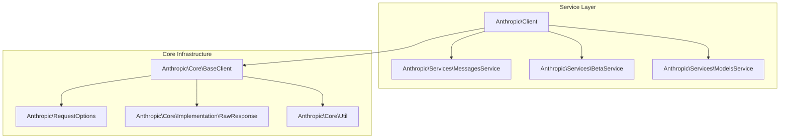
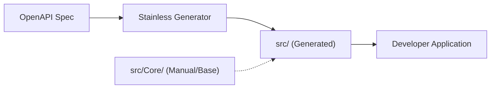

<!-- source: DeepWiki mcp.deepwiki.com · repo anthropics/anthropic-sdk-php · page 1 Overview · fetched 2026-10-26 -->

# Overview

<details>
<summary>Relevant source files</summary>

The following files were used as context for generating this wiki page:

- [.release-please-manifest.json](.release-please-manifest.json)
- [.stats.yml](.stats.yml)
- [CHANGELOG.md](CHANGELOG.md)
- [CONTRIBUTING.md](CONTRIBUTING.md)
- [README.md](README.md)
- [release-please-config.json](release-please-config.json)
- [src/Client.php](src/Client.php)
- [src/Core/BaseClient.php](src/Core/BaseClient.php)
- [src/RequestOptions.php](src/RequestOptions.php)
- [src/Version.php](src/Version.php)
- [tests/Services/Beta/Messages/BatchesTest.php](tests/Services/Beta/Messages/BatchesTest.php)
- [tests/Services/Beta/MessagesTest.php](tests/Services/Beta/MessagesTest.php)
- [tests/Services/Messages/BatchesTest.php](tests/Services/Messages/BatchesTest.php)
- [tests/Services/MessagesTest.php](tests/Services/MessagesTest.php)

</details>


The Anthropic PHP SDK provides a robust, type-safe interface for interacting with the Claude API. It simplifies the integration of Claude's capabilities—such as message generation, streaming, tool use, and batch processing—into PHP applications.

The SDK is architected around a central `Client` that orchestrates requests via a PSR-18 compliant HTTP stack, utilizing a structured data modeling system to convert between PHP objects and API payloads.

### System Architecture Overview

The following diagram illustrates how the high-level service entities relate to the underlying core infrastructure.

**SDK Architecture: Service to Core Mapping**

Sources: [src/Client.php:19-39](), [src/Core/BaseClient.php:32-46](), [src/Services/MessagesService.php:1-20]() (inferred from usage).

---

### Key Capabilities

The SDK covers the full breadth of the Anthropic API, including stable and experimental features:

*   **Messages API**: Create synchronous or streaming completions using Claude models like `claude-opus-4-6` or `claude-sonnet-4-5-20250929` [README.md:28-70]().
*   **Structured Output**: Define PHP classes (extending `StructuredOutputModel`) to automatically generate JSON schemas and parse responses into typed objects [README.md:72-98]().
*   **Message Batches**: Handle large-scale asynchronous processing with dedicated services for creating, listing, and streaming batch results [tests/Services/Messages/BatchesTest.php:34-168]().
*   **Beta Features**: Access experimental capabilities such as MCP servers, context management, and extended thinking through the `beta` namespace [tests/Services/Beta/MessagesTest.php:32-148]().
*   **Auto-Pagination**: Seamlessly iterate through paginated resources using `pagingEachItem()` generators [README.md:102-129]().

---

### Getting Started

To begin using the SDK, install it via Composer:

```sh
composer require "anthropic-ai/sdk:^0.8.0"
```

Authentication is handled via an API key or a Bearer token, typically sourced from environment variables like `ANTHROPIC_API_KEY` [src/Client.php:49-54]().

**Basic Usage Example**
```php
use Anthropic\Client;

$client = new Client();
$message = $client->messages->create(
    maxTokens: 1024,
    messages: [['role' => 'user', 'content' => 'Hello, Claude']],
    model: 'claude-opus-4-6',
);
```
Sources: [README.md:15-39](), [src/Client.php:43-86]().

For detailed installation and configuration instructions, see **[Getting Started](#1.1)**.

---

### Project Structure and Codegen

The SDK is largely auto-generated using the Stainless SDK generator, ensuring high fidelity with the Anthropic OpenAPI specification [.stats.yml:2-4]().

**Codebase Flow: Spec to Execution**


*   **`src/`**: Contains the generated services, models, and the main `Client` [src/Client.php:1-20]().
*   **`src/Core/`**: Houses the manually maintained foundational logic, including the `BaseClient` and request lifecycle management [src/Core/BaseClient.php:1-32]().
*   **`tests/`**: A comprehensive suite of Pest/PHPUnit tests validated against a mock server [tests/Services/MessagesTest.php:1-29]().

For a deep dive into the repository layout and the generation process, see **[Project Structure and Codegen](#1.2)**.

---

### Advanced Concepts

The SDK provides several advanced configuration options via the `RequestOptions` class:

*   **Retries**: Automatically retries failed requests (408, 409, 429, >=500) up to 2 times by default with exponential backoff [src/Core/BaseClient.php:199-214](), [src/RequestOptions.php:41-47]().
*   **Timeouts**: Configurable request timeouts, defaulting to 600 seconds [src/RequestOptions.php:38-38]().
*   **Custom Transport**: Support for custom PSR-18 HTTP clients and PSR-17 factories [src/RequestOptions.php:61-70]().
*   **Undocumented Params**: Use `extraHeaders`, `extraQueryParams`, and `extraBodyParams` to access new API features before they are formally added to the SDK [README.md:204-223](), [src/RequestOptions.php:49-58]().

Sources: [src/Core/BaseClient.php:199-214](), [src/RequestOptions.php:32-75](), [README.md:175-198]().

---

