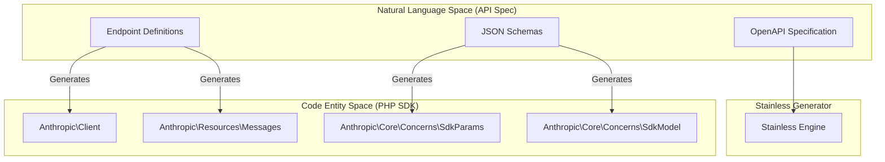
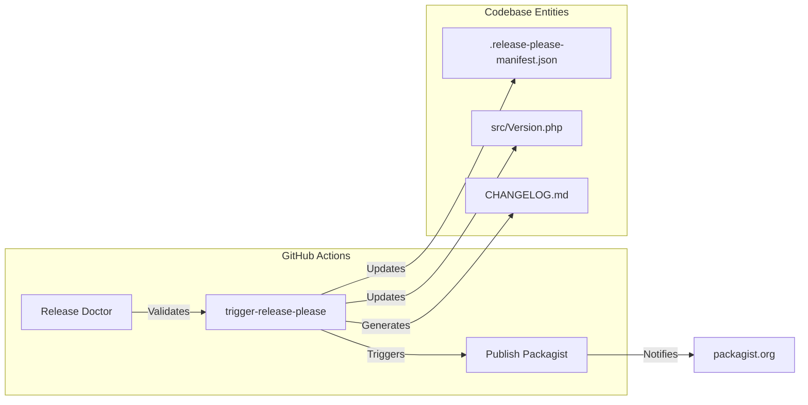

<!-- source: DeepWiki mcp.deepwiki.com · repo anthropics/anthropic-sdk-php · page 1.2 Project Structure and Codegen · fetched 2026-10-26 -->

# Project Structure and Codegen

Relevant source files

The following files were used as context for generating this wiki page:

- [.gitattributes](.gitattributes)
- [.github/workflows/ci.yml](.github/workflows/ci.yml)
- [.github/workflows/create-releases.yml](.github/workflows/create-releases.yml)
- [.github/workflows/publish-packagist.yml](.github/workflows/publish-packagist.yml)
- [.github/workflows/release-doctor.yml](.github/workflows/release-doctor.yml)
- [.gitignore](.gitignore)
- [.php-cs-fixer.dist.php](.php-cs-fixer.dist.php)
- [.release-please-manifest.json](.release-please-manifest.json)
- [CHANGELOG.md](CHANGELOG.md)
- [CONTRIBUTING.md](CONTRIBUTING.md)
- [README.md](README.md)
- [bin/check-release-environment](bin/check-release-environment)
- [src/Core.php](src/Core.php)
- [src/Core/Concerns/SdkParams.php](src/Core/Concerns/SdkParams.php)
- [src/Version.php](src/Version.php)

This page describes the organizational layout of the Anthropic PHP SDK, the automation workflow powered by the Stainless SDK generator, and the release management process.

## Repository Layout

The repository is organized into distinct directories for source code, testing, examples, and automation scripts.

| Directory | Description | Maintenance Type |
| :--- | :--- | :--- |
| `src/` | The core SDK logic, including service clients, data models, and HTTP internals. | Auto-generated / Mixed |
| `tests/` | Unit and integration tests, typically executed against a mock server. | Auto-generated |
| `examples/` | Runnable PHP scripts demonstrating SDK features. | **Manually Maintained** |
| `scripts/` | Utility scripts for environment setup, linting, and testing. | **Manually Maintained** |
| `bin/` | Executable binaries for release health checks. | **Manually Maintained** |

### Key Source Components
*   **`src/Core/`**: Contains the foundational traits and classes for type conversion, request normalization, and exception handling [src/Core.php:1-15]().
*   **`src/Version.php`**: Holds the single source of truth for the SDK version string [src/Version.php:7-9]().
*   **`src/RequestOptions.php`**: Defines the configuration object for per-request overrides like retries and extra headers [src/Core/Concerns/SdkParams.php:9-10]().

Sources: [CONTRIBUTING.md:21-30](), [README.md:100-102](), [.php-cs-fixer.dist.php:11-11]()

## Codegen Workflow (Stainless)

The Anthropic PHP SDK is primarily a **generated library**. It is built using the Stainless SDK generator, which transforms an OpenAPI specification into idiomatic PHP code.

### Generated vs. Manual Files
As noted in the contribution guidelines, most of the SDK is generated. However, certain areas are protected from being overwritten:
1.  **Manual Overrides**: Specific logic in `src/` can be manually patched. These patches are persisted between generations, though they may occasionally require conflict resolution [CONTRIBUTING.md:21-26]().
2.  **Examples**: The generator never modifies the contents of the `examples/` directory [CONTRIBUTING.md:24-25]().
3.  **Tooling**: Scripts in `scripts/` and configuration files like `.php-cs-fixer.dist.php` are manually maintained.

### Data Flow: Spec to Code
The following diagram illustrates how the "Natural Language Space" (API definitions) is transformed into the "Code Entity Space" (PHP classes).

**Codegen Transformation Map**

Sources: [CONTRIBUTING.md:21-26](), [src/Core/Concerns/SdkParams.php:14-15]()

## Versioning and Releases

The SDK follows Semantic Versioning (SemVer) and uses `release-please` to automate version bumps and changelog generation.

### Release-Please Integration
The version is tracked in two primary locations:
1.  **`.release-please-manifest.json`**: Tracks the current version for the release automation tool [ .release-please-manifest.json:1-3]().
2.  **`src/Version.php`**: Contains the `VERSION` constant used by the SDK at runtime [src/Version.php:7-9]().

### Release Pipeline
When changes are merged into the `main` branch, the `create-releases.yml` workflow triggers the `stainless-api/trigger-release-please` action [ .github/workflows/create-releases.yml:19-23](). This creates or updates a Release PR. Once that PR is merged:
1.  The version is updated in `src/Version.php` and `README.md` [README.md:13-19]().
2.  A GitHub Release is created.
3.  The package is automatically published to **Packagist** via a POST request to the Packagist API [ .github/workflows/publish-packagist.yml:13-18]().

**Release Automation Flow**

Sources: [.github/workflows/create-releases.yml:19-31](), [.github/workflows/publish-packagist.yml:1-18](), [.github/workflows/release-doctor.yml:1-25](), [CHANGELOG.md:1-20]()

## Development Scripts

The `scripts/` directory contains the primary entry points for developer workflows.

| Script | Purpose |
| :--- | :--- |
| `bootstrap` | Installs dependencies and prepares the environment [CONTRIBUTING.md:15-19](). |
| `lint` | Runs **PHPStan** for static analysis [CONTRIBUTING.md:47-51](). |
| `format` | Runs **PHP CS Fixer** using the project's ruleset [CONTRIBUTING.md:53-57](). |
| `test` | Executes the test suite via **Pest/PHPUnit** [CONTRIBUTING.md:40-41](). |
| `mock` | (Reference) Developers are encouraged to use `prism` to mock the OpenAPI spec for local testing [CONTRIBUTING.md:32-37](). |

### Linting Configuration
The project uses a strict PHP CS Fixer configuration defined in `.php-cs-fixer.dist.php`, which includes rules for alignment, parentheses, and type ordering [ .php-cs-fixer.dist.php:12-18](). To ensure performance on large generated files, it runs with no memory limit [ .php-cs-fixer.dist.php:7-7]().

Sources: [CONTRIBUTING.md:43-57](), [.php-cs-fixer.dist.php:1-20](), [.github/workflows/ci.yml:32-36]()

---

