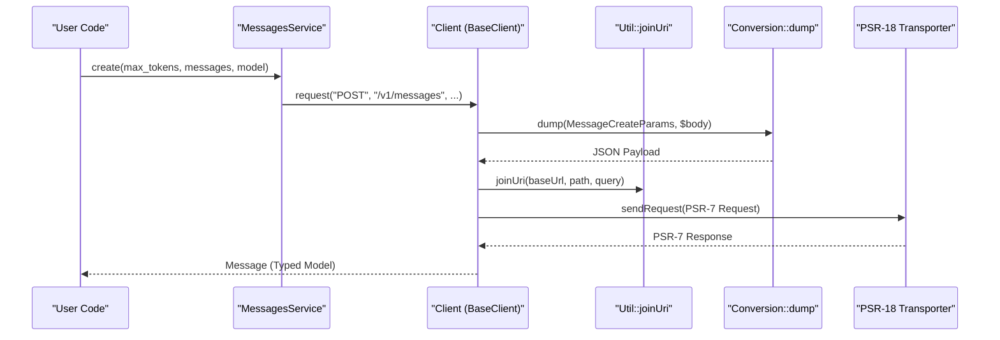

<!-- source: DeepWiki mcp.deepwiki.com · repo anthropics/anthropic-sdk-php · page 2 Core Architecture · fetched 2026-10-26 -->

# Core Architecture

<details>
<summary>Relevant source files</summary>

The following files were used as context for generating this wiki page:

- [release-please-config.json](release-please-config.json)
- [src/Client.php](src/Client.php)
- [src/Core/BaseClient.php](src/Core/BaseClient.php)
- [src/Core/Conversion.php](src/Core/Conversion.php)
- [src/Core/Util.php](src/Core/Util.php)
- [src/RequestOptions.php](src/RequestOptions.php)
- [tests/ClientTest.php](tests/ClientTest.php)
- [tests/Core/UtilTest.php](tests/Core/UtilTest.php)

</details>


The Anthropic PHP SDK is built on a layered architecture designed for extensibility, type safety, and PSR compliance. It leverages a standard HTTP stack to communicate with Anthropic's APIs while providing a high-level, object-oriented interface for developers.

## System Overview

The architecture transitions from high-level service definitions (like `MessagesService`) down to a robust HTTP transport layer. The core responsibility of the SDK is to manage the lifecycle of a request: from PHP object instantiation and validation to network transmission and response deserialization.

### High-Level Component Relationship
This diagram illustrates how user-facing services interact with the foundational core.

```mermaid
graph TD
    subgraph "Service Layer"
        ["Client"] --> ["MessagesService"]
        ["Client"] --> ["ModelsService"]
        ["Client"] --> ["BetaService"]
    end

    subgraph "Core Architecture"
        ["MessagesService"] --> ["BaseClient"]
        ["BaseClient"] --> ["RequestOptions"]
        ["BaseClient"] --> ["RawResponse"]
        ["RawResponse"] --> ["Conversion"]
    end

    subgraph "External Dependencies"
        ["BaseClient"] --> ["PSR-18 Transporter"]
        ["BaseClient"] --> ["PSR-17 Factories"]
    end
```
**Sources:** [src/Client.php:28-38](), [src/Client.php:83-85](), [src/Core/BaseClient.php:32-46](), [src/RequestOptions.php:32-71]()

---

## HTTP Client and Request Lifecycle

The `BaseClient` acts as the engine for all network operations. It utilizes PSR-18 for HTTP transport and PSR-17 for message factories, ensuring compatibility with any modern PHP environment. 

The lifecycle involves:
1.  **Normalization**: Converting high-level parameters into a `NormalizedRequest` array [src/Core/BaseClient.php:24-30]().
2.  **Authentication**: Injecting `X-Api-Key` or `Authorization` headers via `authHeaders()` [src/Client.php:89-107]().
3.  **Execution**: Sending the request through the `transporter` with built-in support for retries (exponential backoff) and redirects [src/Core/BaseClient.php:92]().
4.  **Idempotency**: Automatically generating `stainless-php-retry-*` keys for safe retries on mutating requests [src/Core/BaseClient.php:114-119]().

For details, see [HTTP Client and Request Lifecycle](#2.1).

**Sources:** [src/Core/BaseClient.php:62-96](), [src/Client.php:43-81](), [src/RequestOptions.php:37-47]()

---

## Type Conversion and Data Modeling

The SDK uses a sophisticated conversion system to bridge the gap between raw API JSON and typed PHP objects. This is managed primarily by the `Conversion` class and traits like `SdkModel`.

| Entity | Role |
| :--- | :--- |
| **SdkModel** | Trait providing initialization and property mapping for DTOs [src/RequestOptions.php:35](). |
| **Conversion** | The central utility for `coerce` (deserialization) and `dump` (serialization) [src/Core/Conversion.php:16-17](). |
| **RawResponse** | Holds the PSR-7 response and facilitates the transition to a typed model [src/Core/Implementation/RawResponse.php](). |

For details, see [Type Conversion and Data Modeling](#2.2).

**Sources:** [src/Core/Conversion.php:49-89](), [src/RequestOptions.php:80-86]()

---

## Data Flow: Natural Language to Code Entities

The following diagram maps how a developer's intent (sending a message) flows through the internal code entities.


**Sources:** [src/Core/BaseClient.php:62-96](), [src/Client.php:118-134](), [src/Core/Util.php:183-219](), [src/Core/Conversion.php:72-89]()

---

## Specialized Response Handling

Beyond standard JSON responses, the architecture supports complex interaction patterns:

*   **Streaming**: The `BaseStream` contract and implementations like `SSEStream` handle Server-Sent Events for real-time model output [src/Core/BaseClient.php:9-10](). For details, see [Streaming: SSE and JSONL](#2.3).
*   **Pagination**: Services that return lists use `BasePage` and `PageCursor` to handle automatic iteration through result sets [src/Core/BaseClient.php:7-8](). For details, see [Pagination](#2.4).

---

## Error Handling and Exceptions

The SDK provides a structured exception hierarchy to handle various failure modes. The `BaseClient` evaluates response status codes to determine if a request should be retried or if an exception should be thrown.

*   **Retry Logic**: Status codes like `408`, `409`, `429`, and `5xx` trigger the retry mechanism [src/Core/BaseClient.php:208-211]().
*   **Exception Hierarchy**: All SDK-specific errors extend `APIException`. Network-level failures throw `APIConnectionException`, while specific HTTP statuses throw `APIStatusException` subclasses.

For details, see [Error Handling and Exceptions](#2.5).

**Sources:** [src/Core/BaseClient.php:199-214](), [src/Core/BaseClient.php:12-13]()

---

