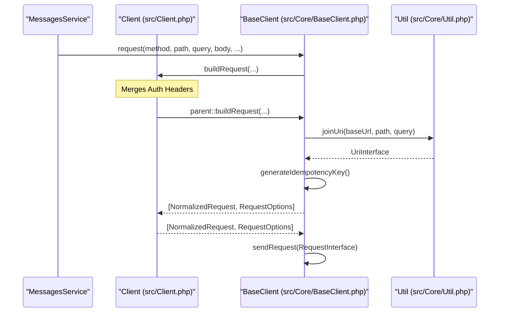

<!-- source: DeepWiki mcp.deepwiki.com · repo anthropics/anthropic-sdk-php · page 2.1 HTTP Client and Request Lifecycle · fetched 2026-10-26 -->

# HTTP Client and Request Lifecycle

<details>
<summary>Relevant source files</summary>

The following files were used as context for generating this wiki page:

- [composer.json](composer.json)
- [release-please-config.json](release-please-config.json)
- [src/Client.php](src/Client.php)
- [src/Core/BaseClient.php](src/Core/BaseClient.php)
- [src/Core/Concerns/SdkModel.php](src/Core/Concerns/SdkModel.php)
- [src/Core/Concerns/SdkUnion.php](src/Core/Concerns/SdkUnion.php)
- [src/Core/Contracts/BaseStream.php](src/Core/Contracts/BaseStream.php)
- [src/Core/Conversion/PropertyInfo.php](src/Core/Conversion/PropertyInfo.php)
- [src/Core/Conversion/UnionOf.php](src/Core/Conversion/UnionOf.php)
- [src/Core/Util.php](src/Core/Util.php)
- [src/RequestOptions.php](src/RequestOptions.php)
- [tests/ClientTest.php](tests/ClientTest.php)
- [tests/Core/UtilTest.php](tests/Core/UtilTest.php)

</details>


This page provides a deep dive into the Anthropic PHP SDK's internal HTTP stack. It covers how requests are constructed, authenticated, and transported using PSR-18, as well as the lifecycle of a request including retry logic and redirect handling.

## Overview

The SDK architecture separates service-level logic (e.g., `MessagesService`) from the transport layer. The `BaseClient` class serves as the foundation for all HTTP operations, managing the transition from high-level PHP parameters to low-level PSR-7 requests.

### Key Components

| Class | Responsibility |
| :--- | :--- |
| `Client` | Primary entry point; configures default headers, authentication, and service instances [src/Client.php:19-40](). |
| `BaseClient` | Core request engine; implements retry logic, redirect following, and request building [src/Core/BaseClient.php:32-33](). |
| `RequestOptions` | DTO for per-request configuration (timeouts, retries, extra headers) [src/RequestOptions.php:32](). |
| `Util` | Static helpers for URI joining, path parsing, and header manipulation [src/Core/Util.php:18](). |

---

## Request Construction

Requests are initiated by service methods calling `BaseClient::request()` [src/Core/BaseClient.php:62-73](). This process transforms abstract parameters into a `NormalizedRequest` array and finally a PSR-7 `RequestInterface`.

### 1. Building the Normalized Request
The `buildRequest` method merges global client state with per-call options:
- **Path Parsing**: Path templates (e.g., `['/models/%s', $id]`) are resolved using `Util::parsePath` [src/Core/BaseClient.php:141]().
- **Query Merging**: Service-provided queries are merged with `extraQueryParams` from `RequestOptions` [src/Core/BaseClient.php:144-147]().
- **Header Assembly**: Headers from the client, the specific call, and `RequestOptions` are flattened into a single array [src/Core/BaseClient.php:154-159]().
- **Idempotency**: If an `idempotencyHeader` is configured, a unique key is generated for the request [src/Core/BaseClient.php:149-151]().

### 2. Authentication Headers
The `Client` class overrides `buildRequest` to inject authentication headers before the request is finalized [src/Client.php:118-134]().
- **API Key**: Added as `X-Api-Key` [src/Client.php:97]().
- **Bearer Token**: Added as `Authorization: Bearer <token>` [src/Client.php:103-106]().

### Request Flow Diagram
This diagram bridges the service-level method call to the underlying PSR-7 request generation.


**Sources:** [src/Core/BaseClient.php:62-96](), [src/Client.php:118-134](), [src/Core/Util.php:183-219]()

---

## Transport and PSR-18

The SDK uses **PHP-HTTP Discovery** to automatically locate PSR-17 factories and a PSR-18 client (transporter) if none are explicitly provided [src/Client.php:56-62]().

- **Request Factory**: Used to create the `RequestInterface` [src/Core/BaseClient.php:88]().
- **Transporter**: The `ClientInterface` implementation (e.g., Guzzle, Symfony HTTP Client) that actually sends the bytes [src/RequestOptions.php:61]().

### Header Normalization
The `Util::withSetHeaders` function ensures all header values are converted to strings or lists of strings, as required by PSR-7, while handling nulls by removing the header entirely [src/Core/Util.php:224-235]().

**Sources:** [src/Client.php:56-62](), [src/Core/BaseClient.php:88-92](), [src/Core/Util.php:224-235]()

---

## The Request Lifecycle

The `BaseClient::sendRequest` method implements a recursive loop that handles the actual transmission, retries, and redirects.

### Retry Logic with Exponential Backoff
The SDK automatically retries failed requests under specific conditions defined in `shouldRetry` [src/Core/BaseClient.php:199-214]():
- **Status Codes**: 408 (Timeout), 409 (Conflict), 429 (Rate Limit), or any `>= 500` (Server Error).
- **Max Retries**: Controlled by `RequestOptions::$maxRetries` (default is 2) [src/RequestOptions.php:41]().

**Backoff Calculation**:
The delay between retries is calculated in `retryDelay` [src/Core/BaseClient.php:219-223](). It respects the `Retry-After` header if present. Otherwise, it uses exponential backoff:
1. Starts at `initialRetryDelay` (default 0.5s) [src/RequestOptions.php:44]().
2. Doubles with each attempt.
3. Capped at `maxRetryDelay` (default 8.0s) [src/RequestOptions.php:47]().
4. Includes a jitter (random factor between 0.5 and 1.5) to prevent thundering herds [src/Core/BaseClient.php:241-246]().

### Redirect Following
If a response returns a 3xx status code and includes a `Location` header, the SDK follows it automatically [src/Core/BaseClient.php:182-194]().
- The SDK limits the number of sequential redirects (internal default is 10) to prevent infinite loops [src/Core/BaseClient.php:274-276]().
- `Util::joinUri` is used to resolve relative redirect locations against the original request URI [src/Core/BaseClient.php:191]().

### Lifecycle State Machine
This diagram maps the internal logic of `sendRequest` and its interaction with `RequestOptions`.

```mermaid
stateDiagram-v2
    [*] --> TransformRequest: "BaseClient::transformRequest()"
    TransformRequest --> Send: "transporter->sendRequest()"
    
    Send --> CheckStatus: "Response received"
    Send --> ConnectionError: "ClientExceptionInterface"
    
    ConnectionError --> ShouldRetry: "retryCount < maxRetries"
    
    CheckStatus --> Success: "2xx Status"
    CheckStatus --> Redirect: "3xx Status + Location"
    CheckStatus --> ShouldRetry: "408, 429, 5xx"
    CheckStatus --> Failure: "Other 4xx"
    
    Redirect --> TransformRequest: "followRedirect() / count++"
    
    ShouldRetry --> Wait: "retryDelay()"
    Wait --> TransformRequest: "retryCount++"
    
    Success --> [*]
    Failure --> [*]
```
**Sources:** [src/Core/BaseClient.php:182-214](), [src/Core/BaseClient.php:219-246](), [src/RequestOptions.php:37-48]()

---

## Idempotency Keys

To safely retry requests that might have side effects (like creating a message), the SDK generates an idempotency key [src/Core/BaseClient.php:114-119]().
- **Header**: Configured via `idempotencyHeader` in the constructor [src/Core/BaseClient.php:44]().
- **Format**: `stainless-php-retry-<hex>` [src/Core/BaseClient.php:118]().
- **Behavior**: If the header is already provided in the request call, the SDK will not overwrite it [src/Core/BaseClient.php:149-151]().

**Sources:** [src/Core/BaseClient.php:114-120](), [src/Core/BaseClient.php:149-151]()

---

