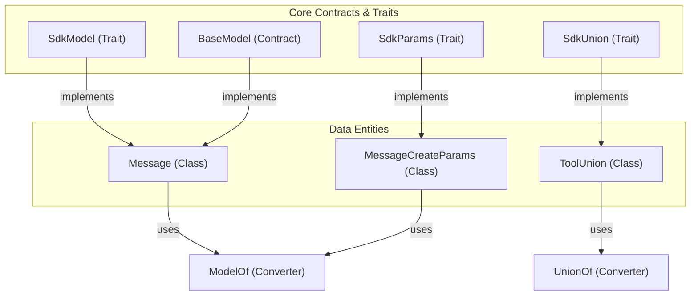
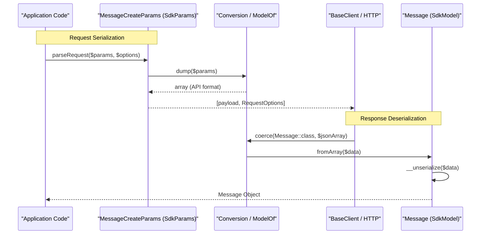

<!-- source: DeepWiki mcp.deepwiki.com · repo anthropics/anthropic-sdk-php · page 2.2 Type Conversion and Data Modeling · fetched 2026-10-26 -->

# Type Conversion and Data Modeling

Relevant source files

The following files were used as context for generating this wiki page:

- [composer.json](composer.json)
- [src/Core.php](src/Core.php)
- [src/Core/Concerns/SdkEnum.php](src/Core/Concerns/SdkEnum.php)
- [src/Core/Concerns/SdkModel.php](src/Core/Concerns/SdkModel.php)
- [src/Core/Concerns/SdkParams.php](src/Core/Concerns/SdkParams.php)
- [src/Core/Concerns/SdkUnion.php](src/Core/Concerns/SdkUnion.php)
- [src/Core/Contracts/BaseStream.php](src/Core/Contracts/BaseStream.php)
- [src/Core/Conversion.php](src/Core/Conversion.php)
- [src/Core/Conversion/ListOf.php](src/Core/Conversion/ListOf.php)
- [src/Core/Conversion/ModelOf.php](src/Core/Conversion/ModelOf.php)
- [src/Core/Conversion/PropertyInfo.php](src/Core/Conversion/PropertyInfo.php)
- [src/Core/Conversion/UnionOf.php](src/Core/Conversion/UnionOf.php)

The Anthropic PHP SDK employs a robust type conversion and data modeling system to bridge the gap between PHP's object-oriented structures and the JSON-based requirements of the Anthropic API. This system handles the serialization of request parameters (sending data) and the deserialization of API responses into typed PHP objects (receiving data).

## Core Data Modeling Traits

The SDK uses a set of internal traits to provide consistent behavior across different types of data entities. These traits utilize `ReflectionClass` to automatically map PHP properties to API fields.

### `SdkModel`
The primary trait for complex data objects (Models). It implements `ArrayAccess`, `JsonSerializable`, and magic methods to handle data storage and retrieval.
- **Data Storage**: Uses a private `$_data` array to store undocumented or extra data returned by the API, ensuring forward compatibility [src/Core/Concerns/SdkModel.php:26-26]().
- **Accessors**: Implements `offsetGet` and `offsetSet` to allow array-like access to properties [src/Core/Concerns/SdkModel.php:145-200]().
- **Serialization**: `__serialize()` and `jsonSerialize()` convert the object into a format suitable for JSON encoding [src/Core/Concerns/SdkModel.php:33-38](), [src/Core/Concerns/SdkModel.php:227-231]().

### `SdkParams`
Used specifically for request parameter DTOs. It provides the `parseRequest` method which handles the conversion of parameters into an array while also extracting and validating `RequestOptions` [src/Core/Concerns/SdkParams.php:21-35]().

### `SdkUnion` and `SdkEnum`
- **`SdkUnion`**: Facilitates types that can be one of several different classes. It uses a `discriminator` (a specific field in the JSON) to determine which variant to instantiate [src/Core/Concerns/SdkUnion.php:18-38]().
- **`SdkEnum`**: Maps PHP class constants or BackedEnums to valid API string/int values [src/Core/Concerns/SdkEnum.php:14-34]().

### Code Entity Space: Model and Parameter Architecture
This diagram shows how the SDK's internal traits and contracts form the foundation for data entities used by developers.

Sources: [src/Core/Concerns/SdkModel.php:19-21](), [src/Core/Concerns/SdkParams.php:14-15](), [src/Core/Concerns/SdkUnion.php:14-15](), [src/Core/Conversion/ModelOf.php:16-17]().

---

## The Conversion System

The `Conversion` class is the central engine for transforming data [src/Core/Conversion.php:16-17](). It operates using two primary modes: **Coerce** (Input) and **Dump** (Output).

### Key Functions
| Function | Purpose |
| :--- | :--- |
| `coerce()` | Converts raw input (usually from an API response array) into a specific target type (e.g., a Model class or a primitive) [src/Core/Conversion.php:49-70](). |
| `dump()` | Converts a PHP object or typed value into a raw format (array/primitive) for JSON serialization [src/Core/Conversion.php:72-89](). |
| `tryConvert()` | Handles low-level type casting for primitives like `int`, `float`, `bool`, and `DateTimeInterface` [src/Core/Conversion.php:91-221](). |

### Converters
The system uses specialized classes implementing the `Converter` contract:
- **`ModelOf`**: Handles the mapping of a specific class. It inspects properties for `Required` or `Optional` attributes to handle field renaming (e.g., `snake_case` in API to `camelCase` in PHP) [src/Core/Conversion/ModelOf.php:26-40]().
- **`ListOf`**: Iterates over an array and applies a specific converter to every element [src/Core/Conversion/ListOf.php:13-14]().
- **`UnionOf`**: Attempts to match data against multiple possible types. It uses a scoring system via `CoerceState` to find the "best fit" variant if no discriminator is present [src/Core/Conversion/UnionOf.php:25-64]().
- **`EnumOf`**: Validates that a value matches one of the allowed enum cases [src/Core/Concerns/SdkEnum.php:32-32]().

### State Management
- **`CoerceState`**: Tracks the success of a conversion. It maintains counters for `yes` (exact match), `maybe` (castable), and `no` (incompatible) [src/Core/Conversion.php:93-219]().
- **`DumpState`**: Tracks the state during serialization, including whether the resulting payload is safe for retries (e.g., if it contains a non-rewindable stream) [src/Core/Concerns/SdkParams.php:29-31]().

---

## Data Flow: Request and Response

### Serialization (PHP to API)
When a service method is called (e.g., `create()`), the parameters are processed through the `SdkParams` trait.
1. `parseRequest()` is called with the params DTO [src/Core/Concerns/SdkParams.php:21]().
2. The `ModelOf` converter for that DTO executes `dump()` [src/Core/Concerns/SdkParams.php:25]().
3. Property names are translated from PHP property names to API field names based on attributes [src/Core/Conversion/ModelOf.php:112-112]().
4. The resulting array is JSON-encoded and sent in the HTTP body.

### Deserialization (API to PHP)
When a response is received, the `BaseClient` uses a `ResponseConverter` (often inferred from the return type) to transform the JSON.
1. The JSON body is decoded into a PHP array.
2. `Conversion::coerce()` is called with the target class name and the array [src/Core/Conversion.php:49]().
3. `ModelOf::coerce()` instantiates the class without calling the constructor [src/Core/Conversion/ModelOf.php:131-131]().
4. `__unserialize()` populates the object properties, coercing nested types recursively [src/Core/Concerns/SdkModel.php:45-51]().

### Natural Language to Code Entity Space: Conversion Lifecycle
This diagram bridges the conceptual "Request/Response" flow to the specific classes and methods responsible for data transformation.

Sources: [src/Core/Concerns/SdkParams.php:21-35](), [src/Core/Concerns/SdkModel.php:236-240](), [src/Core/Conversion.php:49-70](), [src/Core/Conversion/ModelOf.php:41-96]().

---

## Specialized Types

### `PropertyInfo`
This internal class parses PHP reflection data to determine how a single property should be handled. It extracts:
- **`apiName`**: The field name used in JSON [src/Core/Conversion/PropertyInfo.php:17]().
- **`type`**: The expected type, which may be a primitive string, a class name, or a `UnionOf` [src/Core/Conversion/PropertyInfo.php:19]().
- **`nullable`/`optional`**: Boolean flags derived from PHP type hints and SDK attributes [src/Core/Conversion/PropertyInfo.php:21-23]().

### `BaseStream` and `RawResponse`
For streaming responses or raw data:
- **`BaseStream`**: A contract for iterators that yield coerced models as they arrive from a stream (e.g., SSE) [src/Core/Contracts/BaseStream.php:19-33]().
- **`RawResponse`**: Used when the developer needs access to the underlying PSR-7 response without automatic model conversion.

Sources: [src/Core/Conversion/PropertyInfo.php:15-48](), [src/Core/Contracts/BaseStream.php:1-33](), [src/Core/Conversion.php:1-222]().

---

