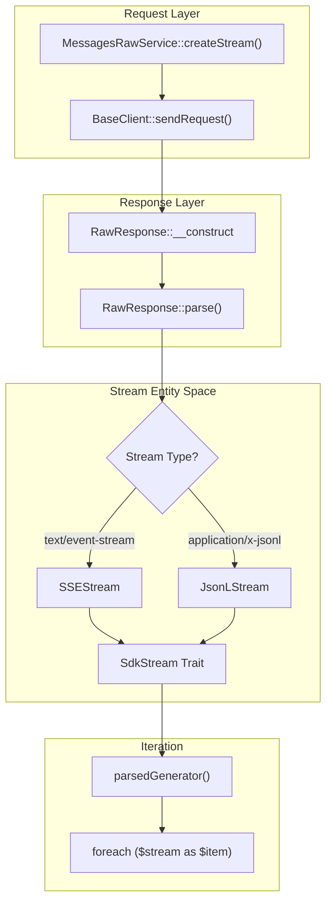
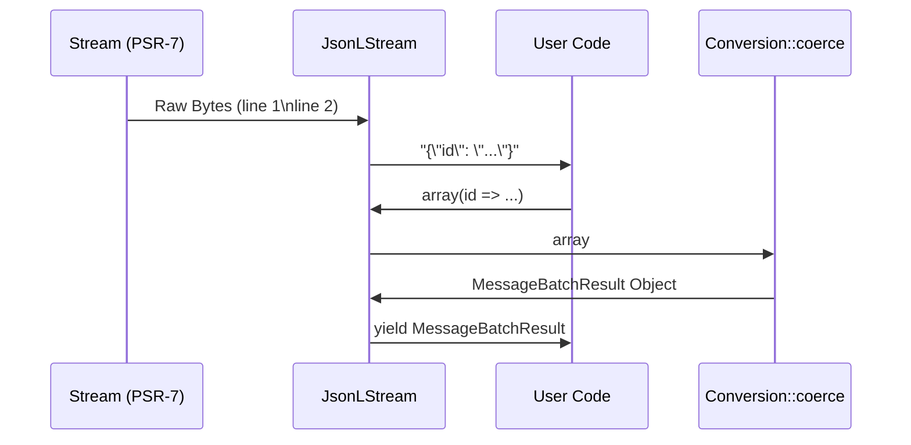

<!-- source: DeepWiki mcp.deepwiki.com · repo anthropics/anthropic-sdk-php · page 2.3 Streaming: SSE and JSONL · fetched 2026-10-26 -->

# Streaming: SSE and JSONL

Relevant source files

The following files were used as context for generating this wiki page:

- [composer.json](composer.json)
- [src/Core/Concerns/SdkModel.php](src/Core/Concerns/SdkModel.php)
- [src/Core/Concerns/SdkStream.php](src/Core/Concerns/SdkStream.php)
- [src/Core/Concerns/SdkUnion.php](src/Core/Concerns/SdkUnion.php)
- [src/Core/Contracts/BaseStream.php](src/Core/Contracts/BaseStream.php)
- [src/Core/Conversion/PropertyInfo.php](src/Core/Conversion/PropertyInfo.php)
- [src/Core/Conversion/UnionOf.php](src/Core/Conversion/UnionOf.php)
- [src/Core/Implementation/RawResponse.php](src/Core/Implementation/RawResponse.php)
- [src/Core/Util.php](src/Core/Util.php)
- [src/JsonLStream.php](src/JsonLStream.php)
- [src/Page.php](src/Page.php)
- [src/PageCursor.php](src/PageCursor.php)
- [src/SSEStream.php](src/SSEStream.php)
- [src/TokenPage.php](src/TokenPage.php)
- [tests/ClientTest.php](tests/ClientTest.php)
- [tests/Core/UtilTest.php](tests/Core/UtilTest.php)

The Anthropic PHP SDK provides robust support for handling streaming responses from the API. This is primarily handled through two specialized stream implementations: `SSEStream` for real-time Server-Sent Events (used in Messages) and `JsonLStream` for newline-delimited JSON (used in Batch results). Both implementations share a common foundation via the `SdkStream` trait and the `BaseStream` contract.

## Stream Architecture

Streaming in the SDK is designed to be memory-efficient, leveraging PHP Generators to yield data as it arrives from the HTTP transport layer. The `RawResponse` class determines whether to instantiate a stream based on the response type and the internal configuration of the service method.

### BaseStream Contract
All stream classes must implement the `Anthropic\Core\Contracts\BaseStream` interface. This interface extends `IteratorAggregate`, ensuring that streams can be iterated over using a standard `foreach` loop [src/Core/Contracts/BaseStream.php:16-19]().

### SdkStream Trait
The `Anthropic\Core\Concerns\SdkStream` trait provides the shared logic for all stream types. It handles:
*   **Initialization**: Setting up the underlying PSR-7 stream and the type converter [src/Core/Concerns/SdkStream.php:40-52]().
*   **Iteration**: Implementing `getIterator()` which proxies to a `parsedGenerator()` method defined in the concrete classes [src/Core/Concerns/SdkStream.php:60-63]().
*   **Resource Management**: Automatically closing the stream when iteration is complete or when `close()` is called manually [src/Core/Concerns/SdkStream.php:73-77]().

### Data Flow: Request to Stream
The following diagram illustrates how a streaming request is transformed into an iterable object.

**Streaming Response Lifecycle**

Sources: [src/Core/Implementation/RawResponse.php:60-68](), [src/SSEStream.php:16-24](), [src/Core/Concerns/SdkStream.php:60-63]()

## SSEStream: Server-Sent Events

`SSEStream` is used for the Messages API when `stream => true` is requested. It parses the `text/event-stream` format, handling Anthropic-specific event types and error states.

### Event Handling
The `parsedGenerator()` method in `SSEStream` iterates over the raw stream and switches on the `event` field of each SSE block [src/SSEStream.php:32-33]().

| Event Type | Action |
| :--- | :--- |
| `completion`, `message_start`, `message_delta`, `message_stop`, `content_block_start`, `content_block_delta`, `content_block_stop` | Decodes the `data` field as JSON and coerces it into the target SdkModel [src/SSEStream.php:34-45](). |
| `ping` | Ignored (used for connection keep-alive) [src/SSEStream.php:49](). |
| `error` | Decodes the error payload and throws an `APIStatusException` [src/SSEStream.php:51-65](). |

### Parsing Logic
The SDK uses `Util::decodeJson` to transform the string data into PHP arrays before passing them to the `Conversion::coerce` system to produce typed objects [src/SSEStream.php:42-44]().

Sources: [src/SSEStream.php:26-68](), [src/Core/Util.php:20-26]()

## JsonLStream: Batch Results

`JsonLStream` handles responses formatted as Newline-Delimited JSON (JSONL). This is primarily used when retrieving the results of a Message Batch.

### Implementation Details
Unlike `SSEStream`, which looks for event prefixes, `JsonLStream` treats every non-empty line in the stream as a standalone JSON object.
1.  The stream reads line-by-line using a buffer.
2.  Each line is passed to `Util::decodeJson`.
3.  The resulting array is coerced into the expected model type.

**JSONL Data Transformation**

Sources: [src/JsonLStream.php:1-30](), [src/Core/Util.php:26-27]()

## Error Handling in Streams

Errors during streaming are handled in two ways:
1.  **Connection Errors**: If the HTTP connection fails during the stream, a `Psr\Http\Client\ClientExceptionInterface` or `Anthropic\Core\Exceptions\APIConnectionException` is raised by the underlying transporter.
2.  **API Level Errors**: In `SSEStream`, if an event of type `error` is encountered, the SDK parses the error JSON and throws an `APIStatusException`. This exception includes the original request and response objects for debugging [src/SSEStream.php:56-62]().

## Utility Functions

The `Anthropic\Core\Util` class provides constants and regex patterns used to identify stream types:
*   `JSON_CONTENT_TYPE`: `const JSON_CONTENT_TYPE = '/^application\/(?:vnd(?:.[^.]+)*+)?json(?!l)/';` [src/Core/Util.php:24]()
*   `JSONL_CONTENT_TYPE`: `const JSONL_CONTENT_TYPE = '/^application\/(:?x-(?:n|l)djson)|(:?(?:x-)?jsonl)/';` [src/Core/Util.php:26]()

Sources: [src/Core/Util.php:20-27](), [src/SSEStream.php:51-65]()

---

