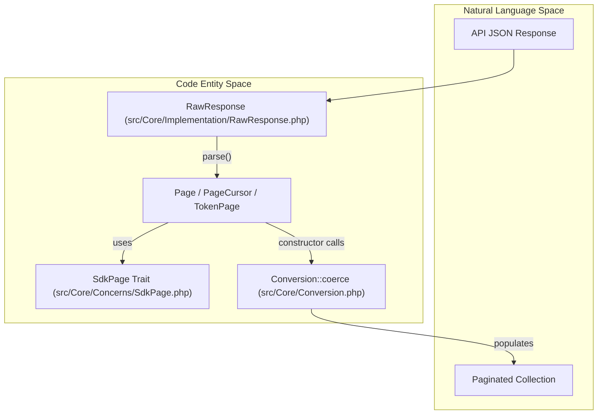
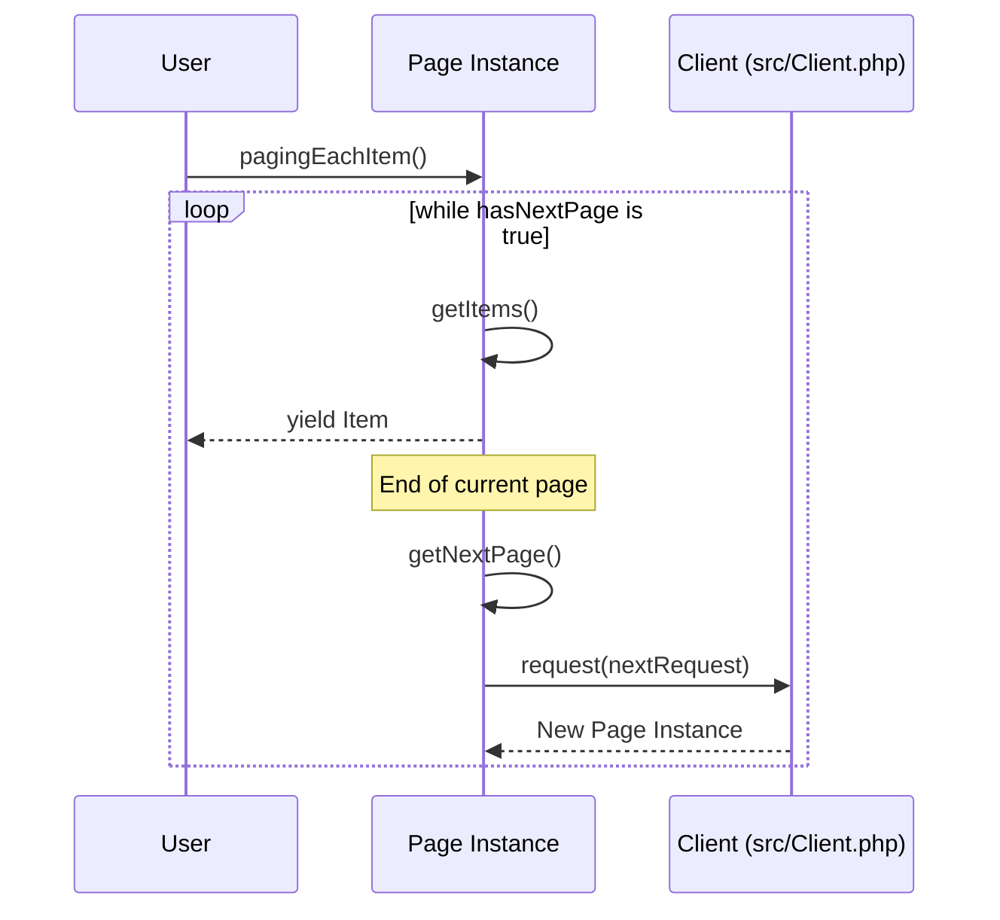

<!-- source: DeepWiki mcp.deepwiki.com · repo anthropics/anthropic-sdk-php · page 2.4 Pagination · fetched 2026-10-26 -->

# Pagination

Relevant source files

The following files were used as context for generating this wiki page:

- [src/Core.php](src/Core.php)
- [src/Core/Concerns/SdkPage.php](src/Core/Concerns/SdkPage.php)
- [src/Core/Concerns/SdkParams.php](src/Core/Concerns/SdkParams.php)
- [src/Core/Concerns/SdkStream.php](src/Core/Concerns/SdkStream.php)
- [src/Core/Contracts/BasePage.php](src/Core/Contracts/BasePage.php)
- [src/Core/Implementation/RawResponse.php](src/Core/Implementation/RawResponse.php)
- [src/Page.php](src/Page.php)
- [src/PageCursor.php](src/PageCursor.php)
- [src/TokenPage.php](src/TokenPage.php)

The Anthropic PHP SDK provides a robust system for handling paginated API responses. It abstracts the complexity of cursor-based and token-based pagination into a set of standard classes and traits, allowing for both manual page-by-page navigation and automatic iteration over all items in a result set.

## Core Concepts

Pagination in the SDK is built around the `BasePage` contract, which defines how a response containing a list of items should behave.

### BasePage Contract
The `BasePage` interface [src/Core/Contracts/BasePage.php:16-34]() defines the essential methods for any paginated response:
- `hasNextPage()`: Determines if more results are available [src/Core/Contracts/BasePage.php:18]().
- `getItems()`: Returns the list of items for the current page [src/Core/Contracts/BasePage.php:23]().
- `getNextPage()`: Fetches the subsequent page object [src/Core/Contracts/BasePage.php:28]().
- `pagingEachItem()`: Returns a PHP Generator to iterate over every item across all pages [src/Core/Contracts/BasePage.php:33]().

### SdkPage Trait
The `SdkPage` trait [src/Core/Concerns/SdkPage.php:21-102]() provides the default implementation for these methods. It manages the internal state required to perform the next request, including the `Client` instance and the original request parameters.

**Sources:** [src/Core/Contracts/BasePage.php:1-34](), [src/Core/Concerns/SdkPage.php:1-102]()

## Page Implementations

The SDK provides three concrete implementations of `BasePage`, each corresponding to a different pagination strategy used by the Anthropic API.

| Class | Strategy | Next Page Logic |
| :--- | :--- | :--- |
| `Page` | Cursor-based (ID) | Uses `after_id` (from `lastID`) or `before_id` (from `firstID`) [src/Page.php:115-120](). |
| `PageCursor` | Page-based | Uses a `page` query parameter [src/PageCursor.php:109-112](). |
| `TokenPage` | Token-based | Uses a `page_token` query parameter [src/TokenPage.php:109-112](). |

### Data Flow: Request to Page Object
The following diagram illustrates how a raw API response is transformed into a paginated object.

**Entity Mapping: Response Conversion**

**Sources:** [src/Core/Implementation/RawResponse.php:69-78](), [src/Page.php:60-82](), [src/PageCursor.php:54-76](), [src/TokenPage.php:54-76]()

## Auto-Pagination

The SDK simplifies data retrieval through generators, allowing developers to treat paginated results as a single stream of items.

### pagingEachItem()
This method [src/Core/Concerns/SdkPage.php:87-94]() uses a nested loop to yield every item across all available pages. It internally calls `getNextPage()` until `hasNextPage()` returns `false`.

### getIterator()
By implementing `\IteratorAggregate` [src/Core/Contracts/BasePage.php:16](), page objects can be used directly in a `foreach` loop to iterate page-by-page [src/Core/Concerns/SdkPage.php:70-80]().

**Logic Flow: Automatic Page Fetching**

**Sources:** [src/Core/Concerns/SdkPage.php:46-63](), [src/Core/Concerns/SdkPage.php:87-94]()

## Implementation Details

### Request Reconstruction
To fetch the next page, the current page object must know how the original request was made. Page classes store `requestInfo` and `options` [src/Page.php:63-64](). When `getNextPage()` is called:
1. `nextRequest()` is invoked to generate the new request parameters (e.g., adding `after_id`) [src/Page.php:105-124]().
2. The `Client` performs a new request using these parameters [src/Core/Concerns/SdkPage.php:59]().
3. The response is parsed into a new instance of the same page class [src/Core/Concerns/SdkPage.php:62]().

### Item Coercion
During construction, page objects use the `Conversion::coerce` system to transform the raw JSON `data` array into typed objects [src/Page.php:77-81](). This ensures that `getItems()` returns a list of DTOs rather than primitive arrays.

**Sources:** [src/Page.php:60-82](), [src/Core/Concerns/SdkPage.php:46-63](), [src/Core/Implementation/RawResponse.php:69-78]()

---

