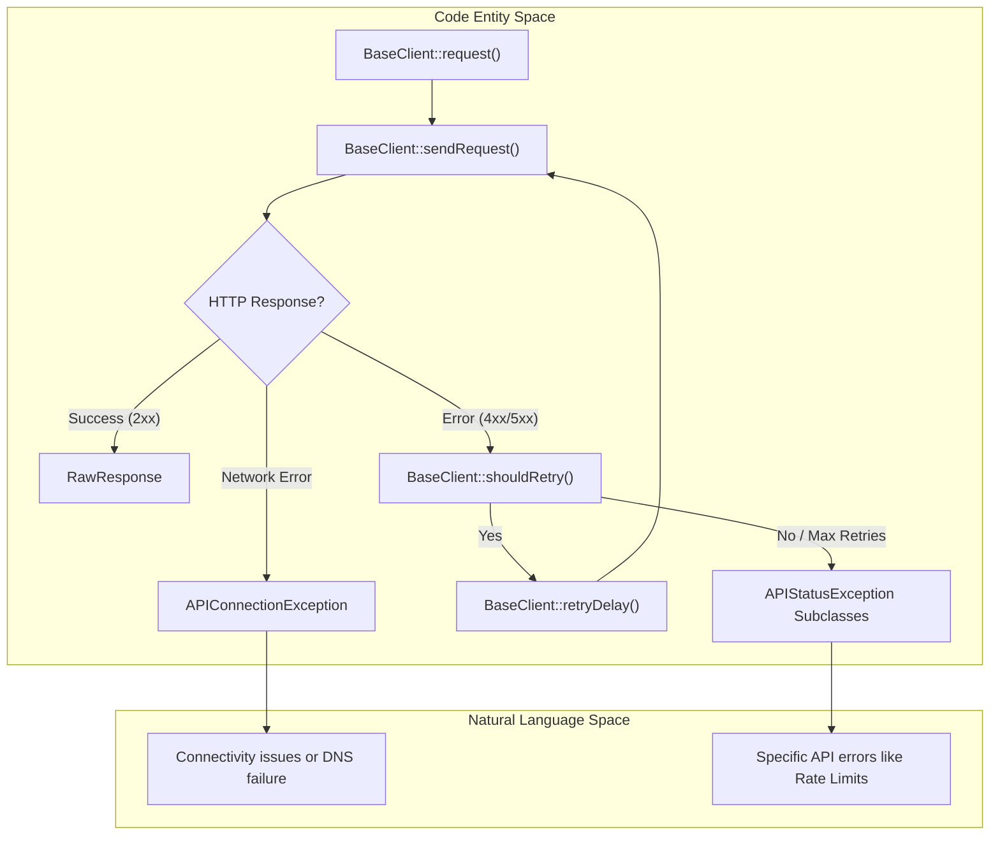
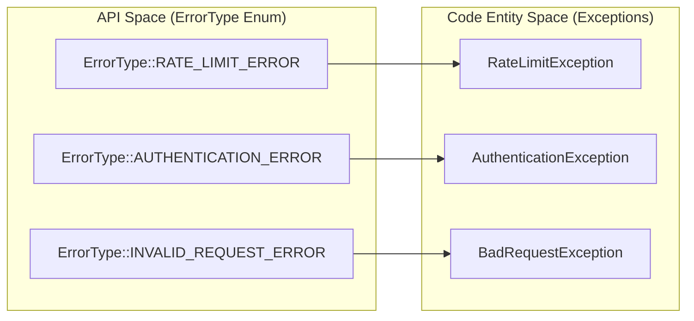

<!-- source: DeepWiki mcp.deepwiki.com · repo anthropics/anthropic-sdk-php · page 2.5 Error Handling and Exceptions · fetched 2026-10-26 -->

# Error Handling and Exceptions

<details>
<summary>Relevant source files</summary>

The following files were used as context for generating this wiki page:

- [.release-please-manifest.json](.release-please-manifest.json)
- [CHANGELOG.md](CHANGELOG.md)
- [CONTRIBUTING.md](CONTRIBUTING.md)
- [README.md](README.md)
- [release-please-config.json](release-please-config.json)
- [src/Client.php](src/Client.php)
- [src/Core/BaseClient.php](src/Core/BaseClient.php)
- [src/ErrorType.php](src/ErrorType.php)
- [src/RequestOptions.php](src/RequestOptions.php)
- [src/Version.php](src/Version.php)

</details>


This page documents the exception hierarchy and error handling mechanisms in the Anthropic PHP SDK. When the library encounters issues connecting to the API or receives a non-success HTTP status code, it throws specific exceptions to allow for granular error handling and automated recovery via retries.

## Exception Hierarchy

All exceptions thrown by the SDK inherit from `Anthropic\Core\Exceptions\APIException`. This hierarchy distinguishes between connectivity issues, timeouts, and specific HTTP error responses returned by the Anthropic API.

### Core Exception Classes

| Exception Class | Description |
| :--- | :--- |
| `APIException` | The base class for all SDK-specific exceptions. |
| `APIConnectionException` | Thrown when the server cannot be reached or a network error occurs [src/Core/BaseClient.php:188](). |
| `APITimeoutException` | Thrown when a request exceeds the configured timeout [README.md:172](). |
| `APIStatusException` | Thrown when the API returns a non-success (4xx or 5xx) status code [README.md:140](). |

### HTTP Status Specific Exceptions

`APIStatusException` is further subclassed to represent specific HTTP error states, allowing developers to catch specific issues like rate limits or authentication failures [README.md:161-174]().

| HTTP Status | Exception Subclass |
| :--- | :--- |
| 400 | `BadRequestException` |
| 401 | `AuthenticationException` |
| 403 | `PermissionDeniedException` |
| 404 | `NotFoundException` |
| 409 | `ConflictException` |
| 422 | `UnprocessableEntityException` |
| 429 | `RateLimitException` |
| >= 500 | `InternalServerException` |

**Sources:** [README.md:131-174](), [src/Core/BaseClient.php:12-13]()

## Error Data Flow

The following diagram illustrates how a request transitions from a standard call to an exception being raised within the `BaseClient` lifecycle.

### Request to Exception Lifecycle

**Sources:** [src/Core/BaseClient.php:62-96](), [src/Core/BaseClient.php:199-214]()

## Retries and Backoff

The SDK includes built-in retry logic to handle transient errors automatically. By default, the SDK will retry a request **2 times** [src/RequestOptions.php:41]().

### Triggering Conditions
A retry is triggered if the request fails with one of the following conditions [src/Core/BaseClient.php:208-210]():
- **Connection Errors:** Network connectivity problems.
- **HTTP 408:** Request Timeout.
- **HTTP 409:** Conflict.
- **HTTP 429:** Rate Limit.
- **HTTP >= 500:** Internal Server Errors.

### Backoff Strategy
The SDK employs an exponential backoff strategy. It starts with an initial delay (default **0.5s**) and increases up to a maximum delay (default **8.0s**) [src/RequestOptions.php:44-47](). If the server provides a `Retry-After` header, the SDK will respect that value [src/Core/BaseClient.php:224-226]().

### Configuration
Retries can be configured globally via the `Client` constructor or per-request using `RequestOptions` [README.md:181-198]().

```php
// Per-request configuration
$client->messages->create(
    maxTokens: 1024,
    messages: [['role' => 'user', 'content' => 'Hello']],
    model: 'claude-3-5-sonnet-20240620',
    requestOptions: ['maxRetries' => 5]
);
```

**Sources:** [README.md:175-198](), [src/Core/BaseClient.php:199-228](), [src/RequestOptions.php:40-48]()

## Handling API Errors in Code

The SDK uses standard PHP `try-catch` blocks. The following diagram maps the relationship between API error types and the resulting PHP exception entities.

### Error Mapping: API to Exception


### Implementation Example
```php
use Anthropic\Core\Exceptions\APIConnectionException;
use Anthropic\Core\Exceptions\RateLimitException;
use Anthropic\Core\Exceptions\APIStatusException;

try {
    $response = $client->messages->create(...);
} catch (APIConnectionException $e) {
    // Handle network failure
} catch (RateLimitException $e) {
    // Handle HTTP 429 specifically
} catch (APIStatusException $e) {
    // Handle all other non-200 responses
}
```

**Sources:** [README.md:142-157](), [src/ErrorType.php:7-26]()

---

