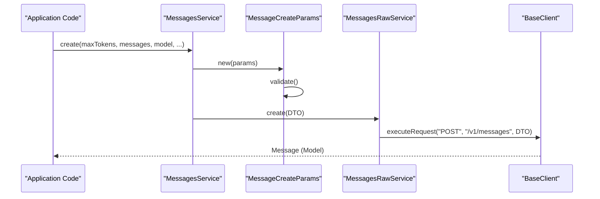

<!-- source: DeepWiki mcp.deepwiki.com · repo anthropics/anthropic-sdk-php · page 3 Messages API · fetched 2026-10-26 -->

# Messages API

<details>
<summary>Relevant source files</summary>

The following files were used as context for generating this wiki page:

- [.stats.yml](.stats.yml)
- [src/Beta/Messages/Batches/BatchCreateParams/Request/Params.php](src/Beta/Messages/Batches/BatchCreateParams/Request/Params.php)
- [src/Beta/Messages/MessageCountTokensParams.php](src/Beta/Messages/MessageCountTokensParams.php)
- [src/Beta/Messages/MessageCreateParams.php](src/Beta/Messages/MessageCreateParams.php)
- [src/Messages/Batches/BatchCreateParams/Request/Params.php](src/Messages/Batches/BatchCreateParams/Request/Params.php)
- [src/Messages/MessageCountTokensParams.php](src/Messages/MessageCountTokensParams.php)
- [src/Messages/MessageCreateParams.php](src/Messages/MessageCreateParams.php)
- [src/ServiceContracts/Beta/MessagesContract.php](src/ServiceContracts/Beta/MessagesContract.php)
- [src/ServiceContracts/MessagesContract.php](src/ServiceContracts/MessagesContract.php)
- [src/Services/Beta/MessagesRawService.php](src/Services/Beta/MessagesRawService.php)
- [src/Services/Beta/MessagesService.php](src/Services/Beta/MessagesService.php)
- [src/Services/MessagesRawService.php](src/Services/MessagesRawService.php)
- [src/Services/MessagesService.php](src/Services/MessagesService.php)
- [tests/Services/Beta/Messages/BatchesTest.php](tests/Services/Beta/Messages/BatchesTest.php)
- [tests/Services/Beta/MessagesTest.php](tests/Services/Beta/MessagesTest.php)
- [tests/Services/Messages/BatchesTest.php](tests/Services/Messages/BatchesTest.php)
- [tests/Services/MessagesTest.php](tests/Services/MessagesTest.php)

</details>


The Messages API is the primary interface for interacting with Anthropic's Claude models. It allows for single queries, stateless multi-turn conversations, and complex workflows involving tools and structured data. The SDK provides two main entry points: a stable service for production-ready features and a beta service for cutting-edge capabilities.

## Overview of Services

The Messages API is accessible through the `Client` via two primary namespaces: `messages` (stable) and `beta->messages` (beta). Both namespaces offer synchronous creation, streaming, and token counting, but they differ in the feature sets they support.

### Service Relationships

The following diagram illustrates how the `Client` orchestrates access to various message-related services.

**Message Service Architecture**
```mermaid
graph TD
    "Client"["Anthropic\Client"] --> "Messages"["Anthropic\Services\MessagesService"]
    "Client" --> "Beta"["Anthropic\Beta\AnthropicBeta"]
    "Beta" --> "BetaMessages"["Anthropic\Services\Beta\MessagesService"]
    
    "Messages" --> "MessagesRaw"["Anthropic\Services\MessagesRawService"]
    "Messages" --> "Batches"["Anthropic\Services\Messages\BatchesService"]
    
    "BetaMessages" --> "BetaMessagesRaw"["Anthropic\Services\Beta\MessagesRawService"]
    "BetaMessages" --> "BetaBatches"["Anthropic\Services\Beta\Messages\BatchesService"]
    "BetaMessages" --> "ToolRunner"["Anthropic\Lib\Tools\BetaToolRunner"]
```
Sources: [src/Services/MessagesService.php:51-70](), [src/Services/Beta/MessagesService.php:63-82]()

## Core Capabilities

### Stable Messages Service
The stable service provides the standard `create()`, `createStream()`, and `countTokens()` methods. It is the recommended choice for most production applications. It handles the core conversational loop using the `MessageParam` DTO and returns structured `Message` objects.

For details, see [Stable Messages Service](#3.1).
Sources: [src/Services/MessagesService.php:75-134](), [src/ServiceContracts/MessagesContract.php:45-58]()

### Beta Messages Service
The beta service extends the stable functionality with experimental features such as Model Context Protocol (MCP) server integration, advanced context management, and extended thinking capabilities. It uses `BetaMessageParam` and returns `BetaMessage` objects.

For details, see [Beta Messages Service](#3.2).
Sources: [src/Services/Beta/MessagesService.php:87-148](), [src/ServiceContracts/Beta/MessagesContract.php:57-130]()

### Message Batches
For high-volume, non-interactive workloads, the Batches API allows sending up to 10,000 requests in a single batch. This service provides 50% lower costs compared to the standard Messages API. The SDK supports creating, retrieving, listing, and canceling batches in both stable and beta namespaces.

For details, see [Message Batches](#3.3).
Sources: [tests/Services/Messages/BatchesTest.php:34-47](), [tests/Services/Beta/Messages/BatchesTest.php:34-51]()

## Advanced Integration

The Messages API serves as the foundation for several advanced SDK features:

| Feature | Description | Link |
| --- | --- | --- |
| **Tool Use** | Allows Claude to interact with external tools and functions. | [Tool Use](#3.4) |
| **Structured Output** | Distills API responses into typed PHP objects using JSON schemas. | [Structured Output](#3.5) |
| **Extended Thinking** | Enables models to perform complex reasoning before responding. | [Extended Thinking](#3.6) |

### Request Lifecycle Flow

The following diagram shows how a request moves from high-level parameters to the network.

**Request Lifecycle**

Sources: [src/Services/MessagesService.php:75-150](), [src/Beta/Messages/MessageCreateParams.php:70-148](), [src/Services/MessagesRawService.php:1-30]()

## Token Counting
Both stable and beta services include a `countTokens()` method. This allows developers to calculate the token usage of a specific set of messages, system prompts, and tool definitions without incurring the cost or latency of a full model generation.

For details, see [Stable Messages Service](#3.1) and [Beta Messages Service](#3.2).
Sources: [src/Services/MessagesService.php:163-178](), [src/Services/Beta/MessagesService.php:217-232]()

---

