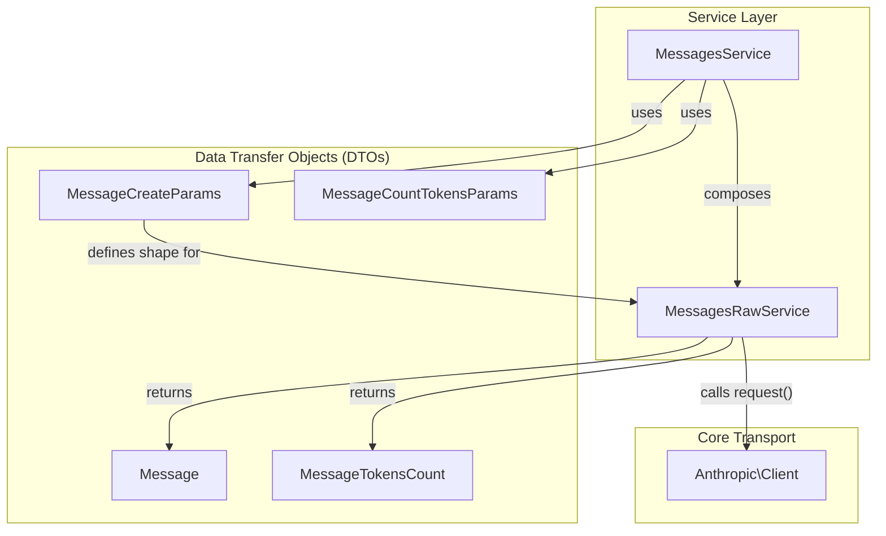
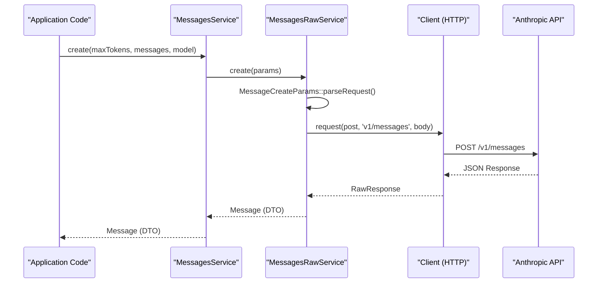

<!-- source: DeepWiki mcp.deepwiki.com · repo anthropics/anthropic-sdk-php · page 3.1 Stable Messages Service · fetched 2026-10-26 -->

# Stable Messages Service

Relevant source files

The following files were used as context for generating this wiki page:

- [src/Beta/Messages/BetaMessage.php](src/Beta/Messages/BetaMessage.php)
- [src/Foundry/Services/MessagesService.php](src/Foundry/Services/MessagesService.php)
- [src/Messages/Batches/BatchCreateParams/Request/Params.php](src/Messages/Batches/BatchCreateParams/Request/Params.php)
- [src/Messages/Message.php](src/Messages/Message.php)
- [src/Messages/MessageCountTokensParams.php](src/Messages/MessageCountTokensParams.php)
- [src/Messages/MessageCreateParams.php](src/Messages/MessageCreateParams.php)
- [src/Messages/Usage.php](src/Messages/Usage.php)
- [src/Messages/WebSearchTool20250305/UserLocation.php](src/Messages/WebSearchTool20250305/UserLocation.php)
- [src/Messages/WebSearchTool20260209/UserLocation.php](src/Messages/WebSearchTool20260209/UserLocation.php)
- [src/Messages/WebSearchToolRequestError/ErrorCode.php](src/Messages/WebSearchToolRequestError/ErrorCode.php)
- [src/Messages/WebSearchToolResultError/ErrorCode.php](src/Messages/WebSearchToolResultError/ErrorCode.php)
- [src/ServiceContracts/MessagesContract.php](src/ServiceContracts/MessagesContract.php)
- [src/Services/MessagesRawService.php](src/Services/MessagesRawService.php)
- [src/Services/MessagesService.php](src/Services/MessagesService.php)

The Stable Messages Service provides the primary interface for interacting with Anthropic's Claude models. It handles conversational turns, content generation, and token counting using the stable API endpoints. The service is divided into a high-level `MessagesService` for convenient, typed interaction and a `MessagesRawService` for lower-level access to raw API responses.

## Service Architecture

The Messages API is exposed through two primary service classes within the `Anthropic\Services` namespace. These services share a common contract but differ in their return types and abstraction levels.

### MessagesService vs. MessagesRawService

*   **`MessagesService`**: Designed for end-users. It abstracts away the `BaseResponse` wrapper and returns DTOs (Data Transfer Objects) like `Message` or `BaseStream` directly. It also provides access to sub-services like `BatchesService` [src/Services/MessagesService.php:51-69]().
*   **`MessagesRawService`**: Returns `BaseResponse` objects, which include metadata about the HTTP response (headers, status codes) alongside the parsed DTOs. This is used when developers need access to underlying transport details [src/Services/MessagesRawService.php:45-186]().

### Component Relationship

The following diagram illustrates how the Messages services relate to the core Client and the DTOs used for requests and responses.

**Messages Service Entity Map**

Sources: [src/Services/MessagesService.php:51-70](), [src/Services/MessagesRawService.php:87-104](), [src/Messages/MessageCreateParams.php:57-61]().

## Key Methods

### create()
The `create()` method is the primary entry point for generating a completion from Claude. It accepts a list of messages and model parameters, sending a `POST` request to `v1/messages` [src/Services/MessagesRawService.php:99]().

*   **Input**: `MessageCreateParams` or an associative array matching its shape [src/Services/MessagesRawService.php:88]().
*   **Processing**: Parameters are validated and serialized via `MessageCreateParams::parseRequest()` [src/Services/MessagesRawService.php:91-94]().
*   **Output**: A `Message` object containing the generated content, usage statistics, and stop reasons [src/Messages/Message.php:32-40]().

### createStream()
`createStream()` initiates a Server-Sent Events (SSE) stream for real-time content generation.

*   **Implementation**: It sets the `stream` parameter to `true` and adds the `Accept: text/event-stream` header [src/Services/MessagesRawService.php:142-148]().
*   **Return Type**: Returns a `BaseStream` yielding various `RawMessageStreamEvent` types (e.g., `RawMessageStartEvent`, `RawContentBlockDeltaEvent`) [src/Services/MessagesRawService.php:130-153]().

### countTokens()
Allows users to calculate the token cost of a request without actually performing the generation.

*   **Endpoint**: Sends a request to the token counting endpoint [src/Services/MessagesRawService.php:181-186]().
*   **Output**: Returns a `MessageTokensCount` object [src/Messages/MessageTokensCount.php]().

Sources: [src/Services/MessagesRawService.php:87-186](), [src/ServiceContracts/MessagesContract.php:45-130]().

## Parameter Serialization and DTOs

The SDK uses specialized DTOs to ensure type safety and correct API payload formatting.

### MessageCreateParams
This DTO defines the schema for creating a message. Key fields include:
*   `model`: The specific Claude model to use [src/Messages/MessageCreateParams.php:133-134]().
*   `messages`: A list of `MessageParam` objects representing the conversation history [src/Messages/MessageCreateParams.php:125-126]().
*   `maxTokens`: The maximum generation limit [src/Messages/MessageCreateParams.php:70-71]().
*   `system`: An optional system prompt [src/Messages/MessageCreateParams.php:218-219]().

### SdkParams and SdkModel Traits
DTOs use the `SdkParams` and `SdkModel` traits to handle the transition from PHP objects to API-ready arrays.
*   **`Required` Attribute**: Used to mark fields that must be present in the JSON payload, often mapping PHP camelCase to API snake_case (e.g., `maxTokens` to `max_tokens`) [src/Messages/MessageCreateParams.php:70]().
*   **`Optional` Attribute**: Handles nullable or non-mandatory fields [src/Messages/MessageCreateParams.php:139]().

Sources: [src/Messages/MessageCreateParams.php:57-240](), [src/Messages/MessageCountTokensParams.php:46-160]().

## Response Processing and Structured Output

When a response is received from the API, the SDK converts the JSON payload into a `Message` object.

### Message Structure
A `Message` object includes:
*   `content`: An array of content blocks (text or tool use) [src/Messages/Message.php:101-102]().
*   `usage`: Token consumption details, including `input_tokens` and `output_tokens` [src/Messages/Message.php:158]().
*   `stop_reason`: Why the model stopped (e.g., `end_turn`, `max_tokens`) [src/Messages/Message.php:136]().

### Structured Output Distillation
The SDK provides a mechanism to parse structured data directly from model responses. The `parsedOutput()` method (available in Beta and Foundry variants) iterates through content blocks to find and instantiate `StructuredOutputModel` implementations [src/Beta/Messages/BetaMessage.php:205-212]().

**Data Flow: Request to Response**

Sources: [src/Services/MessagesService.php:175-220](), [src/Services/MessagesRawService.php:87-103](), [src/Messages/Message.php:33-160]().

## Alternative Cloud Providers
The SDK supports alternative implementations of the Messages service for cloud providers that host Anthropic models:
*   **Foundry**: Uses `Anthropic\Foundry\Services\MessagesService` which mirrors the stable contract but targets Foundry-specific endpoints [src/Foundry/Services/MessagesService.php:46-122]().
*   **Amazon Bedrock & Google Vertex AI**: These utilize specific client implementations to handle provider-specific authentication (AWS SigV4 or Google ADC) while maintaining the same `MessagesContract` interface.

Sources: [src/Foundry/Services/MessagesService.php:1-122]().

---

