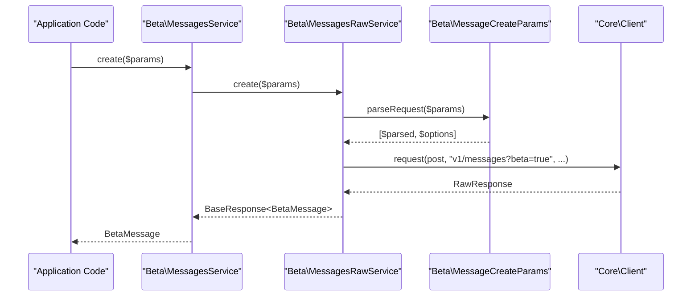
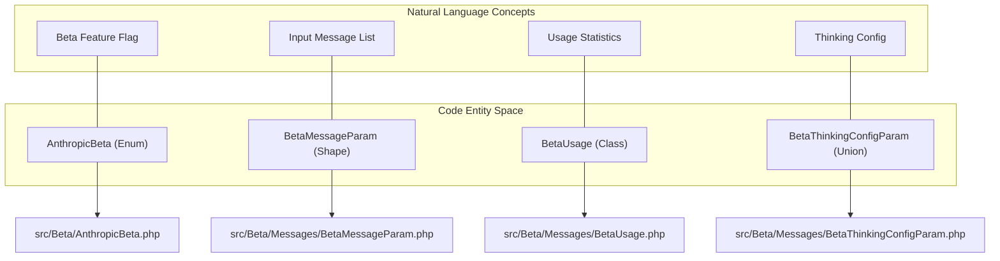

<!-- source: DeepWiki mcp.deepwiki.com · repo anthropics/anthropic-sdk-php · page 3.2 Beta Messages Service · fetched 2026-10-26 -->

# Beta Messages Service

<details>
<summary>Relevant source files</summary>

The following files were used as context for generating this wiki page:

- [src/Beta/AnthropicBeta.php](src/Beta/AnthropicBeta.php)
- [src/Beta/Messages/Batches/BatchCreateParams/Request/Params.php](src/Beta/Messages/Batches/BatchCreateParams/Request/Params.php)
- [src/Beta/Messages/Batches/BatchCreateParams/Request/Params/Speed.php](src/Beta/Messages/Batches/BatchCreateParams/Request/Params/Speed.php)
- [src/Beta/Messages/BetaMessage.php](src/Beta/Messages/BetaMessage.php)
- [src/Beta/Messages/BetaOutputConfig.php](src/Beta/Messages/BetaOutputConfig.php)
- [src/Beta/Messages/BetaServerToolUseBlock.php](src/Beta/Messages/BetaServerToolUseBlock.php)
- [src/Beta/Messages/BetaUsage.php](src/Beta/Messages/BetaUsage.php)
- [src/Beta/Messages/BetaUsage/Speed.php](src/Beta/Messages/BetaUsage/Speed.php)
- [src/Beta/Messages/BetaWebSearchToolResultErrorCode.php](src/Beta/Messages/BetaWebSearchToolResultErrorCode.php)
- [src/Beta/Messages/MessageCountTokensParams.php](src/Beta/Messages/MessageCountTokensParams.php)
- [src/Beta/Messages/MessageCountTokensParams/Speed.php](src/Beta/Messages/MessageCountTokensParams/Speed.php)
- [src/Beta/Messages/MessageCreateParams.php](src/Beta/Messages/MessageCreateParams.php)
- [src/Beta/Messages/MessageCreateParams/Speed.php](src/Beta/Messages/MessageCreateParams/Speed.php)
- [src/Messages/Message.php](src/Messages/Message.php)
- [src/ServiceContracts/Beta/MessagesContract.php](src/ServiceContracts/Beta/MessagesContract.php)
- [src/Services/Beta/MessagesRawService.php](src/Services/Beta/MessagesRawService.php)
- [src/Services/Beta/MessagesService.php](src/Services/Beta/MessagesService.php)

</details>


The Beta Messages Service provides access to Anthropic's experimental and preview features through a dedicated namespace. While functionally similar to the stable Messages API, it includes support for advanced capabilities such as Model Context Protocol (MCP) servers, context management, extended thinking, and specialized output configurations.

## Overview and Beta Flagging

The Beta Messages Service is implemented via `MessagesService` and `MessagesRawService` within the `Anthropic\Services\Beta` namespace [src/Services/Beta/MessagesService.php:63-64](). 

Unlike the stable service, the beta service explicitly appends a `beta=true` query parameter to all outgoing request URLs [src/Services/Beta/MessagesRawService.php:115](). Additionally, it injects the `anthropic-beta` header, which is populated by the `betas` parameter in the request DTOs [src/Services/Beta/MessagesRawService.php:110-119]().

### Key Beta Features
*   **MCP Servers**: Integration with Model Context Protocol servers via `mcpServers` [src/Beta/Messages/MessageCreateParams.php:147]().
*   **Context Management**: Granular control over how Claude manages conversation history and function results [src/Beta/Messages/MessageCreateParams.php:159]().
*   **Extended Thinking**: Support for `thinking` configurations (enabled, disabled, or adaptive) [src/Beta/Messages/MessageCreateParams.php:218]().
*   **Prompt Caching**: Ephemeral cache control markers [src/Beta/Messages/MessageCreateParams.php:150]().
*   **Output Control**: Specialized `outputConfig` and `outputFormat` for structured JSON and long-form generation [src/Beta/Messages/MessageCreateParams.php:188-193]().

**Sources:**
* [src/Services/Beta/MessagesService.php:63-82]()
* [src/Services/Beta/MessagesRawService.php:102-127]()
* [src/Beta/Messages/MessageCreateParams.php:142-230]()

---

## Service Architecture

The Beta Messages implementation follows the standard SDK pattern of separating high-level convenience methods from raw, low-level API interactions.

### MessagesService vs. MessagesRawService

`MessagesService` acts as the primary entry point, providing a simplified interface for `create()`, `createStream()`, and `countTokens()` [src/Services/Beta/MessagesService.php:63-146](). It also provides access to the `BatchesService` for bulk operations [src/Services/Beta/MessagesService.php:73]().

`MessagesRawService` handles the actual HTTP lifecycle, including parameter parsing via `MessageCreateParams::parseRequest()` and conversion of response payloads into `BetaMessage` models [src/Services/Beta/MessagesRawService.php:106-126]().

### Data Flow: Request to Response

The following diagram illustrates the flow of a Beta Message request through the SDK entities.

**Beta Request Lifecycle**


**Sources:**
* [src/Services/Beta/MessagesService.php:63-82]()
* [src/Services/Beta/MessagesRawService.php:102-127]()
* [src/Beta/Messages/MessageCreateParams.php:70-74]()

---

## Beta Parameters and Models

The beta namespace utilizes specific DTOs that mirror stable counterparts but include beta-only fields.

### MessageCreateParams (Beta)
The `MessageCreateParams` class in the Beta namespace [src/Beta/Messages/MessageCreateParams.php:70]() defines the schema for requests. It includes several specialized fields not found in the stable service:

| Parameter | Type | Description |
| :--- | :--- | :--- |
| `mcpServers` | `list<BetaRequestMCPServerURLDefinition>` | Defines external MCP servers Claude can access [src/Beta/Messages/MessageCreateParams.php:147](). |
| `contextManagement` | `BetaContextManagementConfig` | Controls persistence of tool results and context [src/Beta/Messages/MessageCreateParams.php:159](). |
| `thinking` | `BetaThinkingConfigParam` | Configures extended thinking capabilities [src/Beta/Messages/MessageCreateParams.php:218](). |
| `betas` | `list<AnthropicBeta>` | Enums for specific beta feature flags like `COMPUTER_USE_2024_10_22` [src/Beta/AnthropicBeta.php:7-48](). |

### BetaMessage Response Model
The `BetaMessage` model [src/Beta/Messages/BetaMessage.php:33]() encapsulates the API response. It includes a `BetaUsage` object [src/Beta/Messages/BetaMessage.php:158]() which provides detailed token breakdown, including `cacheReadInputTokens` and `cacheCreationInputTokens` [src/Beta/Messages/BetaUsage.php:46-53]().

**Entity Mapping: Natural Language to Code**


**Sources:**
* [src/Beta/Messages/MessageCreateParams.php:45-68]()
* [src/Beta/Messages/BetaMessage.php:20-31]()
* [src/Beta/Messages/BetaUsage.php:19-30]()
* [src/Beta/AnthropicBeta.php:7-48]()

---

## Token Counting (Beta)

The Beta service includes a specialized `countTokens()` method [src/Services/Beta/MessagesService.php:132]() that allows developers to calculate the token cost of a message (including tools and images) without generating a response.

This utilizes the `MessageCountTokensParams` DTO [src/Beta/Messages/MessageCountTokensParams.php:58](). It supports beta-specific counting for:
*   **MCP Servers**: Tokens consumed by server definitions [src/Beta/Messages/MessageCountTokensParams.php:147]().
*   **Context Management**: Tokens associated with managed context blocks [src/Beta/Messages/MessageCountTokensParams.php:139]().

**Sources:**
* [src/Services/Beta/MessagesService.php:132-146]()
* [src/Beta/Messages/MessageCountTokensParams.php:58-153]()

---

## Tool Execution and BetaToolRunner

The Beta Messages Service is frequently used in conjunction with the `BetaToolRunner`. This utility facilitates agentic loops where the model can autonomously call tools, receive results, and continue the conversation.

The `MessagesContract` defines the relationship between the service and the tool runner [src/ServiceContracts/Beta/MessagesContract.php:36](). While the standard `create()` method returns a `BetaMessage`, the `BetaToolRunner` (referenced in the service imports) is used to orchestrate `BetaRunnableTool` instances [src/Services/Beta/MessagesService.php:39-40]().

**Tool Integration Flow**
```mermaid
graph LR
    subgraph "Tool Runner Loop"
        TR["BetaToolRunner"]
        MS["MessagesService"]
        RT["BetaRunnableTool"]
    end

    TR -->|1. Request| MS
    MS -->|2. BetaMessage (tool_use)| TR
    TR -->|3. Execute| RT
    RT -->|4. ToolResult| TR
    TR -->|5. Follow-up| MS
```

**Sources:**
* [src/Services/Beta/MessagesService.php:39-40]()
* [src/ServiceContracts/Beta/MessagesContract.php:35-36]()
* [src/Beta/Messages/BetaMessage.php:127]() (stopReason: "tool_use")

---

