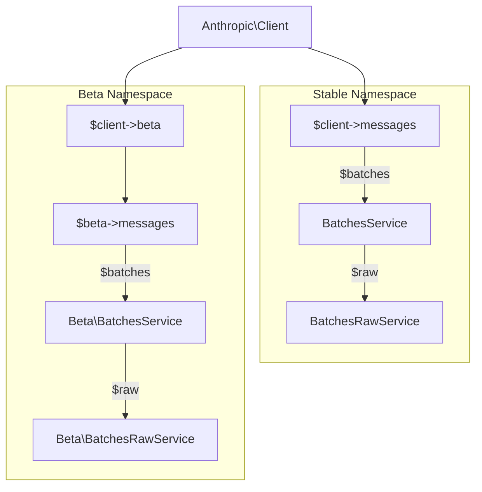
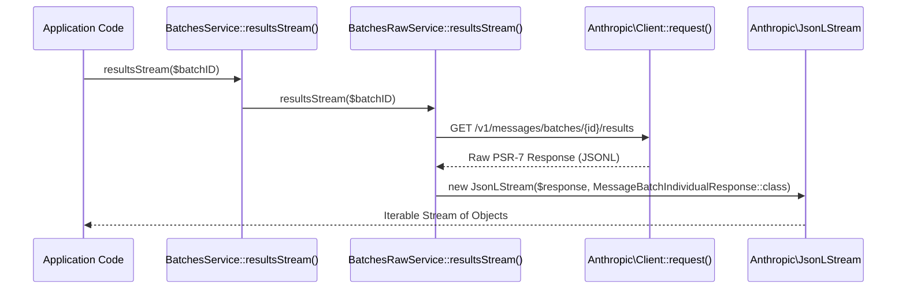

<!-- source: DeepWiki mcp.deepwiki.com · repo anthropics/anthropic-sdk-php · page 3.3 Message Batches · fetched 2026-10-26 -->

# Message Batches

<details>
<summary>Relevant source files</summary>

The following files were used as context for generating this wiki page:

- [.stats.yml](.stats.yml)
- [src/Beta/Files/DeletedFile.php](src/Beta/Files/DeletedFile.php)
- [src/Beta/Files/FileDeleteParams.php](src/Beta/Files/FileDeleteParams.php)
- [src/Beta/Files/FileListParams.php](src/Beta/Files/FileListParams.php)
- [src/Beta/Files/FileMetadata.php](src/Beta/Files/FileMetadata.php)
- [src/Beta/Files/FileRetrieveMetadataParams.php](src/Beta/Files/FileRetrieveMetadataParams.php)
- [src/Beta/Messages/Batches/BatchCancelParams.php](src/Beta/Messages/Batches/BatchCancelParams.php)
- [src/Beta/Messages/Batches/BatchCreateParams.php](src/Beta/Messages/Batches/BatchCreateParams.php)
- [src/Beta/Messages/Batches/BatchDeleteParams.php](src/Beta/Messages/Batches/BatchDeleteParams.php)
- [src/Beta/Messages/Batches/BatchListParams.php](src/Beta/Messages/Batches/BatchListParams.php)
- [src/Beta/Messages/Batches/BatchResultsParams.php](src/Beta/Messages/Batches/BatchResultsParams.php)
- [src/Beta/Messages/Batches/BatchRetrieveParams.php](src/Beta/Messages/Batches/BatchRetrieveParams.php)
- [src/Beta/Messages/Batches/DeletedMessageBatch.php](src/Beta/Messages/Batches/DeletedMessageBatch.php)
- [src/Beta/Messages/Batches/MessageBatch.php](src/Beta/Messages/Batches/MessageBatch.php)
- [src/Beta/Messages/Batches/MessageBatchIndividualResponse.php](src/Beta/Messages/Batches/MessageBatchIndividualResponse.php)
- [src/Beta/Messages/BetaMessageTokensCount.php](src/Beta/Messages/BetaMessageTokensCount.php)
- [src/Messages/Batches/DeletedMessageBatch.php](src/Messages/Batches/DeletedMessageBatch.php)
- [src/Messages/Batches/MessageBatch.php](src/Messages/Batches/MessageBatch.php)
- [src/Messages/Batches/MessageBatchIndividualResponse.php](src/Messages/Batches/MessageBatchIndividualResponse.php)
- [src/ServiceContracts/Beta/Messages/BatchesContract.php](src/ServiceContracts/Beta/Messages/BatchesContract.php)
- [src/ServiceContracts/Beta/Messages/BatchesRawContract.php](src/ServiceContracts/Beta/Messages/BatchesRawContract.php)
- [src/ServiceContracts/Messages/BatchesContract.php](src/ServiceContracts/Messages/BatchesContract.php)
- [src/ServiceContracts/Messages/BatchesRawContract.php](src/ServiceContracts/Messages/BatchesRawContract.php)
- [src/Services/Beta/Messages/BatchesRawService.php](src/Services/Beta/Messages/BatchesRawService.php)
- [src/Services/Beta/Messages/BatchesService.php](src/Services/Beta/Messages/BatchesService.php)
- [src/Services/Messages/BatchesRawService.php](src/Services/Messages/BatchesRawService.php)
- [src/Services/Messages/BatchesService.php](src/Services/Messages/BatchesService.php)
- [tests/Services/Beta/Messages/BatchesTest.php](tests/Services/Beta/Messages/BatchesTest.php)
- [tests/Services/Beta/MessagesTest.php](tests/Services/Beta/MessagesTest.php)
- [tests/Services/Messages/BatchesTest.php](tests/Services/Messages/BatchesTest.php)
- [tests/Services/MessagesTest.php](tests/Services/MessagesTest.php)

</details>


The Message Batches API allows for the asynchronous processing of multiple Messages API requests in a single group. Batches can contain a large number of individual message requests, begin processing immediately upon creation, and may take up to 24 hours to complete [src/Services/Messages/BatchesService.php:41-44]().

## Service Architecture

The SDK provides batch functionality through two primary service layers in both the stable (`Anthropic\Services\Messages`) and beta (`Anthropic\Services\Beta\Messages`) namespaces.

- **BatchesService**: The high-level developer-facing API that returns typed DTOs like `MessageBatch` and `Page` [src/Services/Messages/BatchesService.php:23-24]().
- **BatchesRawService**: The underlying service that returns `BaseResponse` objects, providing access to raw HTTP metadata and the `parse()` method used by the high-level service [src/Services/Messages/BatchesRawService.php:27-32]().

### Code Entity Mapping

The following diagram illustrates the relationship between the client entry points and the batch service implementations.

**Batch Service Organization**

Sources: [src/Services/Messages/BatchesService.php:28-36](), [src/Services/Beta/Messages/BatchesService.php:29-37](), [tests/Services/Messages/BatchesTest.php:36-37](), [tests/Services/Beta/Messages/BatchesTest.php:36-37]()

## Batch Lifecycle Operations

### Creating a Batch
Batches are created by passing a list of request objects. Each request must include a `custom_id` to track the result and a `params` object containing standard Message API parameters (model, messages, max_tokens, etc.) [src/Services/Messages/BatchesService.php:47-55]().

```php
$batch = $client->messages->batches->create(
    requests: [
        [
            'customID' => 'request-123',
            'params' => [
                'model' => 'claude-3-5-sonnet-20240620',
                'maxTokens' => 1024,
                'messages' => [['role' => 'user', 'content' => 'Hello!']],
            ],
        ],
    ]
);
```
Sources: [src/Services/Messages/BatchesService.php:52-62](), [tests/Services/Messages/BatchesTest.php:34-47]()

### Polling and Retrieval
The `retrieve` method is idempotent and used to check the status of a batch [src/Services/Messages/BatchesService.php:67-70](). Developers typically poll this endpoint until the `processing_status` reaches a terminal state (e.g., `ended`) [src/Services/Messages/BatchesService.php:65-84]().

### Listing and Management
- **List**: Returns a paginated list of batches in the workspace, ordered by creation date (newest first) [src/Services/Messages/BatchesService.php:88-91]().
- **Cancel**: Initiates cancellation of an in-progress batch. Some non-interruptible requests may still complete [src/Services/Messages/BatchesService.php:145-149]().
- **Delete**: Removes a batch record. A batch must be in a terminal state (completed or canceled) before it can be deleted [src/Services/Messages/BatchesService.php:123-127]().

Sources: [src/Services/Messages/BatchesService.php:88-166](), [src/ServiceContracts/Messages/BatchesContract.php:48-93]()

## Result Streaming (JSONL)

Once a batch is complete, the results are available via a `results_url`. The SDK provides the `resultsStream()` method to consume these results as a stream of objects [src/Services/Messages/BatchesService.php:178-186]().

The underlying implementation uses `JsonLStream` to parse the `.jsonl` (JSON Lines) format where each line represents a `MessageBatchIndividualResponse` [src/Services/Messages/BatchesRawService.php:12](), [src/Beta/Messages/Batches/BatchResultsParams.php:14-16]().

**Data Flow: Batch Results**

Sources: [src/Services/Messages/BatchesService.php:178-186](), [src/Services/Messages/BatchesRawService.php:197-216](), [src/Beta/Messages/Batches/BatchResultsParams.php:14-17]()

## Beta Namespace and Headers

The Message Batches API often requires specific beta headers. In the `Beta\Messages\BatchesService`, these headers are handled automatically or can be passed explicitly via the `$betas` parameter [src/Services/Beta/Messages/BatchesService.php:49-56]().

- **Endpoint Flag**: Beta batch requests append `?beta=true` to the URL path [src/Services/Beta/Messages/BatchesRawService.php:72]().
- **Automatic Headers**: The `BatchesRawService` injects the required `anthropic-beta: message-batches-2024-09-24` header into the `RequestOptions` if not otherwise specified [src/Services/Beta/Messages/BatchesRawService.php:81-84]().

Sources: [src/Services/Beta/Messages/BatchesRawService.php:67-86](), [src/Services/Beta/Messages/BatchesService.php:54-65]()

## Implementation Summary Table

| Operation | Service Method | Raw Method | Return Type |
| :--- | :--- | :--- | :--- |
| **Create** | `create()` | `create()` | `MessageBatch` |
| **Retrieve** | `retrieve()` | `retrieve()` | `MessageBatch` |
| **List** | `list()` | `list()` | `Page<MessageBatch>` |
| **Cancel** | `cancel()` | `cancel()` | `MessageBatch` |
| **Delete** | `delete()` | `delete()` | `DeletedMessageBatch` |
| **Results** | `resultsStream()` | `resultsStream()` | `BaseStream<IndividualResponse>` |

Sources: [src/ServiceContracts/Messages/BatchesContract.php:20-109](), [src/Services/Messages/BatchesService.php:23-187]()

---

