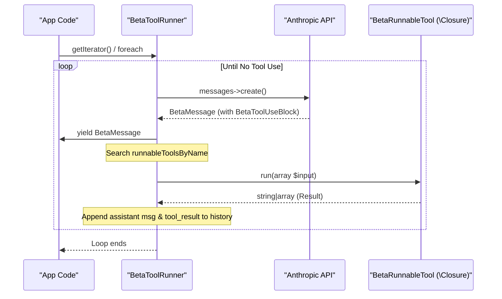
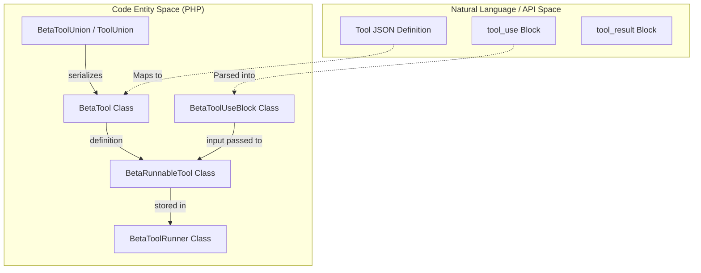

<!-- source: DeepWiki mcp.deepwiki.com · repo anthropics/anthropic-sdk-php · page 3.4 Tool Use · fetched 2026-10-26 -->

# Tool Use

Relevant source files

The following files were used as context for generating this wiki page:

- [examples/beta/beta_tool_runner.php](examples/beta/beta_tool_runner.php)
- [examples/list_models.php](examples/list_models.php)
- [examples/messages.php](examples/messages.php)
- [examples/messages_stream.php](examples/messages_stream.php)
- [src/Beta/Messages/BetaCodeExecutionTool20250522/AllowedCaller.php](src/Beta/Messages/BetaCodeExecutionTool20250522/AllowedCaller.php)
- [src/Beta/Messages/BetaCodeExecutionTool20250825/AllowedCaller.php](src/Beta/Messages/BetaCodeExecutionTool20250825/AllowedCaller.php)
- [src/Beta/Messages/BetaCodeExecutionTool20260120/AllowedCaller.php](src/Beta/Messages/BetaCodeExecutionTool20260120/AllowedCaller.php)
- [src/Beta/Messages/BetaMemoryTool20250818/AllowedCaller.php](src/Beta/Messages/BetaMemoryTool20250818/AllowedCaller.php)
- [src/Beta/Messages/BetaTool.php](src/Beta/Messages/BetaTool.php)
- [src/Beta/Messages/BetaTool/AllowedCaller.php](src/Beta/Messages/BetaTool/AllowedCaller.php)
- [src/Beta/Messages/BetaToolBash20241022/AllowedCaller.php](src/Beta/Messages/BetaToolBash20241022/AllowedCaller.php)
- [src/Beta/Messages/BetaToolBash20250124/AllowedCaller.php](src/Beta/Messages/BetaToolBash20250124/AllowedCaller.php)
- [src/Beta/Messages/BetaToolComputerUse20241022/AllowedCaller.php](src/Beta/Messages/BetaToolComputerUse20241022/AllowedCaller.php)
- [src/Beta/Messages/BetaToolComputerUse20250124/AllowedCaller.php](src/Beta/Messages/BetaToolComputerUse20250124/AllowedCaller.php)
- [src/Beta/Messages/BetaToolComputerUse20251124/AllowedCaller.php](src/Beta/Messages/BetaToolComputerUse20251124/AllowedCaller.php)
- [src/Beta/Messages/BetaToolUnion.php](src/Beta/Messages/BetaToolUnion.php)
- [src/Beta/Messages/MessageCountTokensParams/Tool.php](src/Beta/Messages/MessageCountTokensParams/Tool.php)
- [src/Lib/Tools/BetaRunnableTool.php](src/Lib/Tools/BetaRunnableTool.php)
- [src/Lib/Tools/BetaToolRunner.php](src/Lib/Tools/BetaToolRunner.php)
- [src/Messages/Tool.php](src/Messages/Tool.php)
- [src/Messages/ToolUnion.php](src/Messages/ToolUnion.php)
- [tests/Lib/Tools/BetaToolRunnerTest.php](tests/Lib/Tools/BetaToolRunnerTest.php)

The Tool Use system allows Anthropic models to interact with external functions, APIs, and built-in capabilities. The SDK provides a structured way to define tools, manage tool selection logic, and execute agentic loops where the model can call tools and process results autonomously.

## Tool Definitions and Unions

The SDK uses a "Union" pattern to handle the diverse set of tools available in both stable and beta namespaces. This allows the API to accept either custom user-defined tools or Anthropic's versioned built-in tools.

### ToolUnion and BetaToolUnion
The `ToolUnion` and `BetaToolUnion` classes act as containers for various tool types. They implement `ConverterSource` to handle the polymorphic serialization of tool definitions [src/Beta/Messages/BetaToolUnion.php:40-41]().

The `BetaToolUnion` supports a wide array of variants, including:
*   **Custom Tools**: Defined via the `BetaTool` class [src/Beta/Messages/BetaTool.php:33]().
*   **Built-in Tools**: Specialized classes for Bash, Computer Use, Text Editing, and more [src/Beta/Messages/BetaToolUnion.php:47-73]().

### Custom Tool Structure
A standard tool is defined using the `BetaTool` class (or `Tool` in the stable namespace). Key components include:
*   **name**: The identifier used by the model to invoke the tool [src/Beta/Messages/BetaTool.php:52]().
*   **inputSchema**: A JSON schema defining the parameters the tool accepts [src/Beta/Messages/BetaTool.php:44]().
*   **description**: Detailed natural language instructions for the model on how and when to use the tool [src/Beta/Messages/BetaTool.php:76]().

### AllowedCaller Pattern
Many beta tools support the `AllowedCaller` property. This restricts which entities can invoke a specific tool. For example, a tool might be restricted to being called only from within a code execution environment rather than directly by the model [src/Beta/Messages/BetaCodeExecutionTool20260120/AllowedCaller.php:15-22]().

**Sources:** [src/Beta/Messages/BetaTool.php:33-96](), [src/Beta/Messages/BetaToolUnion.php:40-74](), [src/Beta/Messages/BetaCodeExecutionTool20260120/AllowedCaller.php:1-22]().

## Tool Choice Variants

When sending a request, developers can control how the model selects tools using the `tool_choice` parameter. This typically supports four modes:
1.  **auto**: The model decides whether to use a tool or provide a text response.
2.  **any**: The model is forced to use at least one of the provided tools.
3.  **none**: The model is prevented from using any tools.
4.  **tool**: The model is forced to use a specific, named tool.

## Built-in Versioned Tools

The SDK includes specialized models for Anthropic's built-in capabilities. These are versioned to ensure compatibility with specific model behaviors.

| Tool Category | Key Classes | Versions (Examples) |
| :--- | :--- | :--- |
| **Bash** | `BetaToolBash` | `20241022`, `20250124` |
| **Computer Use** | `BetaToolComputerUse` | `20241022`, `20250124`, `20251124` |
| **Text Editor** | `BetaToolTextEditor` | `20241022`, `20250124`, `20250429`, `20250728` |
| **Code Execution** | `BetaCodeExecutionTool` | `20250522`, `20250825`, `20260120` |
| **Search/Fetch** | `BetaWebSearchTool`, `BetaWebFetchTool` | `20250305`, `20250910`, `20260209` |
| **Memory** | `BetaMemoryTool` | `20250818` |

**Sources:** [src/Beta/Messages/BetaToolUnion.php:47-73](), [src/Lib/Tools/BetaRunnableTool.php:7-32]().

## Agentic Loop: BetaToolRunner

The `BetaToolRunner` is a high-level utility that manages the "Assistant-Tool" conversation loop. It automates the process of sending tool calls to your local code, receiving results, and feeding them back to the model until a final answer is reached.

### Runnable Tools
To use the runner, tools must be wrapped in a `BetaRunnableTool`. This class pairs a tool definition (schema) with a PHP `\Closure` that executes the logic [src/Lib/Tools/BetaRunnableTool.php:35-44]().

### Data Flow and Execution
The `BetaToolRunner` implements `IteratorAggregate`, yielding `BetaMessage` objects for every turn in the conversation [src/Lib/Tools/BetaToolRunner.php:25-70]().

### BetaToolRunner Lifecycle
The following diagram illustrates how the `BetaToolRunner` bridges natural language requests to PHP code execution.

**Title: BetaToolRunner Execution Flow**

### Key Functions
*   `runUntilDone()`: A convenience method that executes the entire loop and returns only the final `BetaMessage` [src/Lib/Tools/BetaToolRunner.php:87-99]().
*   `setMessagesParams()`: Allows updating model, tools, or messages mid-iteration [src/Lib/Tools/BetaToolRunner.php:114-159]().
*   `pushMessages()`: Manually appends messages to the internal history [src/Lib/Tools/BetaToolRunner.php:169-178]().

**Sources:** [src/Lib/Tools/BetaToolRunner.php:25-178](), [src/Lib/Tools/BetaRunnableTool.php:35-71](), [examples/beta/beta_tool_runner.php:20-58]().

## Implementation Mapping

The SDK maps JSON-based API definitions to PHP class entities to ensure type safety during tool execution.

**Title: Tool System Entity Mapping**

**Sources:** [src/Beta/Messages/BetaTool.php:33](), [src/Lib/Tools/BetaRunnableTool.php:35](), [src/Lib/Tools/BetaToolRunner.php:25](), [src/Beta/Messages/BetaToolUnion.php:40]().

---

