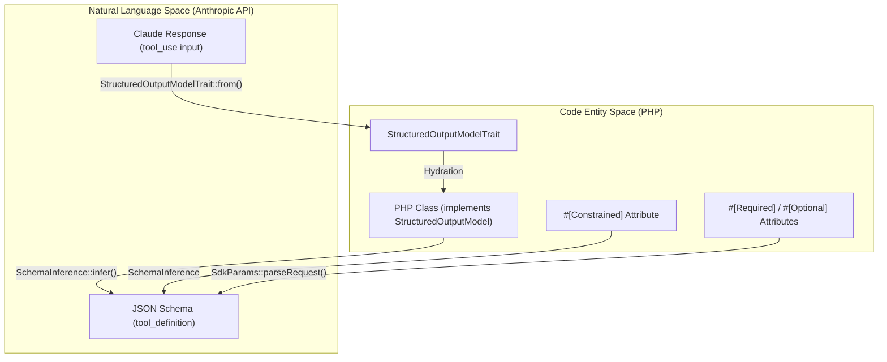
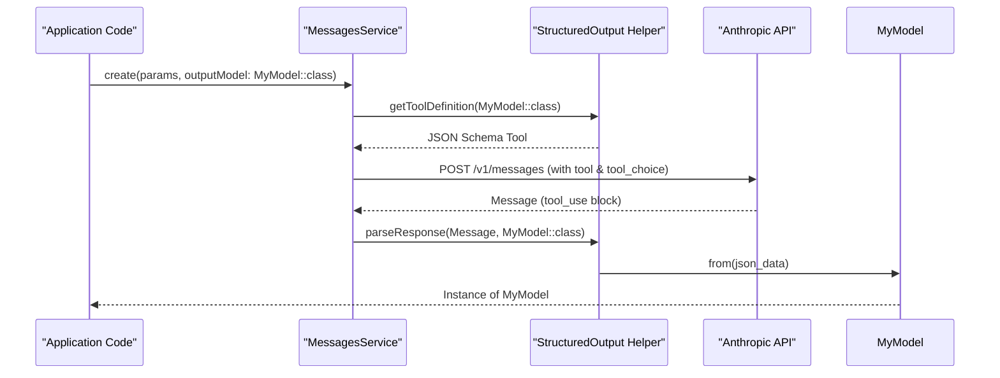

<!-- source: DeepWiki mcp.deepwiki.com · repo anthropics/anthropic-sdk-php · page 3.5 Structured Output · fetched 2026-10-26 -->

# Structured Output

Relevant source files

The following files were used as context for generating this wiki page:

- [examples/messages_structured_output.php](examples/messages_structured_output.php)
- [examples/messages_structured_output_constraints.php](examples/messages_structured_output_constraints.php)
- [examples/messages_structured_output_nested.php](examples/messages_structured_output_nested.php)
- [examples/messages_structured_output_raw_schema.php](examples/messages_structured_output_raw_schema.php)
- [examples/messages_structured_output_stream.php](examples/messages_structured_output_stream.php)
- [src/Beta/Messages/Batches/BatchCreateParams/Request/Params.php](src/Beta/Messages/Batches/BatchCreateParams/Request/Params.php)
- [src/Beta/Messages/BetaTextBlock.php](src/Beta/Messages/BetaTextBlock.php)
- [src/Beta/Messages/MessageCountTokensParams.php](src/Beta/Messages/MessageCountTokensParams.php)
- [src/Beta/Messages/MessageCreateParams.php](src/Beta/Messages/MessageCreateParams.php)
- [src/Core/Attributes/Optional.php](src/Core/Attributes/Optional.php)
- [src/Core/Attributes/Required.php](src/Core/Attributes/Required.php)
- [src/Lib/Attributes/Constrained.php](src/Lib/Attributes/Constrained.php)
- [src/Messages/Batches/BatchCreateParams/Request/Params.php](src/Messages/Batches/BatchCreateParams/Request/Params.php)
- [src/Messages/MessageCountTokensParams.php](src/Messages/MessageCountTokensParams.php)
- [src/Messages/MessageCreateParams.php](src/Messages/MessageCreateParams.php)
- [src/ServiceContracts/Beta/MessagesContract.php](src/ServiceContracts/Beta/MessagesContract.php)
- [src/ServiceContracts/MessagesContract.php](src/ServiceContracts/MessagesContract.php)
- [src/Services/Beta/MessagesRawService.php](src/Services/Beta/MessagesRawService.php)
- [src/Services/Beta/MessagesService.php](src/Services/Beta/MessagesService.php)
- [src/Services/MessagesRawService.php](src/Services/MessagesRawService.php)
- [src/Services/MessagesService.php](src/Services/MessagesService.php)

The Anthropic PHP SDK provides a robust system for generating and parsing structured data from Claude. This system allows developers to define expected response formats using native PHP classes, which are automatically converted into JSON schemas for the API and then hydrated back into typed PHP objects upon response.

## Overview of Structured Output

Structured output is primarily managed through the `StructuredOutput` helper and the `MessagesService`. By leveraging PHP attributes and type reflection, the SDK bridges the gap between natural language responses and strictly typed data structures.

### Data Flow: From PHP Class to API and Back

The following diagram illustrates how a PHP class definition is transformed into a JSON schema for the request and how the resulting JSON is mapped back to a class instance.

**Entity Space Bridge: Class to Schema Mapping**

**Sources:**
- `src/Lib/Helpers/StructuredOutput.php`
- `src/Lib/Attributes/Constrained.php`
- `src/Core/Concerns/SdkModel.php`

---

## Defining Models

To receive structured output, you define a PHP class that represents the desired data structure.

### Key Components

1.  **`StructuredOutputModel` Interface**: A marker interface for classes intended to be used for structured output.
2.  **`StructuredOutputModelTrait`**: Provides the static `from()` method used to instantiate the class from API response data.
3.  **`Constrained` Attribute**: Located in `Anthropic\Lib\Attributes\Constrained`, this attribute allows you to add metadata like descriptions, minimum/maximum values, or regex patterns to properties [src/Lib/Attributes/Constrained.php:7-25]().
4.  **`Required` and `Optional` Attributes**: Used to signal property presence in the generated JSON schema [src/Core/Attributes/Required.php:11-14](), [src/Core/Attributes/Optional.php:11-14]().

### Schema Inference

The SDK uses an internal inference engine to convert PHP type hints into JSON Schema.

| PHP Type | JSON Schema Type |
| :--- | :--- |
| `string` | `string` |
| `int` | `integer` |
| `float` | `number` |
| `bool` | `boolean` |
| `array` | `array` or `object` |
| `class-string` | `object` (recursive) |

**Sources:**
- `src/Lib/Helpers/StructuredOutput.php`
- `src/Lib/Attributes/Constrained.php`

---

## Implementation in Messages API

The `MessagesService` uses the `StructuredOutput` helper to intercept requests that require specific return types.

### Interaction Logic

When a `StructuredOutputModel` is passed to the `create` or `createStream` methods, the following sequence occurs:

1.  **Schema Generation**: The SDK inspects the provided class and generates a tool definition where the tool's input schema matches the class structure.
2.  **Tool Injection**: The tool is added to the `tools` parameter of the `MessageCreateParams` [src/Services/MessagesService.php:10-10]().
3.  **Tool Choice**: The SDK sets `tool_choice` to force the model to use that specific tool.
4.  **Response Parsing**:
    *   **Synchronous**: The `MessagesService` parses the `tool_use` block from the response and calls the model's `from()` method [src/Services/MessagesService.php:87-104]().
    *   **Streaming**: Events are processed via `SSEStream`, and the final accumulated tool input is hydrated into the object.

**Logic Flow: Structured Request Lifecycle**

**Sources:**
- `src/Services/MessagesService.php:51-104]()`
- `src/Services/Beta/MessagesService.php:63-127]()`
- `src/Lib/Helpers/StructuredOutput.php`

---

## Beta vs. Stable Support

Structured output is supported in both the stable and beta namespaces. The implementation details differ slightly in how headers and beta-specific parameters are handled.

### Beta Messages Service
The `Anthropic\Services\Beta\MessagesService` supports structured output while automatically including the required `anthropic-beta` headers for features like context management or MCP servers [src/Services/Beta/MessagesRawService.php:110-126]().

### Message Batches
Structured output can also be used within Message Batches. Individual requests within a batch define their own `max_tokens` and `model`, and can include the tool definitions generated for structured output [src/Beta/Messages/Batches/BatchCreateParams/Request/Params.php:57-80]().

**Sources:**
- `src/Services/Beta/MessagesService.php:63-82]()`
- `src/Beta/Messages/Batches/BatchCreateParams/Request/Params.php:82-95]()`
- `src/Messages/Batches/BatchCreateParams/Request/Params.php:68-81]()`

---

