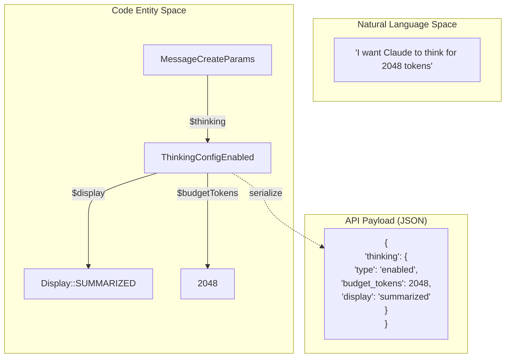
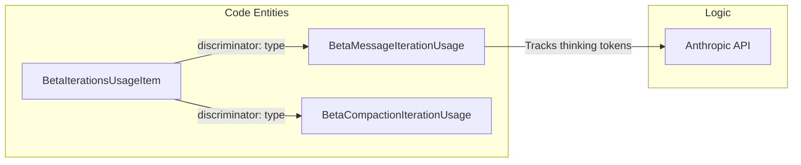

<!-- source: DeepWiki mcp.deepwiki.com · repo anthropics/anthropic-sdk-php · page 3.6 Extended Thinking · fetched 2026-10-26 -->

# Extended Thinking

Relevant source files

The following files were used as context for generating this wiki page:

- [src/Beta/Messages/BetaIterationsUsageItem.php](src/Beta/Messages/BetaIterationsUsageItem.php)
- [src/Beta/Messages/BetaThinkingConfigAdaptive.php](src/Beta/Messages/BetaThinkingConfigAdaptive.php)
- [src/Beta/Messages/BetaThinkingConfigAdaptive/Display.php](src/Beta/Messages/BetaThinkingConfigAdaptive/Display.php)
- [src/Beta/Messages/BetaThinkingConfigEnabled.php](src/Beta/Messages/BetaThinkingConfigEnabled.php)
- [src/Beta/Messages/BetaThinkingConfigEnabled/Display.php](src/Beta/Messages/BetaThinkingConfigEnabled/Display.php)
- [src/Messages/ThinkingConfigAdaptive.php](src/Messages/ThinkingConfigAdaptive.php)
- [src/Messages/ThinkingConfigAdaptive/Display.php](src/Messages/ThinkingConfigAdaptive/Display.php)
- [src/Messages/ThinkingConfigEnabled.php](src/Messages/ThinkingConfigEnabled.php)
- [src/Messages/ThinkingConfigEnabled/Display.php](src/Messages/ThinkingConfigEnabled/Display.php)

Extended Thinking is a feature that allows Claude models to perform internal reasoning before providing a final response. This reasoning process is returned as part of the message content, allowing for more thorough analysis of complex problems. The Anthropic PHP SDK manages this via the `ThinkingConfig` system, available in both stable and beta namespaces.

## Thinking Configuration System

The SDK uses a union-like structure to configure thinking behavior. Users can choose between enabling thinking with a specific token budget, using an adaptive mode, or disabling it entirely.

### Configuration Variants

| Class | Type Identifier | Description |
| :--- | :--- | :--- |
| `ThinkingConfigEnabled` | `enabled` | Enables extended thinking with a mandatory `budgetTokens` value. |
| `ThinkingConfigAdaptive` | `adaptive` | Allows the model to decide when to use extended thinking. |
| `ThinkingConfigDisabled` | `disabled` | Explicitly disables extended thinking features. |

### The Display Sub-type
Both `Enabled` and `Adaptive` configurations support a `display` parameter, which is governed by the `Display` enum [src/Messages/ThinkingConfigEnabled/Display.php:10-15]().

*   **`SUMMARIZED`**: Thinking content is returned normally in the response [src/Messages/ThinkingConfigEnabled/Display.php:12]().
*   **`OMITTED`**: Thinking content is redacted from the response, but a signature is returned to maintain continuity in multi-turn conversations [src/Messages/ThinkingConfigEnabled/Display.php:14]().

### Data Flow: Thinking Configuration to API Payload

The following diagram illustrates how the PHP classes map to the API request structure.

**Thinking Configuration Mapping**

Sources: [src/Messages/ThinkingConfigEnabled.php:14-25](), [src/Messages/ThinkingConfigEnabled/Display.php:10-15]()

## Implementation Details

### ThinkingConfigEnabled
This class requires a `budgetTokens` value, which must be at least 1024 and less than the `max_tokens` specified for the request [src/Messages/ThinkingConfigEnabled.php:28-35]().

*   **Initialization**: Use `ThinkingConfigEnabled::with(budgetTokens: 2048)` for type-safe construction [src/Messages/ThinkingConfigEnabled.php:71-82]().
*   **Validation**: The `budgetTokens` property is marked as `#[Required('budget_tokens')]` to ensure the generator maps it correctly to the snake_case API field [src/Messages/ThinkingConfigEnabled.php:34-35]().

### ThinkingConfigAdaptive
The adaptive configuration allows the model to trigger reasoning based on the complexity of the prompt.

*   **Type**: Fixed to `'adaptive'` [src/Messages/ThinkingConfigAdaptive.php:25]().
*   **Display**: Optional parameter to control visibility of the reasoning process [src/Messages/ThinkingConfigAdaptive.php:32-33]().

Sources: [src/Messages/ThinkingConfigEnabled.php:18-35](), [src/Messages/ThinkingConfigAdaptive.php:18-33]()

## Beta Namespace Equivalents

The SDK maintains identical structures within the `Anthropic\Beta\Messages` namespace to support experimental thinking features.

*   `BetaThinkingConfigEnabled` [src/Beta/Messages/BetaThinkingConfigEnabled.php:18]()
*   `BetaThinkingConfigAdaptive` [src/Beta/Messages/BetaThinkingConfigAdaptive.php:18]()
*   `BetaThinkingConfigEnabled\Display` [src/Beta/Messages/BetaThinkingConfigEnabled/Display.php:10]()

These are used when interacting with the `Beta\MessagesService` to ensure compatibility with beta-specific headers and endpoints.

## Interactions with Token Counting and Streaming

### Token Usage Tracking
When thinking is enabled, the token usage returned by the API includes specific breakdown for reasoning. In the beta namespace, this is handled by `BetaIterationsUsageItem`, which discriminates between standard message usage and compaction usage [src/Beta/Messages/BetaIterationsUsageItem.php:20-38]().

### Streaming Thinking Blocks
In a streaming response (`createStream()`), thinking content is delivered as a specific type of content block.
1.  **Thinking Block Start**: Indicates the beginning of the reasoning process.
2.  **Thinking Delta**: Incremental pieces of the reasoning text.
3.  **Signature (if omitted)**: A cryptographic signature used for conversation continuity when `display` is set to `omitted`.

### Model Specifics and Deprecations
> [!WARNING]
> On `claude-opus-4-6` models, the `enabled` field is deprecated in favor of the structured `thinking` configuration object. Users should migrate from boolean flags to the `ThinkingConfigEnabled` or `ThinkingConfigAdaptive` classes.

**Token Usage and Iteration Flow**

Sources: [src/Beta/Messages/BetaIterationsUsageItem.php:24-38]()

---

