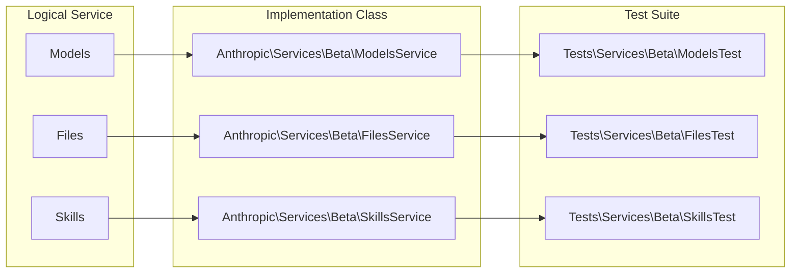

<!-- source: DeepWiki mcp.deepwiki.com · repo anthropics/anthropic-sdk-php · page 4 Beta Services · fetched 2026-10-26 -->

# Beta Services

<details>
<summary>Relevant source files</summary>

The following files were used as context for generating this wiki page:

- [src/ServiceContracts/Beta/FilesContract.php](src/ServiceContracts/Beta/FilesContract.php)
- [src/ServiceContracts/Beta/ModelsContract.php](src/ServiceContracts/Beta/ModelsContract.php)
- [src/ServiceContracts/ModelsContract.php](src/ServiceContracts/ModelsContract.php)
- [src/Services/Beta/FilesService.php](src/Services/Beta/FilesService.php)
- [src/Services/Beta/ModelsService.php](src/Services/Beta/ModelsService.php)
- [src/Services/BetaService.php](src/Services/BetaService.php)
- [src/Services/ModelsService.php](src/Services/ModelsService.php)
- [tests/Services/Beta/FilesTest.php](tests/Services/Beta/FilesTest.php)
- [tests/Services/Beta/ModelsTest.php](tests/Services/Beta/ModelsTest.php)
- [tests/Services/Beta/Skills/VersionsTest.php](tests/Services/Beta/Skills/VersionsTest.php)
- [tests/Services/Beta/SkillsTest.php](tests/Services/Beta/SkillsTest.php)
- [tests/Services/ModelsTest.php](tests/Services/ModelsTest.php)

</details>


The Anthropic PHP SDK provides access to experimental and preview features through the `Beta` namespace. While the Messages API is the primary interface for LLM interaction, the Beta services expand the SDK's capabilities to include advanced model metadata, file management for context, and persistent skill definitions.

All beta services are accessed via the `$client->beta` property [src/Services/BetaService.php:14-52]().

### Service Architecture

The Beta namespace mirrors the structure of the core SDK, providing both high-level typed services and "Raw" variants for direct response access.

Model of Beta Service Entry Points:
```mermaid
graph TD
    "Client"["Anthropic\Client"] --> "BetaService"["Anthropic\Services\BetaService"]
    "BetaService" --> "BetaModels"["Anthropic\Services\Beta\ModelsService"]
    "BetaService" --> "BetaFiles"["Anthropic\Services\Beta\FilesService"]
    "BetaService" --> "BetaSkills"["Anthropic\Services\Beta\SkillsService"]
    "BetaService" --> "BetaMessages"["Anthropic\Services\Beta\MessagesService"]
    
    "BetaModels" --> "BetaModelsRaw"["Anthropic\Services\Beta\ModelsRawService"]
    "BetaFiles" --> "BetaFilesRaw"["Anthropic\Services\Beta\FilesRawService"]
    "BetaSkills" --> "BetaSkillsRaw"["Anthropic\Services\Beta\SkillsRawService"]
```
Sources: [src/Services/BetaService.php:14-52](), [src/Services/Beta/ModelsService.php:19-32](), [src/Services/Beta/FilesService.php:20-33]()

---

## Models Service

The Models service allows developers to programmatically list available Anthropic models and retrieve detailed metadata about specific model versions or aliases. While a stable version exists, the Beta version supports experimental metadata fields.

- **Retrieve**: Fetches information for a specific model ID or alias [src/Services/Beta/ModelsService.php:47-58]().
- **List**: Returns a paginated list of available models, with the most recent models appearing first [src/Services/Beta/ModelsService.php:79-99]().

For details on capabilities like `ThinkingCapability` and pagination, see [Models Service](#4.1).

Sources: [src/Services/Beta/ModelsService.php:19-100](), [src/ServiceContracts/Beta/ModelsContract.php:1-55](), [tests/Services/Beta/ModelsTest.php:31-53]()

---

## Files Service (Beta)

The Files service manages documents and assets that can be referenced in message content. This is essential for features requiring persistent file storage or large-context injection.

- **Metadata Management**: Retrieve details about uploaded files without downloading the full content [src/Services/Beta/FilesService.php:109-120]().
- **Lifecycle**: Support for listing all files and deleting those no longer needed [src/Services/Beta/FilesService.php:52-96]().

For details on `FileMetadata` and integration with messages, see [Files Service (Beta)](#4.2).

Sources: [src/Services/Beta/FilesService.php:20-121](), [src/ServiceContracts/Beta/FilesContract.php:17-71](), [tests/Services/Beta/FilesTest.php:32-63]()

---

## Skills Service (Beta)

The Skills service provides a mechanism for defining and versioning complex toolsets or system behaviors that can be reused across different sessions. It includes a nested `Versions` service to manage the evolution of a skill.

| Operation | Service Method | Response DTO |
| :--- | :--- | :--- |
| **Create Skill** | `beta->skills->create()` | `SkillNewResponse` |
| **List Skills** | `beta->skills->list()` | `PageCursor<SkillListResponse>` |
| **Create Version** | `beta->skills->versions->create()` | `VersionNewResponse` |
| **Retrieve Version**| `beta->skills->versions->retrieve()`| `VersionGetResponse` |

For details on CRUD operations and cursor-based pagination, see [Skills Service (Beta)](#4.3).

Sources: [src/Services/BetaService.php:39-50](), [tests/Services/Beta/SkillsTest.php:34-73](), [tests/Services/Beta/Skills/VersionsTest.php:34-105]()

---

## Code Entity Mapping

The following diagram maps the logical Beta services to their implementation classes and test suites to assist in codebase navigation.


Sources: [src/Services/BetaService.php:14-52](), [tests/Services/Beta/ModelsTest.php:1-20](), [tests/Services/Beta/FilesTest.php:1-20](), [tests/Services/Beta/SkillsTest.php:1-20]()

---

