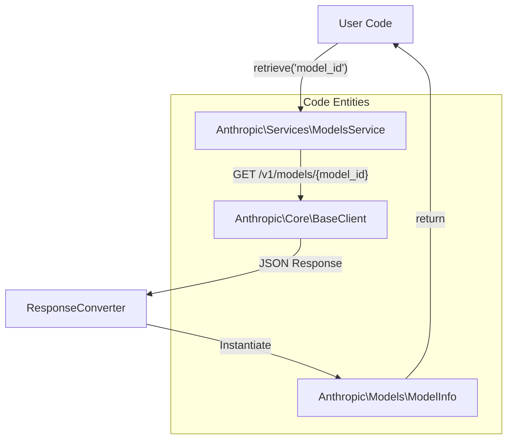
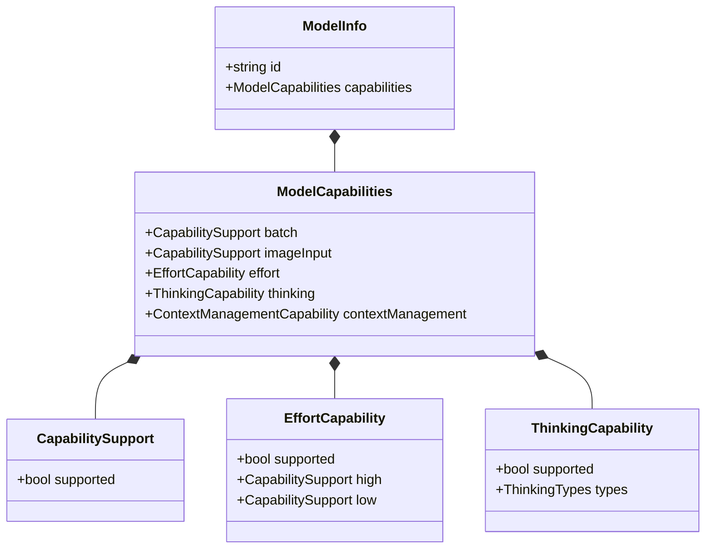

<!-- source: DeepWiki mcp.deepwiki.com · repo anthropics/anthropic-sdk-php · page 4.1 Models Service · fetched 2026-10-26 -->

# Models Service

<details>
<summary>Relevant source files</summary>

The following files were used as context for generating this wiki page:

- [src/Beta/Models/BetaCapabilitySupport.php](src/Beta/Models/BetaCapabilitySupport.php)
- [src/Beta/Models/BetaContextManagementCapability.php](src/Beta/Models/BetaContextManagementCapability.php)
- [src/Beta/Models/BetaEffortCapability.php](src/Beta/Models/BetaEffortCapability.php)
- [src/Beta/Models/BetaModelCapabilities.php](src/Beta/Models/BetaModelCapabilities.php)
- [src/Beta/Models/BetaModelInfo.php](src/Beta/Models/BetaModelInfo.php)
- [src/Beta/Models/BetaThinkingCapability.php](src/Beta/Models/BetaThinkingCapability.php)
- [src/Beta/Models/BetaThinkingTypes.php](src/Beta/Models/BetaThinkingTypes.php)
- [src/Models/CapabilitySupport.php](src/Models/CapabilitySupport.php)
- [src/Models/ContextManagementCapability.php](src/Models/ContextManagementCapability.php)
- [src/Models/EffortCapability.php](src/Models/EffortCapability.php)
- [src/Models/ModelCapabilities.php](src/Models/ModelCapabilities.php)
- [src/Models/ModelInfo.php](src/Models/ModelInfo.php)
- [src/Models/ThinkingCapability.php](src/Models/ThinkingCapability.php)
- [src/Models/ThinkingTypes.php](src/Models/ThinkingTypes.php)
- [src/ServiceContracts/Beta/FilesContract.php](src/ServiceContracts/Beta/FilesContract.php)
- [src/ServiceContracts/Beta/ModelsContract.php](src/ServiceContracts/Beta/ModelsContract.php)
- [src/ServiceContracts/ModelsContract.php](src/ServiceContracts/ModelsContract.php)
- [src/Services/Beta/FilesService.php](src/Services/Beta/FilesService.php)
- [src/Services/Beta/ModelsService.php](src/Services/Beta/ModelsService.php)
- [src/Services/ModelsService.php](src/Services/ModelsService.php)

</details>


The Models Service provides methods to list available Anthropic models and retrieve detailed information about specific model capabilities, such as context window sizes and supported features (e.g., thinking, tool use, or image input). The SDK implementation provides both a stable and a beta version of this service.

## Service Architecture

The Models Service is split into two namespaces: `Anthropic\Services\ModelsService` (Stable) and `Anthropic\Services\Beta\ModelsService` (Beta). Both implement similar contracts but return different Data Transfer Objects (DTOs) that may include beta-specific capability flags.

### Data Flow: Model Retrieval

The following diagram illustrates the flow from a user request to the API and back to a typed DTO.

**Model Retrieval Flow**

Sources: [src/Services/ModelsService.php:1-50](), [src/Models/ModelInfo.php:24-37]()

## Operations

### retrieve()
Fetches metadata for a specific model ID.

*   **Stable**: Returns `ModelInfo` [src/Services/ModelsService.php:36-41]().
*   **Beta**: Returns `BetaModelInfo` [src/Services/Beta/ModelsService.php:36-41]().

### list()
Returns a paginated list of all available models.

*   **Stable**: Returns a `Page` of `ModelInfo` objects [src/Services/ModelsService.php:20-27]().
*   **Beta**: Returns a `Page` of `BetaModelInfo` objects [src/Services/Beta/ModelsService.php:20-27]().

The `list()` operation supports standard cursor-based pagination parameters: `after_id`, `before_id`, and `limit` [src/ServiceContracts/ModelsContract.php:15-20]().

## Model Information DTOs

The `ModelInfo` and `BetaModelInfo` classes encapsulate the metadata returned by the Anthropic API.

| Property | Type | Description |
| :--- | :--- | :--- |
| `id` | `string` | Unique identifier for the model (e.g., `claude-3-5-sonnet-20241022`) |
| `type` | `string` | Always `"model"` |
| `displayName` | `string` | Human-readable name |
| `createdAt` | `DateTimeInterface` | Release date of the model |
| `maxInputTokens` | `int\|null` | Maximum context window size |
| `maxTokens` | `int\|null` | Maximum output tokens for a single request |
| `capabilities` | `ModelCapabilities` | Detailed feature support flags |

Sources: [src/Models/ModelInfo.php:37-73](), [src/Beta/Models/BetaModelInfo.php:37-73]()

## Model Capabilities

The `capabilities` property provides granular information about what a model can do. This is structured as a hierarchy of capability objects.

### Capability Hierarchy

Sources: [src/Models/ModelCapabilities.php:31-88](), [src/Models/CapabilitySupport.php:16-25](), [src/Models/EffortCapability.php:24-57](), [src/Models/ThinkingCapability.php:20-35]()

### Key Capability Classes

#### 1. ThinkingCapability
Documents support for "Extended Thinking".
*   `supported`: Boolean indicating if the model supports thinking [src/Models/ThinkingCapability.php:29]().
*   `types`: A `ThinkingTypes` object specifying if `adaptive` or `enabled` modes are supported [src/Models/ThinkingTypes.php:21-36]().

#### 2. EffortCapability
Details the reasoning effort levels available for models with thinking capabilities.
*   Provides `CapabilitySupport` for `low`, `medium`, `high`, and `max` levels [src/Models/EffortCapability.php:30-51]().

#### 3. ContextManagementCapability
Describes how the model handles long contexts and tool use history.
*   `clearThinking20251015`: Support for clearing thinking blocks [src/Models/ContextManagementCapability.php:31-32]().
*   `clearToolUses20250919`: Support for clearing tool use history [src/Models/ContextManagementCapability.php:37-38]().
*   `compact20260112`: Support for context compaction strategies [src/Models/ContextManagementCapability.php:43-44]().

## Implementation Details

The service uses the `SdkModel` trait for data hydration, allowing the conversion of raw API arrays into typed objects with RFC 3339 datetime parsing for the `createdAt` field [src/Models/ModelInfo.php:26-27]().

The `retrieve()` method in the service implementations constructs a path using the model ID and passes it to the internal `BaseClient`:
```php
// src/Services/ModelsService.php:36-41
public function retrieve(string $modelId, ?RequestOptions $options = null): ModelInfo
{
    return $this->_client->get("/v1/models/$modelId", [
        'options' => $options,
        'converter' => ModelOf::factory(ModelInfo::class),
    ]);
}
```
Sources: [src/Services/ModelsService.php:36-41](), [src/Services/Beta/ModelsService.php:36-41]()

---

