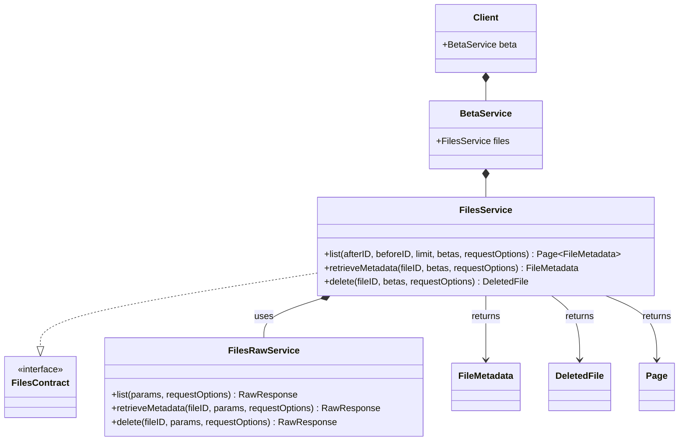
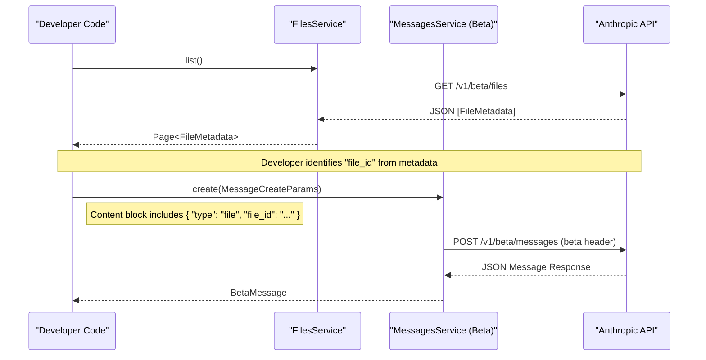

<!-- source: DeepWiki mcp.deepwiki.com · repo anthropics/anthropic-sdk-php · page 4.2 Files Service (Beta) · fetched 2026-10-26 -->

# Files Service (Beta)

<details>
<summary>Relevant source files</summary>

The following files were used as context for generating this wiki page:

- [src/Beta/Files/DeletedFile.php](src/Beta/Files/DeletedFile.php)
- [src/Beta/Files/FileMetadata.php](src/Beta/Files/FileMetadata.php)
- [src/Beta/Messages/Batches/DeletedMessageBatch.php](src/Beta/Messages/Batches/DeletedMessageBatch.php)
- [src/Beta/Messages/Batches/MessageBatch.php](src/Beta/Messages/Batches/MessageBatch.php)
- [src/Beta/Messages/Batches/MessageBatchIndividualResponse.php](src/Beta/Messages/Batches/MessageBatchIndividualResponse.php)
- [src/Beta/Messages/BetaMessageTokensCount.php](src/Beta/Messages/BetaMessageTokensCount.php)
- [src/Messages/Batches/DeletedMessageBatch.php](src/Messages/Batches/DeletedMessageBatch.php)
- [src/Messages/Batches/MessageBatch.php](src/Messages/Batches/MessageBatch.php)
- [src/Messages/Batches/MessageBatchIndividualResponse.php](src/Messages/Batches/MessageBatchIndividualResponse.php)
- [src/ServiceContracts/Beta/FilesContract.php](src/ServiceContracts/Beta/FilesContract.php)
- [src/ServiceContracts/Beta/ModelsContract.php](src/ServiceContracts/Beta/ModelsContract.php)
- [src/ServiceContracts/ModelsContract.php](src/ServiceContracts/ModelsContract.php)
- [src/Services/Beta/FilesService.php](src/Services/Beta/FilesService.php)
- [src/Services/Beta/ModelsService.php](src/Services/Beta/ModelsService.php)
- [src/Services/ModelsService.php](src/Services/ModelsService.php)
- [tests/Services/Beta/FilesTest.php](tests/Services/Beta/FilesTest.php)
- [tests/Services/Beta/ModelsTest.php](tests/Services/Beta/ModelsTest.php)
- [tests/Services/Beta/Skills/VersionsTest.php](tests/Services/Beta/Skills/VersionsTest.php)
- [tests/Services/Beta/SkillsTest.php](tests/Services/Beta/SkillsTest.php)
- [tests/Services/ModelsTest.php](tests/Services/ModelsTest.php)

</details>


The `FilesService` provides capabilities for managing file resources within the Anthropic API's beta namespace. This service allows developers to inspect uploaded files, retrieve their metadata, and perform deletions. Files managed through this service are typically used to provide long-form context or data for message content in supported beta models.

## Architecture and Implementation

The Files Service is structured into two layers: the high-level `FilesService`, which returns typed Data Transfer Objects (DTOs), and the `FilesRawService`, which returns `RawResponse` objects for lower-level access.

### Class Relationship Diagram

This diagram illustrates how the `Client` provides access to the `FilesService` and the resulting DTOs.



**Sources:**
- `src/Services/Beta/FilesService.php:20-33`()
- `src/ServiceContracts/Beta/FilesContract.php:17-71`()
- `tests/Services/Beta/FilesTest.php:20-30`()

## Core Operations

### Listing Files
The `list()` method retrieves a paginated list of all files available to the user. It supports cursor-based pagination through `afterID` and `beforeID` parameters [src/Services/Beta/FilesService.php:40-41]().

| Parameter | Type | Description |
| :--- | :--- | :--- |
| `afterID` | `string\|null` | Cursor for the next page of results [src/Services/Beta/FilesService.php:40](). |
| `beforeID` | `string\|null` | Cursor for the previous page of results [src/Services/Beta/FilesService.php:41](). |
| `limit` | `int` | Number of items per page (Default: 20, Range: 1-1000) [src/Services/Beta/FilesService.php:42-44](). |
| `betas` | `array\|null` | Optional beta headers [src/Services/Beta/FilesService.php:45](). |

The method returns a `Page` object containing `FileMetadata` instances [src/Services/Beta/FilesService.php:48-58]().

### Retrieving Metadata
The `retrieveMetadata()` method fetches details about a specific file using its unique identifier. This does not download the file content but provides its properties like size, name, and creation time [src/Services/Beta/FilesService.php:109-120]().

### Deleting Files
The `delete()` method permanently removes a file from the Anthropic platform. It returns a `DeletedFile` DTO confirming the operation [src/Services/Beta/FilesService.php:85-96]().

**Sources:**
- `src/Services/Beta/FilesService.php:52-121`()
- `src/ServiceContracts/Beta/FilesContract.php:34-71`()

## Data Models (DTOs)

The service utilizes specific DTOs that implement `SdkModel` to provide type-safe access to API responses.

### FileMetadata
Represents the attributes of a file stored on the platform.
*   **Location:** `src/Beta/Files/FileMetadata.php`
*   **Usage:** Returned by `list()` and `retrieveMetadata()` [src/Services/Beta/FilesService.php:48,113]().

### DeletedFile
Confirms the successful deletion of a file resource.
*   **Location:** `src/Beta/Files/DeletedFile.php`
*   **Usage:** Returned by `delete()` [src/Services/Beta/FilesService.php:89]().

## Integration with Message Content

While the `FilesService` handles management, these files are consumed within the Messages API (Beta). The integration flow typically involves referencing a `file_id` within the message content blocks.

### Data Flow: From File ID to Message Response

The following diagram bridges the "Natural Language Space" (Messages) with the "Code Entity Space" (File Services).



**Sources:**
- `src/Services/Beta/FilesService.php:52-72`()
- `tests/Services/Beta/FilesTest.php:33-44`()
- `src/Beta/Messages/BetaMessageTokensCount.php:14-34`() (Context management reference)

## Usage Example

```php
use Anthropic\Client;

$client = new Client(apiKey: 'your-api-key');

// List files
$filesPage = $client->beta->files->list(limit: 5);
foreach ($filesPage->getItems() as $file) {
    echo "File: " . $file->name . " ID: " . $file->id . PHP_EOL;
}

// Retrieve specific metadata
$metadata = $client->beta->files->retrieveMetadata('file_id_123');

// Delete a file
$status = $client->beta->files->delete('file_id_123');
echo "Deleted: " . $status->id;
```

**Sources:**
- `tests/Services/Beta/FilesTest.php:33-62`()
- `src/Services/Beta/FilesService.php:52-121`()

---

