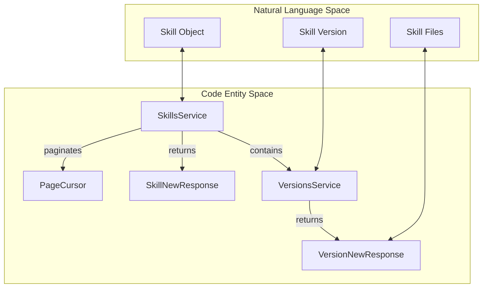
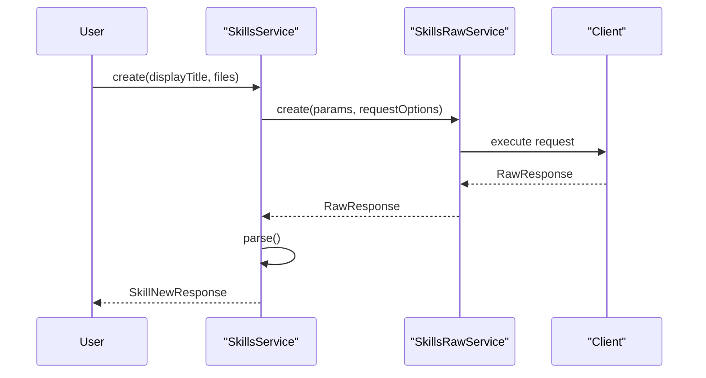

<!-- source: DeepWiki mcp.deepwiki.com · repo anthropics/anthropic-sdk-php · page 4.3 Skills Service (Beta) · fetched 2026-10-26 -->

# Skills Service (Beta)

Relevant source files

The following files were used as context for generating this wiki page:

- [src/Beta/Skills/SkillCreateParams.php](src/Beta/Skills/SkillCreateParams.php)
- [src/Beta/Skills/SkillDeleteParams.php](src/Beta/Skills/SkillDeleteParams.php)
- [src/Beta/Skills/SkillDeleteResponse.php](src/Beta/Skills/SkillDeleteResponse.php)
- [src/Beta/Skills/SkillGetResponse.php](src/Beta/Skills/SkillGetResponse.php)
- [src/Beta/Skills/SkillListParams.php](src/Beta/Skills/SkillListParams.php)
- [src/Beta/Skills/SkillListResponse.php](src/Beta/Skills/SkillListResponse.php)
- [src/Beta/Skills/SkillNewResponse.php](src/Beta/Skills/SkillNewResponse.php)
- [src/Beta/Skills/SkillRetrieveParams.php](src/Beta/Skills/SkillRetrieveParams.php)
- [src/Beta/Skills/Versions/VersionCreateParams.php](src/Beta/Skills/Versions/VersionCreateParams.php)
- [src/Beta/Skills/Versions/VersionDeleteParams.php](src/Beta/Skills/Versions/VersionDeleteParams.php)
- [src/Beta/Skills/Versions/VersionDeleteResponse.php](src/Beta/Skills/Versions/VersionDeleteResponse.php)
- [src/Beta/Skills/Versions/VersionGetResponse.php](src/Beta/Skills/Versions/VersionGetResponse.php)
- [src/Beta/Skills/Versions/VersionListParams.php](src/Beta/Skills/Versions/VersionListParams.php)
- [src/Beta/Skills/Versions/VersionListResponse.php](src/Beta/Skills/Versions/VersionListResponse.php)
- [src/Beta/Skills/Versions/VersionNewResponse.php](src/Beta/Skills/Versions/VersionNewResponse.php)
- [src/Beta/Skills/Versions/VersionRetrieveParams.php](src/Beta/Skills/Versions/VersionRetrieveParams.php)
- [src/Services/Beta/Skills/VersionsService.php](src/Services/Beta/Skills/VersionsService.php)
- [src/Services/Beta/SkillsService.php](src/Services/Beta/SkillsService.php)
- [tests/Services/Beta/FilesTest.php](tests/Services/Beta/FilesTest.php)
- [tests/Services/Beta/ModelsTest.php](tests/Services/Beta/ModelsTest.php)
- [tests/Services/Beta/Skills/VersionsTest.php](tests/Services/Beta/Skills/VersionsTest.php)
- [tests/Services/Beta/SkillsTest.php](tests/Services/Beta/SkillsTest.php)
- [tests/Services/ModelsTest.php](tests/Services/ModelsTest.php)

The Skills Service is a beta feature of the Anthropic PHP SDK that allows for the management of "Skills"—reusable units of functionality that can be uploaded and associated with models. The service provides full CRUD (Create, Read, Update, Delete) operations for both Skills and their specific Versions.

## Service Architecture

The Skills functionality is split into two primary services: `SkillsService` and `VersionsService`. Both follow the standard SDK pattern of delegating to a "Raw" service for HTTP execution while providing a typed interface for developers [src/Services/Beta/SkillsService.php:23-42](), [src/Services/Beta/Skills/VersionsService.php:22-35]().

### Skills and Versions Relationship

The following diagram illustrates how the code entities map to the Skills API structure.

**Entity Mapping: Skills and Versions**

Sources: [src/Services/Beta/SkillsService.php:23-42](), [src/Services/Beta/Skills/VersionsService.php:22-35](), [src/Beta/Skills/SkillNewResponse.php:22-25](), [src/Beta/Skills/Versions/VersionNewResponse.php:23-26]().

## Skills Management

The `SkillsService` manages the top-level Skill entities.

### Key Operations

| Operation | Method | Return Type | Description |
| :--- | :--- | :--- | :--- |
| **Create** | `create()` | `SkillNewResponse` | Creates a new skill with optional display title and files [src/Services/Beta/SkillsService.php:60-74](). |
| **Retrieve** | `retrieve()` | `SkillGetResponse` | Fetches details for a specific skill by its ID [src/Services/Beta/SkillsService.php:89-100](). |
| **List** | `list()` | `PageCursor<SkillListResponse>` | Lists skills with optional filtering by source (custom/anthropic) [src/Services/Beta/SkillsService.php:125-145](). |
| **Delete** | `delete()` | `SkillDeleteResponse` | Permanently removes a skill [src/Services/Beta/SkillsService.php:160-171](). |

### Data Flow: Creating a Skill

When `create()` is called, the SDK processes the input parameters, removes nulls, and passes them to the `SkillsRawService` [src/Services/Beta/SkillsService.php:66-71](). The raw response is then parsed into a typed `SkillNewResponse` object [src/Services/Beta/SkillsService.php:73]().

**Sequence: Skill Creation**

Sources: [src/Services/Beta/SkillsService.php:60-74](), [tests/Services/Beta/SkillsTest.php:35-41]().

## Versions Management

The `VersionsService` is accessed via the `$versions` property on the `SkillsService` [src/Services/Beta/SkillsService.php:33](). Each version represents a specific iteration of a skill, identified by a Unix epoch timestamp [src/Beta/Skills/Versions/VersionNewResponse.php:81-86]().

### Key Operations

| Operation | Method | Return Type | Description |
| :--- | :--- | :--- | :--- |
| **Create** | `create()` | `VersionNewResponse` | Uploads new files to create a version for an existing skill [src/Services/Beta/Skills/VersionsService.php:53-65](). |
| **Retrieve** | `retrieve()` | `VersionGetResponse` | Fetches a specific version using the version timestamp and skill ID [src/Services/Beta/Skills/VersionsService.php:83-95](). |
| **List** | `list()` | `PageCursor<VersionListResponse>` | Lists all versions for a specific skill [src/Services/Beta/Skills/VersionsService.php:116-131](). |
| **Delete** | `delete()` | `VersionDeleteResponse` | Deletes a specific version of a skill [src/Services/Beta/Skills/VersionsService.php:149-161](). |

Sources: [src/Services/Beta/Skills/VersionsService.php:22-162](), [tests/Services/Beta/Skills/VersionsTest.php:35-106]().

## Data Models and Response DTOs

All responses from the Skills service are encapsulated in DTOs (Data Transfer Objects) that implement `BaseModel` and use the `SdkModel` trait for type-safe property access [src/Beta/Skills/SkillNewResponse.php:22-25]().

### Skill Models
- **`SkillNewResponse`**: Contains `id`, `createdAt`, `displayTitle`, `latestVersion`, `source`, `type`, and `updatedAt` [src/Beta/Skills/SkillNewResponse.php:33-79]().
- **`SkillDeleteResponse`**: A minimal response containing the `id` and a `type` set to `"skill_deleted"` [src/Beta/Skills/SkillDeleteResponse.php:14-33]().

### Version Models
- **`VersionNewResponse` / `VersionGetResponse`**: Contains `id`, `createdAt`, `description` (extracted from `SKILL.md`), `directory`, `name`, `skillID`, `type`, and the `version` timestamp [src/Beta/Skills/Versions/VersionNewResponse.php:33-86]().

## Pagination

The `list()` methods for both Skills and Versions return a `PageCursor` [src/Services/Beta/SkillsService.php:121](), [src/Services/Beta/Skills/VersionsService.php:112](). This cursor-based pagination allows for efficient traversal of large result sets.

- **Limit**: The number of items per page (default 20, max 100 for skills, 1000 for versions) [src/Services/Beta/SkillsService.php:107-109](), [src/Services/Beta/Skills/VersionsService.php:105-107]().
- **Page Token**: A cursor string used to fetch the next set of results [src/Services/Beta/SkillsService.php:110-112]().

Example usage in tests:
[tests/Services/Beta/SkillsTest.php:53-64]()
[tests/Services/Beta/Skills/VersionsTest.php:69-80]()

Sources: [src/Services/Beta/SkillsService.php:103-145](), [src/Services/Beta/Skills/VersionsService.php:98-131]().

---

