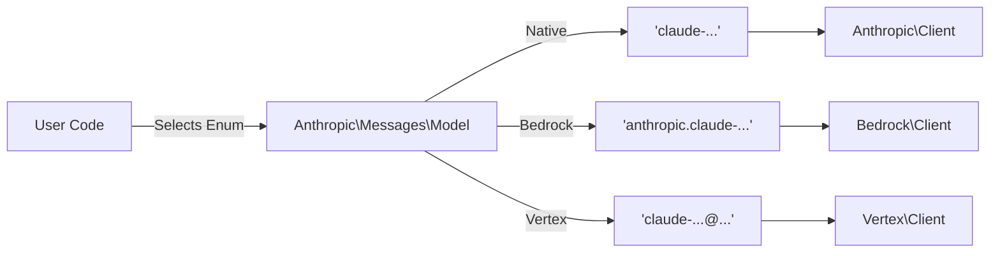

<!-- source: DeepWiki mcp.deepwiki.com · repo anthropics/anthropic-sdk-php · page 5 Alternative Cloud Clients · fetched 2026-10-26 -->

# Alternative Cloud Clients

<details>
<summary>Relevant source files</summary>

The following files were used as context for generating this wiki page:

- [examples/bedrock/messages.php](examples/bedrock/messages.php)
- [examples/bedrock/messages_count_tokens.php](examples/bedrock/messages_count_tokens.php)
- [examples/bedrock/messages_stream.php](examples/bedrock/messages_stream.php)
- [examples/foundry/messages.php](examples/foundry/messages.php)
- [examples/foundry/messages_count_tokens.php](examples/foundry/messages_count_tokens.php)
- [examples/foundry/messages_stream.php](examples/foundry/messages_stream.php)
- [src/Bedrock/BedrockEventStream.php](src/Bedrock/BedrockEventStream.php)
- [src/Bedrock/Client.php](src/Bedrock/Client.php)
- [src/Bedrock/Conversion/MessageTokensCountConverter.php](src/Bedrock/Conversion/MessageTokensCountConverter.php)
- [src/Bedrock/Services/MessagesRawService.php](src/Bedrock/Services/MessagesRawService.php)
- [src/Bedrock/Services/MessagesService.php](src/Bedrock/Services/MessagesService.php)
- [src/Foundry/Client.php](src/Foundry/Client.php)
- [src/Foundry/Services/MessagesRawService.php](src/Foundry/Services/MessagesRawService.php)
- [src/Messages/Model.php](src/Messages/Model.php)
- [src/Vertex/Client.php](src/Vertex/Client.php)
- [src/Vertex/Services/MessagesService.php](src/Vertex/Services/MessagesService.php)

</details>


The Anthropic PHP SDK provides specialized client implementations for interacting with Claude models hosted on major cloud platforms. While the core `Anthropic\Client` is designed for the native Anthropic API, these alternative clients allow developers to leverage the same high-level Messages API surface while utilizing the infrastructure, authentication, and billing of Amazon Web Services (AWS), Google Cloud Platform (GCP), or Azure-based Foundry environments.

## Supported Cloud Providers

The SDK includes three primary alternative clients, each located in its own namespace and requiring specific third-party dependencies (like the AWS SDK or Google Auth library).

| Provider | Client Class | Namespace | Key Authentication |
| :--- | :--- | :--- | :--- |
| **Amazon Bedrock** | `Client` [src/Bedrock/Client.php:25-25]() | `Anthropic\Bedrock` | AWS SigV4 (IAM Roles/Keys) |
| **Google Vertex AI** | `Client` [src/Vertex/Client.php:22-22]() | `Anthropic\Vertex` | Google Application Default Credentials |
| **Foundry** | `Client` [src/Foundry/Client.php:20-20]() | `Anthropic\Foundry` | API Key or Bearer Token |

### Shared Interface

Despite different underlying transport mechanisms and authentication requirements, all cloud clients implement the `MessagesContract` [src/ServiceContracts/MessagesContract.php](). This ensures that code written for the standard Anthropic Messages API can be migrated to a cloud provider with minimal changes to the business logic.

**Cloud Client Architecture**

```mermaid
graph TD
    subgraph "Core SDK"
        BaseClient["BaseClient"]
        MsgContract["MessagesContract"]
    end

    subgraph "Amazon Bedrock"
        BedrockClient["Bedrock\Client"]
        BedrockSvc["Bedrock\MessagesService"]
    end

    subgraph "Google Vertex AI"
        VertexClient["Vertex\Client"]
        VertexSvc["Vertex\MessagesService"]
    end

    subgraph "Foundry"
        FoundryClient["Foundry\Client"]
        FoundrySvc["Foundry\MessagesService"]
    end

    BedrockClient --|> BaseClient
    VertexClient --|> BaseClient
    FoundryClient --|> BaseClient

    BedrockSvc -- implements --> MsgContract
    VertexSvc -- implements --> MsgContract
    FoundrySvc -- implements --> MsgContract
```

**Sources:**
- [src/Bedrock/Client.php:25-25]()
- [src/Vertex/Client.php:22-22]()
- [src/Foundry/Client.php:20-20]()
- [src/Bedrock/Services/MessagesService.php:27-32]()
- [src/Vertex/Services/MessagesService.php:32-32]()

---

## Amazon Bedrock Client

The Amazon Bedrock client is designed for AWS users. It handles the complexities of AWS Signature Version 4 (SigV4) signing and maps Bedrock-specific streaming formats into standard SDK events.

- **Authentication**: Supports `fromEnvironment()` for IAM roles/profiles [src/Bedrock/Client.php:65-80]() and `withCredentials()` for explicit Access Keys [src/Bedrock/Client.php:88-103]().
- **Streaming**: Uses `BedrockEventStream` [src/Bedrock/BedrockEventStream.php:26-26]() to parse AWS binary event stream frames into `RawMessageStreamEvent` objects.
- **Model IDs**: Requires Bedrock-specific identifiers (e.g., `anthropic.claude-3-haiku-20240307-v1:0`) defined in the `Model` enum [src/Messages/Model.php:48-72]().

For details, see [Amazon Bedrock Client](#5.1).

**Sources:**
- [src/Bedrock/Client.php:65-103]()
- [src/Bedrock/BedrockEventStream.php:26-26]()
- [src/Messages/Model.php:48-72]()

---

## Google Vertex AI Client

The Google Vertex AI client integrates with GCP's AI Platform. It automates token fetching and handles the specific REST endpoint structure required by Google.

- **Authentication**: Utilizes Google Application Default Credentials (ADC) [src/Vertex/Client.php:73-88](). It includes built-in token refresh logic with a 5-minute buffer [src/Vertex/Client.php:157-177]().
- **Configuration**: Requires a `location` and `projectId`. The project ID can be resolved from environment variables like `GOOGLE_CLOUD_PROJECT` [src/Vertex/Client.php:125-152]().
- **Endpoints**: Dynamically constructs URLs based on project and region, e.g., `https://{location}-aiplatform.googleapis.com/v1/projects/{projectId}/...` [src/Vertex/Client.php:90-95]().

For details, see [Google Vertex AI Client](#5.2).

**Sources:**
- [src/Vertex/Client.php:73-177]()
- [src/Vertex/Client.php:90-95]()
- [src/Vertex/Client.php:125-152]()

---

## Foundry Client

The Foundry client provides an entry point for Claude instances deployed via the Microsoft Foundry / Azure ecosystem.

- **Consistency**: It maintains the closest parity to the standard `Anthropic\Client` but targets a custom `baseUrl` or `resource` [src/Foundry/Client.php:210-223]().
- **Authentication**: Supports both standard API Keys (`x-api-key`) and Bearer Tokens [src/Foundry/Client.php:131-143]().
- **Factory Methods**: Offers `fromEnvironment()` [src/Foundry/Client.php:83-99]() and `withCredentials()` [src/Foundry/Client.php:106-123]() for flexible setup.

For details, see [Foundry Client](#5.3).

**Sources:**
- [src/Foundry/Client.php:83-123]()
- [src/Foundry/Client.php:131-143]()
- [src/Foundry/Client.php:210-223]()

---

## Model ID Mapping

When using alternative clients, you must use the model identifiers specific to that provider. These are conveniently mapped in the `Anthropic\Messages\Model` enum.

| Provider | Enum Case Example | String Value |
| :--- | :--- | :--- |
| **Native** | `CLAUDE_OPUS_4_6` | `claude-opus-4-6` |
| **Bedrock** | `BEDROCK_CLAUDE_SONNET_4_5_20250929` | `anthropic.claude-sonnet-4-5-20250929-v1:0` |
| **Vertex** | `VERTEX_CLAUDE_OPUS_4_5_20251101` | `claude-opus-4-5@20251101` |

**Model ID Resolution Flow**



**Sources:**
- [src/Messages/Model.php:14-98]()

---

