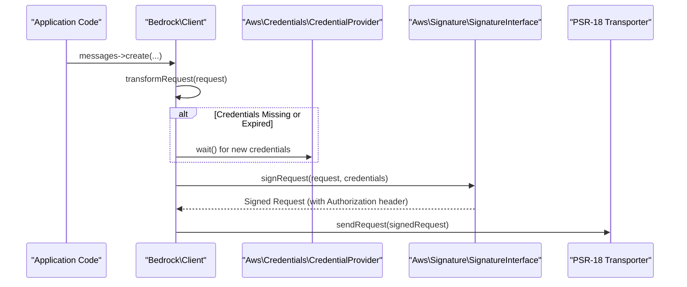
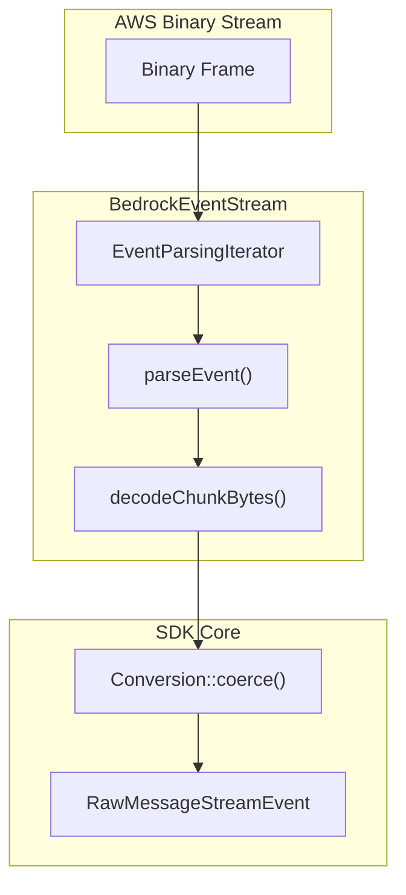

<!-- source: DeepWiki mcp.deepwiki.com · repo anthropics/anthropic-sdk-php · page 5.1 Amazon Bedrock Client · fetched 2026-10-26 -->

# Amazon Bedrock Client

Relevant source files

The following files were used as context for generating this wiki page:

- [examples/bedrock/messages.php](examples/bedrock/messages.php)
- [examples/bedrock/messages_count_tokens.php](examples/bedrock/messages_count_tokens.php)
- [examples/bedrock/messages_stream.php](examples/bedrock/messages_stream.php)
- [src/Bedrock/BedrockEventStream.php](src/Bedrock/BedrockEventStream.php)
- [src/Bedrock/Client.php](src/Bedrock/Client.php)
- [src/Bedrock/Conversion/MessageTokensCountConverter.php](src/Bedrock/Conversion/MessageTokensCountConverter.php)
- [src/Bedrock/Services/MessagesRawService.php](src/Bedrock/Services/MessagesRawService.php)
- [src/Bedrock/Services/MessagesService.php](src/Bedrock/Services/MessagesService.php)
- [src/Vertex/Client.php](src/Vertex/Client.php)
- [src/Vertex/Services/MessagesService.php](src/Vertex/Services/MessagesService.php)

The Amazon Bedrock Client provides a specialized implementation of the Anthropic SDK tailored for AWS Bedrock. It handles AWS-specific requirements such as SigV4 request signing, regional endpoint resolution, and specialized event stream parsing while maintaining an interface consistent with the standard Anthropic client.

## Client Initialization

The `Anthropic\Bedrock\Client` extends `BaseClient` and provides two primary factory methods for instantiation. It requires the `aws/aws-sdk-php` package to be installed [src/Bedrock/Client.php:146-152]().

### Factory Methods

| Method | Description |
| :--- | :--- |
| `fromEnvironment(?string $region)` | Automatically resolves credentials using the default AWS credential provider chain (Environment variables, shared credentials file, IAM instance profiles) [src/Bedrock/Client.php:65-80](). |
| `withCredentials(...)` | Manually specifies `accessKeyId`, `secretAccessKey`, and optional `securityToken` [src/Bedrock/Client.php:88-103](). |

### Regional Endpoints
The client dynamically constructs the base URL based on the provided or resolved AWS region. The default region is `us-east-1` [src/Bedrock/Client.php:30-30](). The URL follows the pattern `https://bedrock-runtime.{region}.amazonaws.com` [src/Bedrock/Client.php:105-112]().

### Authentication Flow (AWS SigV4)
The client implements AWS Signature Version 4 (SigV4) by overriding the `transformRequest` method. This ensures every outgoing PSR-7 request is signed using the provided credentials and the `bedrock` service identifier [src/Bedrock/Client.php:114-128]().

#### Initialization and Signing Process
Title: Bedrock Client Request Transformation

Sources: [src/Bedrock/Client.php:114-128](), [src/Bedrock/Client.php:134-144]()

## Bedrock Services

The Bedrock client exposes a `messages` property which is an instance of `Anthropic\Bedrock\Services\MessagesService` [src/Bedrock/Client.php:32-32](). This service implements the `MessagesContract` [src/Bedrock/Services/MessagesService.php:27-27]().

### Model ID Differences
Unlike the standard Anthropic API, Bedrock requires specific model identifiers. These often include a prefix and versioning suffix.
*   **Standard:** `claude-3-5-sonnet-20240620`
*   **Bedrock:** `anthropic.claude-3-5-sonnet-20240620-v1:0` [examples/bedrock/messages.php:18-18]()

### MessagesRawService Implementation
The `MessagesRawService` handles the mapping between the SDK's generic parameters and the specific requirements of the Bedrock Runtime API.

1.  **Version Header**: It injects a specific version string `bedrock-2023-05-31` into every request [src/Bedrock/Services/MessagesRawService.php:24-24]().
2.  **Path Resolution**:
    *   **Unary**: `/model/{modelId}/invoke` [src/Bedrock/Services/MessagesRawService.php:49-49]()
    *   **Streaming**: `/model/{modelId}/invoke-with-response-stream` [src/Bedrock/Services/MessagesRawService.php:79-79]()
    *   **Token Counting**: `/model/{modelId}/count-tokens` [src/Bedrock/Services/MessagesRawService.php:120-120]()

Sources: [src/Bedrock/Services/MessagesRawService.php:19-130]()

## Streaming with BedrockEventStream

Bedrock does not use standard Server-Sent Events (SSE). Instead, it uses a binary event stream format. The SDK provides `BedrockEventStream` to decode these binary frames into the standard `RawMessageStreamEvent` objects used by the rest of the SDK.

### Implementation Details
*   **Iterator**: Uses the AWS SDK's `EventParsingIterator` to process the response body [src/Bedrock/BedrockEventStream.php:118-138]().
*   **Initial Response**: Automatically skips the `initial-response` event emitted by Bedrock, which contains metadata but no model output [src/Bedrock/BedrockEventStream.php:45-47]().
*   **Chunk Decoding**: Extracts the `chunk` bytes from the AWS event frame and decodes the underlying JSON payload [src/Bedrock/BedrockEventStream.php:72-93]().

Title: Bedrock Event Stream Processing

Sources: [src/Bedrock/BedrockEventStream.php:26-54](), [src/Bedrock/BedrockEventStream.php:72-113]()

## Token Counting

The Bedrock implementation of `countTokens` requires a specific request structure where the standard message payload is JSON-encoded and then Base64-encoded inside an `invokeModel` wrapper [src/Bedrock/Services/MessagesRawService.php:110-116]().

### MessageTokensCountConverter
Because Bedrock returns token counts using camelCase (`inputTokens`), the `MessageTokensCountConverter` normalizes the response to match the SDK's snake_case `input_tokens` property before coercion into the `MessageTokensCount` model [src/Bedrock/Conversion/MessageTokensCountConverter.php:20-28]().

| Original Bedrock Key | Normalized SDK Key |
| :--- | :--- |
| `inputTokens` | `input_tokens` |

Sources: [src/Bedrock/Services/MessagesRawService.php:91-129](), [src/Bedrock/Conversion/MessageTokensCountConverter.php:18-34]()

---

