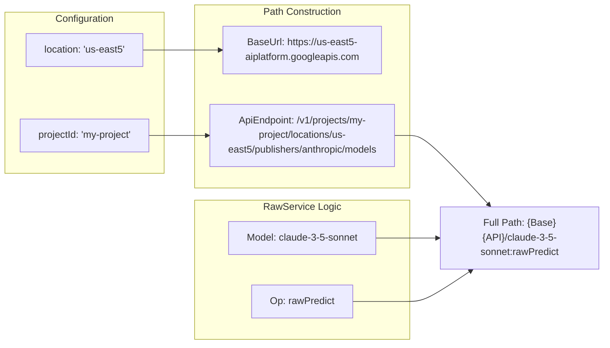

<!-- source: DeepWiki mcp.deepwiki.com · repo anthropics/anthropic-sdk-php · page 5.2 Google Vertex AI Client · fetched 2026-10-26 -->

# Google Vertex AI Client

<details>
<summary>Relevant source files</summary>

The following files were used as context for generating this wiki page:

- [examples/vertex/count_tokens.php](examples/vertex/count_tokens.php)
- [examples/vertex/messages.php](examples/vertex/messages.php)
- [examples/vertex/messages_stream.php](examples/vertex/messages_stream.php)
- [src/Bedrock/Services/MessagesService.php](src/Bedrock/Services/MessagesService.php)
- [src/Vertex/Client.php](src/Vertex/Client.php)
- [src/Vertex/Services/MessagesRawService.php](src/Vertex/Services/MessagesRawService.php)
- [src/Vertex/Services/MessagesService.php](src/Vertex/Services/MessagesService.php)

</details>


The Google Vertex AI Client provides a specialized implementation of the Anthropic SDK tailored for Google Cloud Platform. It handles the complexities of Vertex AI's REST endpoint structure, Google Application Default Credentials (ADC), and OAuth2 token management while maintaining a service interface consistent with the standard Anthropic client.

## Client Initialization and Factory Methods

The `Anthropic\Vertex\Client` extends the `BaseClient` and introduces specific logic for Google Cloud authentication and region-based endpoint discovery [src/Vertex/Client.php:22-23]().

### Factory: `fromEnvironment`
The primary way to instantiate the client is via `fromEnvironment`. This method requires a Google Cloud location (region) and optionally a project ID [src/Vertex/Client.php:73-88]().

*   **Location**: Required (e.g., `us-east5`).
*   **Project ID**: Optional. If not provided, the client attempts to resolve it from the environment or the credentials provider.
*   **Credentials**: Automatically uses `Google\Auth\ApplicationDefaultCredentials` with the `https://www.googleapis.com/auth/cloud-platform` scope [src/Vertex/Client.php:77-81]().

### Pre-requisites
The Vertex client requires the `google/auth` library. The SDK performs a runtime check for `FetchAuthTokenInterface` before initialization [src/Vertex/Client.php:199-207]().

```php
use Anthropic\Vertex;

// Basic initialization
$client = Vertex\Client::fromEnvironment(
    location: 'us-east5', 
    projectId: 'my-project-id'
);
```
*Sources: [src/Vertex/Client.php:73-88](), [src/Vertex/Client.php:199-207](), [examples/vertex/messages.php:7]()*

---

## Authentication and Token Management

Unlike the standard API which uses static API keys, Vertex AI requires OAuth2 Bearer tokens. The `Client` manages the lifecycle of these tokens internally.

### Token Refresh Logic
The client implements a proactive refresh strategy to ensure requests do not fail due to expired credentials:
1.  **Buffer**: A `TOKEN_REFRESH_BUFFER_SECONDS` of 300 seconds (5 minutes) is used [src/Vertex/Client.php:24]().
2.  **Validation**: Before every request, `authToken()` checks if the `lastToken` is null or expired [src/Vertex/Client.php:157-164]().
3.  **Expiration Check**: A token is considered expired if its `expires_at` timestamp is less than or equal to the current time plus the 5-minute buffer [src/Vertex/Client.php:169-177]().

### Request Transformation
The client overrides `transformRequest` to inject the `Authorization` header into every outgoing PSR-7 request [src/Vertex/Client.php:97-100]().

### Authentication Data Flow
The following diagram illustrates how the client interacts with Google Auth libraries to secure requests.

**Diagram: Vertex AI Authentication Flow**
```mermaid
graph TD
    subgraph "Natural Language Space"
        "User Code"
        "Google Cloud Environment"
    end

    subgraph "Code Entity Space"
        Client["Vertex\Client"]
        ADC["Google\Auth\ApplicationDefaultCredentials"]
        FAT["FetchAuthTokenInterface"]
        Base["Core\BaseClient"]
    end

    "User Code" -- "Calls" --> Client
    Client -- "fromEnvironment()" --> ADC
    ADC -- "Returns" --> FAT
    
    Client -- "transformRequest()" --> FAT
    FAT -- "fetchAuthToken()" --> Token["OAuth2 Bearer Token"]
    Token -- "Header: Authorization" --> Base
    Base -- "PSR-18 Request" --> "Vertex AI REST Endpoint"
```
*Sources: [src/Vertex/Client.php:12-13](), [src/Vertex/Client.php:97-100](), [src/Vertex/Client.php:157-177]()*

---

## Project ID Resolution

The client uses a specific precedence order to determine which Google Cloud Project ID to use for the API path [src/Vertex/Client.php:125-152]():

| Precedence | Source | Details |
| :--- | :--- | :--- |
| 1 | Constructor Argument | The `$projectId` passed to `fromEnvironment` or `__construct`. |
| 2 | Environment Variables | Checked in order: `GOOGLE_CLOUD_PROJECT`, `GCLOUD_PROJECT`, `GOOGLE_CLOUD_PROJECT_ID`. |
| 3 | Credentials Provider | If the provider implements `ProjectIdProviderInterface`. |

If no project ID can be resolved, a `RuntimeException` is thrown [src/Vertex/Client.php:149-151]().

*Sources: [src/Vertex/Client.php:25-29](), [src/Vertex/Client.php:125-152]()*

---

## REST Endpoint Format

The Vertex AI implementation does not use the standard Anthropic base URL. Instead, it constructs a regional Google Cloud endpoint and a specific resource path.

### Base URL
The base URL is derived from the location: `https://{location}-aiplatform.googleapis.com` [src/Vertex/Client.php:57-58]().

### Resource Path
The resource path is constructed in `getApiEndpoint()`:
`/v1/projects/{projectId}/locations/{location}/publishers/anthropic/models` [src/Vertex/Client.php:90-95]().

### Operation Specifiers
When making requests, `MessagesRawService` appends the model ID and the specific Vertex operation [src/Vertex/Services/MessagesRawService.php:127-129]():
*   **Predict**: `{endpoint}/{modelId}:rawPredict`
*   **Stream**: `{endpoint}/{modelId}:streamRawPredict`
*   **Count Tokens**: `{endpoint}/count-tokens:rawPredict` [src/Vertex/Services/MessagesRawService.php:85]()

**Diagram: Vertex Request Preparation**

*Sources: [src/Vertex/Client.php:58](), [src/Vertex/Client.php:94](), [src/Vertex/Services/MessagesRawService.php:127-129]()*

---

## Messages Service Implementation

The Vertex implementation provides two service layers: `MessagesService` (high-level) and `MessagesRawService` (low-level).

### MessagesService
This service implements `MessagesContract` and provides a signature identical to the main SDK [src/Vertex/Services/MessagesService.php:32](). It acts as a wrapper around the raw service, handling the parsing of responses back into `Message` objects or `BaseStream` instances [src/Vertex/Services/MessagesService.php:84-132]().

### MessagesRawService
This service handles the specific payload requirements for Vertex AI:
*   **Anthropic Version**: Forces the header/parameter `anthropic_version` to `vertex-2023-10-16` [src/Vertex/Services/MessagesRawService.php:31]().
*   **Model Extraction**: Extracts the `model` from the parameters to use it in the URL path, then unsets it from the JSON body [src/Vertex/Services/MessagesRawService.php:114-120]().
*   **Stream Flag**: Explicitly sets the `stream` boolean in the payload [src/Vertex/Services/MessagesRawService.php:123]().

### Token Counting
Vertex AI supports a specific `countTokens` operation via the `:rawPredict` suffix on the `count-tokens` resource [src/Vertex/Services/MessagesRawService.php:79-99]().

*Sources: [src/Vertex/Services/MessagesService.php:32-165](), [src/Vertex/Services/MessagesRawService.php:24-131]()*

---

