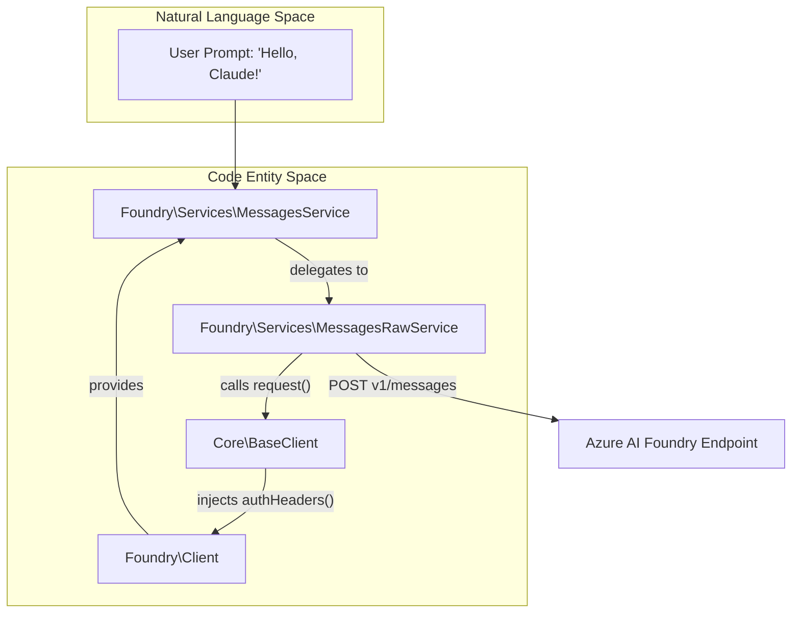
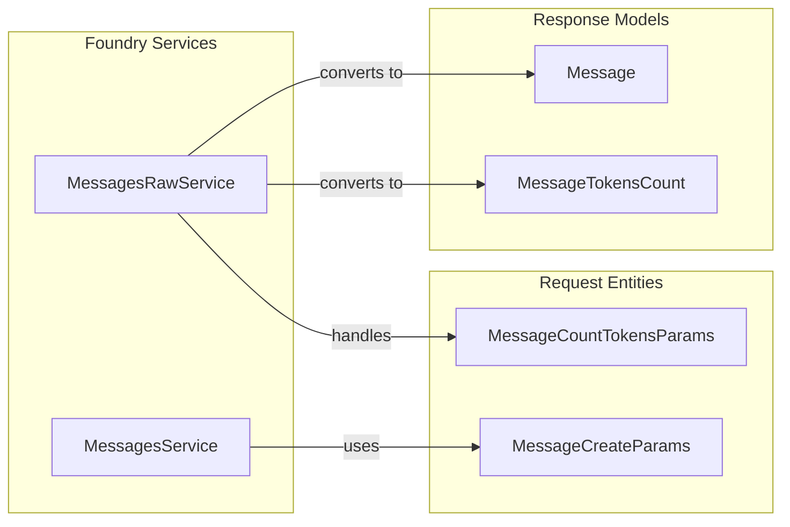

<!-- source: DeepWiki mcp.deepwiki.com · repo anthropics/anthropic-sdk-php · page 5.3 Foundry Client · fetched 2026-10-26 -->

# Foundry Client

Relevant source files

The following files were used as context for generating this wiki page:

- [examples/foundry/messages.php](examples/foundry/messages.php)
- [examples/foundry/messages_count_tokens.php](examples/foundry/messages_count_tokens.php)
- [examples/foundry/messages_stream.php](examples/foundry/messages_stream.php)
- [src/Foundry/Client.php](src/Foundry/Client.php)
- [src/Foundry/Services/MessagesRawService.php](src/Foundry/Services/MessagesRawService.php)
- [src/Foundry/Services/MessagesService.php](src/Foundry/Services/MessagesService.php)
- [src/Messages/Model.php](src/Messages/Model.php)
- [src/Messages/WebSearchTool20250305/UserLocation.php](src/Messages/WebSearchTool20250305/UserLocation.php)
- [src/Messages/WebSearchTool20260209/UserLocation.php](src/Messages/WebSearchTool20260209/UserLocation.php)
- [src/Messages/WebSearchToolRequestError/ErrorCode.php](src/Messages/WebSearchToolRequestError/ErrorCode.php)
- [src/Messages/WebSearchToolResultError/ErrorCode.php](src/Messages/WebSearchToolResultError/ErrorCode.php)

The `Anthropic\Foundry\Client` provides a specialized entry point for interacting with Anthropic models hosted via Microsoft Azure AI Foundry. It maintains the same API surface as the primary `Anthropic\Client` but incorporates specific authentication mechanisms and URL resolution logic required for Azure-hosted deployments.

## Architecture and Role

The Foundry Client acts as an alternative implementation of the `BaseClient` [src/Foundry/Client.php:20-20](). It is designed to be a drop-in replacement for users who are consuming Claude models through Azure rather than Anthropic's direct API. While it shares data models and service contracts with the rest of the SDK, it overrides the request construction process to handle Azure-specific authentication headers.

### Data Flow and Entity Mapping

The following diagram illustrates how the Foundry Client integrates with the core SDK infrastructure to fulfill Message requests.

**Foundry Message Creation Flow**

Sources: [src/Foundry/Client.php:29-29](), [src/Foundry/Services/MessagesService.php:58-59](), [src/Foundry/Services/MessagesRawService.php:56-62](), [src/Foundry/Client.php:126-129]()

## Configuration and Initialization

The Foundry Client supports two primary methods of instantiation: environment-based and explicit credentials. It requires either a `baseUrl` or a `resource` name to construct the target endpoint [src/Foundry/Client.php:210-220]().

### Authentication Modes
The client supports two mutually exclusive authentication methods [src/Foundry/Client.php:188-193]():
1.  **API Key**: Passed via the `x-api-key` header [src/Foundry/Client.php:134-134]().
2.  **Bearer Token**: Passed via the `Authorization: Bearer ...` header [src/Foundry/Client.php:140-142]().

### Factory Methods

| Method | Description | Source |
| :--- | :--- | :--- |
| `fromEnvironment()` | Reads `ANTHROPIC_FOUNDRY_API_KEY`, `ANTHROPIC_FOUNDRY_BASE_URL`, and `ANTHROPIC_FOUNDRY_RESOURCE`. | [src/Foundry/Client.php:83-99]() |
| `withCredentials()` | Accepts explicit `apiKey`, `authToken`, `baseUrl`, or `resource`. | [src/Foundry/Client.php:106-123]() |

If a `resource` is provided instead of a full `baseUrl`, the client automatically resolves the URL to `https://{resource}.services.ai.azure.com/anthropic/` [src/Foundry/Client.php:219-219]().

Sources: [src/Foundry/Client.php:83-123](), [src/Foundry/Client.php:188-220]()

## Foundry Messages Service

The `Foundry\Services\MessagesService` implements the `MessagesContract` [src/Foundry/Services/MessagesService.php:46-46](), ensuring parity with the standard SDK's messaging capabilities.

### Implementation Details
- **Service Composition**: It contains a `MessagesRawService` instance for low-level request handling [src/Foundry/Services/MessagesService.php:51-51]().
- **Parameter Handling**: Methods like `create` and `createStream` utilize `Util::removeNulls` to clean up optional parameters before passing them to the raw service [src/Foundry/Services/MessagesService.php:97-116]().
- **Response Parsing**: The service calls `parse()` on the `BaseResponse` returned by the raw service to convert the API result into a typed `Message` object [src/Foundry/Services/MessagesService.php:121-121]().

### Key Methods

| Method | Return Type | Purpose |
| :--- | :--- | :--- |
| `create()` | `Message` | Synchronous message generation [src/Foundry/Services/MessagesService.php:77-122](). |
| `createStream()` | `BaseStream` | Server-Sent Events (SSE) streaming for real-time responses [src/Foundry/Services/MessagesService.php:142-161](). |
| `countTokens()` | `MessageTokensCount` | Calculates token usage for a specific prompt and model [src/Foundry/Services/MessagesRawService.php:107-124](). |

**Entity Association: Request to Model**

Sources: [src/Foundry/Services/MessagesRawService.php:50-61](), [src/Foundry/Services/MessagesRawService.php:111-123](), [src/Foundry/Services/MessagesService.php:121-121]()

## Supported Models

The Foundry Client is designed to work with Claude models deployed on Azure. While the `Model` enum contains identifiers for various providers, the Foundry documentation specifically highlights the following model families [src/Messages/Model.php:12-12]():

- **Claude 3.5 Sonnet**: `claude-sonnet-4-5` [src/Messages/Model.php:30-30]()
- **Claude 3.5 Haiku**: `claude-haiku-4-5` [src/Messages/Model.php:22-22]()
- **Claude 3 Opus**: `claude-opus-4-6` [src/Messages/Model.php:18-18]()

Sources: [src/Messages/Model.php:12-32](), [src/Foundry/Services/MessagesService.php:65-65]()

---

