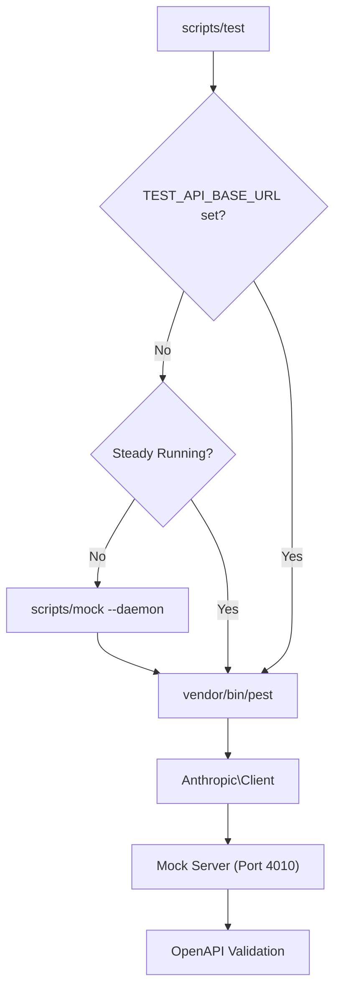
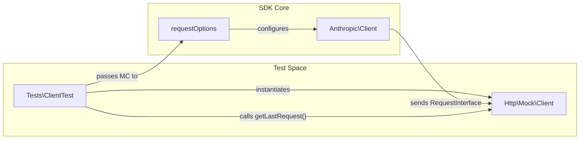

<!-- source: DeepWiki mcp.deepwiki.com · repo anthropics/anthropic-sdk-php · page 6.1 Testing Infrastructure · fetched 2026-10-26 -->

# Testing Infrastructure

Relevant source files

The following files were used as context for generating this wiki page:

- [.stats.yml](.stats.yml)
- [scripts/mock](scripts/mock)
- [scripts/test](scripts/test)
- [src/Core/Util.php](src/Core/Util.php)
- [tests/ClientTest.php](tests/ClientTest.php)
- [tests/Core/ModelTest.php](tests/Core/ModelTest.php)
- [tests/Core/UtilTest.php](tests/Core/UtilTest.php)
- [tests/Services/Beta/Messages/BatchesTest.php](tests/Services/Beta/Messages/BatchesTest.php)
- [tests/Services/Beta/MessagesTest.php](tests/Services/Beta/MessagesTest.php)
- [tests/Services/Messages/BatchesTest.php](tests/Services/Messages/BatchesTest.php)
- [tests/Services/MessagesTest.php](tests/Services/MessagesTest.php)

The Anthropic PHP SDK employs a robust testing infrastructure designed to ensure high reliability and strict adherence to the Anthropic OpenAPI specification. The suite combines unit testing for core utilities with integration-style service tests that validate request/response cycles against a mock server.

## Test Framework and Environment

The SDK uses the **Pest** testing framework, a wrapper around PHPUnit, to execute its test suite. Tests are located in the `tests/` directory and are structured to mirror the service hierarchy of the `src/` directory.

### Environment Configuration
The testing environment is primarily controlled via environment variables. The SDK uses `Anthropic\Core\Util::getenv` to safely retrieve these values [src/Core/Util.php:28-43]().

| Variable | Description | Default |
|----------|-------------|---------|
| `TEST_API_BASE_URL` | The target URL for all API requests during testing. | `http://127.0.0.1:4010` |
| `ANTHROPIC_BASE_URL` | Overrides the default production URL in the client. | `api.anthropic.com` |

Tests typically initialize the `Anthropic\Client` by checking for `TEST_API_BASE_URL` to point requests toward the mock server instead of the live API [tests/Services/MessagesTest.php:25-28]().

### Test Execution Flow
The `scripts/test` bash script manages the lifecycle of a test run, including the automated startup of the mock server if it is not already running [scripts/test:28-34]().

**Data Flow: Test Execution**
"Test Runner"

Sources: [scripts/test:1-56](), [tests/Services/MessagesTest.php:21-31]()

## Mock Server (Steady/Prism)

The SDK validates its behavior against the OpenAPI specification using a mock server. The primary tool used is **Steady** (an evolution of Prism), which acts as a contract-testing gateway.

### The `scripts/mock` Utility
The `scripts/mock` script is responsible for downloading and running the `@stdy/cli` package via `npm` [scripts/mock:27-52](). It dynamically retrieves the latest OpenAPI spec URL from the `.stats.yml` file to ensure the mock server is always in sync with the current API definition [scripts/mock:11-12]().

Key features of the mock server setup:
*   **Spec Synchronization**: It uses the `openapi_spec_url` defined in `.stats.yml` [.stats.yml:2]().
*   **Health Checks**: The test script waits for the `/_x-steady/health` endpoint to return a success status before starting tests [scripts/mock:32-47]().
*   **Validation**: The server is configured with specific query array and object formats (`comma` and `brackets`) to match the SDK's serialization logic [scripts/mock:51]().

Sources: [scripts/mock:1-53](), [.stats.yml:1-4](), [scripts/test:12-14]()

## MockClient Pattern

For unit tests that do not require a full network stack or OpenAPI validation (such as testing authentication headers or custom base URLs), the SDK utilizes the `Http\Mock\Client` (MockClient) from the `php-http/mock-client` package.

### Implementation in `ClientTest`
The `Tests\ClientTest` class demonstrates how to inject a mock transporter into the `Anthropic\Client` via `requestOptions` [tests/ClientTest.php:39-40]().

1.  **Setup**: A `MockClient` is initialized and assigned a default 200 OK JSON response [tests/ClientTest.php:23-32]().
2.  **Injection**: The client is instantiated with the mock transporter.
3.  **Verification**: After a service call (e.g., `$client->messages->create`), the `getLastRequest()` method is used to inspect the PSR-7 `RequestInterface` object [tests/ClientTest.php:114-120]().

**Code Entity Map: Mock Transport**
"Mocking Architecture"

Sources: [tests/ClientTest.php:19-47](), [src/Core/Util.php:224-233]()

## Testing Categories

### Service Integration Tests
These tests verify that the DTOs and Service methods correctly map to API endpoints. They use the mock server to validate that every parameter (required and optional) is correctly serialized.
*   **Stable Services**: e.g., `tests/Services/MessagesTest.php` [tests/Services/MessagesTest.php:17-31]()
*   **Beta Services**: e.g., `tests/Services/Beta/Messages/BatchesTest.php` [tests/Services/Beta/Messages/BatchesTest.php:19-31]()

### Core Utility Tests
Tests in `tests/Core/` focus on the internal logic of the SDK, such as:
*   **URI Joining**: Validating how paths and query parameters are merged in `Util::joinUri` [tests/Core/UtilTest.php:47-89]().
*   **Model Serialization**: Ensuring `SdkModel` traits correctly handle `Required` and `Optional` attributes, and discern between `null` and `unset` properties during `json_encode` [tests/Core/ModelTest.php:87-144]().
*   **Environment Handling**: Verifying `Util::getenv` correctly interacts with `$_ENV` and `putenv` [tests/Core/UtilTest.php:91-127]().

Sources: [tests/Core/UtilTest.php:1-128](), [tests/Core/ModelTest.php:1-144]()

---

