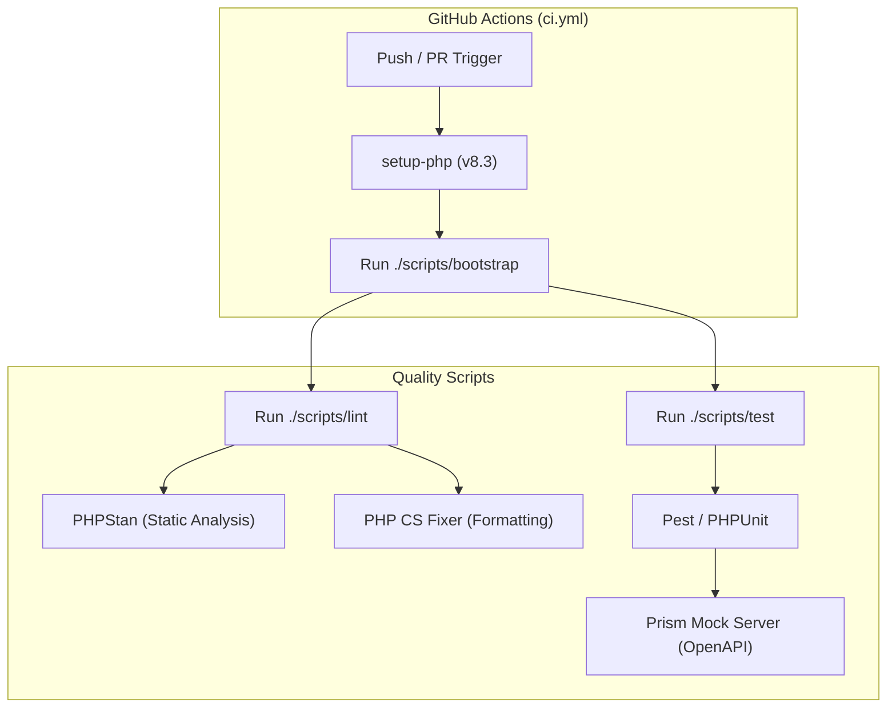
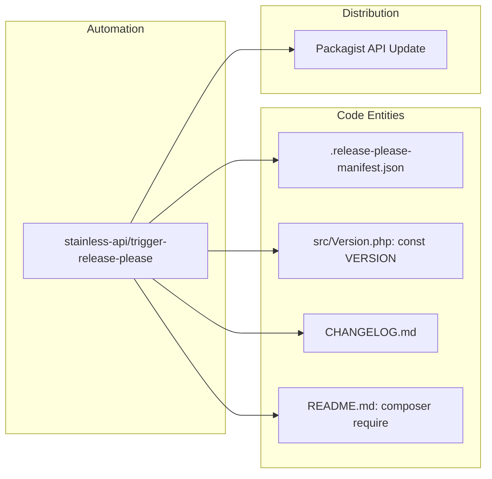

<!-- source: DeepWiki mcp.deepwiki.com · repo anthropics/anthropic-sdk-php · page 6.2 CI/CD and Release Pipeline · fetched 2026-10-26 -->

# CI/CD and Release Pipeline

Relevant source files

The following files were used as context for generating this wiki page:

- [.github/workflows/ci.yml](.github/workflows/ci.yml)
- [.github/workflows/claude.yml](.github/workflows/claude.yml)
- [.github/workflows/create-releases.yml](.github/workflows/create-releases.yml)
- [.github/workflows/publish-packagist.yml](.github/workflows/publish-packagist.yml)
- [.github/workflows/release-doctor.yml](.github/workflows/release-doctor.yml)
- [.release-please-manifest.json](.release-please-manifest.json)
- [CHANGELOG.md](CHANGELOG.md)
- [CONTRIBUTING.md](CONTRIBUTING.md)
- [README.md](README.md)
- [bin/check-release-environment](bin/check-release-environment)
- [src/Version.php](src/Version.php)

This page documents the automated workflows and infrastructure used to maintain, version, and publish the Anthropic PHP SDK. The pipeline ensures code quality through static analysis and testing, manages versioning via automated changelogs, and handles distribution to Packagist.

## Continuous Integration (CI)

The CI suite is triggered on every push to any branch (excluding specific internal preview branches) and on every pull request [ .github/workflows/ci.yml:2-16](). It consists of two primary jobs: `lint` and `test`.

### Linting Workflow
The `lint` job ensures the codebase adheres to defined style and static analysis standards [ .github/workflows/ci.yml:18-36]().
1.  **Environment**: Runs on PHP 8.3 [ .github/workflows/ci.yml:30]().
2.  **Bootstrap**: Executes `./scripts/bootstrap` to install dependencies via Composer [ .github/workflows/ci.yml:33]().
3.  **Execution**: Runs `./scripts/lint`, which invokes **PHPStan** for static analysis and **PHP CS Fixer** for code formatting [ CONTRIBUTING.md:45-51]().

### Testing Workflow
The `test` job executes the functional and unit test suite [ .github/workflows/ci.yml:37-54]().
1.  **Environment**: Runs on PHP 8.3 [ .github/workflows/ci.yml:48]().
2.  **Mock Server**: Tests typically require a mock server (e.g., Stoplight Prism) running against the OpenAPI spec [ CONTRIBUTING.md:31-37]().
3.  **Execution**: Runs `./scripts/test` to execute the test suite [ .github/workflows/ci.yml:54]().

### CI Data Flow
The following diagram illustrates the relationship between CI scripts and the GitHub Actions workflow.

**CI Execution Flow**

Sources: [ .github/workflows/ci.yml:1-55](), [ CONTRIBUTING.md:31-57]()

## Automated Release Pipeline

The SDK uses `release-please` (integrated via Stainless) to automate versioning and changelog generation. This pipeline is triggered daily or on pushes to the `main` branch [ .github/workflows/create-releases.yml:2-7]().

### Versioning and Manifests
The release process tracks the current version in two primary locations:
1.  **Manifest**: `.release-please-manifest.json` tracks the current version string [ .release-please-manifest.json:1-3]().
2.  **Code Constant**: `src/Version.php` contains the `VERSION` constant, wrapped in `x-release-please` markers to allow automated updates [ src/Version.php:7-9]().

### Release-Please Workflow
The `create-releases.yml` workflow performs the following steps:
1.  **Trigger**: Uses `stainless-api/trigger-release-please@v1` to check for new commits since the last release [ .github/workflows/create-releases.yml:19-23]().
2.  **Changelog**: Automatically updates `CHANGELOG.md` with categorized entries (Features, Bug Fixes, Chores) based on commit messages [ CHANGELOG.md:1-20]().
3.  **PR Creation**: If changes are detected, it creates a "Release PR". Merging this PR triggers the actual tag creation and publishing.

### Release-Please Integration
The following diagram maps the release automation to the specific files it modifies.

**Release Entity Mapping**

Sources: [ .github/workflows/create-releases.yml:19-28](), [ src/Version.php:7-9](), [ .release-please-manifest.json:1-3](), [ README.md:13-19]()

## Distribution and Publishing

Once a release is created, the SDK is published to Packagist to make it available via Composer.

### Packagist Integration
Publishing is handled by sending a POST request to the Packagist API [ .github/workflows/publish-packagist.yml:13-15]().
-   **Automated**: The `create-releases` job automatically triggers the Packagist update if `releases_created` is true [ .github/workflows/create-releases.yml:25-31]().
-   **Manual**: A `workflow_dispatch` event in `publish-packagist.yml` allows maintainers to trigger a manual sync if needed [ .github/workflows/publish-packagist.yml:2-3]().

### Secrets Management
The publishing process requires the following secrets [ .github/workflows/publish-packagist.yml:17-18]():
-   `PACKAGIST_USERNAME`: The account username on Packagist.
-   `PACKAGIST_SAFE_KEY`: The API token for the Packagist account.

Sources: [ .github/workflows/create-releases.yml:25-31](), [ .github/workflows/publish-packagist.yml:1-18]()

## Health Checks and Maintenance

### Release Doctor
The `release-doctor.yml` workflow runs on pushes to `main` and on `workflow_dispatch` [ .github/workflows/release-doctor.yml:1-7](). It executes the `bin/check-release-environment` script to verify that all necessary secrets and configurations are present for a successful release [ .github/workflows/release-doctor.yml:18-20]().

**Validation Checks [ bin/check-release-environment:3-29]():**
-   Presence of `STAINLESS_API_KEY`.
-   Presence of `PACKAGIST_USERNAME`.
-   Presence of `PACKAGIST_SAFE_KEY`.

### Claude Code Review
The SDK includes a `claude.yml` workflow that integrates Claude for automated code assistance and review [ .github/workflows/claude.yml:1-12]().
-   **Triggers**: Mentions of `@claude` in issue comments, PR review comments, or issue titles/bodies [ .github/workflows/claude.yml:15-19]().
-   **Permissions**: The action has `actions: read` permissions, allowing Claude to inspect CI results to help debug failing tests or lints [ .github/workflows/claude.yml:26-41]().

Sources: [ .github/workflows/release-doctor.yml:1-25](), [ bin/check-release-environment:1-30](), [ .github/workflows/claude.yml:1-51]()

---

