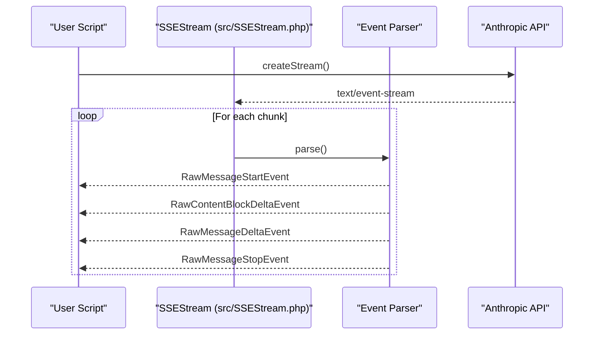
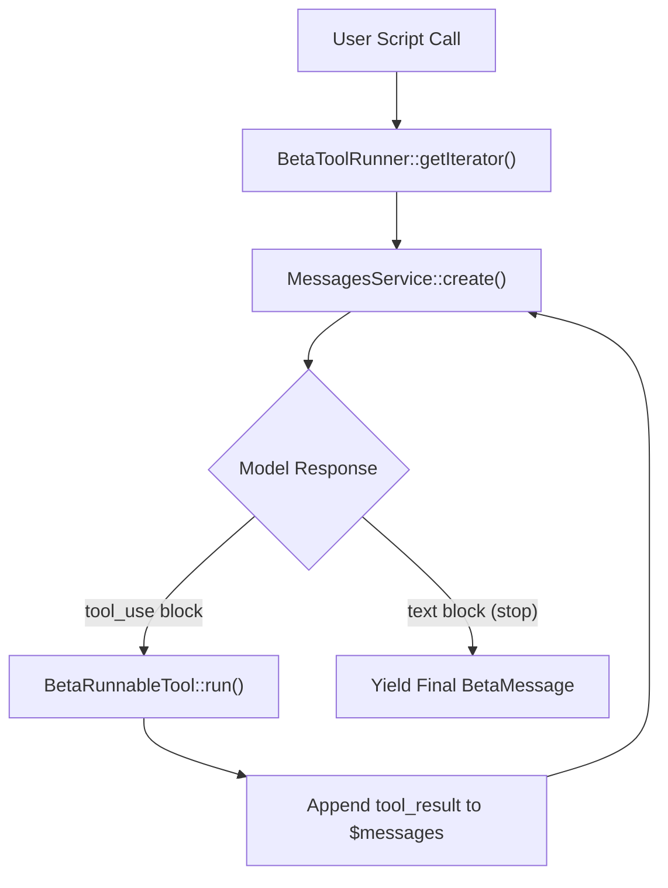

<!-- source: DeepWiki mcp.deepwiki.com · repo anthropics/anthropic-sdk-php · page 7 Examples · fetched 2026-10-26 -->

# Examples

<details>
<summary>Relevant source files</summary>

The following files were used as context for generating this wiki page:

- [examples/bedrock/messages.php](examples/bedrock/messages.php)
- [examples/bedrock/messages_count_tokens.php](examples/bedrock/messages_count_tokens.php)
- [examples/bedrock/messages_stream.php](examples/bedrock/messages_stream.php)
- [examples/beta/beta_tool_runner.php](examples/beta/beta_tool_runner.php)
- [examples/foundry/messages.php](examples/foundry/messages.php)
- [examples/foundry/messages_count_tokens.php](examples/foundry/messages_count_tokens.php)
- [examples/foundry/messages_stream.php](examples/foundry/messages_stream.php)
- [examples/list_models.php](examples/list_models.php)
- [examples/messages.php](examples/messages.php)
- [examples/messages_stream.php](examples/messages_stream.php)
- [examples/messages_structured_output.php](examples/messages_structured_output.php)
- [examples/messages_structured_output_constraints.php](examples/messages_structured_output_constraints.php)
- [examples/messages_structured_output_nested.php](examples/messages_structured_output_nested.php)
- [examples/messages_structured_output_raw_schema.php](examples/messages_structured_output_raw_schema.php)
- [examples/messages_structured_output_stream.php](examples/messages_structured_output_stream.php)
- [examples/vertex/count_tokens.php](examples/vertex/count_tokens.php)
- [examples/vertex/messages.php](examples/vertex/messages.php)
- [examples/vertex/messages_stream.php](examples/vertex/messages_stream.php)
- [src/Bedrock/BedrockEventStream.php](src/Bedrock/BedrockEventStream.php)
- [src/Bedrock/Client.php](src/Bedrock/Client.php)
- [src/Bedrock/Conversion/MessageTokensCountConverter.php](src/Bedrock/Conversion/MessageTokensCountConverter.php)
- [src/Bedrock/Services/MessagesRawService.php](src/Bedrock/Services/MessagesRawService.php)
- [src/Beta/Messages/BetaTextBlock.php](src/Beta/Messages/BetaTextBlock.php)
- [src/Beta/Messages/BetaTool.php](src/Beta/Messages/BetaTool.php)
- [src/Core/Attributes/Optional.php](src/Core/Attributes/Optional.php)
- [src/Core/Attributes/Required.php](src/Core/Attributes/Required.php)
- [src/Foundry/Client.php](src/Foundry/Client.php)
- [src/Foundry/Services/MessagesRawService.php](src/Foundry/Services/MessagesRawService.php)
- [src/Lib/Attributes/Constrained.php](src/Lib/Attributes/Constrained.php)
- [src/Lib/Tools/BetaRunnableTool.php](src/Lib/Tools/BetaRunnableTool.php)
- [src/Lib/Tools/BetaToolRunner.php](src/Lib/Tools/BetaToolRunner.php)
- [src/Messages/Model.php](src/Messages/Model.php)
- [src/Messages/Tool.php](src/Messages/Tool.php)
- [src/Vertex/Services/MessagesRawService.php](src/Vertex/Services/MessagesRawService.php)

</details>


The `examples/` directory contains runnable PHP scripts that demonstrate the core functionality of the Anthropic PHP SDK. These examples serve as a reference for implementing common patterns such as basic messaging, streaming, tool use, and multi-cloud integrations.

## Basic Messaging

The most common entry point for the SDK is the Messages API. The SDK provides both a standard `create` method for synchronous responses and a `createStream` method for handling real-time output.

### Synchronous Creation
The script in `examples/messages.php` demonstrates a basic request-response cycle using the `Anthropic\Client`.

```php
$message = $client->messages->create(
    maxTokens: 1024,
    messages: [['role' => 'user', 'content' => 'Hello, Claude']],
    model: 'claude-sonnet-4-20250514'
);
```
[examples/messages.php:9-17]()

### Event Streaming
For low-latency applications, `examples/messages_stream.php` shows how to iterate over an `SSEStream`. The stream yields different event types that correspond to the lifecycle of a message generation.

**Message Stream Data Flow**
The following diagram illustrates how the `SSEStream` decodes raw server-sent events into typed PHP event objects.

Title: Message Streaming Lifecycle

Sources: [examples/messages_stream.php:18-56](), [src/Foundry/Services/MessagesRawService.php:75-95]()

## Tool Use and Agents

The SDK supports complex "Tool Use" (function calling) workflows. This includes a high-level `BetaToolRunner` that automates the loop between the assistant and local PHP code execution.

### BetaToolRunner Loop
The `examples/beta/beta_tool_runner.php` script demonstrates how to define a `BetaRunnableTool` and execute it within an automated loop.

1.  **Define Tool**: A `BetaRunnableTool` is created with a JSON schema and a PHP `\Closure` [src/Lib/Tools/BetaRunnableTool.php:35-44]().
2.  **Initialize Runner**: The `toolRunner` method is called via the beta messages service [examples/beta/beta_tool_runner.php:42-47]().
3.  **Iterate**: The runner is an `IteratorAggregate` that yields `BetaMessage` objects as the conversation progresses [src/Lib/Tools/BetaToolRunner.php:25-77]().

Title: BetaToolRunner Execution Flow

Sources: [src/Lib/Tools/BetaToolRunner.php:208-250](), [examples/beta/beta_tool_runner.php:49-58]()

## Cloud Provider Integrations

The SDK provides specialized clients for Amazon Bedrock, Google Vertex AI, and Microsoft Azure (Foundry). These clients share a similar interface but handle different authentication and endpoint requirements.

### Microsoft Azure (Foundry)
The Foundry client supports both API key and Bearer token authentication.

| Feature | Example File | Key Method |
| :--- | :--- | :--- |
| Message Creation | `examples/foundry/messages.php` | `$client->messages->create()` |
| Token Counting | `examples/foundry/messages_count_tokens.php` | `$client->messages->countTokens()` |
| Streaming | `examples/foundry/messages_stream.php` | `$client->messages->createStream()` |

**Foundry Client Initialization:**
```php
$client = Foundry\Client::fromEnvironment(
    baseUrl: 'https://example-resource.services.ai.azure.com/anthropic'
);
```
[examples/foundry/messages.php:7-9]()

### Amazon Bedrock and Google Vertex AI
Examples for Bedrock and Vertex AI demonstrate provider-specific model identifiers and authentication via environment credentials.

*   **Bedrock**: Uses AWS SigV4 signing and identifiers like `anthropic.claude-sonnet-4-5-20250929-v1:0` [src/Messages/Model.php:50]().
*   **Vertex AI**: Uses Google Application Default Credentials and identifiers like `claude-sonnet-4@20250929` [src/Messages/Model.php:81]().

## Model Management

The `examples/list_models.php` script demonstrates how to retrieve available models and their capabilities.

```php
$page = $client->models->list();
foreach ($page as $model) {
    var_dump($model->id);
}
```
[examples/list_models.php:13-15]()

The `Anthropic\Messages\Model` enum provides a comprehensive list of supported model identifiers across all platforms [src/Messages/Model.php:14-98]().

## Structured Output

Structured output allows users to define PHP classes that represent the desired JSON schema for the model's response.

| Example | Purpose |
| :--- | :--- |
| `messages_structured_output.php` | Basic usage of `StructuredOutputModel`. |
| `messages_structured_output_nested.php` | Handling complex, nested PHP object hierarchies. |
| `messages_structured_output_constraints.php` | Using the `#[Constrained]` attribute to enforce regex or range limits. |

Sources: [examples/messages_structured_output.php](), [src/Lib/Attributes/Constrained.php:1-20]()

---

