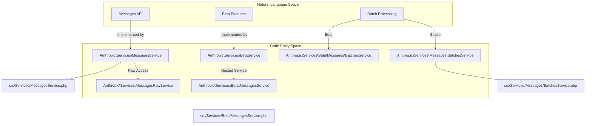
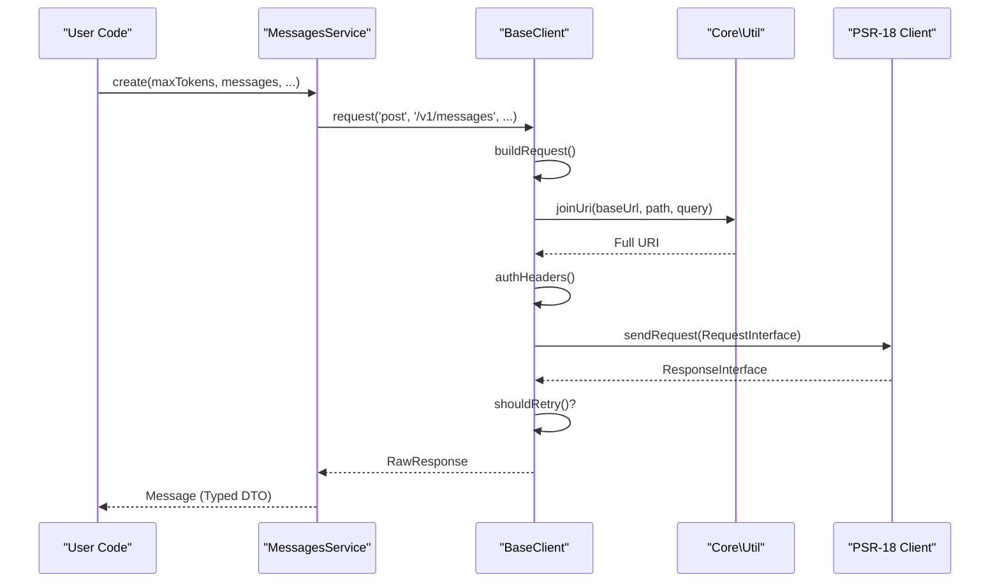

<!-- source: DeepWiki mcp.deepwiki.com · repo anthropics/anthropic-sdk-php · page 8 Glossary · fetched 2026-10-26 -->

# Glossary

Relevant source files

The following files were used as context for generating this wiki page:

- [.release-please-manifest.json](.release-please-manifest.json)
- [CHANGELOG.md](CHANGELOG.md)
- [CONTRIBUTING.md](CONTRIBUTING.md)
- [README.md](README.md)
- [composer.json](composer.json)
- [examples/beta/beta_tool_runner.php](examples/beta/beta_tool_runner.php)
- [examples/messages_structured_output.php](examples/messages_structured_output.php)
- [examples/messages_structured_output_constraints.php](examples/messages_structured_output_constraints.php)
- [examples/messages_structured_output_nested.php](examples/messages_structured_output_nested.php)
- [examples/messages_structured_output_raw_schema.php](examples/messages_structured_output_raw_schema.php)
- [examples/messages_structured_output_stream.php](examples/messages_structured_output_stream.php)
- [release-please-config.json](release-please-config.json)
- [src/Beta/Messages/Batches/BatchCreateParams/Request/Params.php](src/Beta/Messages/Batches/BatchCreateParams/Request/Params.php)
- [src/Beta/Messages/Batches/BatchResultsParams.php](src/Beta/Messages/Batches/BatchResultsParams.php)
- [src/Beta/Messages/BetaTextBlock.php](src/Beta/Messages/BetaTextBlock.php)
- [src/Beta/Messages/MessageCountTokensParams.php](src/Beta/Messages/MessageCountTokensParams.php)
- [src/Beta/Messages/MessageCreateParams.php](src/Beta/Messages/MessageCreateParams.php)
- [src/Beta/Models/BetaCapabilitySupport.php](src/Beta/Models/BetaCapabilitySupport.php)
- [src/Beta/Models/BetaContextManagementCapability.php](src/Beta/Models/BetaContextManagementCapability.php)
- [src/Beta/Models/BetaEffortCapability.php](src/Beta/Models/BetaEffortCapability.php)
- [src/Beta/Models/BetaModelCapabilities.php](src/Beta/Models/BetaModelCapabilities.php)
- [src/Beta/Models/BetaThinkingCapability.php](src/Beta/Models/BetaThinkingCapability.php)
- [src/Beta/Models/BetaThinkingTypes.php](src/Beta/Models/BetaThinkingTypes.php)
- [src/Client.php](src/Client.php)
- [src/Core/Attributes/Optional.php](src/Core/Attributes/Optional.php)
- [src/Core/Attributes/Required.php](src/Core/Attributes/Required.php)
- [src/Core/BaseClient.php](src/Core/BaseClient.php)
- [src/Core/Concerns/SdkModel.php](src/Core/Concerns/SdkModel.php)
- [src/Core/Concerns/SdkStream.php](src/Core/Concerns/SdkStream.php)
- [src/Core/Concerns/SdkUnion.php](src/Core/Concerns/SdkUnion.php)
- [src/Core/Contracts/BaseStream.php](src/Core/Contracts/BaseStream.php)
- [src/Core/Conversion/PropertyInfo.php](src/Core/Conversion/PropertyInfo.php)
- [src/Core/Conversion/UnionOf.php](src/Core/Conversion/UnionOf.php)
- [src/Core/Implementation/RawResponse.php](src/Core/Implementation/RawResponse.php)
- [src/Core/Util.php](src/Core/Util.php)
- [src/JsonLStream.php](src/JsonLStream.php)
- [src/Lib/Attributes/Constrained.php](src/Lib/Attributes/Constrained.php)
- [src/Lib/Tools/BetaRunnableTool.php](src/Lib/Tools/BetaRunnableTool.php)
- [src/Lib/Tools/BetaToolRunner.php](src/Lib/Tools/BetaToolRunner.php)
- [src/Messages/Batches/BatchCreateParams/Request/Params.php](src/Messages/Batches/BatchCreateParams/Request/Params.php)
- [src/Messages/MessageCountTokensParams.php](src/Messages/MessageCountTokensParams.php)
- [src/Messages/MessageCreateParams.php](src/Messages/MessageCreateParams.php)
- [src/Models/CapabilitySupport.php](src/Models/CapabilitySupport.php)
- [src/Models/ContextManagementCapability.php](src/Models/ContextManagementCapability.php)
- [src/Models/EffortCapability.php](src/Models/EffortCapability.php)
- [src/Page.php](src/Page.php)
- [src/PageCursor.php](src/PageCursor.php)
- [src/RequestOptions.php](src/RequestOptions.php)
- [src/SSEStream.php](src/SSEStream.php)
- [src/ServiceContracts/Beta/Messages/BatchesContract.php](src/ServiceContracts/Beta/Messages/BatchesContract.php)
- [src/ServiceContracts/Beta/Messages/BatchesRawContract.php](src/ServiceContracts/Beta/Messages/BatchesRawContract.php)
- [src/ServiceContracts/Beta/MessagesContract.php](src/ServiceContracts/Beta/MessagesContract.php)
- [src/ServiceContracts/Messages/BatchesContract.php](src/ServiceContracts/Messages/BatchesContract.php)
- [src/ServiceContracts/Messages/BatchesRawContract.php](src/ServiceContracts/Messages/BatchesRawContract.php)
- [src/ServiceContracts/MessagesContract.php](src/ServiceContracts/MessagesContract.php)
- [src/Services/Beta/Messages/BatchesRawService.php](src/Services/Beta/Messages/BatchesRawService.php)
- [src/Services/Beta/Messages/BatchesService.php](src/Services/Beta/Messages/BatchesService.php)
- [src/Services/Beta/MessagesRawService.php](src/Services/Beta/MessagesRawService.php)
- [src/Services/Beta/MessagesService.php](src/Services/Beta/MessagesService.php)
- [src/Services/Messages/BatchesRawService.php](src/Services/Messages/BatchesRawService.php)
- [src/Services/Messages/BatchesService.php](src/Services/Messages/BatchesService.php)
- [src/Services/MessagesRawService.php](src/Services/MessagesRawService.php)
- [src/Services/MessagesService.php](src/Services/MessagesService.php)
- [src/TokenPage.php](src/TokenPage.php)
- [src/Version.php](src/Version.php)
- [tests/ClientTest.php](tests/ClientTest.php)
- [tests/Core/UtilTest.php](tests/Core/UtilTest.php)

This page provides definitions for codebase-specific terms, jargon, and domain concepts used throughout the Anthropic PHP SDK. It serves as a technical reference for engineers to understand the internal mechanics and naming conventions of the SDK.

## Core Concepts

### BaseClient & Client
The `BaseClient` is the abstract foundation for all service interactions. it handles request construction, header assembly, and the retry/redirect lifecycle. The `Client` class extends `BaseClient` and serves as the primary entry point for users, initializing the default `MessagesService`, `ModelsService`, and `BetaService`.

*   **Implementation**: [src/Core/BaseClient.php:32-33](), [src/Client.php:19-20]()
*   **Data Flow**: The `Client` passes itself into child services, allowing them to use the `request()` method defined in `BaseClient`. [src/Client.php:83-85]()

### NormalizedRequest
A standardized internal array structure used to represent an HTTP request before it is passed to the PSR-18 transporter. It ensures consistency across different service calls.

*   **Structure**: Includes `method`, `path`, `query`, `headers`, and `body`. [src/Core/BaseClient.php:24-30]()
*   **Generation**: Produced by the `buildRequest` method. [src/Core/BaseClient.php:131-164]()

### RequestOptions
A configuration object (or associative array) that allows users to override client-level settings on a per-request basis. This includes `maxRetries`, `timeout`, and `extraHeaders`.

*   **Implementation**: [src/RequestOptions.php:14-15]()
*   **Usage**: Merged during the request building phase. [src/Core/BaseClient.php:139-140]()

### SdkModel
A trait applied to Data Transfer Objects (DTOs) that provides standardized methods for object initialization (`with`) and serialization. It bridges the gap between raw API arrays and typed PHP objects.

*   **Implementation**: [src/Core/Concerns/SdkModel.php:11-12]()
*   **Usage Example**: Used in `Base64ImageSource` and other parameter objects. [README.md:41-47]()

---

## Service Mapping: Natural Language to Code Entities

The following diagram maps high-level API concepts to their specific implementation classes and service structures within the SDK.

**Diagram: API Service Mapping**

**Sources**: [src/Client.php:28-38](), [src/Services/MessagesService.php:51-61](), [src/Services/Beta/MessagesService.php:63-74]()

---

## Request Lifecycle Terminology

### Idempotency Key
A unique string sent in the `idempotency-key` (or configured header) to ensure that retrying a request does not result in duplicate operations on the server.

*   **Logic**: The SDK generates a key starting with `stainless-php-retry-`. [src/Core/BaseClient.php:114-119]()
*   **Header Placement**: Injected during `buildRequest` if an idempotency header is defined for the client. [src/Core/BaseClient.php:149-151]()

### Exponential Backoff
The strategy used to delay retries after a failure. The delay increases exponentially based on the number of attempts to avoid overwhelming the API.

*   **Calculation**: Handled in `retryDelay`. [src/Core/BaseClient.php:219-245]()
*   **Retry Conditions**: Triggered by 408, 409, 429, and >=500 status codes. [src/Core/BaseClient.php:208-211]()

### SSE (Server-Sent Events)
A streaming protocol used by the Messages API to deliver incremental updates. The SDK wraps these in a `BaseStream`.

*   **Implementation**: [src/SSEStream.php:16-17]()
*   **Parsing**: Uses `Util::BUF_SIZE` (8192 bytes) to chunk the incoming stream. [src/Core/Util.php:20]()

---

## Technical Data Flow

The following diagram illustrates how a high-level service call is transformed into a network request and back into a typed response.

**Diagram: Request-Response Transformation**

**Sources**: [src/Core/BaseClient.php:62-96](), [src/Client.php:118-134](), [src/Core/Util.php:183-219]()

---

## Jargon & Abbreviations

| Term | Definition | Code Pointer |
| :--- | :--- | :--- |
| **MCP** | Model Context Protocol. Used in Beta services for server definitions. | [src/Services/Beta/MessagesService.php:53]() |
| **JSONL** | JSON Lines. Used for batch results where each line is a valid JSON object. | [src/Core/Util.php:26]() |
| **Unwrap** | The process of extracting a specific key from a nested API response array. | [src/Core/BaseClient.php:68]() |
| **Converter** | Logic used to transform raw response data into a specific class or union. | [src/Core/BaseClient.php:69]() |
| **Thinking** | A model capability for extended reasoning, configured via `ThinkingConfig`. | [src/Services/MessagesService.php:26-29]() |
| **Release Please** | The automated tool used to manage versions and changelogs. | [CHANGELOG.md:1-5](), [src/Version.php:7-9]() |

**Sources**: [src/Core/Util.php:26](), [src/Core/BaseClient.php:68-69](), [src/Version.php:7-9](), [src/Services/MessagesService.php:26-29]()