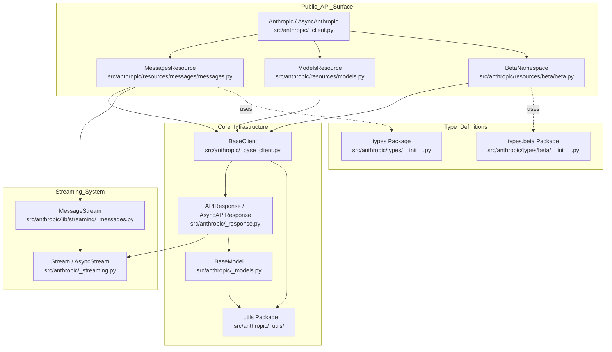
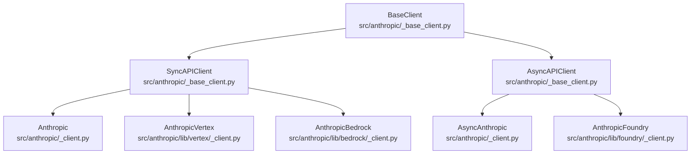
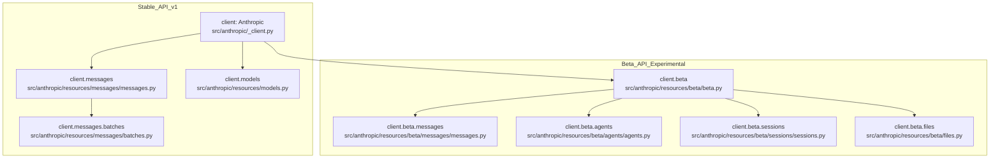
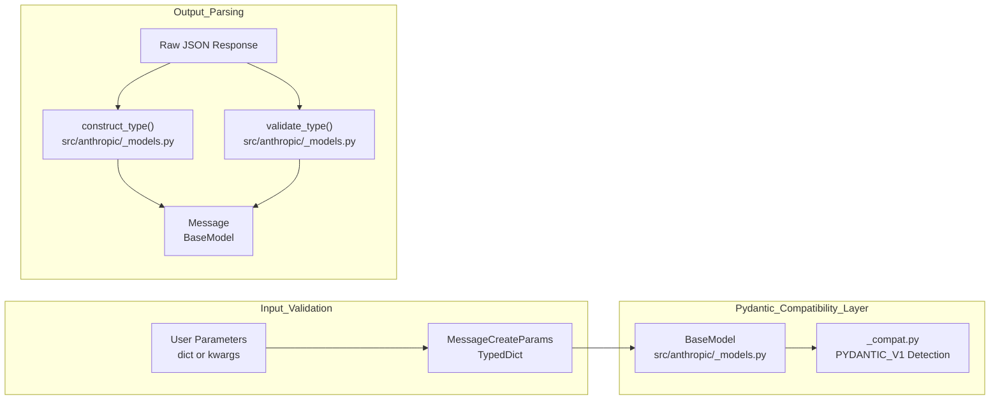
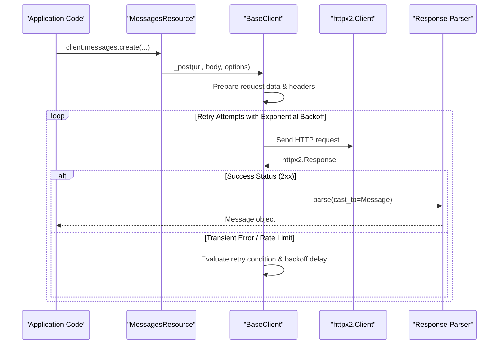

<!-- source: DeepWiki mcp.deepwiki.com · repo anthropics/anthropic-sdk-python · page 1 Overview · fetched 2026-10-26 -->

# Overview

Relevant source files

The following files were used as context for generating this wiki page:

- [.release-please-manifest.json](.release-please-manifest.json)
- [.stats.yml](.stats.yml)
- [CHANGELOG.md](CHANGELOG.md)
- [CONTRIBUTING.md](CONTRIBUTING.md)
- [README.md](README.md)
- [api.md](api.md)
- [pyproject.toml](pyproject.toml)
- [requirements-dev.lock](requirements-dev.lock)
- [scripts/mock-spec.json.gz](scripts/mock-spec.json.gz)
- [scripts/utils/ruffen-docs.py](scripts/utils/ruffen-docs.py)
- [src/anthropic/__init__.py](src/anthropic/__init__.py)
- [src/anthropic/_base_client.py](src/anthropic/_base_client.py)
- [src/anthropic/_client.py](src/anthropic/_client.py)
- [src/anthropic/_constants.py](src/anthropic/_constants.py)
- [src/anthropic/_types.py](src/anthropic/_types.py)
- [src/anthropic/_version.py](src/anthropic/_version.py)
- [src/anthropic/types/__init__.py](src/anthropic/types/__init__.py)
- [src/anthropic/types/anthropic_beta_param.py](src/anthropic/types/anthropic_beta_param.py)
- [src/anthropic/types/beta/__init__.py](src/anthropic/types/beta/__init__.py)
- [tests/test_client.py](tests/test_client.py)
- [uv.lock](uv.lock)

## Purpose and Scope

The Anthropic Python SDK is the official client library for accessing the Claude AI API from Python applications. It provides type-safe, synchronous, and asynchronous access to Claude models, structured outputs, streaming responses, tool execution systems, and administrative APIs. The SDK requires Python 3.10+ and maintains full compatibility with both Pydantic v1 and v2 via an abstraction layer [pyproject.toml:22](), [src/anthropic/_compat.py:1-69]().

**Key Features:**
- Synchronous (`Anthropic`) and asynchronous (`AsyncAnthropic`) clients [src/anthropic/_client.py:132-524]()
- Server-sent event (SSE) streaming for real-time response generation [src/anthropic/_streaming.py:24-486]()
- Comprehensive type definitions using `TypedDict` for requests and Pydantic for validation [src/anthropic/types/__init__.py:1-210]()
- Automatic retry logic with exponential backoff for transient HTTP errors [src/anthropic/_base_client.py:772-880]()
- Cloud provider integrations (Google Vertex AI, AWS Bedrock, and Azure AI Foundry) [src/anthropic/__init__.py:103-107]()
- Native OpenTelemetry tracing support (`open_telemetry` client option and `ANTHROPIC_OPEN_TELEMETRY` environment variables) [README.md:47-78]()
- Beta API access for experimental features including Managed Agents, Model Context Protocol (MCP), and Extended Thinking [src/anthropic/resources/beta/beta.py:92-220]()

Sources: [README.md:1-50](), [src/anthropic/_client.py:132-524](), [src/anthropic/_base_client.py:368-756](), [pyproject.toml:22-31]()

## High-Level Architecture

The SDK follows a layered architecture enforcing strict separation of concerns between public API client classes, core HTTP communication infrastructure, request building pipelines, data models, and helper utilities.

### SDK Component Overview

Sources: [src/anthropic/_client.py:53-291](), [src/anthropic/_base_client.py:368-756](), [src/anthropic/_models.py:144-397]()

## Client Hierarchy

The SDK provides multiple client classes inheriting from shared foundational base classes in `_base_client.py` [src/anthropic/_base_client.py:313-446](). Authentication logic supports API keys, environment variables, credentials provider chains, and cloud-specific signing mechanisms [src/anthropic/_client.py:177-205]().

### Client Classes and Inheritance

| Client Class | Base Class | Purpose | Authentication Mechanism |
|--------------|------------|---------|--------------------------|
| `Anthropic` | `SyncAPIClient` | Primary synchronous client | API key, auth token, or environment config [src/anthropic/_client.py:134]() |
| `AsyncAnthropic` | `AsyncAPIClient` | Primary asynchronous client | API key, auth token, or environment config [src/anthropic/_client.py:330]() |
| `AnthropicVertex` | `SyncAPIClient` | Google Cloud Vertex AI integration | OAuth 2.0 via `google-auth` [pyproject.toml:42]() |
| `AnthropicBedrock` | `SyncAPIClient` | AWS Bedrock integration | SigV4 request signing via `boto3` [pyproject.toml:44]() |
| `AnthropicFoundry` | `AsyncAPIClient` | Azure AI Foundry / Anthropic platform | Bearer token authentication [src/anthropic/__init__.py:132]() |

Sources: [src/anthropic/_client.py:132-524](), [src/anthropic/_base_client.py:313-446](), [src/anthropic/__init__.py:128-132]()

## API Resource Organization

Resources represent API endpoints and are accessed as properties on client instances. The SDK organizes its capabilities into stable (v1) namespaces and experimental beta namespaces.

### API Resource Structure

**Stable API Resources:**

| Resource | Access Path | Primary Methods |
|----------|-------------|-----------------|
| `Messages` | `client.messages` | `create()`, `stream()`, `count_tokens()` [src/anthropic/resources/messages/messages.py:35-150]() |
| `Models` | `client.models` | `list()`, `retrieve()` [src/anthropic/resources/models.py:20-80]() |
| `Batches` | `client.messages.batches` | `create()`, `retrieve()`, `list()`, `cancel()` [src/anthropic/resources/messages/batches.py:30-120]() |

**Beta API Resources:**

| Resource | Access Path | Beta Capabilities |
|----------|-------------|-------------------|
| `BetaMessages` | `client.beta.messages` | Context management, computer use, extended thinking [src/anthropic/resources/beta/messages/messages.py:40-200]() |
| `Agents` | `client.beta.agents` | Managed agents system and versions [src/anthropic/resources/beta/agents/agents.py:25-100]() |
| `Sessions` | `client.beta.sessions` | Agent session and thread orchestration [src/anthropic/resources/beta/sessions/sessions.py:20-90]() |
| `Files` | `client.beta.files` | File upload and asset management [src/anthropic/resources/beta/files.py:20-70]() |

Sources: [src/anthropic/resources/beta/beta.py:92-220](), [src/anthropic/resources/messages/messages.py:1-150](), [src/anthropic/resources/models.py:1-80]()

## Type System and Validation

The SDK uses a dual-type system designed for input flexibility and output safety, leveraging Pydantic models for response parsing [src/anthropic/_models.py:144]().

### Type Validation Pipeline

**Input Validation:**
- Request parameters utilize `TypedDict` definitions (e.g., `MessageCreateParams` [src/anthropic/types/message_create_params.py]()).
- Processed via `maybe_transform()` before execution [src/anthropic/_utils/_transform.py:20-80]().

**Output Validation:**
- Response payloads are parsed into Pydantic `BaseModel` subclasses [src/anthropic/_models.py:144]().
- Two validation modes are supported:
  - `construct_type()`: lenient parsing for developer convenience [src/anthropic/_models.py:44-90]()
  - `validate_type()`: strict schema enforcement for production environments [src/anthropic/_models.py:92-142]()

Sources: [src/anthropic/_models.py:44-397](), [src/anthropic/_compat.py:1-69]()

## Request/Response Lifecycle

Every API call traverses a structured execution pipeline managed by `BaseClient`, incorporating retry handlers, timeout configurations, and error mapping [src/anthropic/_base_client.py:490-592]().

### Request Execution Sequence

**Key Phases:**
1. **Request Preparation**: Parameters are stripped of unassigned sentinels (`NotGiven`, `Omit`) and serialized via `_qs.py` and `_transform.py` [src/anthropic/_base_client.py:500-550]().
2. **HTTP Transmission**: Executed via `httpx2` client with connection pooling and timeouts [src/anthropic/_base_client.py:600-680]().
3. **Response Wrapping**: Responses are wrapped in `APIResponse` or `AsyncAPIResponse` instances [src/anthropic/_response.py:1-150]().
4. **Error Handling**: Non-2xx status codes trigger specific exception types mapping through `_make_status_error()` [src/anthropic/_exceptions.py:1-120]().

Sources: [src/anthropic/_base_client.py:490-592](), [src/anthropic/_response.py:1-150](), [src/anthropic/_exceptions.py:1-120]()

## Authentication and Configuration

The SDK supports flexible authentication configuration through constructor arguments and environment variables [src/anthropic/_client.py:179-190]().

| Authentication Method | Target Client | Environment Variable |
|-----------------------|---------------|----------------------|
| API Key | `Anthropic` | `ANTHROPIC_API_KEY` [src/anthropic/_client.py:184]() |
| Auth Token | `Anthropic` | `ANTHROPIC_AUTH_TOKEN` [src/anthropic/_client.py:184]() |
| Profile | `Anthropic` | `ANTHROPIC_PROFILE` [src/anthropic/_client.py:186]() |
| Workload Identity | `Anthropic` | Federation configuration variables [src/anthropic/_client.py:188]() |

**Default Client Configurations:**
- `timeout`: Defaults to 10 minutes (`DEFAULT_TIMEOUT`) [src/anthropic/_constants.py:28]()
- `max_retries`: Defaults to `2` retries [src/anthropic/_constants.py:28]()
- `base_url`: Overridable for enterprise proxies or local mock servers [src/anthropic/_client.py:156]()

Sources: [src/anthropic/_client.py:132-210](), [src/anthropic/_constants.py:28]()

---

