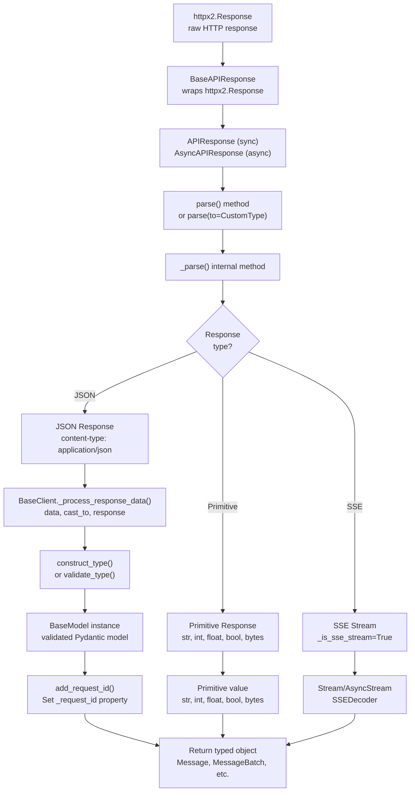

<!-- source: DeepWiki mcp.deepwiki.com · repo anthropics/anthropic-sdk-python · page 10 Response Processing · fetched 2026-10-26 -->

# Response Processing

Relevant source files

The following files were used as context for generating this wiki page:

- [examples/batch_results.py](examples/batch_results.py)
- [src/anthropic/_decoders/jsonl.py](src/anthropic/_decoders/jsonl.py)
- [src/anthropic/_exceptions.py](src/anthropic/_exceptions.py)
- [src/anthropic/_response.py](src/anthropic/_response.py)
- [src/anthropic/_streaming.py](src/anthropic/_streaming.py)
- [src/anthropic/resources/beta/messages/__init__.py](src/anthropic/resources/beta/messages/__init__.py)
- [tests/decoders/test_jsonl.py](tests/decoders/test_jsonl.py)
- [tests/test_response.py](tests/test_response.py)
- [tests/test_streaming.py](tests/test_streaming.py)
- [tests/utils.py](tests/utils.py)

This page explains how HTTP responses are wrapped, parsed, and transformed into typed Python objects in the Anthropic Python SDK. It covers the response class hierarchy, the parsing pipeline from raw bytes to validated models, and utilities for accessing response metadata.

---

## 1. Response Overview

The SDK transforms raw HTTP responses into typed Python objects through a multi-stage pipeline. This process handles content type detection, JSON parsing, type validation, and model construction.

### From Bytes to Objects

Sources: [src/anthropic/_response.py:50-199](), [src/anthropic/_streaming.py:26-131]()

---

## 10.1. Response Classes and Parsing

The SDK provides both synchronous (`APIResponse`) and asynchronous (`AsyncAPIResponse`) response classes that wrap `httpx2.Response` instances. These classes provide methods for parsing payloads (`parse()`), reading binary data, and inspecting transport metadata such as headers, status codes, and elapsed time.

For detailed coverage of `APIResponse`, `AsyncAPIResponse`, binary response classes, content type detection, and the `cast_to` parameter, see **[Response Classes and Parsing](#10.1)**.

Sources: [src/anthropic/_response.py:50-128](), [tests/test_response.py:31-74]()

---

## 10.2. Exception Types and Error Handling

HTTP status codes outside the `2xx` range are automatically intercepted and mapped into a structured exception hierarchy rooted at `AnthropicError`. Status errors inherit from `APIStatusError`, which extracts workspace IDs and request IDs from response headers, as well as error types from the JSON response body.

For detailed coverage of the exception hierarchy, status code mapping, and error response parsing, see **[Exception Types and Error Handling](#10.2)**.

Sources: [src/anthropic/_exceptions.py:31-94](), [src/anthropic/_exceptions.py:135-180]()

---

## 10.3. Stream and SSE Decoding

For streaming endpoints, the SDK uses specialized decoder classes such as `SSEDecoder`, `SSEBytesDecoder`, and `JSONLDecoder` to process Server-Sent Events and line-delimited JSON payloads. The `Stream` and `AsyncStream` classes manage iteration, automatically handling connection closure and event dispatching.

For detailed coverage of `Stream`, `AsyncStream`, `SSEDecoder`, `ServerSentEvent`, and batch/Bedrock decoding, see **[Stream and SSE Decoding](#10.3)**.

Sources: [src/anthropic/_streaming.py:26-152](), [src/anthropic/_decoders/jsonl.py:15-76]()

---

## 10.4. Pagination and Response Wrappers

Endpoints returning collections use pagination classes (`BasePage`, `SyncPage`, `AsyncPage`, `SyncPageCursor`) to abstract over cursor-based pagination. Additionally, response wrapper utilities such as `to_raw_response_wrapper` and `to_streamed_response_wrapper` allow callers to bypass default parsing or access raw streams directly.

For detailed coverage of pagination classes, auto-pagination, and response wrappers, see **[Pagination and Response Wrappers](#10.4)**.

Sources: [src/anthropic/_response.py:31-35](), [tests/utils.py:30-36]()

---

