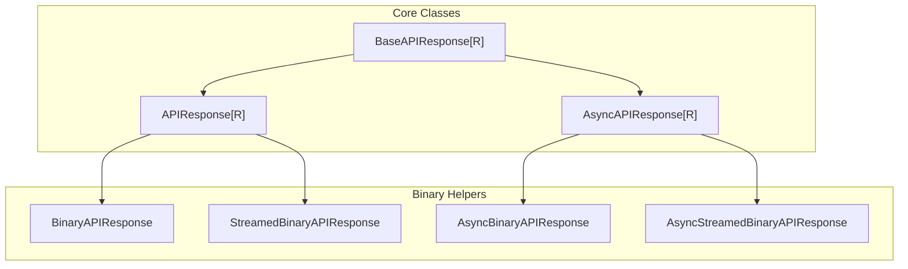
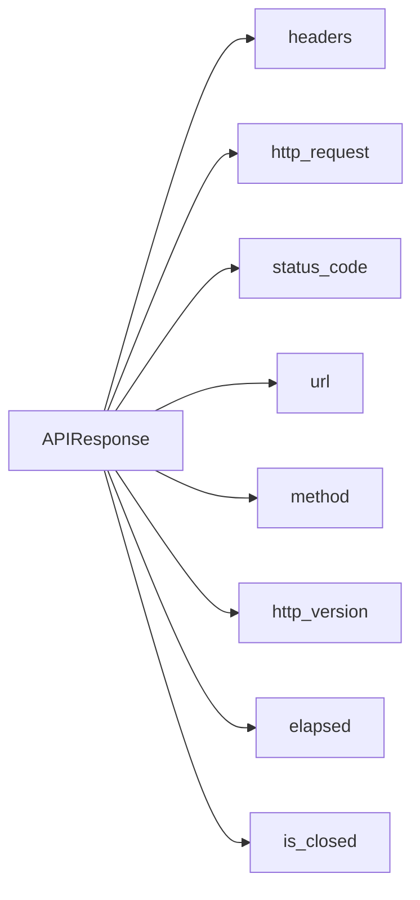
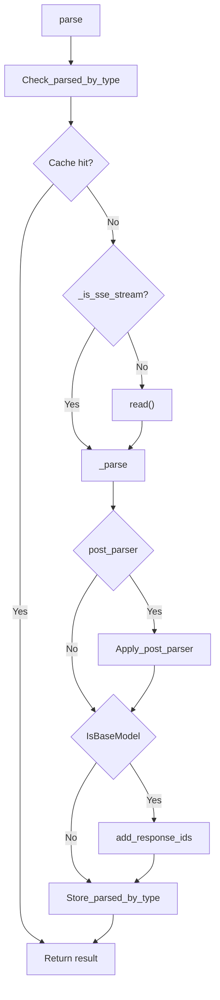
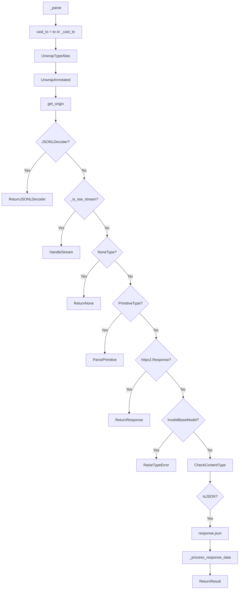

<!-- source: DeepWiki mcp.deepwiki.com · repo anthropics/anthropic-sdk-python · page 10.1 Response Classes and Parsing · fetched 2026-10-26 -->

# Response Classes and Parsing

<details>
<summary>Relevant source files</summary>

The following files were used as context for generating this wiki page:

- [examples/batch_results.py](examples/batch_results.py)
- [src/anthropic/_decoders/jsonl.py](src/anthropic/_decoders/jsonl.py)
- [src/anthropic/_exceptions.py](src/anthropic/_exceptions.py)
- [src/anthropic/_response.py](src/anthropic/_response.py)
- [src/anthropic/_streaming.py](src/anthropic/_streaming.py)
- [src/anthropic/resources/beta/messages/__init__.py](src/anthropic/resources/beta/messages/__init__.py)
- [tests/decoders/test_jsonl.py](tests/decoders/test_jsonl.py)
- [tests/test_response.py](tests/test_response.py)
- [tests/test_streaming.py](tests/test_streaming.py)
- [tests/utils.py](tests/utils.py)

</details>


This page documents the response wrapper classes that encapsulate HTTP responses from the Anthropic API and provide type-safe parsing into Python objects. These classes handle content type detection, type validation, and transformation of raw JSON data into strongly-typed Python models.

For streaming-specific SSE handling, see [Stream and SSE Decoding](10.3). For paginated result handling, see [Pagination and Response Wrappers](10.4). For error responses and exception handling, see [Exception Types and Error Handling](10.2).

## Response Class Hierarchy

The SDK provides a class hierarchy for wrapping `httpx2.Response` objects with type-safe parsing capabilities [src/anthropic/_response.py:49-515]():

Title: Response Class Hierarchy


Sources: [src/anthropic/_response.py:49-515]()

### BaseAPIResponse

`BaseAPIResponse[R]` is a generic base class that provides shared functionality for both synchronous and asynchronous response handling [src/anthropic/_response.py:49-56]():

| Property | Type | Description |
|----------|------|-------------|
| `_cast_to` | `type[R]` | The target type for parsing the response [src/anthropic/_response.py:50]() |
| `_client` | `BaseClient[Any, Any]` | Reference to the client that made the request [src/anthropic/_response.py:51]() |
| `_parsed_by_type` | `dict[type[Any], Any]` | Cache of parsed results by type [src/anthropic/_response.py:52]() |
| `_is_sse_stream` | `bool` | Whether this is a server-sent events stream [src/anthropic/_response.py:53]() |
| `_stream_cls` | `type[Stream] \| type[AsyncStream] \| None` | Stream class for SSE responses [src/anthropic/_response.py:54]() |
| `_options` | `FinalRequestOptions` | Request options used [src/anthropic/_response.py:55]() |
| `http_response` | `httpx2.Response` | The underlying httpx response object [src/anthropic/_response.py:58]() |
| `retries_taken` | `int` | Number of retries that were made (0 if none) [src/anthropic/_response.py:60-61]() |

Sources: [src/anthropic/_response.py:49-81]()

### APIResponse and AsyncAPIResponse

`APIResponse[R]` and `AsyncAPIResponse[R]` extend `BaseAPIResponse` with concrete implementations for synchronous and asynchronous contexts [src/anthropic/_response.py:301-515]():

| Method | Sync Version | Async Version |
|--------|--------------|---------------|
| Parse response | `parse()` [src/anthropic/_response.py:338]() | `async parse()` [src/anthropic/_response.py:445]() |
| Read binary content | `read()` [src/anthropic/_response.py:360]() | `async read()` [src/anthropic/_response.py:467]() |
| Get text content | `text()` [src/anthropic/_response.py:368]() | `async text()` [src/anthropic/_response.py:475]() |
| Get JSON content | `json()` [src/anthropic/_response.py:374]() | `async json()` [src/anthropic/_response.py:481]() |
| Close connection | `close()` [src/anthropic/_response.py:380]() | `async close()` [src/anthropic/_response.py:487]() |
| Iterate bytes | `iter_bytes()` [src/anthropic/_response.py:387]() | `async iter_bytes()` [src/anthropic/_response.py:494]() |
| Iterate text | `iter_text()` [src/anthropic/_response.py:393]() | `async iter_text()` [src/anthropic/_response.py:500]() |
| Iterate lines | `iter_lines()` [src/anthropic/_response.py:399]() | `async iter_lines()` [src/anthropic/_response.py:506]() |

Sources: [src/anthropic/_response.py:301-515]()

### Binary Response Helpers

The SDK provides specialized subclasses for handling binary data with convenience methods:
- `BinaryAPIResponse` / `AsyncBinaryAPIResponse`: Add `write_to_file()` method for eager writing [src/anthropic/_response.py:517-567]().
- `StreamedBinaryAPIResponse` / `AsyncStreamedBinaryAPIResponse`: Add `stream_to_file()` method for streaming writes [src/anthropic/_response.py:569-599]().

Sources: [src/anthropic/_response.py:517-599]()

## Response Properties

All response classes expose properties for accessing response metadata [src/anthropic/_response.py:82-127]():

Title: Code Entity Space to Response Metadata


Sources: [src/anthropic/_response.py:82-127]()

The `request_id` property extracts the unique request identifier from the `request-id` response header [src/anthropic/_exceptions.py:85]().

Sources: [src/anthropic/_exceptions.py:85]()

## The parse() Method

The `parse()` method is the primary interface for converting raw HTTP responses into typed Python objects:

Title: parse Method Execution Flow


Sources: [src/anthropic/_response.py:312-359](), [src/anthropic/_response.py:421-465]()

### Method Signature

The `parse()` method supports optional type override via the `to` parameter [src/anthropic/_response.py:338-340]():

```python
result = response.parse()
custom_result = response.parse(to=CustomModel)
```

Sources: [src/anthropic/_response.py:338-340]()

### Caching

Parsed results are cached by type in `_parsed_by_type` to avoid redundant parsing [src/anthropic/_response.py:343-345]().

Sources: [src/anthropic/_response.py:343-345]()

### Request ID Attachment

When the parsed result is a `BaseModel` instance, the SDK automatically attaches request IDs using `add_response_ids()` [src/anthropic/_response.py:29](), [src/anthropic/_response.py:354-356]().

Sources: [src/anthropic/_response.py:29](), [src/anthropic/_response.py:354-356]()

## Internal Parsing Logic

The `_parse()` method implements core type transformation logic [src/anthropic/_response.py:129-298]():

Title: Internal Parse Logic


Sources: [src/anthropic/_response.py:129-298]()

### Pydantic BaseModel Validation

The SDK enforces that Pydantic models must subclass `anthropic.BaseModel` rather than `pydantic.BaseModel` directly [src/anthropic/_response.py:244-251]().

Sources: [src/anthropic/_response.py:244-251]()

## Low-Level Access Methods

For direct access to response content without parsing, response classes provide low-level methods:
- `read()` [src/anthropic/_response.py:360-366](), [src/anthropic/_response.py:467-473]()
- `text()` [src/anthropic/_response.py:368-372](), [src/anthropic/_response.py:475-479]()
- `json()` [src/anthropic/_response.py:374-378](), [src/anthropic/_response.py:481-485]()
- `iter_bytes()` [src/anthropic/_response.py:387-391](), [src/anthropic/_response.py:494-498]()
- `iter_text()` [src/anthropic/_response.py:393-397](), [src/anthropic/_response.py:500-504]()
- `iter_lines()` [src/anthropic/_response.py:399-407](), [src/anthropic/_response.py:506-514]()

Sources: [src/anthropic/_response.py:360-407](), [src/anthropic/_response.py:467-514]()

## Binary Response Utilities

Binary response subclasses provide file I/O convenience methods:
- `write_to_file()` [src/anthropic/_response.py:525-540](), [src/anthropic/_response.py:550-565]()
- `stream_to_file()` [src/anthropic/_response.py:569-582](), [src/anthropic/_response.py:585-598]()

Sources: [src/anthropic/_response.py:525-598]()

## Type Extraction Utility

The `extract_response_type()` function extracts the generic type variable from response classes [src/anthropic/_response.py:860-875]().

Sources: [src/anthropic/_response.py:860-875]()

---

