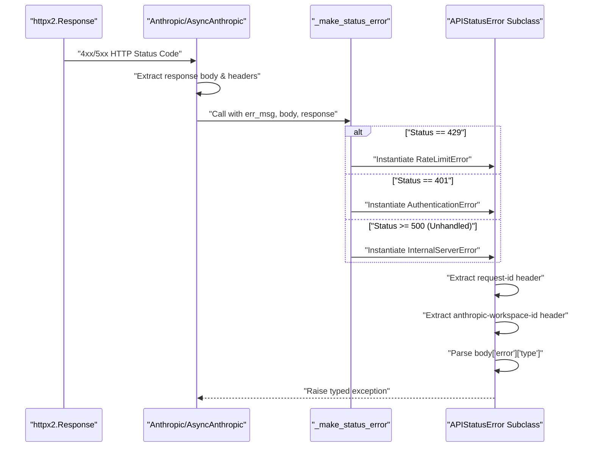

<!-- source: DeepWiki mcp.deepwiki.com · repo anthropics/anthropic-sdk-python · page 10.2 Exception Types and Error Handling · fetched 2026-10-26 -->

# Exception Types and Error Handling

Relevant source files

The following files were used as context for generating this wiki page:

- [examples/batch_results.py](examples/batch_results.py)
- [src/anthropic/_decoders/jsonl.py](src/anthropic/_decoders/jsonl.py)
- [src/anthropic/_exceptions.py](src/anthropic/_exceptions.py)
- [src/anthropic/_response.py](src/anthropic/_response.py)
- [src/anthropic/_streaming.py](src/anthropic/_streaming.py)
- [src/anthropic/resources/beta/messages/__init__.py](src/anthropic/resources/beta/messages/__init__.py)
- [tests/decoders/test_jsonl.py](tests/decoders/test_jsonl.py)
- [tests/test_response.py](tests/test_response.py)
- [tests/test_streaming.py](tests/test_streaming.py)
- [tests/utils.py](tests/utils.py)

This document describes the exception hierarchy, status code mapping, request ID and workspace ID extraction, and error handling mechanisms in the Anthropic Python SDK. It covers all exception types defined by the SDK, how HTTP status codes are mapped to specific exception classes, and how errors are parsed from both standard and streaming responses.

## Purpose and Scope

The SDK provides a structured exception hierarchy for handling errors that occur during API interactions. All exceptions inherit from a common base (`AnthropicError`), enabling systematic error handling while allowing fine-grained exception catching for specific error conditions. The SDK automatically maps HTTP status codes to appropriate exception types and extracts error metadata (such as `request-id`, `anthropic-workspace-id`, and error types) from response headers and bodies [src/anthropic/_exceptions.py:71-93]().

Sources: [src/anthropic/_exceptions.py:31-93]()

## Exception Hierarchy

The SDK defines a structured exception hierarchy with `AnthropicError` as the root. All status-specific exceptions inherit from `APIStatusError`, which represents HTTP 4xx or 5xx responses [src/anthropic/_exceptions.py:31-93]().

### Exception Class Hierarchy Diagram

```mermaid
graph TB
    AnthropicError["AnthropicError"]
    
    APIError["APIError<br/>message, request, body"]
    
    APIStatusError["APIStatusError<br/>response, status_code, request_id, workspace_id, type"]
    APIResponseValidationError["APIResponseValidationError<br/>response, status_code"]
    APIWebhookValidationError["APIWebhookValidationError"]
    APIConnectionError["APIConnectionError"]
    
    APITimeoutError["APITimeoutError"]
    
    BadRequestError["BadRequestError<br/>status_code: 400"]
    AuthenticationError["AuthenticationError<br/>status_code: 401"]
    PermissionDeniedError["PermissionDeniedError<br/>status_code: 403"]
    NotFoundError["NotFoundError<br/>status_code: 404"]
    ConflictError["ConflictError<br/>status_code: 409"]
    RequestTooLargeError["RequestTooLargeError<br/>status_code: 413"]
    UnprocessableEntityError["UnprocessableEntityError<br/>status_code: 422"]
    RateLimitError["RateLimitError<br/>status_code: 429"]
    ServiceUnavailableError["ServiceUnavailableError<br/>status_code: 503"]
    OverloadedError["OverloadedError<br/>status_code: 529"]
    DeadlineExceededError["DeadlineExceededError<br/>status_code: 504"]
    InternalServerError["InternalServerError"]
    RetryableError["RetryableError"]
    CredentialsError["CredentialsError"]
    IdentityTokenFileError["IdentityTokenFileError"]
    
    AnthropicError --> APIError
    AnthropicError --> RetryableError
    AnthropicError --> CredentialsError
    CredentialsError --> IdentityTokenFileError
    APIError --> APIStatusError
    APIError --> APIResponseValidationError
    APIError --> APIWebhookValidationError
    APIError --> APIConnectionError
    APIConnectionError --> APITimeoutError
    
    APIStatusError --> BadRequestError
    APIStatusError --> AuthenticationError
    APIStatusError --> PermissionDeniedError
    APIStatusError --> NotFoundError
    APIStatusError --> ConflictError
    APIStatusError --> RequestTooLargeError
    APIStatusError --> UnprocessableEntityError
    APIStatusError --> RateLimitError
    APIStatusError --> ServiceUnavailableError
    APIStatusError --> OverloadedError
    APIStatusError --> DeadlineExceededError
    APIStatusError --> InternalServerError
```

Sources: [src/anthropic/_exceptions.py:31-180]()

## Core Exception Types

### Base Exceptions

| Exception Class | Purpose | Key Attributes |
|----------------|---------|----------------|
| `AnthropicError` | Root exception for all SDK errors [src/anthropic/_exceptions.py:31-32]() | None |
| `APIError` | Base for API-related errors [src/anthropic/_exceptions.py:35-55]() | `message`, `request`, `body` |
| `APIStatusError` | Base for HTTP 4xx/5xx errors [src/anthropic/_exceptions.py:71-93]() | `response`, `status_code`, `request_id`, `workspace_id`, `type` |
| `APIResponseValidationError` | Invalid API response schema [src/anthropic/_exceptions.py:57-65]() | `response`, `status_code` |
| `APIConnectionError` | Network connection failures [src/anthropic/_exceptions.py:95-98]() | `message`, `request` |
| `APITimeoutError` | Request timeout or interruption [src/anthropic/_exceptions.py:100-106]() | `message`, `request` |
| `RetryableError` | Error that triggers the SDK retry policy [src/anthropic/_exceptions.py:108-115]() | None |
| `CredentialsError` | Credential loading failures [src/anthropic/_exceptions.py:117-118]() | None |
| `IdentityTokenFileError` | Projected token file error [src/anthropic/_exceptions.py:121-133]() | `path` |

Sources: [src/anthropic/_exceptions.py:31-133]()

### Status-Specific Exceptions

The SDK maps specific HTTP status codes to typed exceptions. `InternalServerError` serves as a catch-all for 5xx codes not explicitly mapped to another subclass.

| Exception Class | Status Code | Meaning |
|----------------|-------------|---------|
| `BadRequestError` | 400 | Invalid request parameters [src/anthropic/_exceptions.py:135-136]() |
| `AuthenticationError` | 401 | Invalid or missing API key [src/anthropic/_exceptions.py:139-140]() |
| `PermissionDeniedError` | 403 | Insufficient permissions [src/anthropic/_exceptions.py:143-144]() |
| `NotFoundError` | 404 | Resource not found [src/anthropic/_exceptions.py:147-148]() |
| `ConflictError` | 409 | Request conflicts with current state [src/anthropic/_exceptions.py:151-152]() |
| `RequestTooLargeError` | 413 | Request payload too large [src/anthropic/_exceptions.py:155-156]() |
| `UnprocessableEntityError` | 422 | Valid syntax but semantic errors [src/anthropic/_exceptions.py:159-160]() |
| `RateLimitError` | 429 | Rate limit exceeded [src/anthropic/_exceptions.py:163-164]() |
| `ServiceUnavailableError` | 503 | Service temporarily unavailable [src/anthropic/_exceptions.py:167-168]() |
| `DeadlineExceededError` | 504 | Gateway timeout [src/anthropic/_exceptions.py:175-176]() |
| `OverloadedError` | 529 | Service overloaded [src/anthropic/_exceptions.py:171-172]() |
| `InternalServerError` | 5xx | Unexpected server error [src/anthropic/_exceptions.py:179-180]() |

Sources: [src/anthropic/_exceptions.py:135-180]()

## Exception Attributes and Parsing

### APIError and Body Parsing
The `APIError` class stores the response `body` [src/anthropic/_exceptions.py:39-54](). If the API responds with a valid JSON structure, this property contains the decoded result dictionary or list; otherwise, it contains the raw response content or text.

### APIStatusError Metadata Extraction
When an `APIStatusError` is initialized, it extracts tracing and error classification metadata from the response headers and body [src/anthropic/_exceptions.py:81-93]():
1. **Request ID**: Extracted from the `request-id` header (`self.request_id = response.headers.get("request-id")`) [src/anthropic/_exceptions.py:85]().
2. **Workspace ID**: Extracted from the `anthropic-workspace-id` header (`self.workspace_id = response.headers.get("anthropic-workspace-id")`) [src/anthropic/_exceptions.py:86]().
3. **Error Type**: Parsed from the JSON error payload (`body.get("error").get("type")`) if `body` is a dictionary [src/anthropic/_exceptions.py:89-93]().

Sources: [src/anthropic/_exceptions.py:35-93]()

## Error Handling in Streams

When consuming Server-Sent Event (SSE) streams via `Stream` or `AsyncStream`, errors can be signaled inline via SSE error events [src/anthropic/_streaming.py:99-112]().

### SSE Error Event Flow
1. The stream decoder inspects incoming SSE events (`sse.event`) [src/anthropic/_streaming.py:92-99]().
2. If `sse.event == "error"`, the SDK extracts `sse.data` and attempts to decode it as JSON [src/anthropic/_streaming.py:99-103]().
3. It invokes `self._client._make_status_error` to construct and raise the appropriate `APIStatusError` subclass [src/anthropic/_streaming.py:108-112]().
4. The underlying HTTP connection is closed automatically in the `finally` block [src/anthropic/_streaming.py:124-130]().

Sources: [src/anthropic/_streaming.py:99-130]()

## Error Response Flow

The following sequence diagram illustrates the lifecycle of transforming a raw HTTP error response into a typed exception using the internal client architecture.

Sources: [src/anthropic/_exceptions.py:71-93](), [src/anthropic/_streaming.py:99-112]()

## Summary of Error Types

The `ErrorType` definition specifies the literal strings that can be present in the `type` attribute of an `APIStatusError`, providing programmatic insight into server-side error classification [src/anthropic/_exceptions.py:10]().

| ErrorType Literal | Description |
|-------------------|-------------|
| `invalid_request_error` | The request was malformed or unacceptable |
| `authentication_error` | Authentication failed or token invalid |
| `permission_error` | Insufficient permissions for action |
| `not_found_error` | Requested resource does not exist |
| `rate_limit_error` | Rate limit threshold exceeded |
| `timeout_error` | Request processing timed out |
| `overloaded_error` | Anthropic backend capacity overloaded |
| `api_error` | Unexpected internal API error |
| `billing_error` | Account billing or credit issue |

Sources: [src/anthropic/_exceptions.py:10-11](), [src/anthropic/_exceptions.py:71-93]()

---

