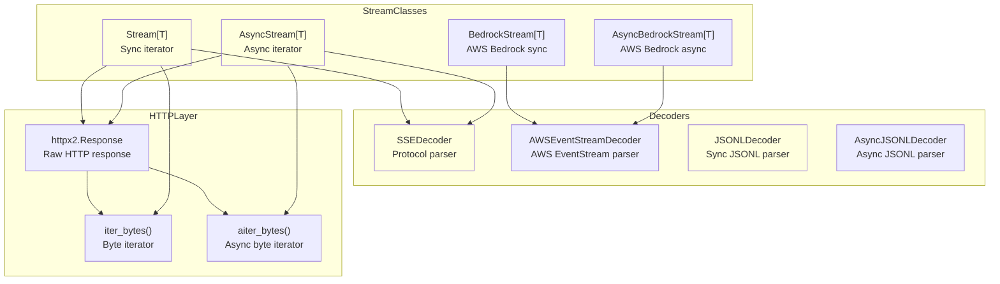
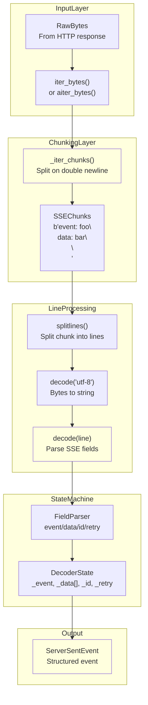
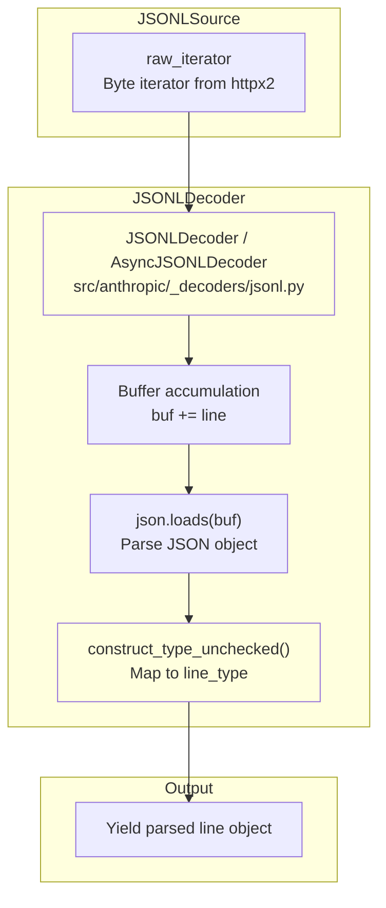

<!-- source: DeepWiki mcp.deepwiki.com · repo anthropics/anthropic-sdk-python · page 10.3 Stream and SSE Decoding · fetched 2026-10-26 -->

# Stream and SSE Decoding

<details>
<summary>Relevant source files</summary>

The following files were used as context for generating this wiki page:

- [examples/batch_results.py](examples/batch_results.py)
- [src/anthropic/_decoders/jsonl.py](src/anthropic/_decoders/jsonl.py)
- [src/anthropic/_exceptions.py](src/anthropic/_exceptions.py)
- [src/anthropic/_response.py](src/anthropic/_response.py)
- [src/anthropic/_streaming.py](src/anthropic/_streaming.py)
- [src/anthropic/lib/bedrock/_stream.py](src/anthropic/lib/bedrock/_stream.py)
- [src/anthropic/lib/bedrock/_stream_decoder.py](src/anthropic/lib/bedrock/_stream_decoder.py)
- [src/anthropic/resources/beta/messages/__init__.py](src/anthropic/resources/beta/messages/__init__.py)
- [tests/decoders/test_jsonl.py](tests/decoders/test_jsonl.py)
- [tests/test_response.py](tests/test_response.py)
- [tests/test_streaming.py](tests/test_streaming.py)
- [tests/utils.py](tests/utils.py)

</details>


This page documents the low-level streaming infrastructure that handles Server-Sent Events (SSE) protocol decoding, JSON Lines (JSONL) decoding for message batches, and AWS Bedrock event-stream decoding. It covers the `Stream` and `AsyncStream` classes, the `SSEDecoder` implementation, `ServerSentEvent`, `JSONLDecoder`, and `AWSEventStreamDecoder`.

For higher-level streaming functionality including message accumulation and parsed events, see [Streaming](#6). For general response parsing, see [Response Classes and Parsing](#10.1).

## Overview

The streaming and decoding systems provide core responsibilities across different response modalities:
1. **SSE Protocol Decoding**: Parse raw byte streams following the Server-Sent Events specification into structured events for streaming messages.
2. **JSONL Decoding**: Provide synchronous and asynchronous iterators for parsing JSON Lines response bodies (e.g., in Message Batches results).
3. **AWS Bedrock EventStream Decoding**: Parse binary AWS event stream messages into SSE-compatible events for Bedrock integrations.
4. **Event Iteration**: Provide synchronous and asynchronous iterators over decoded events with automatic response cleanup.

**Sources**: [src/anthropic/_streaming.py:1-486](), [src/anthropic/_decoders/jsonl.py:1-135](), [src/anthropic/lib/bedrock/_stream_decoder.py:1-91]()

## Stream and AsyncStream Classes

### Class Hierarchy



**Sources**: [src/anthropic/_streaming.py:26-194](), [src/anthropic/_decoders/jsonl.py:15-135](), [src/anthropic/lib/bedrock/_stream.py:14-37]()

### Stream Class

The `Stream` class provides synchronous iteration over SSE events. It implements the iterator protocol and context manager interface for automatic cleanup.

**Key Attributes**:

| Attribute | Type | Description |
| :--- | :--- | :--- |
| `response` | `httpx2.Response` | The underlying HTTP response object [src/anthropic/_streaming.py:29]() |
| `_cast_to` | `type[_T]` | Target type for event data parsing [src/anthropic/_streaming.py:36]() |
| `_client` | `Anthropic` | Client instance for response processing [src/anthropic/_streaming.py:38]() |
| `_options` | `FinalRequestOptions` | Request options including timeout config [src/anthropic/_streaming.py:30]() |
| `_decoder` | `SSEBytesDecoder` | SSE protocol decoder instance [src/anthropic/_streaming.py:31]() |
| `_iterator` | `Iterator[_T]` | Internal iterator over parsed events [src/anthropic/_streaming.py:48]() |

**Initialization**: [src/anthropic/_streaming.py:33-45]()

```python
def __init__(
    self,
    *,
    cast_to: type[_T],
    response: httpx2.Response,
    client: Anthropic,
    options: Optional[FinalRequestOptions] = None,
) -> None
```

The decoder is created via `client._make_sse_decoder()`, allowing the client to provide a custom decoder implementation if needed [src/anthropic/_streaming.py:45]().

**Iterator Protocol**: [src/anthropic/_streaming.py:58-68]()

The class implements `__next__()` and `__iter__()` by delegating to the internal `_iterator`.

**Context Manager**: [src/anthropic/_streaming.py:132-151]()

Entering the context manager returns `self`, while exiting ensures `self.response.close()` is called to release the connection [src/anthropic/_streaming.py:143-151]().

**Sources**: [src/anthropic/_streaming.py:26-152]()

### AsyncStream Class

The `AsyncStream` class mirrors `Stream` but for asynchronous iteration. It implements the async iterator protocol (`__anext__`, `__aiter__`) and async context manager interface.

**Key Differences from Stream**:

| Aspect | Stream | AsyncStream |
| :--- | :--- | :--- |
| Client type | `Anthropic` | `AsyncAnthropic` [src/anthropic/_streaming.py:166]() |
| Iterator method | `__next__()` | `async __anext__()` [src/anthropic/_streaming.py:186]() |
| Iteration protocol | `__iter__()` | `async __aiter__()` [src/anthropic/_streaming.py:192]() |
| Event iteration | `_iter_events()` | `async _iter_events()` [src/anthropic/_streaming.py:204]() |
| Cleanup | `response.close()` | `await response.aclose()` [src/anthropic/_streaming.py:255]() |

**Sources**: [src/anthropic/_streaming.py:154-260]()

## Server-Sent Event Structure

### ServerSentEvent Class

The `ServerSentEvent` class represents a single parsed SSE event following the SSE specification.

**Event Fields**:

| Field | Type | Description |
| :--- | :--- | :--- |
| `event` | `str \| None` | Event type name (e.g., "message_start", "completion") [src/anthropic/_streaming.py:264]() |
| `data` | `str` | Event data payload (defaults to empty string) [src/anthropic/_streaming.py:265]() |
| `id` | `str \| None` | Event identifier for reconnection [src/anthropic/_streaming.py:266]() |
| `retry` | `int \| None` | Reconnection time in milliseconds [src/anthropic/_streaming.py:267]() |

**JSON Parsing**: [src/anthropic/_streaming.py:301-302]()

The `json()` method parses the `data` field as JSON:

```python
def json(self) -> Any:
    return json.loads(self.data)
```

**Sources**: [src/anthropic/_streaming.py:263-306]()

## SSE Protocol Decoding

### SSEDecoder Implementation

The `SSEDecoder` class implements the Server-Sent Events specification for parsing SSE protocol from raw bytes [src/anthropic/_streaming.py:309-411]().



**Sources**: [src/anthropic/_streaming.py:309-411]()

## JSONL Decoding for Batch Results

For batch processing results retrieved via `client.messages.batches.results(batch_id)`, the server responds with a [JSON Lines](https://jsonlines.org) formatted stream [src/anthropic/_decoders/jsonl.py:15-20](), [examples/batch_results.py:17-19](). The SDK provides `JSONLDecoder` and `AsyncJSONLDecoder` to process these response streams [src/anthropic/_response.py:144-162]().

### JSONLDecoder and AsyncJSONLDecoder Classes

`JSONLDecoder` and `AsyncJSONLDecoder` accept a raw byte iterator and line type, accumulating bytes into a buffer across chunks, splitting on line endings, and parsing each line into a typed object using `construct_type_unchecked()` [src/anthropic/_decoders/jsonl.py:15-135]().



**Sources**: [src/anthropic/_decoders/jsonl.py:15-135](), [src/anthropic/_response.py:144-162](), [examples/batch_results.py:17-19]()

## Bedrock Event-Stream Decoding

When using AWS Bedrock integrations, requests and responses flow through AWS EventStream rather than standard HTTP SSE [src/anthropic/lib/bedrock/_stream_decoder.py:25-53]().

### AWSEventStreamDecoder, BedrockStream, and AsyncBedrockStream

`AWSEventStreamDecoder` leverages `botocore`'s `EventStreamBuffer` and `EventStreamJSONParser` to unpack binary event stream messages [src/anthropic/lib/bedrock/_stream_decoder.py:25-53](). It translates AWS event frames into `ServerSentEvent` instances, which are then consumed by `BedrockStream` and `AsyncBedrockStream` [src/anthropic/lib/bedrock/_stream.py:14-37]().

**Sources**: [src/anthropic/lib/bedrock/_stream_decoder.py:25-91](), [src/anthropic/lib/bedrock/_stream.py:14-37]()

---

