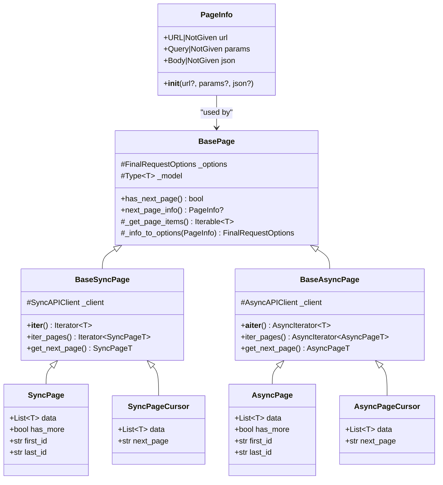
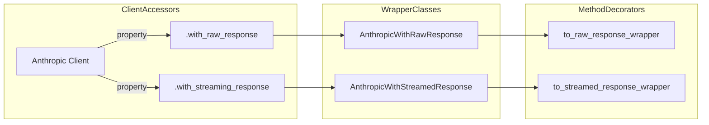

<!-- source: DeepWiki mcp.deepwiki.com · repo anthropics/anthropic-sdk-python · page 10.4 Pagination and Response Wrappers · fetched 2026-10-26 -->

# Pagination and Response Wrappers

Relevant source files

The following files were used as context for generating this wiki page:

- [examples/batch_results.py](examples/batch_results.py)
- [src/anthropic/_decoders/jsonl.py](src/anthropic/_decoders/jsonl.py)
- [src/anthropic/_exceptions.py](src/anthropic/_exceptions.py)
- [src/anthropic/_response.py](src/anthropic/_response.py)
- [src/anthropic/_streaming.py](src/anthropic/_streaming.py)
- [src/anthropic/pagination.py](src/anthropic/pagination.py)
- [src/anthropic/resources/beta/messages/__init__.py](src/anthropic/resources/beta/messages/__init__.py)
- [src/anthropic/resources/beta/organization/analytics/cost_report.py](src/anthropic/resources/beta/organization/analytics/cost_report.py)
- [src/anthropic/resources/beta/organization/analytics/usage_report.py](src/anthropic/resources/beta/organization/analytics/usage_report.py)
- [src/anthropic/resources/beta/organization/analytics/user_cost_report.py](src/anthropic/resources/beta/organization/analytics/user_cost_report.py)
- [src/anthropic/resources/beta/organization/analytics/user_usage_report.py](src/anthropic/resources/beta/organization/analytics/user_usage_report.py)
- [tests/api_resources/beta/organization/analytics/test_cost_report.py](tests/api_resources/beta/organization/analytics/test_cost_report.py)
- [tests/api_resources/beta/organization/analytics/test_usage_report.py](tests/api_resources/beta/organization/analytics/test_usage_report.py)
- [tests/api_resources/beta/organization/analytics/test_user_cost_report.py](tests/api_resources/beta/organization/analytics/test_user_cost_report.py)
- [tests/api_resources/beta/organization/analytics/test_user_usage_report.py](tests/api_resources/beta/organization/analytics/test_user_usage_report.py)
- [tests/decoders/test_jsonl.py](tests/decoders/test_jsonl.py)
- [tests/test_response.py](tests/test_response.py)
- [tests/test_streaming.py](tests/test_streaming.py)
- [tests/utils.py](tests/utils.py)

This document covers two distinct yet related systems for handling API responses in the Anthropic Python SDK: **pagination support** for list endpoints that return multiple pages of results, and **response wrappers** that control how responses are returned to the user (raw vs parsed, with context management).

For information about the core response parsing system, see [Response Classes and Parsing](10.1). For details about streaming responses specifically, see [Stream and SSE Decoding](10.3).

---

## Overview

The SDK provides two main abstractions for handling API outputs:

| Component | Purpose | Key Classes |
|-----------|---------|-------------|
| **Pagination** | Handle multi-page API responses with automatic iteration | `BasePage`, `BaseSyncPage`, `BaseAsyncPage`, `PageInfo`, `AsyncPaginator`, `SyncPage`, `AsyncPage`, `SyncPageCursor`, `AsyncPageCursor` [src/anthropic/_base_client.py:123-362](), [src/anthropic/pagination.py:22-201]() |
| **Response Wrappers** | Control response return format (raw/parsed/streaming) and lifecycle | `ResponseContextManager`, wrapper functions, `*WithRawResponse`, `*WithStreamedResponse` [src/anthropic/_response.py:642-857]() |

---

## Pagination System

The pagination system enables efficient traversal of API endpoints that return paginated results. It provides a uniform interface for both synchronous and asynchronous clients, automatically handling the logic to fetch subsequent pages.

### Architecture

Sources: [src/anthropic/_base_client.py:123-362](), [src/anthropic/pagination.py:22-201]()

### PageInfo Class

The `PageInfo` class (`[src/anthropic/_base_client.py:123-172]()`) stores the information necessary to construct a request for the next page of results. It supports three mutually exclusive approaches for pagination:

| Approach | Field | Use Case |
|----------|-------|----------|
| URL-based | `url: URL` | Server provides complete next page URL |
| Parameter-based | `params: Query` | Add/update query parameters for next page |
| JSON body-based | `json: Body` | Modify request body for next page (POST pagination) |

The class enforces that exactly one of these fields is set via overloaded `__init__` signatures.

Sources: [src/anthropic/_base_client.py:123-172]()

### BasePage: Core Pagination Interface

The `BasePage` class (`[src/anthropic/_base_client.py:174-233]()`) defines the fundamental pagination contract. It is a generic class parameterized by the item type `_T`.

**Key methods:**
- `has_next_page() -> bool`: Checks if another page exists by verifying that page items exist and `next_page_info()` returns a value [src/anthropic/_base_client.py:192-198]().
- `next_page_info() -> Optional[PageInfo]`: Abstract method implemented by subclasses to determine pagination strategy [src/anthropic/_base_client.py:186-187]().
- `_get_page_items() -> Iterable[_T]`: Abstract method that extracts items from the current page [src/anthropic/_base_client.py:189-190]().
- `_info_to_options(info: PageInfo) -> FinalRequestOptions`: Converts `PageInfo` into request options by merging with existing options [src/anthropic/_base_client.py:200-233]().

Sources: [src/anthropic/_base_client.py:174-233]()

### Concrete Pagination Classes

The SDK provides several concrete implementations for different pagination strategies, defined in `src/anthropic/pagination.py`. These classes implement `_get_page_items()` to return the list from the `data` field and `next_page_info()` to determine the next request based on specific cursor fields.

| Class | Strategy | Logic |
|-------|----------|-------|
| `SyncPage` / `AsyncPage` | Cursor-based | Uses `before_id` or `after_id` parameters [src/anthropic/pagination.py:23-95]() |
| `SyncTokenPage` / `AsyncTokenPage` | Token-based | Uses a `page_token` parameter from `next_page` field [src/anthropic/pagination.py:97-152]() |
| `SyncPageCursor` / `AsyncPageCursor` | Page-based | Uses a simple `page` parameter from `next_page` field [src/anthropic/pagination.py:155-201]() |
| `SyncBidirectionalPageCursor` / `AsyncBidirectionalPageCursor` | Bidirectional | Supports `next_page` and `prev_page` [src/anthropic/pagination.py:203-251]() |

Sources: [src/anthropic/pagination.py:23-251]()

### BaseSyncPage: Synchronous Pagination

`BaseSyncPage` (`[src/anthropic/_base_client.py:235-282]()`) extends `BasePage` to provide synchronous iteration over paginated results.

- `__iter__()`: Overrides Pydantic's default dict-conversion behavior to enable iteration over items [src/anthropic/_base_client.py:259-262]().
- `iter_pages()`: Generator that yields page instances, automatically fetching subsequent pages via `get_next_page()` until `has_next_page()` returns `False` [src/anthropic/_base_client.py:264-271]().
- `get_next_page()`: Fetches the next page by calling `_client._request_api_list()` with options derived from `next_page_info()` [src/anthropic/_base_client.py:273-281]().

Sources: [src/anthropic/_base_client.py:235-282]()

### BaseAsyncPage and AsyncPaginator

The async pagination system mirrors the sync implementation with async/await support (`[src/anthropic/_base_client.py:284-362]()`).

- `AsyncPaginator`: Provides the async entry point, supporting `__await__()` (`[src/anthropic/_base_client.py:302-304]()`) to return the first page directly and `__aiter__()` (`[src/anthropic/_base_client.py:306-310]()`) for item iteration.
- `BaseAsyncPage`: Implements `__aiter__()` (`[src/anthropic/_base_client.py:343-346]()`), `iter_pages()` (`[src/anthropic/_base_client.py:348-354]()`), and `get_next_page()` (`[src/anthropic/_base_client.py:356-362]()`).

Sources: [src/anthropic/_base_client.py:284-362]()

---

## Response Wrappers

Response wrappers provide control over the format and lifecycle of API responses. The SDK supports two wrapper types: **raw response wrappers** and **streaming response wrappers**.

### Architecture

Sources: [src/anthropic/_response.py:707-857]()

### Raw Response Wrappers

Raw response wrappers modify API methods to return the `APIResponse` (or `AsyncAPIResponse`) wrapper object instead of the parsed result (`[src/anthropic/_response.py:707-751]()`). This provides access to HTTP response metadata (status code, headers, request-id, etc.) and allows manual parsing via `.parse()` (`[src/anthropic/_response.py:421-468]()`).

The decorator injects the `RAW_RESPONSE_HEADER` into `extra_headers`, which signals to the client to return the response object directly instead of auto-parsing (`[src/anthropic/_response.py:707-726]()`, `[src/anthropic/_constants.py:28]()`).

Sources: [src/anthropic/_response.py:707-751](), [src/anthropic/_constants.py:28]()

### Streaming Response Wrappers

Streaming response wrappers enable access to the response as a stream of bytes/text/lines without eagerly reading the response body. They return a `ResponseContextManager` that wraps the `APIResponse`.

The decorator functions are:
- `to_streamed_response_wrapper()` for sync methods (`[src/anthropic/_response.py:754-805]()`).
- `async_to_streamed_response_wrapper()` for async methods (`[src/anthropic/_response.py:808-857]()`).

These wrappers inject the `OVERRIDE_CAST_TO_HEADER` with `httpx.Response` as the value, causing the response parser to return the raw `httpx2.Response` wrapped inside `APIResponse`.

Sources: [src/anthropic/_response.py:754-857](), [src/anthropic/_constants.py:28]()

### ResponseContextManager

The `ResponseContextManager` class (`[src/anthropic/_response.py:642-704]()`) provides the context manager protocol (`__enter__`, `__exit__`, `__aenter__`, `__aexit__`) for both raw and streaming response wrappers.

- **Enter**: Returns the response object directly (`[src/anthropic/_response.py:663-664]()`).
- **Exit**: Calls `response.close()` or `await response.aclose()` to ensure connections and resources are released (`[src/anthropic/_response.py:666-670, 675-679]()`).

Sources: [src/anthropic/_response.py:642-704]()

---

## Summary

| System | Key Components | Primary Use Cases |
|--------|----------------|-------------------|
| **Pagination** | `BasePage`, `PageInfo`, `SyncPage`, `AsyncPage`, `SyncPageCursor`, `AsyncPageCursor` | List endpoints with multiple pages; automatic traversal |
| **Raw Response Wrappers** | `to_raw_response_wrapper()`, `APIResponse` | Access HTTP metadata; re-parse responses; debugging |
| **Streaming Response Wrappers** | `to_streamed_response_wrapper()`, `ResponseContextManager` | Large file downloads; memory-efficient processing |

Sources: [src/anthropic/_base_client.py:123-362](), [src/anthropic/_response.py:642-857](), [src/anthropic/pagination.py:23-251]()

---

