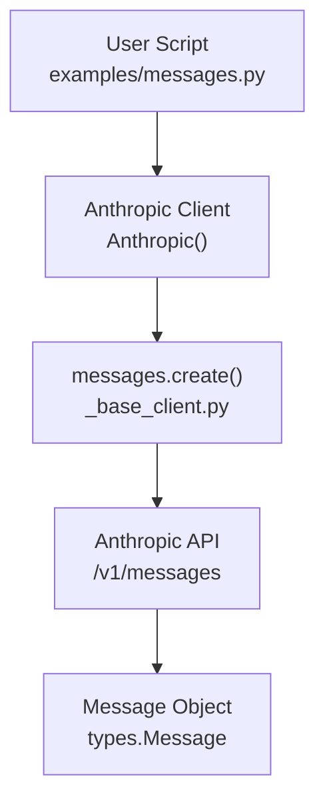
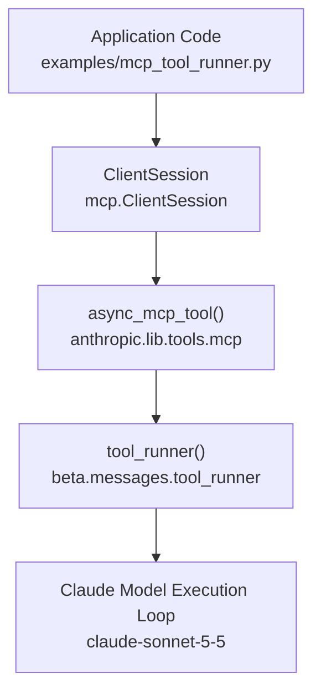

<!-- source: DeepWiki mcp.deepwiki.com · repo anthropics/anthropic-sdk-python · page 11 Usage Patterns and Examples · fetched 2026-10-26 -->

# Usage Patterns and Examples

Relevant source files

The following files were used as context for generating this wiki page:

- [examples/agents.py](examples/agents.py)
- [examples/agents_with_files.py](examples/agents_with_files.py)
- [examples/images.py](examples/images.py)
- [examples/mcp_tool_runner.py](examples/mcp_tool_runner.py)
- [examples/messages.py](examples/messages.py)
- [examples/messages_stream.py](examples/messages_stream.py)
- [examples/structured_outputs.py](examples/structured_outputs.py)
- [examples/structured_outputs_streaming.py](examples/structured_outputs_streaming.py)
- [examples/thinking.py](examples/thinking.py)
- [examples/thinking_stream.py](examples/thinking_stream.py)
- [examples/tools.py](examples/tools.py)
- [examples/tools_stream.py](examples/tools_stream.py)
- [helpers.md](helpers.md)

This page provides a high-level overview of the usage patterns, examples directory (`examples/`), and integration guides (`helpers.md`) available in the Anthropic Python SDK. It organizes common workflows into two major categories: core messaging/streaming/structured outputs, and advanced agentic workflows with tool use and MCP integration.

For exhaustive code walkthroughs, see the child pages:
- [Messaging, Streaming, and Structured Output Examples](#11.1)
- [Agent and Tool Examples](#11.2)

---

## 11.1 Messaging, Streaming, and Structured Output Examples

The SDK provides streamlined patterns for simple request-response interactions, server-sent event (SSE) streaming, reasoning/thinking loops, image attachments, web search, and structured output parsing using Pydantic models. 

Examples in the codebase demonstrate how to construct messages synchronously [examples/messages.py:1-15]() or asynchronously [examples/messages_stream.py:5-20](), stream text deltas via `MessageStreamManager` [helpers.md:5-21](), handle thinking tokens [examples/thinking.py:5-17](), and extract structured Pydantic objects using `client.messages.parse()` or streaming transforms [examples/structured_outputs.py:6-26]().

For detailed code examples and explanations, see [Messaging, Streaming, and Structured Output Examples](#11.1).

Sources: [examples/messages.py:1-15](), [src/anthropic/_client.py:118-128]()

---

## 11.2 Agent and Tool Examples

For complex orchestration, multi-turn conversations, and tool execution, the SDK supports native tool definitions (`ToolParam`), Model Context Protocol (MCP) tool integration, agentic run loops (`tool_runner`), memory stores, and workspace environments [examples/tools.py:12-28](), [examples/mcp_tool_runner.py:22-54](), [examples/agents_with_files.py:13-79]().

These patterns leverage specialized helpers such as `async_mcp_tool()` for bridging local/remote MCP servers and `tool_runner()` for managing automatic tool execution loops [helpers.md:152-173]().

For detailed code examples and deep dives, see [Agent and Tool Examples](#11.2).

Sources: [helpers.md:152-173](), [examples/mcp_tool_runner.py:22-54]()

---

