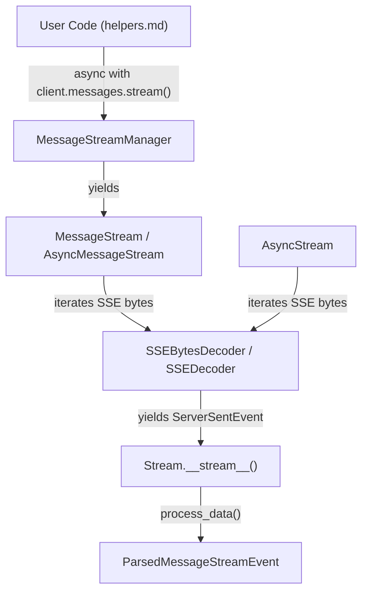
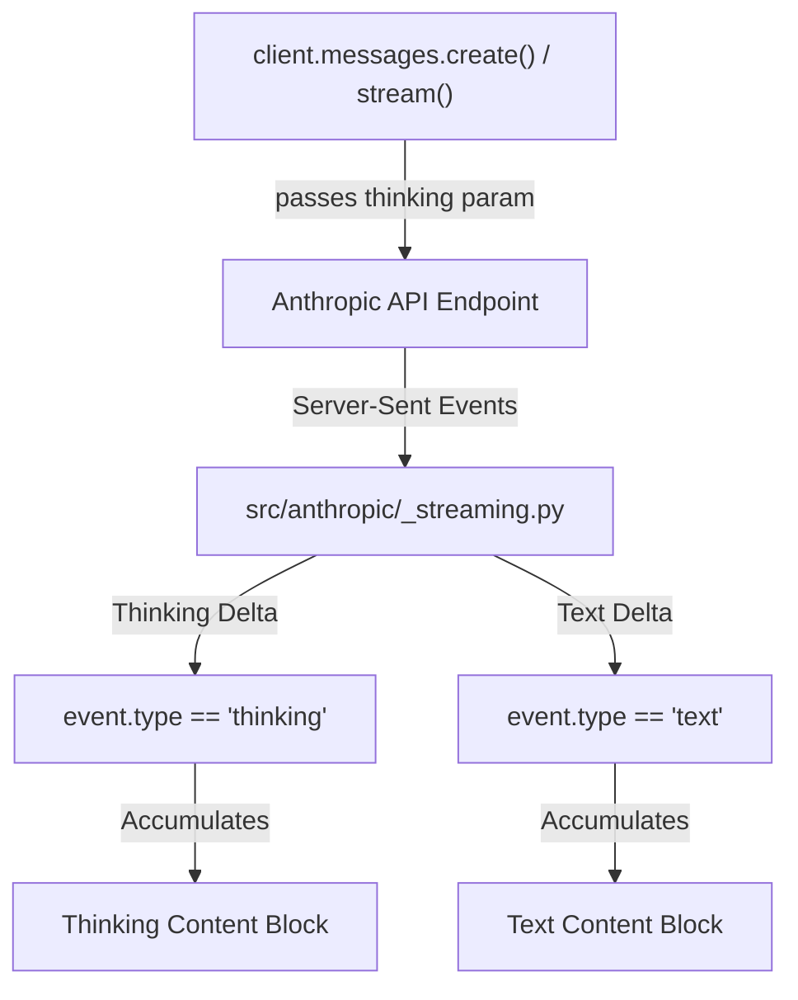

<!-- source: DeepWiki mcp.deepwiki.com · repo anthropics/anthropic-sdk-python · page 11.1 Messaging, Streaming, and Structured Output Examples · fetched 2026-10-26 -->

# Messaging, Streaming, and Structured Output Examples

<details>
<summary>Relevant source files</summary>

The following files were used as context for generating this wiki page:

- [examples/agents.py](examples/agents.py)
- [examples/agents_with_files.py](examples/agents_with_files.py)
- [examples/batch_results.py](examples/batch_results.py)
- [examples/images.py](examples/images.py)
- [examples/mcp_tool_runner.py](examples/mcp_tool_runner.py)
- [examples/messages.py](examples/messages.py)
- [examples/messages_stream.py](examples/messages_stream.py)
- [examples/structured_outputs.py](examples/structured_outputs.py)
- [examples/structured_outputs_streaming.py](examples/structured_outputs_streaming.py)
- [examples/thinking.py](examples/thinking.py)
- [examples/thinking_stream.py](examples/thinking_stream.py)
- [examples/tools.py](examples/tools.py)
- [examples/tools_stream.py](examples/tools_stream.py)
- [helpers.md](helpers.md)
- [src/anthropic/_decoders/jsonl.py](src/anthropic/_decoders/jsonl.py)
- [src/anthropic/_exceptions.py](src/anthropic/_exceptions.py)
- [src/anthropic/_response.py](src/anthropic/_response.py)
- [src/anthropic/_streaming.py](src/anthropic/_streaming.py)
- [src/anthropic/resources/beta/messages/__init__.py](src/anthropic/resources/beta/messages/__init__.py)
- [tests/decoders/test_jsonl.py](tests/decoders/test_jsonl.py)
- [tests/test_response.py](tests/test_response.py)
- [tests/test_streaming.py](tests/test_streaming.py)
- [tests/utils.py](tests/utils.py)

</details>


## Purpose and Scope
This page walks through practical implementation examples and execution pathways for core Anthropic Python SDK features. It covers basic synchronous and asynchronous messaging, server-sent event (SSE) streaming, extended thinking configurations, multimodal inputs, tool streaming, structured output parsing, and batch processing results.

Sources: `helpers.md:1-29()`, `examples/messages.py:1-36()`

---

## 1. Basic Messaging (`messages.create()`)

The foundational operation in the SDK is creating messages via `client.messages.create()` or its asynchronous counterpart `AsyncAnthropic.messages.create()`. Conversations are structured as sequences of role-content mappings.

```python
from anthropic import Anthropic

client = Anthropic()

response = client.messages.create(
    max_tokens=1024,
    messages=[
        {
            "role": "user",
            "content": "Hello!",
        }
    ],
    model="claude-sonnet-5-5",
)
print(response)
```

For multi-turn conversations, the response content blocks and role identifiers from previous assistant turns are appended to the `messages` array alongside new user turns [examples/messages.py:17-34]().

Sources: `examples/messages.py:1-36()`

---

## 2. Streaming Responses and Event Processing (`messages.stream()`)

Streaming responses are managed through `client.messages.stream()`, which returns a `MessageStreamManager` context manager [helpers.md:21](). This manager yields a `MessageStream` or `AsyncMessageStream` instance [helpers.md:21](). Under the hood, the `Stream` class [src/anthropic/_streaming.py:26-32]() processes raw byte streams using an SSE decoder (`_decoder.iter_bytes()`) [src/anthropic/_streaming.py:70-71]().


*Diagram 1: Streaming Event Architecture mapping user-facing stream constructs to underlying stream decoders and processing entities.*

Sources: `helpers.md:1-29()`, `src/anthropic/_streaming.py:26-153()`, `examples/messages_stream.py:1-37()`

---

## 3. Extended Thinking and Adaptive Effort Configuration

Models supporting extended thinking can be configured via the `thinking` parameter dict (`{"type": "adaptive", "display": "summarized"}`) and `output_config` (`{"effort": "high"}`) [examples/thinking.py:5-16](). When streaming, the event stream yields blocks of type `thinking` prior to standard `text` blocks [examples/thinking_stream.py:20-31]().


*Diagram 2: Thinking & Text Response Pipeline mapping API generation payloads to stream event handlers and block accumulators.*

Sources: `examples/thinking.py:1-23()`, `examples/thinking_stream.py:1-32()`, `src/anthropic/_streaming.py:26-123()`

---

## 4. Multimodal Inputs (Images)

Multimodal requests incorporate image content blocks directly within the `messages` array structure. Images can be provided via base64 encoded data payloads or URL references alongside standard text prompt blocks [examples/images.py:1-1]().

Sources: `examples/images.py:1-1()`

---

## 5. Tool Use and Input Streaming

When defining tools via the `tools` parameter, models generate tool call requests incrementally. The SDK handles incremental tool input streaming through `input_json` events, exposing partial JSON strings (`event.partial_json`) and snapshots (`event.snapshot`) as JSON payloads accumulate [helpers.md:90-98]().

```python
async with client.messages.stream(
    max_tokens=1024,
    model="claude-sonnet-5-5",
    tools=[...],
    messages=[{"role": "user", "content": "What is the weather in SF?"}],
) as stream:
    async for event in stream:
        if event.type == "input_json":
            print(f"delta: {repr(event.partial_json)}")
            print(f"snapshot: {event.snapshot}")
```

Sources: `helpers.md:90-98()`, `examples/tools_stream.py:1-41()`

---

## 6. Structured Outputs

Structured outputs are validated and parsed against Pydantic models subclassing `BaseModel`. The `APIResponse._parse()` method handles casting response payloads into custom model types, ensuring type safety and schema validation [src/anthropic/_response.py:130-181]().

```python
class CustomModel(BaseModel):
    foo: str
    bar: int

obj = response.parse(to=CustomModel)
```

Sources: `src/anthropic/_response.py:130-181()`, `tests/test_response.py:123-141()`, `examples/structured_outputs.py:1-1()`

---

## 7. Batch Processing and JSONL Decoders

Batch processing operations use `beta.messages.batches` to submit asynchronous job sets. Results are returned as JSONL streams, which are decoded by `JSONLDecoder` and `AsyncJSONLDecoder` in `src/anthropic/_decoders/jsonl.py` [src/anthropic/_response.py:144-162]().

```python
if issubclass(origin, JSONLDecoder):
    return cast(
        R,
        cast("type[JSONLDecoder[Any]]", cast_to)(
            raw_iterator=self.http_response.iter_bytes(chunk_size=64),
            line_type=extract_type_arg(cast_to, 0),
            http_response=self.http_response,
        ),
    )
```

Sources: `src/anthropic/_response.py:130-163()`, `src/anthropic/_decoders/jsonl.py:1-1()`, `examples/batch_results.py:1-1()`

---

