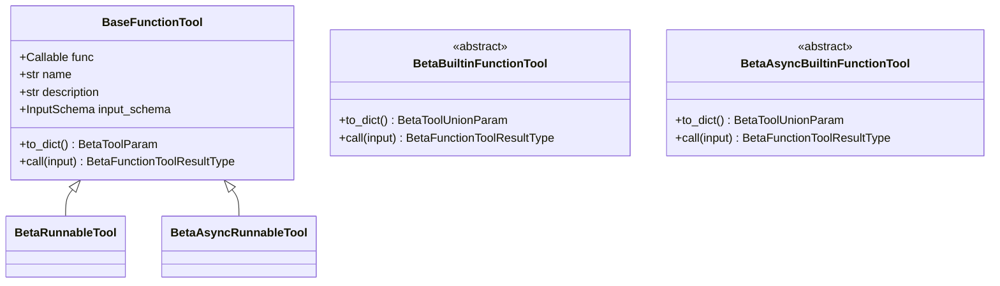
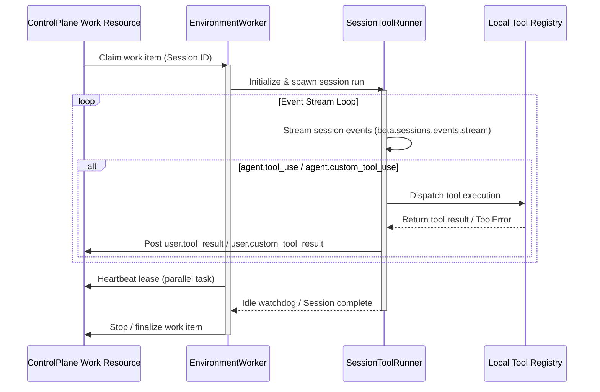
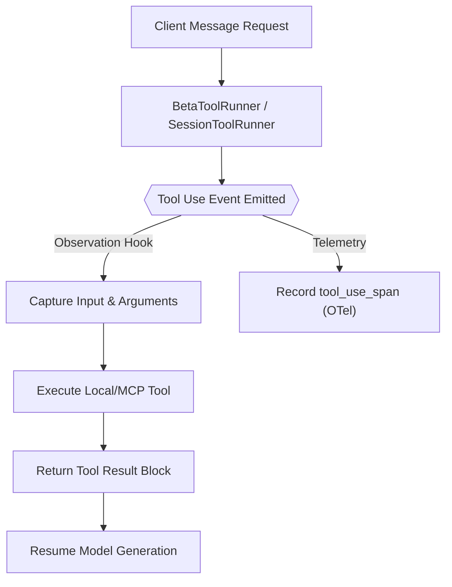
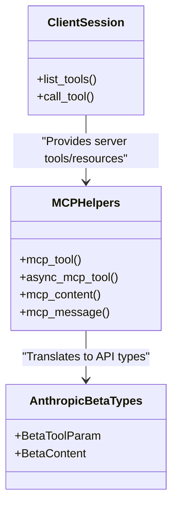
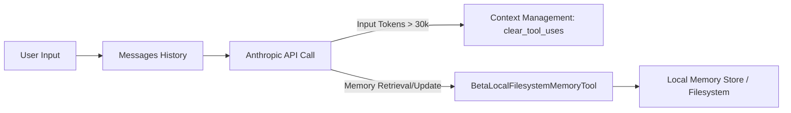
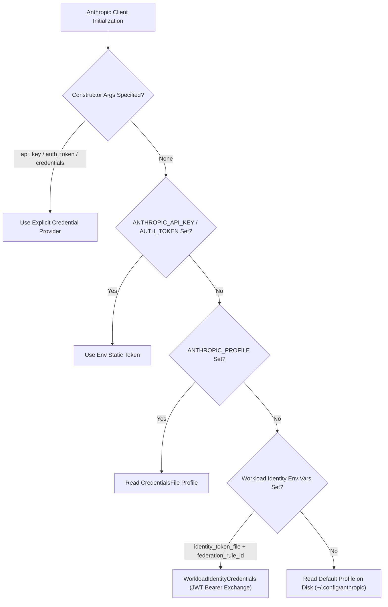

<!-- source: DeepWiki mcp.deepwiki.com · repo anthropics/anthropic-sdk-python · page 11.2 Agent and Tool Examples · fetched 2026-10-26 -->

# Agent and Tool Examples

Relevant source files

The following files were used as context for generating this wiki page:

- [examples/agents_comprehensive.py](examples/agents_comprehensive.py)
- [examples/managed-agents-observe-tool-calls.py](examples/managed-agents-observe-tool-calls.py)
- [examples/managed-agents-self-hosted-sandbox-worker.py](examples/managed-agents-self-hosted-sandbox-worker.py)
- [examples/managed-agents-worker-dispatch.py](examples/managed-agents-worker-dispatch.py)
- [examples/memory/basic.py](examples/memory/basic.py)
- [examples/workload_identity.py](examples/workload_identity.py)
- [src/anthropic/lib/_scoped_client.py](src/anthropic/lib/_scoped_client.py)
- [src/anthropic/lib/credentials/__init__.py](src/anthropic/lib/credentials/__init__.py)
- [src/anthropic/lib/credentials/_auth.py](src/anthropic/lib/credentials/_auth.py)
- [src/anthropic/lib/credentials/_cache.py](src/anthropic/lib/credentials/_cache.py)
- [src/anthropic/lib/credentials/_chain.py](src/anthropic/lib/credentials/_chain.py)
- [src/anthropic/lib/credentials/_close.py](src/anthropic/lib/credentials/_close.py)
- [src/anthropic/lib/credentials/_constants.py](src/anthropic/lib/credentials/_constants.py)
- [src/anthropic/lib/credentials/_providers.py](src/anthropic/lib/credentials/_providers.py)
- [src/anthropic/lib/credentials/_secrets.py](src/anthropic/lib/credentials/_secrets.py)
- [src/anthropic/lib/credentials/_types.py](src/anthropic/lib/credentials/_types.py)
- [src/anthropic/lib/credentials/_workload.py](src/anthropic/lib/credentials/_workload.py)
- [src/anthropic/lib/environments/_worker.py](src/anthropic/lib/environments/_worker.py)
- [src/anthropic/lib/tools/__init__.py](src/anthropic/lib/tools/__init__.py)
- [src/anthropic/lib/tools/_beta_functions.py](src/anthropic/lib/tools/_beta_functions.py)
- [src/anthropic/lib/tools/_beta_session_runner.py](src/anthropic/lib/tools/_beta_session_runner.py)
- [src/anthropic/lib/tools/_tool_dispatch.py](src/anthropic/lib/tools/_tool_dispatch.py)
- [src/anthropic/lib/tools/_tool_params.py](src/anthropic/lib/tools/_tool_params.py)
- [src/anthropic/lib/tools/mcp.py](src/anthropic/lib/tools/mcp.py)
- [src/anthropic/resources/beta/environments/work.py](src/anthropic/resources/beta/environments/work.py)
- [tests/lib/environments/test_worker.py](tests/lib/environments/test_worker.py)
- [tests/lib/test_credentials.py](tests/lib/test_credentials.py)
- [tests/lib/test_scoped_client.py](tests/lib/test_scoped_client.py)
- [tests/lib/tools/test_functions.py](tests/lib/tools/test_functions.py)
- [tests/lib/tools/test_session_runner.py](tests/lib/tools/test_session_runner.py)

This page provides full technical details and walkthroughs for agent examples, managed-agents workers and dispatch, tool observation, Model Context Protocol (MCP) tool runners, memory systems, and workload identity federation within the Anthropic Python SDK (`https://github.com/anthropics/anthropic-sdk-python`).

---

## 1. Scope and Purpose

The Anthropic Python SDK includes high-level agentic abstractions, specialized tool runners, memory components, and secure authentication providers. This page explores how these features integrate to build resilient agents, execute tools locally or inside managed environments, coordinate via event-driven streams, and handle production identity workflows.

---

## 2. Comprehensive Agents and Tool Runners

The SDK provides client-side tool execution via `client.beta.messages.tool_runner` and the lower-level function registration primitives in `src/anthropic/lib/tools/_beta_functions.py` [src/anthropic/lib/tools/_beta_functions.py:1-625](). 

### Function Tool Abstractions
Functions decorated or wrapped via `BaseFunctionTool` support automatic schema generation, Pydantic `validate_call` parameter validation, cleanup hooks (`close`), and context manager lifecycles [src/anthropic/lib/tools/_beta_functions.py:110-146]().

*Sources: `src/anthropic/lib/tools/_beta_functions.py`*

---

## 3. Managed-Agents Workers and Dispatch

Managed agents introduce remote session orchestration, workers, and session-side tool runners (`SessionToolRunner`) [src/anthropic/lib/tools/_beta_session_runner.py:1-16]().

### SessionToolRunner and EnvironmentWorker Architecture
`SessionToolRunner` connects to a managed-agents session event stream, dispatches `agent.tool_use` and `agent.custom_tool_use` events against a local tool registry, handles user confirmation gates (`evaluated_permission: ask`), and posts results back via `user.tool_result` or `user.custom_tool_result` [src/anthropic/lib/tools/_beta_session_runner.py:4-11]().

`EnvironmentWorker` (`src/anthropic/lib/environments/_worker.py`) wraps the session tool runner, handling work item leases, control-plane heartbeats, skill downloads, and session termination [src/anthropic/lib/environments/_worker.py:1-32]().

*Sources: `src/anthropic/lib/tools/_beta_session_runner.py`, `src/anthropic/lib/environments/_worker.py`, `src/anthropic/resources/beta/environments/work.py`*

---

## 4. Observe Tool Calls

Tool observation and tracing allow developers to inspect intermediate tool calls, execution durations, parameters, and results. By tapping into streaming tool runner events or utilizing OpenTelemetry spans (`tool_use_span`), observability backends capture gen-ai execution attributes.

*Sources: `src/anthropic/lib/tools/_beta_session_runner.py`, `src/anthropic/lib/tools/_beta_functions.py`*

---

## 5. MCP Tool Runner and Integration

The Model Context Protocol (MCP) helper module (`src/anthropic/lib/tools/mcp.py`) converts MCP types (tools, content blocks, resources) into Anthropic beta tool parameters and content blocks [src/anthropic/lib/tools/mcp.py:1-12]().

*Sources: `src/anthropic/lib/tools/mcp.py`*

---

## 6. Memory Stores

Stateful agent memory utilizes memory tools (such as `BetaLocalFilesystemMemoryTool`) alongside context management configurations (`BetaContextManagementConfigParam`) to prune old tool outputs when token thresholds are exceeded [examples/memory/basic.py:17-35]().

*Sources: `examples/memory/basic.py`, `src/anthropic/lib/tools/_memories.py`*

---

## 7. Workload Identity and Credential Providers

Authentication resolution follows a strict precedence order, supporting environment variables, static tokens, config profiles (`CredentialsFile`), and OIDC workload identity federation (`WorkloadIdentityCredentials`) [examples/workload_identity.py:3-15]().

*Sources: `src/anthropic/lib/credentials/_providers.py`, `src/anthropic/lib/credentials/_workload.py`, `examples/workload_identity.py`*

---

