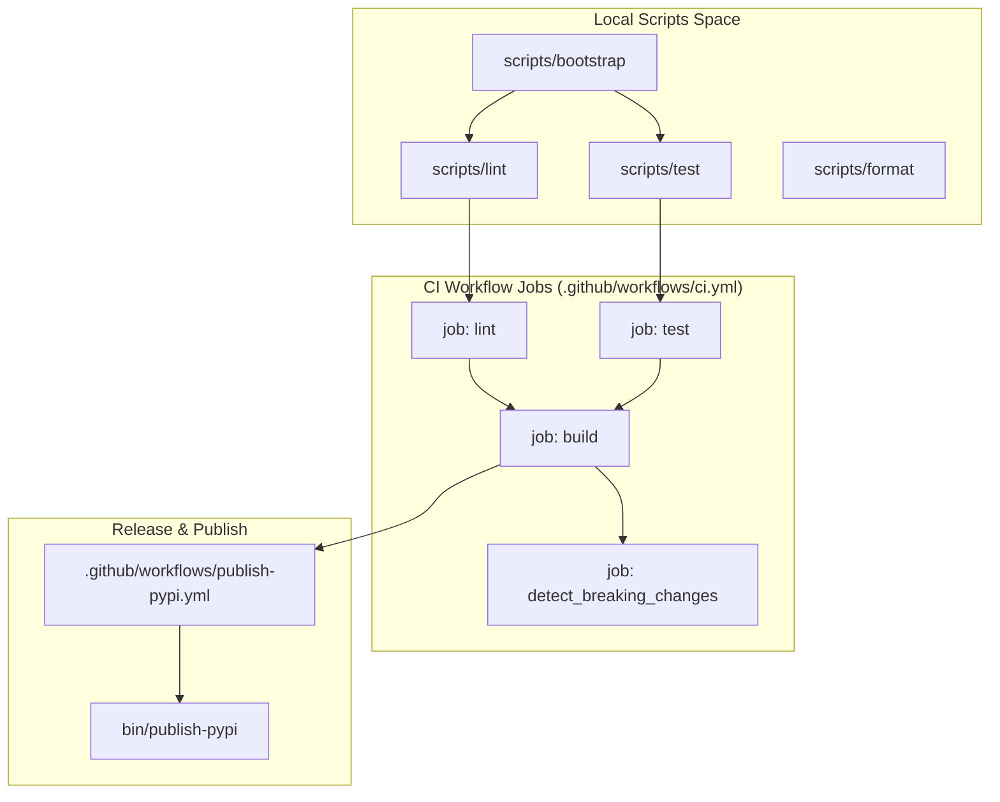

<!-- source: DeepWiki mcp.deepwiki.com · repo anthropics/anthropic-sdk-python · page 12 Development and Contributing · fetched 2026-10-26 -->

# Development and Contributing

Relevant source files

The following files were used as context for generating this wiki page:

- [.devcontainer/Dockerfile](.devcontainer/Dockerfile)
- [.devcontainer/devcontainer.json](.devcontainer/devcontainer.json)
- [.github/CODEOWNERS](.github/CODEOWNERS)
- [.github/workflows/ci.yml](.github/workflows/ci.yml)
- [.github/workflows/publish-pypi.yml](.github/workflows/publish-pypi.yml)
- [.gitignore](.gitignore)
- [.vscode/settings.json](.vscode/settings.json)
- [Brewfile](Brewfile)
- [CLAUDE.md](CLAUDE.md)
- [SECURITY.md](SECURITY.md)
- [bin/publish-pypi](bin/publish-pypi)
- [scripts/bootstrap](scripts/bootstrap)
- [scripts/format](scripts/format)
- [scripts/lint](scripts/lint)
- [scripts/utils/check-dependency-caps.py](scripts/utils/check-dependency-caps.py)
- [scripts/utils/upload-artifact.sh](scripts/utils/upload-artifact.sh)

This page provides high-level guidance for contributors working on the Anthropic Python SDK (`anthropic`). It covers project structure, dependency management, environment setup, testing strategies, and CI/CD automation. 

For detailed information, refer to the child pages:
- Project Structure and Dependencies: See [Project Structure and Dependencies](#12.1)
- Development Environment Setup: See [Development Environment Setup](#12.2)
- Testing Strategy and Test Matrix: See [Testing Strategy and Test Matrix](#12.3)
- CI/CD, Breaking Changes, and Release Process: See [CI/CD, Breaking Changes, and Release Process](#12.4)

Sources: [CLAUDE.md:1-4](), [.github/workflows/ci.yml:1-25]()

## Development Workflow Overview

The development lifecycle relies on standard scripts located in `./scripts/` and automation workflows defined in `.github/workflows/ci.yml`.

*Figure 1: Relationship between local development helper scripts and GitHub Actions CI/CD jobs.*

Sources: [CLAUDE.md:40-49](), [.github/workflows/ci.yml:21-115](), [.github/workflows/publish-pypi.yml:1-79]()

## Project Structure and Dependencies

The SDK uses `uv` for fast, deterministic dependency management [CLAUDE.md:42](). Most code is generated via Stainless, while hand-written logic resides in `src/anthropic/lib/`, `examples/`, and `tests/lib/` [CLAUDE.md:13](). 

For comprehensive details on `pyproject.toml` configuration, dependency version caps, `uv.lock`, and Pydantic conflict handling, see [Project Structure and Dependencies](#12.1).

Sources: [CLAUDE.md:9-16](), [.github/workflows/ci.yml:30-36]()

## Development Environment Setup

Setting up an isolated workspace can be done locally using bootstrap scripts or via containerization. The repository includes a Dev Container configuration (`.devcontainer/devcontainer.json`) that provisions Python and installs `uv` automatically.

For details on container setup, VS Code configurations, linting/formatting tools (`scripts/lint`, `scripts/format`), and dependency bootstrapping (`scripts/bootstrap`), see [Development Environment Setup](#12.2).

Sources: [.devcontainer/devcontainer.json:1-27](), [.devcontainer/Dockerfile:1-8](), [scripts/bootstrap:1-30]()

## Testing Strategy and Test Matrix

The test suite runs using `pytest` across multiple Python versions (such as oldest `>=3.10.0` and newest `>=3.14.0`) under Pydantic v1 and v2 compatibility layers [CLAUDE.md:50-55](), [.github/workflows/ci.yml:87-95](). 

For full details on the test matrix, conftest fixtures, `respx` mocking, and running `./scripts/test`, see [Testing Strategy and Test Matrix](#12.3).

Sources: [CLAUDE.md:50-61](), [.github/workflows/ci.yml:82-110]()

## CI/CD, Breaking Changes, and Release Process

Continuous Integration is driven by GitHub Actions (`.github/workflows/ci.yml`), performing linting, building, matrix testing, and breaking-change detection against the codebase [._github/workflows/ci.yml:21-172](). Publishing is handled via `.github/workflows/publish-pypi.yml` and `bin/publish-pypi` [ [.github/workflows/publish-pypi.yml:1-79](), [bin/publish-pypi:1-11]()].

For details on workflow definitions, artifact uploads (`scripts/utils/upload-artifact.sh`), release-please automation, and breaking change detection, see [CI/CD, Breaking Changes, and Release Process](#12.4).

Sources: [.github/workflows/ci.yml:1-172](), [.github/workflows/publish-pypi.yml:1-79](), [bin/publish-pypi:1-11](), [scripts/utils/upload-artifact.sh:1-27]()

---

