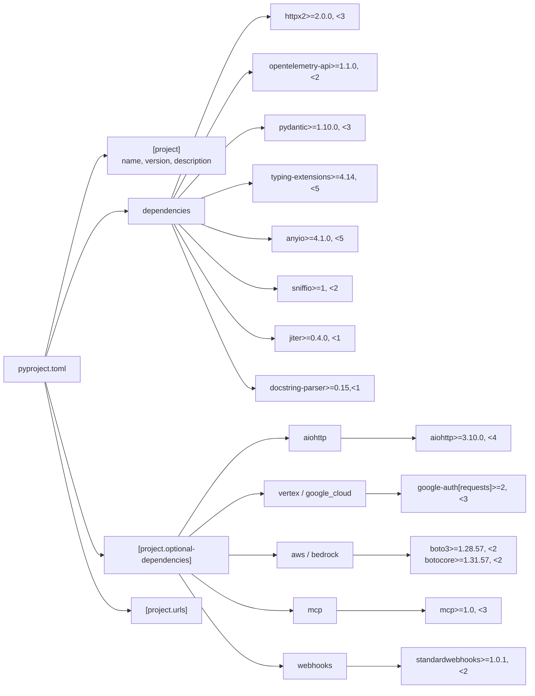
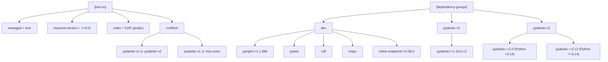
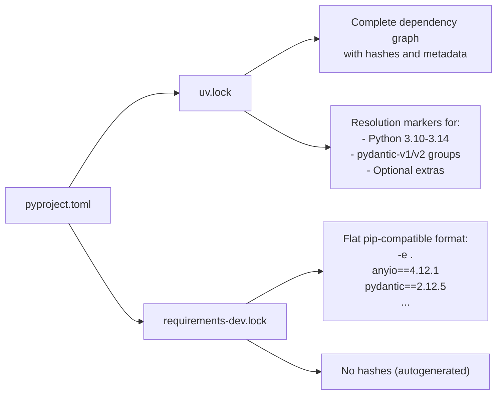
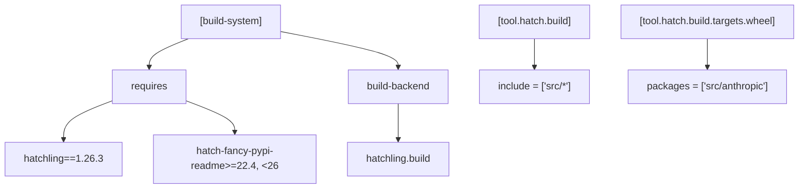

<!-- source: DeepWiki mcp.deepwiki.com · repo anthropics/anthropic-sdk-python · page 12.1 Project Structure and Dependencies · fetched 2026-10-26 -->

# Project Structure and Dependencies

<details>
<summary>Relevant source files</summary>

The following files were used as context for generating this wiki page:

- [.devcontainer/Dockerfile](.devcontainer/Dockerfile)
- [.devcontainer/devcontainer.json](.devcontainer/devcontainer.json)
- [.github/workflows/ci.yml](.github/workflows/ci.yml)
- [.github/workflows/publish-pypi.yml](.github/workflows/publish-pypi.yml)
- [.gitignore](.gitignore)
- [.release-please-manifest.json](.release-please-manifest.json)
- [.vscode/settings.json](.vscode/settings.json)
- [Brewfile](Brewfile)
- [CHANGELOG.md](CHANGELOG.md)
- [bin/publish-pypi](bin/publish-pypi)
- [pyproject.toml](pyproject.toml)
- [requirements-dev.lock](requirements-dev.lock)
- [scripts/bootstrap](scripts/bootstrap)
- [scripts/format](scripts/format)
- [scripts/lint](scripts/lint)
- [scripts/utils/check-dependency-caps.py](scripts/utils/check-dependency-caps.py)
- [scripts/utils/upload-artifact.sh](scripts/utils/upload-artifact.sh)
- [src/anthropic/_version.py](src/anthropic/_version.py)
- [uv.lock](uv.lock)

</details>


This page documents the project structure, dependency management, and version strategy for the Anthropic Python SDK. It covers the organization of source files, the role of `pyproject.toml` as the configuration center, dependency management using `uv`, optional extras for cloud providers, and the Pydantic compatibility strategy.

For information about setting up a development environment, see [Development Environment Setup](#12.2). For details on testing across multiple Python and Pydantic versions, see [Testing Strategy and Test Matrix](#12.3).

## Package Structure Overview

The SDK follows a standard Python package layout with source code in `src/`, tests in `tests/`, and examples in `examples/`:

```mermaid
graph TB
    Root["anthropic-sdk-python/"]
    
    Root --> SrcDir["src/anthropic/"]
    Root --> TestsDir["tests/"]
    Root --> ExamplesDir["examples/"]
    Root --> ScriptsDir["scripts/"]
    Root --> ConfigFiles["Config Files"]
    
    SrcDir --> Client["_client.py<br/>Anthropic, AsyncAnthropic"]
    SrcDir --> Models["_models.py<br/>BaseModel"]
    SrcDir --> BaseClient["_base_client.py<br/>BaseClient, AsyncBaseClient"]
    SrcDir --> Resources["resources/<br/>API endpoints"]
    SrcDir --> TypesDir["types/<br/>Request/Response models"]
    SrcDir --> LibDir["lib/<br/>Helpers & integrations"]
    SrcDir --> UtilsDir["_utils/<br/>Internal utilities"]
    SrcDir --> VersionPy["_version.py<br/>__version__"]
    SrcDir --> Compat["_compat.py<br/>Pydantic v1/v2 abstraction"]
    
    Resources --> Messages["messages.py<br/>MessagesResource"]
    Resources --> BetaDir["beta/<br/>Beta namespace resources"]
    Resources --> Completions["completions.py<br/>CompletionsResource"]
    Resources --> ModelsAPI["models.py<br/>ModelsResource"]
    
    LibDir --> Streaming["streaming/<br/>MessageStream classes"]
    LibDir --> Vertex["vertex/<br/>AnthropicVertex client"]
    LibDir --> Bedrock["bedrock/<br/>AnthropicBedrock client"]
    LibDir --> Tools["tools/<br/>BetaToolRunner"]
    
    ConfigFiles --> PyProject["pyproject.toml<br/>Metadata & dependencies"]
    ConfigFiles --> UVLock["uv.lock<br/>Locked dependency graph"]
    ConfigFiles --> ReqDevLock["requirements-dev.lock<br/>Flattened dev deps"]
    ConfigFiles --> ReleaseManifest[".release-please-manifest.json<br/>Version source of truth"]
    
    ScriptsDir --> TestScript["scripts/test<br/>Test runner"]
    ScriptsDir --> LintScript["scripts/lint<br/>Linter runner"]
    ScriptsDir --> MockScript["scripts/mock<br/>Prism server"]
```



**Sources:** [pyproject.toml:106-125](), [src/anthropic/_version.py:1-2]()

## pyproject.toml Structure

The `pyproject.toml` file serves as the single source of truth for package metadata, dependencies, and tool configurations [pyproject.toml:1-105]().

### Project Metadata and Core Dependencies



The package requires Python 3.10 or higher and declares support for Python 3.10 through 3.14 in classifiers [pyproject.toml:22-30](). Core dependencies include:

| Dependency | Version Constraint | Purpose |
|-----------|-------------------|---------|
| `httpx2` | `>=2.0.0, <3` | HTTP client for API requests [pyproject.toml:12]() |
| `opentelemetry-api` | `>=1.1.0, <2` | OpenTelemetry tracing support [pyproject.toml:13]() |
| `pydantic` | `>=1.10.0, <3` | Data validation and serialization (v1 and v2 support) [pyproject.toml:14]() |
| `typing-extensions` | `>=4.14, <5` | Backported type hints for older Python versions [pyproject.toml:15]() |
| `anyio` | `>=4.1.0, <5` | Async I/O abstraction layer [pyproject.toml:16]() |
| `sniffio` | `>=1, <2` | Detect async library in use [pyproject.toml:17]() |
| `jiter` | `>=0.4.0, <1` | Fast partial JSON parsing for streaming [pyproject.toml:18]() |
| `docstring-parser` | `>=0.15,<1` | Parse function docstrings for tool definitions [pyproject.toml:19]() |

**Sources:** [pyproject.toml:1-20](), [pyproject.toml:22-38]()

### Optional Dependencies (Extras)

Optional dependency groups enable cloud platform integrations and specialized features:

```python
# Install with extras
pip install anthropic[aiohttp]  # Alternative async HTTP client
pip install anthropic[vertex]   # Google Cloud Vertex AI
pip install anthropic[bedrock]  # AWS Bedrock
pip install anthropic[mcp]      # MCP (Model Context Protocol) support (Python 3.10+)
pip install anthropic[webhooks] # Webhook validation
```

| Extra | Dependencies | Python Requirement | Purpose |
|-------|-------------|-------------------|---------|
| `aiohttp` | `aiohttp>=3.10.0, <4` | All versions | Alternative HTTP client using aiohttp [pyproject.toml:41]() |
| `vertex` / `google_cloud` | `google-auth[requests]>=2, <3` | All versions | Google Cloud Vertex AI authentication [pyproject.toml:42-43]() |
| `aws` / `bedrock` | `boto3>=1.28.57, <2`, `botocore>=1.31.57, <2` | All versions | AWS Bedrock authentication [pyproject.toml:44-45]() |
| `mcp` | `mcp>=1.0, <3` | Python 3.10+ | Model Context Protocol integration [pyproject.toml:46]() |
| `webhooks` | `standardwebhooks>=1.0.1, <2` | All versions | Support for verifying Anthropic webhooks [pyproject.toml:47]() |

**Sources:** [pyproject.toml:40-48]()

## Dependency Management with uv

The project uses `uv` as its primary dependency manager. `uv` provides fast dependency resolution with hash verification and reproducible builds.

### UV Configuration



Key configurations in `[tool.uv]`:

- `managed = true`: Project is managed by uv [pyproject.toml:55]().
- `required-version = ">=0.9"`: Requires uv 0.9 or higher [pyproject.toml:56]().
- `index`: Ensures the lockfile always uses the public PyPI registry [pyproject.toml:59]().
- `conflicts`: Declares mutually exclusive dependency sets [pyproject.toml:60-69]():
  - `pydantic-v1` vs `pydantic-v2`: Ensures tests run against only one major Pydantic version at a time [pyproject.toml:60-64]().
  - `pydantic-v1` vs `mcp` extra: The `mcp` library requires Pydantic v2, making it incompatible with the `pydantic-v1` group [pyproject.toml:65-68]().

**Sources:** [pyproject.toml:54-69]()

### Dependency Groups

The project defines three dependency groups in `[dependency-groups]` [pyproject.toml:71-100]():

1. **`dev`**: Development tools including type checkers (`pyright`), linters (`ruff`), and testing utilities (`pytest`, `respx`, `hypothesis`, `time-machine`, etc.) [pyproject.toml:73-93]().
2. **`pydantic-v1`**: Pins Pydantic to version 1.x for compatibility testing [pyproject.toml:94-96]().
3. **`pydantic-v2`**: Pins Pydantic to version 2.x, with specific pins for Python 3.14 compatibility [pyproject.toml:97-100]().

**Sources:** [pyproject.toml:71-100]()

### Lock Files

The project maintains two lock files:



- **`uv.lock`**: The authoritative lock file containing the complete dependency graph with cryptographic hashes and resolution markers for various environment combinations [uv.lock:1-20]().
- **`requirements-dev.lock`**: A flat, pip-compatible list of development dependencies autogenerated via `uv export` [requirements-dev.lock:1-147]().

**Sources:** [uv.lock:1-20](), [requirements-dev.lock:1-147]()

## Pydantic Version Compatibility Strategy

The SDK supports both Pydantic v1 and v2 through a compatibility layer, allowing users to choose their preferred version.

### Version Support Matrix

| Pydantic Version | Python Versions | Installation |
|-----------------|----------------|--------------|
| v1 (1.10.0 - 1.x) | 3.10 - 3.13 | Core dependency (backward compat) [pyproject.toml:14, 95]() |
| v2 (2.0.x - 2.11.x) | 3.10 - 3.13 | Core dependency (default) [pyproject.toml:98]() |
| v2 (2.12.x+) | 3.14+ | Core dependency (required for 3.14) [pyproject.toml:99]() |

The core dependency constraint `pydantic>=1.10.0, <3` allows either v1 or v2 to satisfy the requirement [pyproject.toml:14]().

**Sources:** [pyproject.toml:14](), [pyproject.toml:94-100]()

### Conflict Management

To prevent runtime errors and dependency conflicts, the SDK uses `uv`'s conflict mechanism. This is critical for the `mcp` extra, which has a hard dependency on Pydantic v2. The SDK explicitly forbids installing the `mcp` extra when the `pydantic-v1` dependency group is active [pyproject.toml:60-69]().

**Sources:** [pyproject.toml:60-69]()

## Build System Configuration

The project uses Hatchling as its build backend with custom configuration for readme generation.



The build system includes:
- **`hatchling`**: The core build backend [pyproject.toml:102-104]().
- **`hatch-fancy-pypi-readme`**: A hook that transforms relative links in `README.md` into absolute GitHub URLs for correct rendering on PyPI [pyproject.toml:103, 127-137]().

**Sources:** [pyproject.toml:102-137]()

## Version Management

Version information is maintained in synchronized locations to ensure consistency across releases.

- **`src/anthropic/_version.py`**: Contains the `__version__` string used by the package at runtime [src/anthropic/_version.py:1-2]().
- **`pyproject.toml`**: Contains the version used by the build system and package managers [pyproject.toml:3]().
- **`.release-please-manifest.json`**: Used by the `release-please` automation to track the current version [.release-please-manifest.json:1-3]().
- **`CHANGELOG.md`**: Records the history of changes associated with each version [CHANGELOG.md:1-10]().

**Sources:** [src/anthropic/_version.py:1-2](), [pyproject.toml:3](), [.release-please-manifest.json:1-3](), [CHANGELOG.md:1-10]()

## Tool Configurations

The `pyproject.toml` includes extensive configurations for development tools to maintain code quality:

| Tool | Purpose | Key Settings |
|------|---------|--------------|
| **Pyright** | Type Checking | `strict` mode, targeting Python 3.10, excludes `_vendor` [pyproject.toml:152-164](). |
| **Ruff** | Linting/Formatting | 120 character line length, targeting Python 3.10, with rules for isort, bugbear, and typing [pyproject.toml:172-200](). |
| **pytest** | Testing | Asyncio mode `auto`, treats warnings as errors, and uses `pytest-xdist` for parallel execution [pyproject.toml:138-148](). |

**Sources:** [pyproject.toml:138-228]()

---

