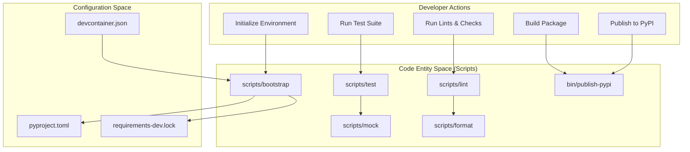
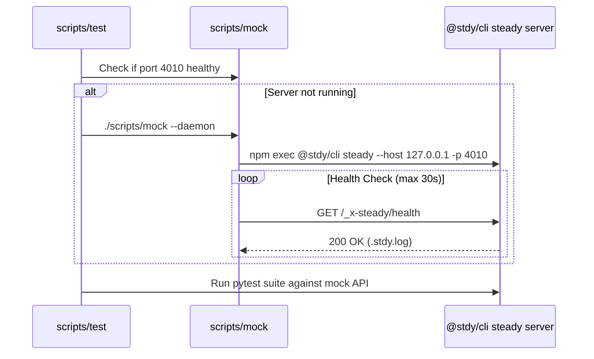

<!-- source: DeepWiki mcp.deepwiki.com · repo anthropics/anthropic-sdk-python · page 12.2 Development Environment Setup · fetched 2026-10-26 -->

# Development Environment Setup

<details>
<summary>Relevant source files</summary>

The following files were used as context for generating this wiki page:

- [.devcontainer/Dockerfile](.devcontainer/Dockerfile)
- [.devcontainer/devcontainer.json](.devcontainer/devcontainer.json)
- [.github/workflows/ci.yml](.github/workflows/ci.yml)
- [.github/workflows/publish-pypi.yml](.github/workflows/publish-pypi.yml)
- [.gitignore](.gitignore)
- [.vscode/settings.json](.vscode/settings.json)
- [Brewfile](Brewfile)
- [bin/publish-pypi](bin/publish-pypi)
- [scripts/bootstrap](scripts/bootstrap)
- [scripts/format](scripts/format)
- [scripts/lint](scripts/lint)
- [scripts/mock](scripts/mock)
- [scripts/test](scripts/test)
- [scripts/utils/check-dependency-caps.py](scripts/utils/check-dependency-caps.py)
- [scripts/utils/upload-artifact.sh](scripts/utils/upload-artifact.sh)
- [src/anthropic/_qs.py](src/anthropic/_qs.py)
- [tests/test_qs.py](tests/test_qs.py)

</details>


This page guides contributors through setting up a local development environment for the Anthropic Python SDK. It covers dependency installation using `uv`, development container configuration, linting and formatting scripts, and running the Steady mock server for testing.

## Overview and Prerequisites

The SDK development environment is optimized for speed and reproducibility using `uv`. It supports Python versions `>=3.10.0` through `>=3.14.0` [scripts/test:59-60]() and ensures compatibility with both Pydantic v1 and v2 [scripts/test:63-70]().

**Required Tools:**
- **Python**: Version 3.10 or higher (managed automatically by `uv`) [scripts/test:59]()
- **uv**: The recommended package manager for this repository [.github/workflows/ci.yml:31-33]()
- **Git**: For version control

**Optional Tools:**
- **Docker & VS Code**: For the Dev Container workflow [.devcontainer/devcontainer.json:1-8]()
- **Homebrew**: For macOS users to install system dependencies via the bootstrap script [scripts/bootstrap:7-20]()

Sources: [.github/workflows/ci.yml:30-34](), [scripts/bootstrap:1-30](), [scripts/test:59-60]()

## Installation Process

### 1. Automatic Setup (Recommended)
The repository provides a bootstrap script that handles Homebrew bundle checks, Python installation via `uv`, dependency syncing, and lockfile generation [scripts/bootstrap:7-30]().

```sh
$ ./scripts/bootstrap
```
This script performs the following actions:
1. Checks for and installs Homebrew dependencies on macOS if applicable [scripts/bootstrap:7-20]()
2. Installs the required Python version via `uv python install` [scripts/bootstrap:22-23]()
3. Syncs all dependencies and optional extras using `uv sync --all-extras` [scripts/bootstrap:25-26]()
4. Exports a `requirements-dev.lock` for environments not using `uv` [scripts/bootstrap:28-30]()

Sources: [scripts/bootstrap:1-30]()

### 2. Manual Setup with uv
If you prefer to run commands manually:

```sh
# Install all dependencies including vertex, bedrock, mcp, and dev tools
$ uv sync --all-extras

# Activate the virtual environment
$ source .venv/bin/activate
```
Sources: [scripts/bootstrap:25-26](), [.devcontainer/Dockerfile:8]()

### 3. Setup without uv
If you cannot use `uv`, you can install dependencies using standard `pip` with the generated lockfile:

```sh
$ pip install -r requirements-dev.lock
```
Sources: [scripts/bootstrap:28-30]()

## Development Container Setup

The repository includes a pre-configured VS Code Dev Container environment that mirrors the CI pipeline.

### Container Configuration
- **Base Image**: `mcr.microsoft.com/vscode/devcontainers/python` [.devcontainer/Dockerfile:2]()
- **Tooling**: Installs `uv` and `uvx` binaries directly from the official `ghcr.io/astral-sh/uv` container image [.devcontainer/Dockerfile:6]()
- **Post-Start Command**: Automatically executes `uv sync --all-extras` to populate the environment [.devcontainer/devcontainer.json:10]()

### VS Code Integration
The environment is customized with settings in [.devcontainer/devcontainer.json:12-27]():
- **Python Path**: Points to `.venv/bin/python` [.devcontainer/devcontainer.json:19-20]()
- **Type Checking**: Set to `basic` [.devcontainer/devcontainer.json:21]()
- **Extensions**: Automatically installs the Python extension (`ms-python.python`) [.devcontainer/devcontainer.json:14-16]()

Sources: [.devcontainer/Dockerfile:1-8](), [.devcontainer/devcontainer.json:1-43]()

## Development Workflow and Script Architecture

This diagram bridges the natural language developer actions to the specific script entities in the repository codebase.

Title: "Development Workflow Entity Mapping"

Sources: [scripts/bootstrap:1-30](), [scripts/lint:1-22](), [scripts/test:1-91](), [scripts/mock:1-53](), [bin/publish-pypi:1-11]()

## Steady Mock Server

Most tests in the SDK require a mock API server to run. The test runner automatically manages the mock server, which uses the `@stdy/cli` (Steady) package running against the OpenAPI specification [scripts/test:28-34]().

### Running the Mock Server
You can start the mock server manually or as a daemon using the provided helper script:

```sh
# Run interactively on port 4010
$ ./scripts/mock

# Or run as a daemon
$ ./scripts/mock --daemon
```
Sources: [scripts/mock:24-53]()

The script checks for an OpenAPI spec URL or falls back to a gzipped specification (`scripts/mock-spec.json.gz`), starts the Steady mock server on `127.0.0.1:4010`, and polls `http://127.0.0.1:4010/_x-steady/health` until it is ready [scripts/mock:13-48](). Logs are directed to `.stdy.log` [.gitignore:1]().

Title: "Mock Server Startup Flow"

Sources: [scripts/test:12-53](), [scripts/mock:24-48]()

## Verification, Linting, and Formatting

Once the environment is set up, verify type safety, code style, and dependencies using the linting and formatting scripts.

### Linting Suite
The `./scripts/lint` script executes several checks sequentially [scripts/lint:1-22]():
1. **Ruff**: Runs lint checks via `uv run ruff check .` [scripts/lint:9-12]()
2. **Dependency Caps**: Validates dependency version constraints via `python scripts/utils/check-dependency-caps.py` [scripts/lint:15-16]()
3. **Pyright**: Executes static type checking via `pyright --project .` [scripts/lint:18-19]()
4. **Import Check**: Confirms the package imports cleanly via `python -c 'import anthropic'` [scripts/lint:21-22]()

### Formatting
To automatically fix formatting and lint issues:
```sh
$ ./scripts/format
```
Sources: [scripts/lint:7-13]()

## CI Pipeline Alignment

The local environment setup mirrors the GitHub Actions CI pipeline defined in [.github/workflows/ci.yml](). The table below maps CI pipeline jobs to their local script equivalents.

| CI Job | Local Command Equivalent | File Reference |
| :--- | :--- | :--- |
| `lint` | `./scripts/lint` | [.github/workflows/ci.yml:39]() |
| `test` | `./scripts/test` | [.github/workflows/ci.yml:109]() |
| `build` | `uv build` | [.github/workflows/ci.yml:61]() |
| `publish` | `bin/publish-pypi` | [.github/workflows/publish-pypi.yml:79]() |

Sources: [.github/workflows/ci.yml:21-110](), [.github/workflows/publish-pypi.yml:1-79](), [bin/publish-pypi:1-11]()

---

