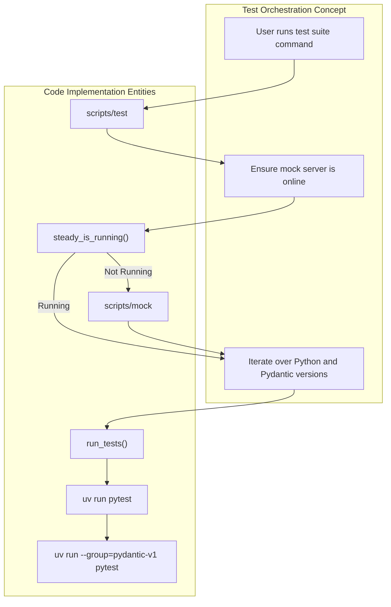
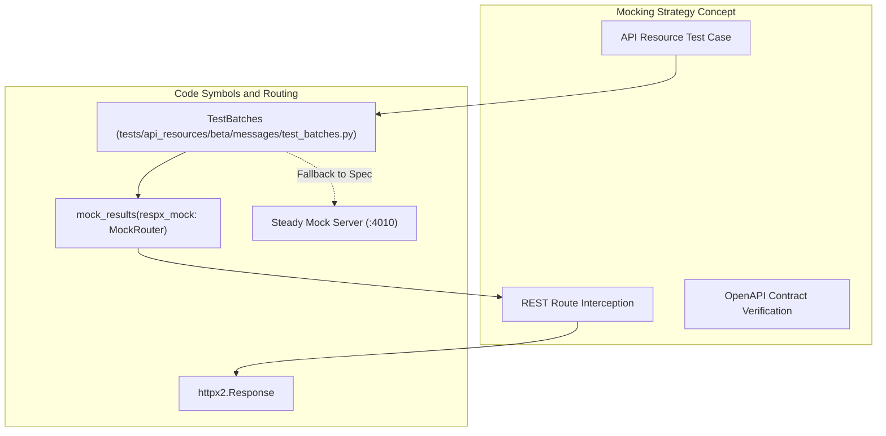

<!-- source: DeepWiki mcp.deepwiki.com · repo anthropics/anthropic-sdk-python · page 12.3 Testing Strategy and Test Matrix · fetched 2026-10-26 -->

# Testing Strategy and Test Matrix

Relevant source files

The following files were used as context for generating this wiki page:

- [scripts/mock](scripts/mock)
- [scripts/test](scripts/test)
- [src/anthropic/_qs.py](src/anthropic/_qs.py)
- [src/anthropic/resources/beta/files.py](src/anthropic/resources/beta/files.py)
- [src/anthropic/resources/beta/models.py](src/anthropic/resources/beta/models.py)
- [src/anthropic/resources/models.py](src/anthropic/resources/models.py)
- [src/anthropic/types/beta/beta_model_info.py](src/anthropic/types/beta/beta_model_info.py)
- [src/anthropic/types/beta/model_list_params.py](src/anthropic/types/beta/model_list_params.py)
- [src/anthropic/types/model_info.py](src/anthropic/types/model_info.py)
- [src/anthropic/types/model_list_params.py](src/anthropic/types/model_list_params.py)
- [tests/__init__.py](tests/__init__.py)
- [tests/api_resources/__init__.py](tests/api_resources/__init__.py)
- [tests/api_resources/beta/__init__.py](tests/api_resources/beta/__init__.py)
- [tests/api_resources/beta/agents/__init__.py](tests/api_resources/beta/agents/__init__.py)
- [tests/api_resources/beta/environments/__init__.py](tests/api_resources/beta/environments/__init__.py)
- [tests/api_resources/beta/memory_stores/__init__.py](tests/api_resources/beta/memory_stores/__init__.py)
- [tests/api_resources/beta/messages/__init__.py](tests/api_resources/beta/messages/__init__.py)
- [tests/api_resources/beta/messages/test_batches.py](tests/api_resources/beta/messages/test_batches.py)
- [tests/api_resources/beta/organization/__init__.py](tests/api_resources/beta/organization/__init__.py)
- [tests/api_resources/beta/organization/federation/__init__.py](tests/api_resources/beta/organization/federation/__init__.py)
- [tests/api_resources/beta/organization/federation/rules/__init__.py](tests/api_resources/beta/organization/federation/rules/__init__.py)
- [tests/api_resources/beta/organization/service_accounts/__init__.py](tests/api_resources/beta/organization/service_accounts/__init__.py)
- [tests/api_resources/beta/test_messages.py](tests/api_resources/beta/test_messages.py)
- [tests/api_resources/beta/test_models.py](tests/api_resources/beta/test_models.py)
- [tests/api_resources/messages/test_batches.py](tests/api_resources/messages/test_batches.py)
- [tests/api_resources/test_messages.py](tests/api_resources/test_messages.py)
- [tests/api_resources/test_models.py](tests/api_resources/test_models.py)
- [tests/conftest.py](tests/conftest.py)
- [tests/test_qs.py](tests/test_qs.py)

## Purpose and Scope

This document details the testing architecture, execution workflows, version matrices, and mocking strategies used in the Anthropic Python SDK codebase. The SDK maintains a rigorous testing framework to ensure cross-version compatibility across Python releases (3.10 through 3.14) and Pydantic major versions (v1 and v2), backed by automated mock servers and snapshot testing utilities [scripts/test:59-70](), [tests/conftest.py:65-133]().

---

## Python Version Matrix and Pydantic v1/v2 Compatibility Testing

The SDK validates its functionality across a matrix of Python interpreters and Pydantic validation engines. Execution is orchestrated by the `scripts/test` script, which enforces minimum and maximum Python boundaries and toggles between Pydantic v2 and v1 test groups [scripts/test:59-70]().

| Dimension | Configured Range / Options | Purpose in Test Suite |
|-----------|---------------------------|------------------------|
| **Python Version** | `>=3.10.0` (Min) to `>=3.14.0` (Max) | Validates compatibility across supported Python interpreters [scripts/test:59-60]() |
| **Pydantic Version** | Pydantic v2 (Default) & Pydantic v1 (`--group=pydantic-v1`) | Ensures the `_compat.py` abstraction layer correctly supports both major versions [scripts/test:63-70]() |
| **HTTP Backends** | `httpx` (Default) & `aiohttp` (`DefaultAioHttpClient`) | Tests alternative async transport implementations [tests/conftest.py:124-126]() |

Pydantic v1 tests are automatically omitted when executing on the maximum Python version (`>=3.14.0`) due to upstream library incompatibility [scripts/test:66-67](). Additionally, MCP-specific tests are executed against `mcp>=2` packages [scripts/test:74-77]().

Sources: [scripts/test:55-78](), [tests/conftest.py:110-133]()

---

## Test Execution Flow and Script Workflow

The test runner script (`scripts/test`) manages environment bootstrapping, mock server lifecycle control, and matrix iteration [scripts/test:1-91]().

Diagram: Test Execution Workflow and Matrix Iteration (Natural Language to Code Entity Space)

**Key Lifecycle Functions:**
- `steady_is_running()`: Probes `http://127.0.0.1:4010/_x-steady/health` to verify the Steady mock server daemon is active [scripts/test:12-14]().
- `kill_server_on_port()`: Terminates orphaned server processes using `lsof` upon script exit via shell `trap` hooks [scripts/test:16-22](), [scripts/test:30]().
- `run_tests()`: Executes pytest under isolated `uv run` environments, separating Pydantic v2 and v1 runs [scripts/test:62-78]().

Sources: [scripts/test:1-91](), [scripts/mock:23-53]()

---

## Mock Server Infrastructure and Respx Mocking

The test suite relies on two mocking approaches:
1. **Steady Mock Server**: An OpenAPI-driven mock server (`@stdy/cli`) running on port `4010` that validates requests against the Anthropic OpenAPI specification [scripts/test:12-46](), [scripts/mock:26-28]().
2. **Respx Mocking**: In-test HTTP routing via `respx.MockRouter` used in resource tests (e.g., batch processing tests) to mock specific API responses [tests/api_resources/beta/messages/test_batches.py:9-34]().

Diagram: Mocking and Request Routing Architecture

**Respx Mocking Example:**
Resource tests configure `respx_mock` routers to return canned `httpx2.Response` payloads for complex endpoints like message batch results [tests/api_resources/beta/messages/test_batches.py:23-34](). Note that `aiohttp` async clients are explicitly skipped when `respx_mock` is present because `respx` does not support custom transports [tests/conftest.py:46-58]().

Sources: [scripts/test:12-53](), [scripts/mock:23-53](), [tests/api_resources/beta/messages/test_batches.py:7-34](), [tests/conftest.py:46-58]()

---

## Test Organization and Global Fixtures

The test suite is organized under `tests/`, featuring global fixtures defined in `tests/conftest.py` [tests/conftest.py:1-133]().

### Global Test Fixtures
- `client`: A session-scoped synchronous `Anthropic` client fixture pointed at `base_url` (`http://127.0.0.1:4010`) [tests/conftest.py:65-73]().
- `async_client`: A session-scoped asynchronous `AsyncAnthropic` client fixture supporting parameterization for both `httpx` and `aiohttp` backends [tests/conftest.py:110-133]().
- `snapshot_client` and `async_snapshot_client`: Function-scoped fixtures integrated with `http_snapshot` for recording and playing back HTTP interactions [tests/conftest.py:84-108]().

### Automatic Async Discovery Hook
The `pytest_collection_modifyitems` hook automatically injects the `pytest.mark.asyncio(loop_scope="session")` marker into all asynchronous test functions, eliminating boilerplate across test modules [tests/conftest.py:40-44]().

Sources: [tests/conftest.py:1-133]()

---

## Snapshot Testing

The SDK utilizes `inline-snapshot` and `http-snapshot` to verify both generated code structures and recorded HTTP request/response payloads [tests/conftest.py:9-12](). 

- **Header Exclusion**: Sensitive or volatile headers (such as `authorization`, `x-api-key`, `date`, `request-id`, and `cf-ray`) are automatically scrubbed during serialization via `SNAPSHOT_RESPONSE_HEADERS_EXCLUDE` and `SNAPSHOT_REQUEST_HEADERS_EXCLUDE` to maintain test reproducibility [tests/conftest.py:24-35]().
- **Serializer Options**: Defined in `http_snapshot_serializer_options`, enforcing strict comparison parameters for HTTP snapshots [tests/conftest.py:76-81]().

Sources: [tests/conftest.py:9-36](), [tests/conftest.py:76-108]()

---

