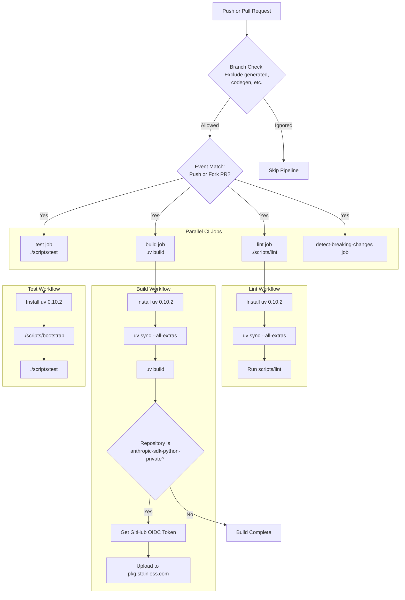
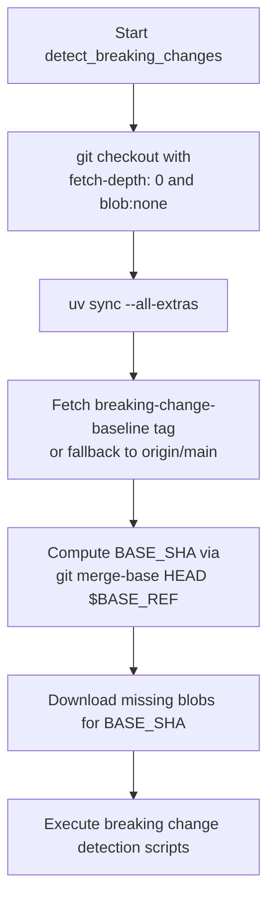
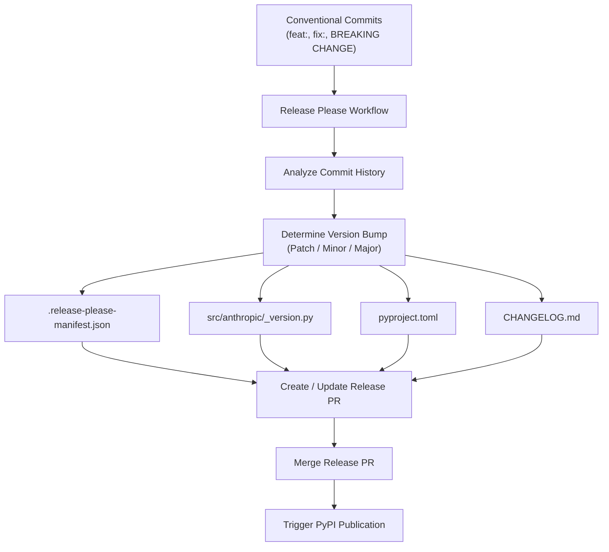
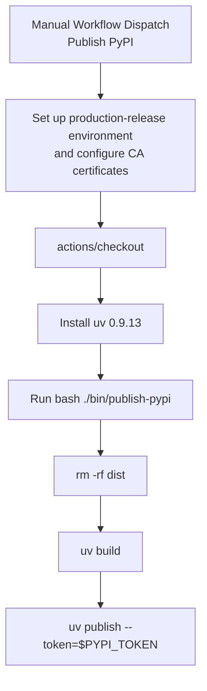

<!-- source: DeepWiki mcp.deepwiki.com · repo anthropics/anthropic-sdk-python · page 12.4 CI/CD, Breaking Changes, and Release Process · fetched 2026-10-26 -->

# CI/CD, Breaking Changes, and Release Process

Relevant source files

The following files were used as context for generating this wiki page:

- [.devcontainer/Dockerfile](.devcontainer/Dockerfile)
- [.devcontainer/devcontainer.json](.devcontainer/devcontainer.json)
- [.github/workflows/changelog.yml](.github/workflows/changelog.yml)
- [.github/workflows/ci.yml](.github/workflows/ci.yml)
- [.github/workflows/publish-pypi.yml](.github/workflows/publish-pypi.yml)
- [.gitignore](.gitignore)
- [.release-please-manifest.json](.release-please-manifest.json)
- [.vscode/settings.json](.vscode/settings.json)
- [Brewfile](Brewfile)
- [CHANGELOG.md](CHANGELOG.md)
- [bin/publish-pypi](bin/publish-pypi)
- [pyproject.toml](pyproject.toml)
- [requirements-dev.lock](requirements-dev.lock)
- [scripts/bootstrap](scripts/bootstrap)
- [scripts/detect-breaking-changes.py](scripts/detect-breaking-changes.py)
- [scripts/format](scripts/format)
- [scripts/lint](scripts/lint)
- [scripts/utils/check-dependency-caps.py](scripts/utils/check-dependency-caps.py)
- [scripts/utils/upload-artifact.sh](scripts/utils/upload-artifact.sh)
- [src/anthropic/_version.py](src/anthropic/_version.py)
- [uv.lock](uv.lock)

This document describes the continuous integration (CI) pipeline, release automation, versioning strategy, breaking-change detection, and package publishing workflows for the Anthropic Python SDK.

## Purpose and Scope

The SDK relies on GitHub Actions for automated testing, building, linting, and publishing. The CI pipeline validates code quality through static analysis, type checking, and parallelized test execution on every push and pull request [.github/workflows/ci.yml:1-110](). Releases are automated using `release-please`, which analyzes conventional commits, updates version identifiers across configuration and source files, generates changelogs, and triggers PyPI publishing. The system maintains strict version consistency and integrates with internal artifact distribution channels.

## CI Pipeline Architecture

The CI pipeline triggers on all pushes and pull requests (excluding specific branches such as `generated`, `codegen`, and `stl-preview-*`) [.github/workflows/ci.yml:1-16](). Concurrency groups are configured to cancel in-progress runs on the same ref [.github/workflows/ci.yml:17-20]().

**Sources:** [.github/workflows/ci.yml:1-110]()

## Continuous Integration Jobs

### Lint Job
The lint job ensures adherence to code quality and type-checking standards [.github/workflows/ci.yml:22-40](). It runs on `ubuntu-latest` with a 10-minute timeout [.github/workflows/ci.yml:23-25]().

**Execution Flow:**
1. Checkout code using `actions/checkout` [.github/workflows/ci.yml:28]()
2. Set up `uv` version `0.10.2` via `astral-sh/setup-uv` [.github/workflows/ci.yml:30-33]()
3. Synchronize all dependencies and optional extras with `uv sync --all-extras` [.github/workflows/ci.yml:36]()
4. Execute `./scripts/lint` which runs `ruff check`, dependency cap validation via `scripts/utils/check-dependency-caps.py`, and `pyright` type checking [scripts/lint:1-22](), [.github/workflows/ci.yml:39]()

**Sources:** [.github/workflows/ci.yml:22-40](), [scripts/lint:1-22]()

### Build Job
The build job packages the SDK into distribution tarballs and wheels [.github/workflows/ci.yml:41-81]().

**Execution Flow:**
1. Install `uv` 0.10.2 and sync all dependencies [.github/workflows/ci.yml:50-59]()
2. Build distribution artifacts using `uv build` [.github/workflows/ci.yml:60-61]()
3. If running inside the private `anthropic-sdk-python-private` repository (excluding `stl/` refs), retrieve a GitHub OIDC token via `actions/github-script` [.github/workflows/ci.yml:63-71]()
4. Upload the resulting artifact via `./scripts/utils/upload-artifact.sh` pointing to the Stainless package repository [.github/workflows/ci.yml:72-80]()

**Sources:** [.github/workflows/ci.yml:41-81]()

### Test Job
The test job executes the test suite across multiple Python runtimes using a matrix strategy [.github/workflows/ci.yml:82-110]().

**Execution Flow:**
1. Install `uv` 0.10.2 [.github/workflows/ci.yml:98-101]()
2. Bootstrap the test environment using `./scripts/bootstrap` [.github/workflows/ci.yml:103-104]()
3. Run tests via `./scripts/test` with `UV_PYTHON` bound to matrix targets (`>=3.10.0` and `>=3.14.0`) [.github/workflows/ci.yml:107-109]()

**Sources:** [.github/workflows/ci.yml:82-110]()

### Breaking-Change Detection Job
The `detect_breaking_changes` job prevents accidental removal or modification of public API symbols [.github/workflows/ci.yml:111-172]().

**Execution Flow:**
1. Clone the repository with `fetch-depth: 0` and `filter: blob:none` to retain commit history while keeping blob downloads minimal [.github/workflows/ci.yml:125-128]()
2. Determine the comparison baseline by checking for a `breaking-change-baseline` tag or falling back to `origin/main` [.github/workflows/ci.yml:139-151]()
3. Compute the merge base SHA using `git merge-base` [.github/workflows/ci.yml:153-154]()
4. Download missing base commit files in bulk and run detection scripts to flag removed or modified public symbols [.github/workflows/ci.yml:156-172]()

**Sources:** [.github/workflows/ci.yml:111-172]()

## Release Automation and Version Management

Versioning information is synchronized across several configuration files in the repository:
- `pyproject.toml`: Defines project metadata and version `2.1.0` [pyproject.toml:3]()
- `src/anthropic/_version.py`: Stores the runtime version string `__version__ = "2.1.0"` annotated with `# x-release-please-version` [src/anthropic/_version.py:2]()
- `.release-please-manifest.json`: Maps repository paths to their release versions [.release-please-manifest.json:1-3]()

**Sources:** [pyproject.toml:3](), [src/anthropic/_version.py:1-2](), [.release-please-manifest.json:1-3]()

## PyPI Publishing and Artifact Uploads

When a release pull request is merged, or when triggered manually via workflow dispatch [.github/workflows/publish-pypi.yml:5](), the publishing workflow executes.

**Execution Flow (`bin/publish-pypi`):**
1. Remove existing build artifacts: `rm -rf dist` [bin/publish-pypi:4]()
2. Create output directory and build distribution wheels/tarballs: `uv build` [bin/publish-pypi:5-6]()
3. Publish to PyPI via `uv publish` using `PYPI_TOKEN` if provided [bin/publish-pypi:7-11]()

**Sources:** [.github/workflows/publish-pypi.yml:1-79](), [bin/publish-pypi:1-11]()

---

