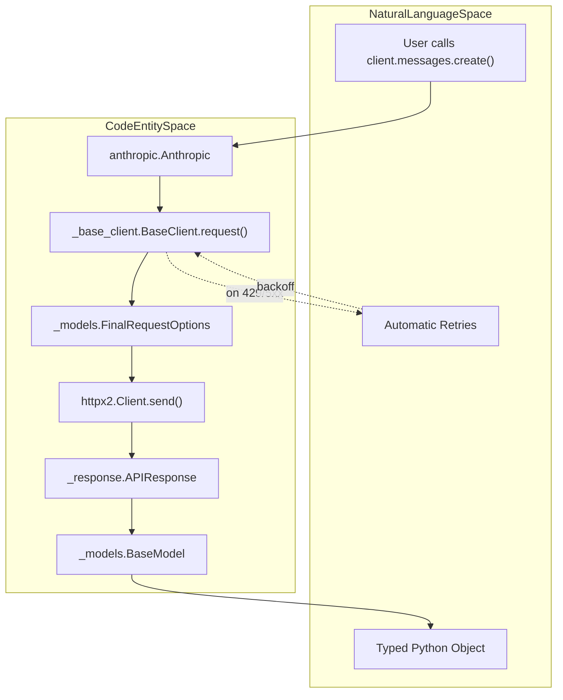
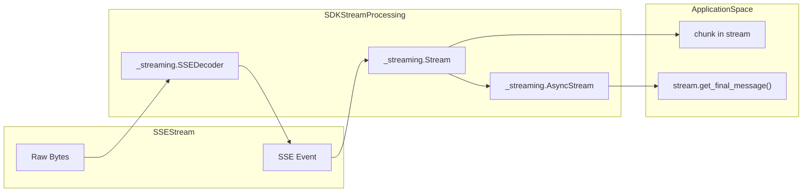

<!-- source: DeepWiki mcp.deepwiki.com · repo anthropics/anthropic-sdk-python · page 13 Glossary · fetched 2026-10-26 -->

# Glossary

Relevant source files

The following files were used as context for generating this wiki page:

- [.stats.yml](.stats.yml)
- [CONTRIBUTING.md](CONTRIBUTING.md)
- [README.md](README.md)
- [api.md](api.md)
- [scripts/mock-spec.json.gz](scripts/mock-spec.json.gz)
- [scripts/utils/ruffen-docs.py](scripts/utils/ruffen-docs.py)
- [src/anthropic/__init__.py](src/anthropic/__init__.py)
- [src/anthropic/_base_client.py](src/anthropic/_base_client.py)
- [src/anthropic/_client.py](src/anthropic/_client.py)
- [src/anthropic/_compat.py](src/anthropic/_compat.py)
- [src/anthropic/_constants.py](src/anthropic/_constants.py)
- [src/anthropic/_models.py](src/anthropic/_models.py)
- [src/anthropic/_types.py](src/anthropic/_types.py)
- [src/anthropic/_utils/__init__.py](src/anthropic/_utils/__init__.py)
- [src/anthropic/_utils/_reflection.py](src/anthropic/_utils/_reflection.py)
- [src/anthropic/_utils/_sync.py](src/anthropic/_utils/_sync.py)
- [src/anthropic/_utils/_typing.py](src/anthropic/_utils/_typing.py)
- [src/anthropic/_utils/_utils.py](src/anthropic/_utils/_utils.py)
- [src/anthropic/lib/aws/_client.py](src/anthropic/lib/aws/_client.py)
- [src/anthropic/lib/bedrock/_client.py](src/anthropic/lib/bedrock/_client.py)
- [src/anthropic/lib/bedrock/_mantle.py](src/anthropic/lib/bedrock/_mantle.py)
- [src/anthropic/lib/foundry.py](src/anthropic/lib/foundry.py)
- [src/anthropic/lib/tools/_beta_runner.py](src/anthropic/lib/tools/_beta_runner.py)
- [src/anthropic/lib/vertex/_client.py](src/anthropic/lib/vertex/_client.py)
- [src/anthropic/types/__init__.py](src/anthropic/types/__init__.py)
- [src/anthropic/types/anthropic_beta_param.py](src/anthropic/types/anthropic_beta_param.py)
- [src/anthropic/types/beta/__init__.py](src/anthropic/types/beta/__init__.py)
- [tests/lib/test_aws.py](tests/lib/test_aws.py)
- [tests/lib/test_azure.py](tests/lib/test_azure.py)
- [tests/lib/test_bedrock.py](tests/lib/test_bedrock.py)
- [tests/lib/test_bedrock_mantle.py](tests/lib/test_bedrock_mantle.py)
- [tests/lib/test_vertex.py](tests/lib/test_vertex.py)
- [tests/lib/tools/test_runners.py](tests/lib/tools/test_runners.py)
- [tests/test_client.py](tests/test_client.py)
- [tests/test_models.py](tests/test_models.py)
- [tools.md](tools.md)

This glossary defines technical terms, internal abstractions, and domain-specific jargon used throughout the Anthropic Python SDK. It serves as a reference for onboarding engineers to understand how conceptual API features map to specific code entities.

## SDK Core Concepts

| Term | Definition | Code Pointer |
| :--- | :--- | :--- |
| **BaseModel** | The SDK's custom extension of `pydantic.BaseModel` providing specialized serialization (`to_dict`, `to_json`) and Pydantic V1/V2 compatibility. | `[src/anthropic/_models.py:114-129]()` |
| **NotGiven** | A sentinel value used to distinguish between a parameter being omitted (using the default) vs. being explicitly set to `None`. | `[src/anthropic/_base_client.py:57-57]()` |
| **Construct Type** | A lenient parsing mechanism that builds Python objects from API responses without strict validation, prioritizing runtime resilience. | `[src/anthropic/_models.py:85-85]()` |
| **Strict Validation** | A mode where the SDK enforces Pydantic schema validation on API responses, raising `APIResponseValidationError` on mismatch. | `[src/anthropic/_client.py:120-121]()` |
| **Managed Agents** | A beta system involving long-running agentic tasks, sessions, and memory stores. | `[src/anthropic/_client.py:119-126]()` |

Sources: `[src/anthropic/_models.py:114-129]`, `[src/anthropic/_base_client.py:57-57]`, `[src/anthropic/_client.py:120-121]`

---

## Data Flow: Request to Response
The following diagram illustrates how natural language concepts (like "Making a request") map to specific internal code entities during the request lifecycle.

### Request Pipeline Mapping

Sources: `[src/anthropic/_models.py:85-85]`, `[src/anthropic/_client.py:153-156]`, `[src/anthropic/_base_client.py:1-50]`

---

## Beta & Feature Jargon

*   **MCP (Model Context Protocol):** A protocol for connecting AI models to external data sources and tools. The SDK includes optional support for MCP toolsets. `[pyproject.toml:46-46]()`
*   **Message Batches:** An asynchronous API for processing large volumes of Message requests with background turnaround. `[src/anthropic/_client.py:119-126]()`
*   **Computer Use:** A beta feature allowing Claude to interact with a GUI (screen, keyboard, mouse) via specific tool definitions. `[api.md:187-217]()`
*   **Context Compaction:** A beta feature for summarizing or compressing conversation history to fit within context limits. `[api.md:1-217]()`
*   **Workload Identity Federation:** A mechanism for exchanging external identity tokens (e.g., GitHub Actions, AWS) for Anthropic access tokens without static API keys. `[src/anthropic/_client.py:37-46]()`
*   **Refusal Details:** Specific metadata returned when a model refuses a request due to policy categories. `[src/vertex/_client.py:55-91]()`

Sources: `[src/anthropic/_client.py:37-46]`, `[src/vertex/_client.py:55-91]`, `[api.md:187-217]`

---

## Streaming Architecture
Streaming in the SDK involves a complex transformation from raw Server-Sent Events (SSE) to accumulated Message objects.

### Streaming Entity Mapping

Sources: `[src/anthropic/_base_client.py:110-110]`, `[src/anthropic/_streaming.py:1-100]()`, `[src/anthropic/_client.py:28-28]`

---

## Abbreviations & Terms

| Abbreviation | Full Term | Context |
| :--- | :--- | :--- |
| **SSE** | Server-Sent Events | The protocol used for streaming responses. |
| **OIDC** | OpenID Connect | Used in Workload Identity Federation for token exchange. |
| **TypedDict** | Python Typed Dictionary | Used for `CreateParams` to provide IDE autocompletion for keyword arguments. |
| **UA** | User Agent | Custom headers sent with requests. |
| **RAW_RESPONSE** | Raw Response Header | An internal header used to trigger returning the raw `httpx2.Response`. |
| **PYDANTIC_V1** | Pydantic Version 1 | A boolean flag used to toggle compatibility logic between Pydantic v1 and v2. |

Sources: `[src/anthropic/_models.py:71-83]`, `[src/anthropic/_version.py:1-5]`, `[src/anthropic/_compat.py:1-15]`