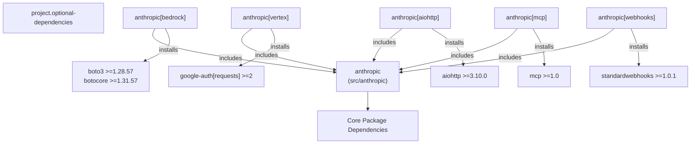
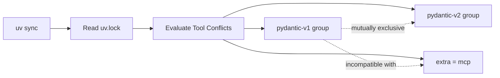

<!-- source: DeepWiki mcp.deepwiki.com · repo anthropics/anthropic-sdk-python · page 2 Installation and Setup · fetched 2026-10-26 -->

# Installation and Setup

<details>
<summary>Relevant source files</summary>

The following files were used as context for generating this wiki page:

- [.release-please-manifest.json](.release-please-manifest.json)
- [CHANGELOG.md](CHANGELOG.md)
- [pyproject.toml](pyproject.toml)
- [requirements-dev.lock](requirements-dev.lock)
- [src/anthropic/_version.py](src/anthropic/_version.py)
- [uv.lock](uv.lock)

</details>


This document covers the installation process, dependency management, Python version requirements, optional extras, and environment configuration for the Anthropic Python SDK. For further details on client configuration, refer to [Authentication and Configuration]() and [Client Architecture]().

## Purpose and Scope

The scope of this page is to guide users and contributors through acquiring the `anthropic` package from package registries, configuring target environments, resolving optional extras (such as AWS Bedrock, Google Cloud Vertex AI, aiohttp, MCP, and webhooks), managing development dependencies via `uv`, and ensuring type safety and compatibility with Python runtime and Pydantic requirements.

**Sources:** [pyproject.toml:1-48]()

## System Requirements

The Anthropic Python SDK specifies its runtime requirements in `pyproject.toml`.

| Requirement | Specification |
|-------------|---------------|
| Python Version | `>= 3.10` [pyproject.toml:22]() |
| Operating Systems | OS Independent (macOS, Linux, Windows) [pyproject.toml:31-35]() |
| Package Manager | `pip` (standard) or `uv` (recommended for development) [pyproject.toml:54-56]() |

The SDK is tested against Python versions 3.10 through 3.14. It supports both Pydantic v1 (`>=1.10.0, <2`) and Pydantic v2 (`>=2.0.0, <3`) via internal compatibility abstractions [pyproject.toml:14]().

**Sources:** [pyproject.toml:14-22](), [pyproject.toml:31-38]()

## Installation Methods

### Standard Installation

To install the core SDK using `pip`, execute:

```bash
pip install anthropic
```

This fetches the base package along with mandatory runtime dependencies required by `BaseClient` and related execution pipelines.

### Optional Extras

Optional integrations and features are defined as extra dependency groups in `[project.optional-dependencies]` [pyproject.toml:40-47]():

```bash
# For AWS Bedrock integrations
pip install anthropic[bedrock]

# For Google Cloud Vertex AI
pip install anthropic[vertex]

# For aiohttp transport support
pip install anthropic[aiohttp]

# For Model Context Protocol (MCP) tools
pip install anthropic[mcp]

# For webhook signature verification
pip install anthropic[webhooks]
```

Title: "SDK Extras and Dependency Mapping"

Sources: [pyproject.toml:40-47]()

## Core Dependencies

The core package relies on a strict set of external libraries defined in `pyproject.toml`:

| Package | Version Constraint | Role in Codebase |
|---|---|---|
| `httpx2` | `>=2.0.0, <3` [pyproject.toml:12]() | Underlying HTTP request execution engine |
| `opentelemetry-api` | `>=1.1.0, <2` [pyproject.toml:13]() | Native tracing span creation and propagation [CHANGELOG.md:93-95]() |
| `pydantic` | `>=1.10.0, <3` [pyproject.toml:14]() | Data modeling and response validation via `BaseModel` |
| `typing-extensions` | `>=4.14, <5` [pyproject.toml:15]() | Backported typing constructs (`NotGiven`, `Omit`) |
| `anyio` | `>=4.1.0, <5` [pyproject.toml:16]() | Async concurrency primitives |
| `sniffio` | `>=1, <2` [pyproject.toml:17]() | Async runtime detection |
| `jiter` | `>=0.4.0, <1` [pyproject.toml:18]() | High-performance JSON iteration for streaming deltas |
| `docstring-parser` | `>=0.15, <1` [pyproject.toml:19]() | Tool schema extraction from docstrings |

Sources: [pyproject.toml:11-20]()

## Development Dependency Management and Conflicts

Development workflows utilize `uv` for dependency locking via `uv.lock`. 

Title: "Dependency Resolution and Conflict Management Logic"

Sources: [pyproject.toml:54-69](), [uv.lock:1-19]()

The `uv.lock` configuration enforces that the `pydantic-v1` group cannot be installed simultaneously with `pydantic-v2`, nor can `pydantic-v1` be combined with the `mcp` extra [pyproject.toml:60-69]().

Sources: [pyproject.toml:54-69](), [uv.lock:13-19]()

## Environment Configuration

In addition to API keys (`ANTHROPIC_API_KEY`, `ANTHROPIC_AUTH_TOKEN`), the SDK respects environment variables governing OpenTelemetry tracing integration (introduced in version 1.14.0) [CHANGELOG.md:93-95]():

- `ANTHROPIC_OPEN_TELEMETRY`: Set to `false` to disable automatic global tracer registration and span export [CHANGELOG.md:93-95]().

Sources: [CHANGELOG.md:93-95]()

---

