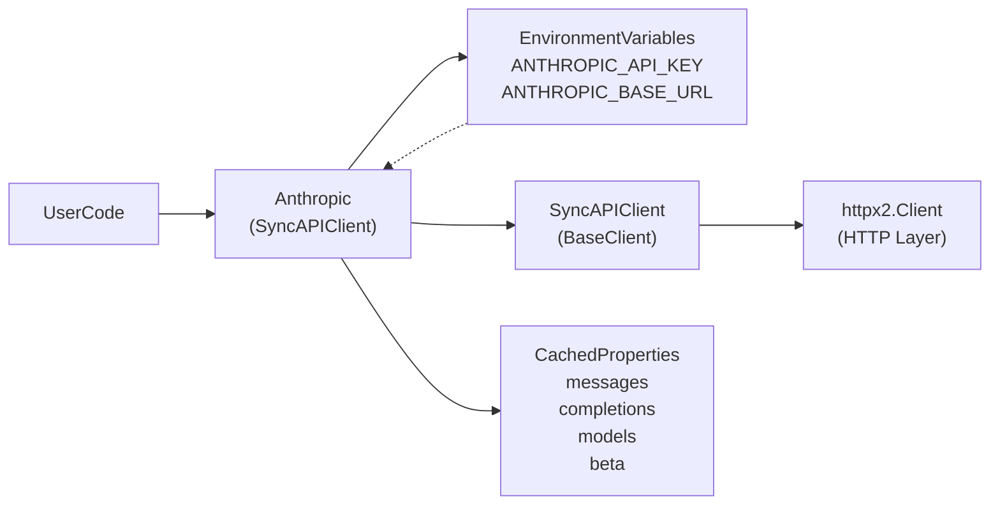
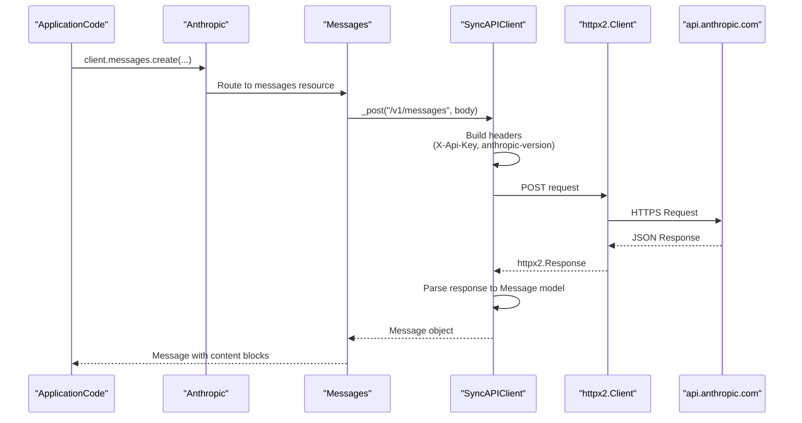
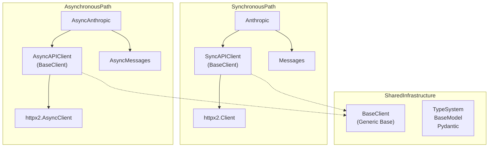
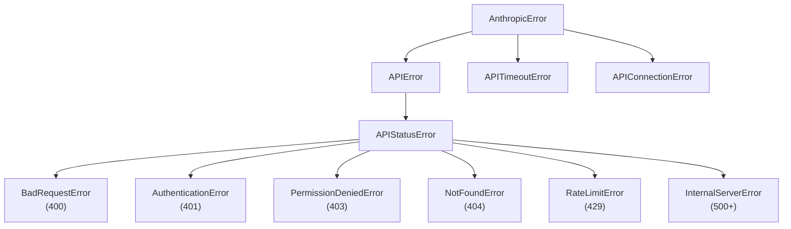

<!-- source: DeepWiki mcp.deepwiki.com · repo anthropics/anthropic-sdk-python · page 3 Quick Start · fetched 2026-10-26 -->

# Quick Start

<details>
<summary>Relevant source files</summary>

The following files were used as context for generating this wiki page:

- [CONTRIBUTING.md](CONTRIBUTING.md)
- [README.md](README.md)
- [examples/images.py](examples/images.py)
- [examples/mcp_tool_runner.py](examples/mcp_tool_runner.py)
- [examples/messages.py](examples/messages.py)
- [examples/messages_stream.py](examples/messages_stream.py)
- [examples/thinking.py](examples/thinking.py)
- [examples/thinking_stream.py](examples/thinking_stream.py)
- [examples/tools.py](examples/tools.py)
- [examples/tools_stream.py](examples/tools_stream.py)
- [helpers.md](helpers.md)
- [scripts/utils/ruffen-docs.py](scripts/utils/ruffen-docs.py)
- [src/anthropic/__init__.py](src/anthropic/__init__.py)
- [src/anthropic/_base_client.py](src/anthropic/_base_client.py)
- [src/anthropic/_client.py](src/anthropic/_client.py)
- [src/anthropic/_constants.py](src/anthropic/_constants.py)
- [src/anthropic/_types.py](src/anthropic/_types.py)
- [tests/test_client.py](tests/test_client.py)

</details>


This page provides code examples and technical workflows for getting started with the Anthropic Python SDK (`anthropic`). It covers basic synchronous and asynchronous usage patterns, client initialization, message creation, streaming, and error handling. For installation instructions, see [Installation and Setup](#2). For detailed client configuration and authentication options, see [Authentication and Configuration](#4.4).

Sources: [README.md:1-12](), [src/anthropic/_client.py:134-173]()

---

## Basic Synchronous Usage

### Client Initialization

The `Anthropic` client class is the primary entry point for synchronous operations. The client automatically inspects environment variables such as `ANTHROPIC_API_KEY` when instantiated without explicit credentials [src/anthropic/_client.py:181-182]().

```python
import os
from anthropic import Anthropic

# Initialize client explicitly with API key from environment variable
client = Anthropic(
    api_key=os.environ.get("ANTHROPIC_API_KEY")
)

# Alternatively, rely on automatic environment variable resolution
client = Anthropic()
```

Sources: [README.md:19-25](), [src/anthropic/_client.py:134-182]()

### Client Initialization Flow



Sources: [src/anthropic/_client.py:134-173](), [src/anthropic/_base_client.py:910-959]()

### Creating a Simple Message

The `messages.create()` method sends a request payload to the Claude API and returns a structured `Message` response model [README.md:27-36]().

```python
message = client.messages.create(
    model="claude-3-5-sonnet-20241022",
    max_tokens=1024,
    messages=[
        {
            "role": "user",
            "content": "Hello, Claude"
        }
    ]
)

print(message.content)
# Output: [TextBlock(type='text', text='Hello! How can I help you today?')]
```

**Key Parameters:**
- `model`: The target Claude model identifier [src/anthropic/types/message_create_params.py:120-125]()
- `max_tokens`: The maximum number of tokens to generate [src/anthropic/types/message_create_params.py:36-49]()
- `messages`: An iterable of message dicts/objects containing `role` and `content` [src/anthropic/types/message_create_params.py:51-118]()

Sources: [README.md:27-38](), [src/anthropic/resources/messages/messages.py:119-147](), [src/anthropic/types/message_create_params.py:35-126]()

### Message Request Flow



Sources: [src/anthropic/_base_client.py:1002-1083](), [src/anthropic/_client.py:134-173]()

### Streaming Messages

For real-time incremental token generation, use the `stream()` method, which returns a `MessageStreamManager` context manager [helpers.md:21]().

```python
with client.messages.stream(
    model="claude-3-5-sonnet-20241022",
    max_tokens=1024,
    messages=[
        {
            "role": "user",
            "content": "Tell me a short story"
        }
    ]
) as stream:
    for text in stream.text_stream:
        print(text, end="", flush=True)
```

The stream context manager ensures resource cleanup and supports multiple iteration interfaces:
- `text_stream`: Iterates over text delta strings [helpers.md:36-44]()
- Event iteration: Accesses granular event structures like `text` and `content_block_stop` [helpers.md:47-78]()

Sources: [helpers.md:5-33](), [src/anthropic/resources/messages/messages.py:40-61]()

---

## Asynchronous Usage

### Async Client Initialization

The `AsyncAnthropic` class provides non-blocking counterparts to all synchronous methods, utilizing `async/await` syntax [src/anthropic/_client.py:382-445]().

```python
import asyncio
from anthropic import AsyncAnthropic

async def main():
    client = AsyncAnthropic(
        api_key=os.environ.get("ANTHROPIC_API_KEY")
    )
    # Async operations...

asyncio.run(main())
```

Sources: [src/anthropic/_client.py:382-445](), [tests/test_client.py:120-124]()

### Async vs Sync Client Architecture



Sources: [src/anthropic/_client.py:134-445](), [src/anthropic/_base_client.py:910-959, 1304-1363]()

### Async Message Creation

When invoking methods on `AsyncAnthropic`, you must `await` the coroutine response:

```python
async def create_message():
    client = AsyncAnthropic()
    
    message = await client.messages.create(
        model="claude-3-5-sonnet-20241022",
        max_tokens=1024,
        messages=[
            {
                "role": "user",
                "content": "What is the capital of France?"
            }
        ]
    )
    print(message.content)
    return message
```

Sources: [src/anthropic/_client.py:382-445](), [tests/test_client.py:120-124]()

### Async Streaming

Asynchronous streaming combines `async with` and `async for` semantics [helpers.md:5-19]():

```python
async def stream_message():
    client = AsyncAnthropic()
    
    async with client.messages.stream(
        model="claude-3-5-sonnet-20241022",
        max_tokens=1024,
        messages=[
            {
                "role": "user",
                "content": "Write a haiku about programming"
            }
        ]
    ) as stream:
        async for event in stream:
            if event.type == "text":
                print(event.text, end="", flush=True)
        
        final_message = await stream.get_final_message()
        print(f"\n\nStop reason: {final_message.stop_reason}")
```

Sources: [helpers.md:5-19](), [helpers.md:55-78]()

---

## Common Patterns

### Context Manager Usage

Both `Anthropic` and `AsyncAnthropic` implement context manager protocols to guarantee underlying connection cleanup [src/anthropic/_base_client.py:973-982, 1355-1363]():

```python
# Synchronous Context Manager
with Anthropic() as client:
    message = client.messages.create(...)

# Asynchronous Context Manager
async with AsyncAnthropic() as client:
    message = await client.messages.create(...)
```

Sources: [src/anthropic/_base_client.py:973-982, 1355-1363]()

### Error Handling

The SDK defines a hierarchy of exceptions inheriting from `AnthropicError` to capture failure states [src/anthropic/_exceptions.py:1-45]():

```python
from anthropic import (
    APIError,
    APIStatusError,
    RateLimitError,
    AuthenticationError
)

try:
    message = client.messages.create(...)
except AuthenticationError as e:
    print(f"Authentication failed: {e}")
except RateLimitError as e:
    print(f"Rate limit hit: {e}")
except APIStatusError as e:
    print(f"API error status {e.status_code}: {e.message}")
```

Sources: [src/anthropic/_exceptions.py:1-45](), [src/anthropic/__init__.py:30-49]()

### Exception Hierarchy



Sources: [src/anthropic/_exceptions.py:1-45](), [src/anthropic/__init__.py:30-49]()

---

## Key Entities Reference

| Entity | Type | Purpose |
|--------|------|---------|
| `Anthropic` | Class | Main synchronous API client [src/anthropic/_client.py:134]() |
| `AsyncAnthropic` | Class | Main asynchronous API client [src/anthropic/_client.py:382]() |
| `client.messages` | Resource | Namespace for messages endpoints [src/anthropic/resources/messages/messages.py:94]() |
| `client.messages.create()` | Method | Execute non-streaming message creation [src/anthropic/resources/messages/messages.py:119]() |
| `client.messages.stream()` | Method | Execute streaming message session [helpers.md:6]() |
| `Message` | Model | Structured API response container [src/anthropic/types/message.py]() |
| `MessageStream` | Class | Stream event accumulator and processor [src/anthropic/_streaming.py:87]() |
| `ANTHROPIC_API_KEY` | Environment Variable | Default credential source [src/anthropic/_client.py:181]() |

Sources: [src/anthropic/_client.py:134-445](), [src/anthropic/__init__.py:8-18]()

---

